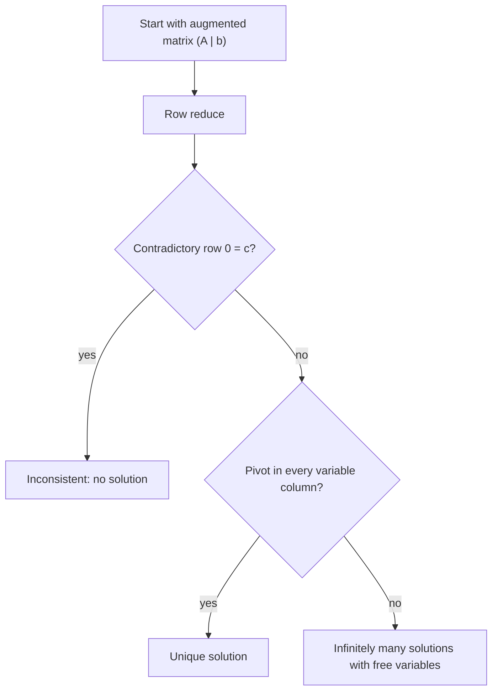

# Systems of Linear Equations

A linear system asks for values that satisfy several flat constraints at once. In two variables the constraints are lines; in three variables they are planes; in $n$ variables they are hyperplanes. The algebraic question “which tuples satisfy every equation?” is the geometric question “where do these hyperplanes meet?”

The standard move is to replace the equations by an augmented matrix. Row operations then expose whether the constraints meet in no point, one point, or an affine family. The same machinery later reappears as rank, column space, null space, inverse matrices, least squares, and numerical factorization.

## From equations to an augmented matrix

A linear equation in unknowns $x_1,\ldots,x_n$ has the form

$$
a_1x_1+a_2x_2+\cdots+a_nx_n=b,
$$

where the coefficients $a_i$ and constant $b$ are scalars. A solution of a finite system is an ordered tuple $(s_1,\ldots,s_n)$ that makes every equation true.

A system is **consistent** if it has at least one solution and **inconsistent** if it has none. A homogeneous system has zero on the right:

$$
A\mathbf{x}=\mathbf{0}.
$$

It is always consistent because $\mathbf{x}=\mathbf{0}$ is a solution. That solution is trivial; any other solution is nontrivial.

The augmented matrix stores the coefficients and constants:

$$
\left[
\begin{array}{ccc|c}
a_{11} & \cdots & a_{1n} & b_1 \\
\vdots & & \vdots & \vdots \\
a_{m1} & \cdots & a_{mn} & b_m
\end{array}
\right].
$$

With coefficient matrix $A=[a_{ij}]$, unknown vector $\mathbf{x}$, and constant vector $\mathbf{b}$, the system is

$$
A\mathbf{x}=\mathbf{b}.
$$

The elementary row operations are:

1. interchange two rows;
2. multiply a row by a nonzero scalar;
3. add a multiple of one row to another row.

Two systems are equivalent when they have exactly the same solution set. Elementary row operations produce equivalent systems.

The augmented column has a special role. Row operations may combine equations, so they act on every entry of a row, including the right-hand side. Column operations would combine unknowns and change their meaning; they can be used only if the corresponding change of variables is tracked explicitly.

Each elementary row operation is multiplication on the left by an invertible elementary matrix $E$. A sequence of elimination steps therefore has the form

$$
EA\mathbf{x}=E\mathbf{b}.
$$

Because $E$ is invertible, the transformed equation has exactly the same solutions. This matrix view later becomes the $LU$ factorization: elimination is recorded rather than repeated from scratch for every new right-hand side.

## What echelon form tells us

Every linear system has exactly one of three outcomes: no solution, one solution, or infinitely many solutions. Row reduction distinguishes them directly.



| Reduced-form signal | Algebraic meaning | Geometric meaning |
|---|---|---|
| Row $[0\ 0\ \cdots\ 0\mid c]$, $c\neq 0$ | impossible equation | constraints do not meet |
| Pivot in every variable column | one value for each unknown | one intersection point |
| At least one free variable | parameterized family | line, plane, or higher-dimensional flat |
| Homogeneous system with a free variable | nontrivial null-space vector | solution subspace has positive dimension |

If a consistent system has a pivot in every variable column, its solution is unique. If at least one variable column lacks a pivot, that variable is free and the solution set is infinite.

For a homogeneous $m\times n$ system with $m\lt n$, there can be at most $m$ pivots, so at least one of the $n$ variables is free. Homogeneous systems cannot contain a contradictory row, hence such a system has nontrivial solutions.

The column-space formulation packages the same test differently:

$$
A\mathbf{x}=x_1\mathbf{a}_1+\cdots+x_n\mathbf{a}_n.
$$

Therefore $A\mathbf{x}=\mathbf{b}$ is consistent exactly when $\mathbf{b}$ lies in the column space of $A$.

The rank criterion says the same thing in a form suited to row reduction:

$$
\operatorname{rank}(A)
=\operatorname{rank}([A\mid\mathbf{b}])
$$

if and only if the system is consistent. Appending $\mathbf{b}$ creates a new column. If that column increases rank, then it lies outside the span of the columns of $A$, and no coefficient vector can build it. If rank is unchanged, $\mathbf{b}$ is already a column combination.

Suppose a consistent system has $n$ unknowns and rank $r$. There are $r$ pivot variables and $n-r$ free variables. The rank-nullity theorem gives

$$
\dim\operatorname{Null}(A)=n-r.
$$

If $\mathbf{x}_p$ is one particular solution, every solution is

$$
\mathbf{x}=\mathbf{x}_p+\mathbf{z},
\qquad
\mathbf{z}\in\operatorname{Null}(A).
$$

Indeed, $A(\mathbf{x}_p+\mathbf{z})=\mathbf{b}$ whenever $A\mathbf{z}=0$. Conversely, subtracting two solutions gives a null-space vector. Thus a nonhomogeneous solution set is either empty or a translate of the null space. Its number of free parameters depends only on $A$, not on the compatible right-hand side.

## Why elimination preserves the answer

Each row operation is reversible. Interchanging equations changes only their order. Multiplying an equation by a nonzero scalar leaves its truth set unchanged. Replacing one equation by itself plus a multiple of another can be undone by subtracting the same multiple. The original and reduced systems therefore have the same solutions.

This reversibility also explains the restriction on row scaling: multiplying a row by zero destroys information and cannot be undone.

Row echelon form and reduced row echelon form answer slightly different needs. Echelon form has pivots stepping to the right and zeros below them; it is enough for classification and back-substitution. Reduced echelon form also scales pivots to one and clears entries above them. It exposes the parameterization immediately, but doing the extra arithmetic by hand or in floating point is often unnecessary.

## One intersection point

Solve

$$
\begin{aligned}
x+y+z&=4,\\
2x+y-z&=1,\\
-x+2y+3z&=9.
\end{aligned}
$$

The augmented matrix is

$$
\left[
\begin{array}{rrr|r}
1&1&1&4\\
2&1&-1&1\\
-1&2&3&9
\end{array}
\right].
$$

Use $R_2\leftarrow R_2-2R_1$ and $R_3\leftarrow R_3+R_1$:

$$
\left[
\begin{array}{rrr|r}
1&1&1&4\\
0&-1&-3&-7\\
0&3&4&13
\end{array}
\right].
$$

Then $R_3\leftarrow R_3+3R_2$ gives

$$
\left[
\begin{array}{rrr|r}
1&1&1&4\\
0&-1&-3&-7\\
0&0&-5&-8
\end{array}
\right].
$$

Back-substitution yields $z=8/5$, followed by

$$
-y-3z=-7
\quad\Longrightarrow\quad
y=7-3z=\frac{11}{5},
$$

and

$$
x=4-y-z=\frac15.
$$

Hence

$$
(x,y,z)=\left(\frac15,\frac{11}{5},\frac85\right).
$$

For example, the second original equation gives $2/5+11/5-8/5=1$; the other two equations check as well.

There is also a determinant reading because this example is square. The elimination produced three pivots, so $A$ is invertible and every right-hand side has one solution. For an $n\times n$ matrix, the following statements are equivalent:

- $A$ is invertible;
- every column contains a pivot;
- $\operatorname{rank}(A)=n$;
- $\operatorname{Null}(A)=\{\mathbf{0}\}$;
- $A\mathbf{x}=\mathbf{b}$ has exactly one solution for every $\mathbf{b}$;
- $\det A\ne0$.

These equivalences apply only to a square coefficient matrix. A tall matrix can have a pivot in every variable column and still fail to represent some right-hand sides. A wide matrix cannot have a pivot in every variable column, so any consistent system with more unknowns than pivots has infinitely many solutions.

## Free variables and affine solution sets

Consider

$$
\begin{aligned}
x-2y+z&=3,\\
2x-4y+2z&=6.
\end{aligned}
$$

The second equation is twice the first, so row reduction gives

$$
\left[
\begin{array}{rrr|r}
1&-2&1&3\\
0&0&0&0
\end{array}
\right].
$$

The pivot is in the $x$ column; $y$ and $z$ are free. Put

$$
y=s,
\qquad
z=t.
$$

The pivot equation becomes

$$
x=3+2s-t,
$$

so every solution has the form

$$
\begin{bmatrix}x\\y\\z\end{bmatrix}
=
\begin{bmatrix}3\\0\\0\end{bmatrix}
+s\begin{bmatrix}2\\1\\0\end{bmatrix}
+t\begin{bmatrix}-1\\0\\1\end{bmatrix},
\qquad s,t\in\mathbb{R}.
$$

Substitution gives $(3+2s-t)-2s+t=3$ for every $s,t$. Geometrically, the solution set is a plane in $\mathbb{R}^3$. It is an affine plane rather than a subspace because it does not pass through the origin.

The two direction vectors form a basis for the null space of the coefficient matrix:

$$
\operatorname{Null}(A)
=\operatorname{span}
\left\{
\begin{bmatrix}2\\1\\0\end{bmatrix},
\begin{bmatrix}-1\\0\\1\end{bmatrix}
\right\}.
$$

The coefficient matrix has rank one, so rank-nullity predicts nullity $3-1=2$, agreeing with the two parameters. Choosing a different particular solution would move the base point within the same affine plane but would not change the direction space.

## A contradiction exposed by elimination

Consider

$$
\begin{aligned}
x+2y-z&=1,\\
2x+4y-2z&=3.
\end{aligned}
$$

The coefficient part of the second equation is twice the first, but its right-hand side is not. Row reduction gives

$$
\left[
\begin{array}{rrr|r}
1&2&-1&1\\
2&4&-2&3
\end{array}
\right]
\xrightarrow{R_2\leftarrow R_2-2R_1}
\left[
\begin{array}{rrr|r}
1&2&-1&1\\
0&0&0&1
\end{array}
\right].
$$

The last row asserts $0=1$, so there is no solution. Here $\operatorname{rank}(A)=1$ while $\operatorname{rank}([A\mid\mathbf{b}])=2$. Geometrically the equations describe parallel, distinct planes: they have the same normal vector but different offsets.

Changing the second right-hand side from $3$ to $2$ would replace the contradiction by a zero row. The system would then have two free variables. A small change in data can therefore change exact consistency, although a noisy application usually treats the mismatch through least squares instead of demanding exact intersection.

## Reading the shape before doing arithmetic

The dimensions of $A$ already constrain the possible outcomes. An $m\times n$ matrix represents $m$ equations in $n$ unknowns. When $m\lt n$, uniqueness is impossible for a consistent system because there cannot be a pivot in every variable column. When $m\gt n$, a unique solution is possible, but only for right-hand sides in the column space. Extra equations may agree with the same point or may make the system inconsistent.

The words underdetermined and overdetermined describe shape, not the final solution count. An underdetermined system is usually nonunique when consistent. An overdetermined system can still have one exact solution if the equations are compatible and the columns are independent. Rank gives the decisive information.

Many models naturally produce repeated solves with the same coefficient matrix and different right-hand sides. Examples include equilibrium under several load cases and a time-stepping scheme whose spatial operator is fixed. Row-reducing each augmented matrix separately repeats work. A factorization records the elimination of $A$ once; each new right-hand side then needs only triangular substitutions.

Several right-hand sides can be collected as columns of a matrix $B$. The equation

$$
AX=B
$$

means that each column of $X$ solves the corresponding system. If $B=I$ and $A$ is square and invertible, the solution is $X=A^{-1}$. This identity defines the inverse, but explicitly computing the inverse is usually inferior to solving with a factorization when only a few right-hand sides are needed.

Units also provide a useful check. If a column of $A$ multiplies an unknown measured in seconds, its coefficients must convert that unknown into the units of each equation's right-hand side. Rescaling an equation does not change the exact solution, but it can change the numerical behavior. Poorly scaled rows or columns can lead to tiny pivots and misleading stopping tests even when the underlying model is well posed.

## Solving and checking with NumPy

```python
import numpy as np

A = np.array([[1, 1, 1],
              [2, 1, -1],
              [-1, 2, 3]], dtype=float)
b = np.array([4, 1, 9], dtype=float)

x = np.linalg.solve(A, b)
print(x)
print(A @ x)
print(np.allclose(A @ x, b))

rank_A = np.linalg.matrix_rank(A)
rank_aug = np.linalg.matrix_rank(np.column_stack([A, b]))
print(rank_A, rank_aug)
```

`np.linalg.solve` applies only when the coefficient matrix is square and nonsingular. The rank comparison supplies a numerical consistency test: $A\mathbf{x}=\mathbf{b}$ is consistent when $\operatorname{rank}(A)=\operatorname{rank}([A\mid\mathbf{b}])$.

Numerical rank is tolerance-dependent. Floating-point software does not test whether a computed pivot is literally zero; it compares its size with the matrix scale. A matrix whose rows are nearly dependent may be mathematically invertible yet behave like a rank-deficient matrix at working precision.

For dense numerical solves, elimination should use pivoting. If the next pivot is zero, a row exchange is mandatory. Even a nonzero but tiny pivot can create large multipliers and magnify rounding error. Partial pivoting chooses the largest available magnitude in the current column before eliminating below it. Standard solve routines use an $LU$-type factorization with pivoting rather than explicitly forming $A^{-1}$.

Residual and forward error must be separated. A computed vector $\widehat{\mathbf{x}}$ has residual

$$
\mathbf{r}=\mathbf{b}-A\widehat{\mathbf{x}}.
$$

A small residual means the computed vector nearly satisfies the stated equations. It need not be close to the exact solution when $A$ is ill-conditioned: a large change in $\mathbf{x}$ may produce only a small change in $A\mathbf{x}$. Conditioning belongs to the problem, while numerical stability belongs to the algorithm used to solve it.

## Reading a reduction without losing information

- A row operation acts on the whole row, including the augmented entry.
- A zero pivot candidate calls for a row swap or a move to the next column; it must not be used as a divisor.
- A zero coefficient row is contradictory only when its augmented entry is nonzero.
- Infinitely many solutions do not require every variable to be free. Pivot variables are determined by whichever values are assigned to the free variables.
- A homogeneous system always contains the zero solution.

A useful check has three parts: confirm that each row operation was legal, classify the echelon form before solving, and substitute the result into the original equations. For a parameterized solution, assign parameters only to non-pivot variables and solve the pivot equations afterward.

Cramer's rule expresses each component of a square nonsingular solution as a ratio of determinants. It is valuable for identities and very small symbolic systems, but it is not a sensible general solver: computing many determinants costs more work and behaves worse numerically than elimination. Gaussian elimination remains the standard textbook route because it gives classification, rank information, and a reusable factorization in one process.

Exact row reduction and floating-point elimination serve different purposes. Fractions preserve algebraic identities and are suitable for small symbolic examples. Floating-point arithmetic scales to measured data but needs pivoting and tolerances. Mixing the two viewpoints can create false conclusions, such as declaring a rounded pivot exactly zero or treating a tiny symbolic fraction as numerical noise without any model-based threshold.

The geometry matches the classification. Two lines can meet once, be parallel and distinct, or coincide. Three-dimensional planes may meet at a point, along a line, in a plane, or fail to share a point. Noisy measurement models are often inconsistent even when the underlying model is sensible; least squares replaces exact intersection by a closest fit.

<div className="see-also">

See also: [Gaussian Elimination](/math/linear-algebra/gaussian-elimination) · [Matrices and Matrix Algebra](/math/linear-algebra/matrices-and-matrix-algebra) · [Bases, Dimension, and Rank](/math/linear-algebra/bases-dimension-and-rank) · [Applications and Modeling](/math/linear-algebra/applications-and-modeling)

</div>
