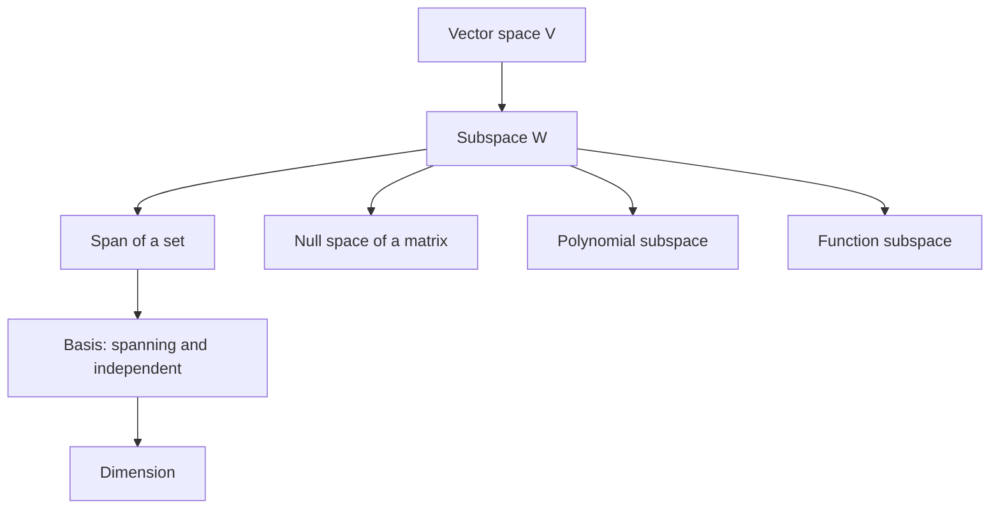

# General Vector Spaces

Passing from $\mathbb{R}^n$ to an abstract vector space keeps the algebra and changes the objects. Polynomials, functions, matrices, sequences, and solution sets can all be added and scaled, so the same ideas of span, independence, basis, dimension, and linear transformation apply to them.

The abstraction separates linear structure from the appearance of its elements. A matrix or polynomial counts as a vector when it belongs to a set equipped with suitable addition and scalar multiplication.

## What the axioms retain

A real vector space is a set $V$ with vector addition and scalar multiplication satisfying closure, associativity, commutativity, identity, inverse, compatibility, and distributive axioms. Its elements are called vectors even when they are functions or matrices.

More explicitly, for vectors $\mathbf{u},\mathbf{v},\mathbf{w}\in V$ and scalars $a,b\in\mathbb{R}$, the axioms require

$$
\begin{aligned}
\mathbf{u}+\mathbf{v}&=\mathbf{v}+\mathbf{u},&
(\mathbf{u}+\mathbf{v})+\mathbf{w}&=\mathbf{u}+(\mathbf{v}+\mathbf{w}),\\
\mathbf{v}+\mathbf{0}&=\mathbf{v},&
\mathbf{v}+(-\mathbf{v})&=\mathbf{0},\\
a(\mathbf{u}+\mathbf{v})&=a\mathbf{u}+a\mathbf{v},&
(a+b)\mathbf{v}&=a\mathbf{v}+b\mathbf{v},\\
(ab)\mathbf{v}&=a(b\mathbf{v}),&
1\mathbf{v}&=\mathbf{v}.
\end{aligned}
$$

Closure is built into the statement that the operations map back into $V$. Several familiar facts follow from the axioms rather than being extra assumptions. For example,

$$
0\mathbf{v}=(0+0)\mathbf{v}=0\mathbf{v}+0\mathbf{v},
$$

so adding the inverse of $0\mathbf{v}$ to both sides gives $0\mathbf{v}=\mathbf{0}$. Similarly $a\mathbf{0}=\mathbf{0}$ and $(-1)\mathbf{v}=-\mathbf{v}$.

The choice of scalar field matters. The complex numbers $\mathbb{C}$ form a one-dimensional vector space over $\mathbb{C}$ with basis $\{1\}$, but a two-dimensional vector space over $\mathbb{R}$ with basis $\{1,i\}$. Independence and dimension must therefore be stated relative to the allowed scalars.

Important examples include:

- $\mathbb{R}^n$ with componentwise operations;
- $P_n$, the polynomials of degree at most $n$;
- $M_{m,n}$, the $m\times n$ matrices;
- $C[a,b]$, the continuous real-valued functions on $[a,b]$.

The zero vector depends on the ambient space: it may be a zero column, zero matrix, zero polynomial, or zero function. The operations also belong to the space and must be stated before the axioms can be checked.

A linear combination of $\mathbf{v}_1,\ldots,\mathbf{v}_k$ is

$$
c_1\mathbf{v}_1+\cdots+c_k\mathbf{v}_k.
$$

Their span is

$$
\operatorname{span}\{\mathbf{v}_1,\ldots,\mathbf{v}_k\}
=
\left\{
c_1\mathbf{v}_1+\cdots+c_k\mathbf{v}_k:c_i\in\mathbb{R}
\right\}.
$$

The list is linearly independent when

$$
c_1\mathbf{v}_1+\cdots+c_k\mathbf{v}_k=\mathbf{0}
$$

forces every $c_i=0$. A basis is an independent spanning set, and the dimension of a finite-dimensional space is the number of vectors in any basis.

Linear dependence can be restated without solving a full system: a finite list is dependent exactly when one vector in the list is a linear combination of the preceding or remaining vectors. In one direction, solve a nontrivial relation for a vector whose coefficient is nonzero. In the other, move the stated combination to one side to obtain a nontrivial relation equal to zero. This equivalence explains why removing a redundant vector leaves the span unchanged.

## The subspace test

A subspace $W$ of $V$ is a subset that is itself a vector space under the operations inherited from $V$. It is enough to check:

1. $\mathbf{0}\in W$;
2. $\mathbf{u},\mathbf{v}\in W$ implies $\mathbf{u}+\mathbf{v}\in W$;
3. $c\in\mathbb{R}$ and $\mathbf{u}\in W$ implies $c\mathbf{u}\in W$.

Equivalently, closure can be compressed into one condition:

$$
\mathbf{u},\mathbf{v}\in W
\quad\Longrightarrow\quad
c\mathbf{u}+d\mathbf{v}\in W
$$

for all scalars $c,d$.

| Candidate set | Subspace? | Reason |
|---|---|---|
| $\mathbb{R}^n$ | yes | standard addition and scalar multiplication |
| $P_n$ | yes | degree remains at most $n$ under addition and scaling |
| Solutions of $A\mathbf{x}=\mathbf{0}$ | yes | homogeneous equations are closed |
| Solutions of $A\mathbf{x}=\mathbf{b}$ with $\mathbf{b}\neq\mathbf{0}$ | usually no | the zero vector is usually absent |
| Polynomials satisfying $p(0)=1$ | no | scalar multiplication does not preserve the condition |

The zero-vector check is the fastest rejection test, but passing it is not enough: closure must still be established. The span of any nonempty set is a subspace because sums and scalar multiples of linear combinations are still linear combinations.

When a candidate is defined by equations, their form often settles the question quickly. Homogeneous linear conditions give subspaces; nonhomogeneous linear conditions give affine sets when they are consistent. Nonlinear conditions need direct testing. For example,

$$
S=\left\{
\begin{bmatrix}x\\y\end{bmatrix}:xy=0
\right\}
$$

contains the zero vector and is closed under scalar multiplication, but it is not closed under addition:

$$
\begin{bmatrix}1\\0\end{bmatrix},
\begin{bmatrix}0\\1\end{bmatrix}\in S,
\qquad
\begin{bmatrix}1\\1\end{bmatrix}\notin S.
$$

The set is the union of the two coordinate axes. Each axis is a subspace; their union is not.

## Homogeneous conditions and null spaces

The solution set of

$$
A\mathbf{x}=\mathbf{0}
$$

is a subspace of $\mathbb{R}^n$. If $A\mathbf{u}=\mathbf{0}$ and $A\mathbf{v}=\mathbf{0}$, then

$$
A(\mathbf{u}+\mathbf{v})
=A\mathbf{u}+A\mathbf{v}
=\mathbf{0},
$$

and

$$
A(c\mathbf{u})=cA\mathbf{u}=\mathbf{0}.
$$

Homogeneous linear conditions are compatible with addition and scaling. Examples include $p(1)=0$, $A\mathbf{x}=\mathbf{0}$, and the solution space of a homogeneous linear differential equation such as $f''+f=0$.

Nonhomogeneous conditions usually define shifted, or affine, sets. The solutions of $A\mathbf{x}=\mathbf{b}$ with $\mathbf{b}\neq\mathbf{0}$ generally omit $\mathbf{0}$, just as $p(1)=1$ does.

The same reasoning works for kernels of linear maps. If $T:V\to W$ is linear, then

$$
\ker T=\{\mathbf{v}\in V:T\mathbf{v}=\mathbf{0}\}
$$

is a subspace of $V$, and

$$
\operatorname{range}T=\{T\mathbf{v}:\mathbf{v}\in V\}
$$

is a subspace of $W$. The first follows from $T(a\mathbf{u}+b\mathbf{v})=aT\mathbf{u}+bT\mathbf{v}$. For the range, linear combinations of output vectors remain outputs of the matching input combination.

Evaluation is a good example outside coordinate vectors. Define $E_1:P_3\to\mathbb{R}$ by $E_1(p)=p(1)$. It is linear, and the polynomial space $W$ in the next example is exactly $\ker E_1$. Since $E_1$ reaches every real number using constant polynomials, its range has dimension one. Rank-nullity then predicts

$$
\dim W=\dim P_3-\dim\operatorname{range}E_1=4-1=3.
$$

## A polynomial subspace

Let

$$
W=\{p(x)\in P_3:p(1)=0\}.
$$

The zero polynomial belongs to $W$. If $p,q\in W$, then

$$
(p+q)(1)=p(1)+q(1)=0,
$$

and for any scalar $c$,

$$
(cp)(1)=c\,p(1)=0.
$$

Thus $W$ is a subspace. The factor theorem gives a more concrete description:

$$
p(x)=(x-1)(ax^2+bx+c).
$$

Consequently,

$$
W=\operatorname{span}\{x-1,\ x(x-1),\ x^2(x-1)\}.
$$

These three polynomials are also independent, so they form a basis of $W$ and $\dim W=3$.

Contrast this with polynomials of exactly degree $n$. That set omits the zero polynomial, and leading terms can cancel when two degree-$n$ polynomials are added. It is not a subspace.

## A line that misses the origin

Consider

$$
S=
\left\{
\begin{bmatrix}x\\y\end{bmatrix}\in\mathbb{R}^2:x+y=1
\right\}.
$$

The zero vector does not satisfy the equation, so $S$ is not a subspace. Scalar multiplication fails as well:

$$
\begin{bmatrix}1\\0\end{bmatrix}\in S,
\qquad
2\begin{bmatrix}1\\0\end{bmatrix}
=\begin{bmatrix}2\\0\end{bmatrix}\notin S.
$$

Geometrically, $S$ is a line translated away from the origin. Only lines through the origin are subspaces of $\mathbb{R}^2$.

## Bases, coordinates, and dimension

Every finite spanning set can be reduced to a basis by removing redundant vectors. Every finite independent set can be extended to a basis by adding vectors until it spans. These two facts imply that all bases of a finite-dimensional space have the same size.

A polynomial in $P_3$ can be represented by a coordinate column relative to

$$
\{1,x,x^2,x^3\},
$$

but the polynomial remains the vector; the coefficient column is its representation in a chosen basis. The distinction matters whenever the basis or inner product changes.

Let

$$
\mathcal{B}=\{1,\ x-1,\ (x-1)^2\}
$$

be a basis of $P_2$. To find the $\mathcal{B}$-coordinates of $p(x)=x^2+x+1$, rewrite powers of $x$ around $x=1$. Put $u=x-1$, so $x=u+1$. Then

$$
p(x)=(u+1)^2+(u+1)+1=u^2+3u+3.
$$

Therefore

$$
[p]_{\mathcal B}
=\begin{bmatrix}3\\3\\1\end{bmatrix}.
$$

In the standard basis $\mathcal{E}=\{1,x,x^2\}$, the same polynomial has coordinates

$$
[p]_{\mathcal E}
=\begin{bmatrix}1\\1\\1\end{bmatrix}.
$$

The coordinate map $[\cdot]_{\mathcal B}:P_2\to\mathbb{R}^3$ is a linear isomorphism. It preserves addition and scalar multiplication and is one-to-one and onto. Choosing a basis therefore lets every finite-dimensional abstract vector space use matrix calculations, but the coordinate vector changes when the basis changes.

Span and independence answer different questions. A spanning set may contain redundant vectors, while an independent set may fail to reach the whole space. A basis satisfies both requirements.

The basis extension and reduction statements also give useful dimension tests. In an $n$-dimensional space:

- every independent list has at most $n$ vectors;
- every spanning list has at least $n$ vectors;
- any independent list of $n$ vectors is automatically a basis;
- any spanning list of $n$ vectors is automatically a basis.

These shortcuts require finite dimension. Spaces such as $P$, the set of all real polynomials, and $C[0,1]$ are infinite-dimensional. No finite list spans all polynomials because the degrees in a finite list have a finite maximum. The monomials $1,x,x^2,\ldots$ form an infinite basis of $P$ in the algebraic sense: every polynomial uses only finitely many of them. Continuous functions need a more delicate treatment; approximation by polynomials does not mean that every continuous function is a finite polynomial combination.

## Linear maps reveal the useful structure

A linear map respects the two vector-space operations:

$$
T(a\mathbf{u}+b\mathbf{v})
=aT(\mathbf{u})+bT(\mathbf{v}).
$$

Once a basis is chosen in the domain and codomain, every linear map is represented by a matrix. The $j$th matrix column is the coordinate vector of $T(\mathbf{v}_j)$, where $\mathbf{v}_j$ is the $j$th domain basis vector. Matrix multiplication then extends these images to every linear combination.

Differentiation illustrates the point. The map $D:P_3\to P_2$ defined by $D(p)=p'$ is linear. Relative to the standard monomial bases, its matrix has columns given by the derivatives of $1,x,x^2,x^3$:

$$
[D]=
\begin{bmatrix}
0&1&0&0\\
0&0&2&0\\
0&0&0&3
\end{bmatrix}.
$$

Its kernel consists of constant polynomials and has dimension one. Its range is all of $P_2$ and has dimension three. Rank-nullity gives $1+3=4$, the dimension of $P_3$. The same theorem applies regardless of whether the vectors look like columns, polynomials, or functions.

An isomorphism is a one-to-one, onto linear map. Isomorphic spaces have the same linear structure. Every real $n$-dimensional vector space is isomorphic to $\mathbb{R}^n$ after a basis is selected, but the isomorphism is not canonical: a different basis gives a different coordinate map. Statements that depend only on dimension and linear relations survive every isomorphism. Lengths and angles require an inner product and are additional structure.

The direct product $V\times W$ is a vector space under componentwise operations. If both spaces are finite-dimensional, then

$$
\dim(V\times W)=\dim V+\dim W.
$$

A basis is obtained by pairing basis vectors of $V$ with zero in $W$, and then zero in $V$ with basis vectors of $W$. This construction appears in state-space models, where position and velocity may live in separate copies of the same coordinate space.

## Affine sets keep directions but lose the origin

An affine set has the form $\mathbf{p}+W$, where $W$ is a subspace and $\mathbf{p}$ is a fixed point. It is closed under affine combinations whose coefficients sum to one, but not generally under arbitrary linear combinations. If $\mathbf{x},\mathbf{y}\in\mathbf{p}+W$, then

$$
(1-t)\mathbf{x}+t\mathbf{y}\in\mathbf{p}+W
$$

for every scalar $t$. This property explains why a line or plane that misses the origin still contains the entire line through any two of its points.

The direction subspace is intrinsic even though the chosen base point is not. If $\mathbf{q}$ is another point of the same affine set, then $\mathbf{p}+W=\mathbf{q}+W$. Subtracting any two points removes the offset and produces an element of $W$. For a consistent system $A\mathbf{x}=\mathbf{b}$, the affine solution set has direction $\ker A$.

Confusing affine and linear structure causes several common errors. Averages of points stay in an affine set because their weights sum to one. Scaling a point usually leaves the set because it also scales the offset from the origin. Coordinate systems in geometry often use affine points and vector displacements together, although elementary notation writes both as columns.

## Combining subspaces

The intersection of two subspaces is always a subspace: any linear combination of vectors that lie in both sets remains in both. Their union is usually not a subspace. If neither subspace contains the other, choose $\mathbf{u}$ from the first but not the second and $\mathbf{v}$ from the second but not the first; then $\mathbf{u}+\mathbf{v}$ generally lies in neither part of the union. The union is a subspace only when one subspace contains the other.

The sum of subspaces is the smallest subspace containing both:

$$
U+W=\{\mathbf{u}+\mathbf{w}:\mathbf{u}\in U,\ \mathbf{w}\in W\}.
$$

For finite-dimensional subspaces,

$$
\dim(U+W)=\dim U+\dim W-\dim(U\cap W).
$$

To see the counting, begin with a basis of $U\cap W$. Extend it to a basis of $U$ and separately to a basis of $W$. Combining the two extended lists spans $U+W$, and the shared basis vectors are counted only once. The result resembles inclusion-exclusion because the same overlap causes the same bookkeeping issue.

As a concrete case, let

$$
U=\operatorname{span}\{\mathbf{e}_1,\mathbf{e}_2\},
\qquad
W=\operatorname{span}\{\mathbf{e}_2,\mathbf{e}_3\}
$$

in $\mathbb{R}^3$. Both have dimension two, their intersection is $\operatorname{span}\{\mathbf{e}_2\}$ with dimension one, and their sum is all of $\mathbb{R}^3$. The formula gives

$$
\dim(U+W)=2+2-1=3.
$$

If $U\cap W=\{\mathbf{0}\}$, the sum is called a direct sum and written $U\oplus W$. Every vector in a direct sum has a unique decomposition $\mathbf{u}+\mathbf{w}$. If two such decompositions existed, subtracting them would produce a nonzero vector in the intersection.

Infinite-dimensional spaces require care with the word basis. An algebraic, or Hamel, basis represents every vector by a finite linear combination. Analysis often uses sequences of functions whose infinite series converge in a specified norm; these are different objects and depend on topology as well as algebra. Fourier series, for example, cannot be justified from vector-space axioms alone. Questions about limits, completeness, and convergence begin only after a norm or inner product is supplied.

That separation is useful: linear algebra determines which finite relations are possible, while analysis determines whether an infinite approximation converges and in what sense.

Subspaces also form a useful hierarchy. The zero subspace lies inside every subspace, and every subspace lies inside its ambient space. A maximal proper subspace of a finite-dimensional space has codimension one and can be described as the kernel of a nonzero linear functional. In coordinate space these are hyperplanes through the origin. Adding a nonzero constant to the functional equation shifts the hyperplane and turns it into an affine set.

Kernels, ranges, eigenspaces, and homogeneous solution sets are all subspaces. Once a set passes the subspace test, the next useful questions are which vectors span it, which spanning vectors are redundant, and what its dimension is.

See also: [Vectors in Rn](/math/linear-algebra/vectors) · [Bases, Dimension, and Rank](/math/linear-algebra/bases-dimension-and-rank) · [Linear Transformations](/math/linear-algebra/linear-transformations) · [Inner Product Spaces](/math/linear-algebra/inner-product-spaces)

