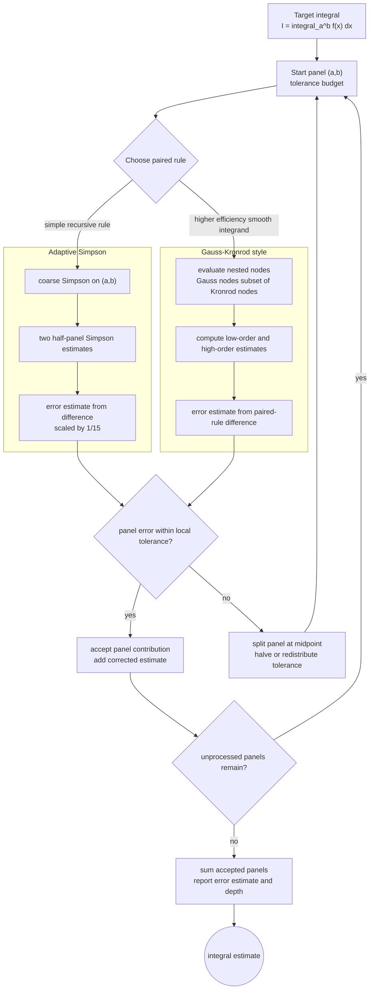

# Adaptive and Gaussian Quadrature

Composite quadrature spends evaluation points uniformly. That is reasonable when the integrand is equally easy everywhere, but wasteful when most of the interval is smooth and only a small region is difficult. Adaptive quadrature refines the interval only where an error indicator says refinement is needed.

Gaussian quadrature takes a different approach. Instead of equally spacing the nodes, it chooses both nodes and weights to maximize polynomial exactness. For smooth integrands, a small number of Gaussian nodes can outperform much denser Newton-Cotes rules. The price is that the nodes are less intuitive and basic Gauss rules are not naturally nested.

## Adaptive Simpson's accept-or-split test

Adaptive Simpson quadrature compares one Simpson estimate on $[a,b]$ with two Simpson estimates on $[a,m]$ and $[m,b]$, where $m=(a+b)/2$. If

$$
|S(a,m)+S(m,b)-S(a,b)|
$$

is small enough, the refined estimate is accepted. Otherwise the interval is subdivided again. The correction

$$
S(a,m)+S(m,b)+\frac{S(a,m)+S(m,b)-S(a,b)}{15}
$$

comes from the fourth-order error model for Simpson's rule.

Here is the scaling behind the factor $15$. If $S_h$ denotes a composite Simpson approximation with panel scale $h$, its leading error has the form

$$
I-S_h=Ch^4+O(h^6).
$$

Halving the panel scale gives

$$
I-S_{h/2}=C\left(\frac h2\right)^4+O(h^6)
=\frac{Ch^4}{16}+O(h^6).
$$

Subtracting the two relations yields

$$
S_{h/2}-S_h
=\frac{15}{16}Ch^4+O(h^6).
$$

Therefore the refined estimate still has error approximately $(S_{h/2}-S_h)/15$, and adding that quantity to $S_{h/2}$ cancels the leading term. The correction is a local Richardson extrapolation. It is reliable only while the same smooth-error model describes both panel sizes.

An implementation also has to divide a global tolerance among panels. Giving each child half its parent's absolute tolerance ensures that the accepted local budgets sum to at most the requested amount. A relative tolerance is usually scaled against the current magnitude estimate, often through a test resembling

$$
\text{error}\le \text{atol}+\text{rtol}\,|Q|.
$$

Pure relative error is poorly defined for an integral near zero; pure absolute error can be either excessive or too loose when magnitudes vary greatly.

The $n$-point Gauss-Legendre rule on $[-1,1]$ has the form

$$
\int_{-1}^{1} f(x)\,dx\approx \sum_{i=1}^{n}w_if(x_i),
$$

where the nodes $x_i$ are roots of the Legendre polynomial $P_n$ and the weights $w_i$ are chosen for exactness. On a general interval $[a,b]$, use the change of variables

$$
t=\frac{b-a}{2}x+\frac{a+b}{2}.
$$

Including the Jacobian gives the complete mapped rule:

$$
\int_a^b f(t)\,dt
\approx
\frac{b-a}{2}
\sum_{i=1}^n w_i
f\left(
\frac{b-a}{2}x_i+\frac{a+b}{2}
\right).
$$

The factor $(b-a)/2$ multiplies the weights; omitting it integrates over the wrong interval scale.

## Polynomial exactness and paired rules

An $n$-point Gauss-Legendre rule is exact for every polynomial of degree at most $2n-1$. This is much higher than what is possible with $n$ fixed equally spaced nodes. Orthogonality of Legendre polynomials is the reason: the error component orthogonal to all lower-degree polynomials is pushed to a higher degree.

The exactness argument can be made precise without solving for every weight. Given a polynomial $p$ with degree at most $2n-1$, divide it by the Legendre polynomial $P_n$:

$$
p(x)=q(x)P_n(x)+r(x),
$$

where $\deg q\le n-1$ and $\deg r\le n-1$. Orthogonality gives

$$
\int_{-1}^1q(x)P_n(x)\,dx=0.
$$

At every Gaussian node $x_i$, $P_n(x_i)=0$, so $p(x_i)=r(x_i)$. The quadrature weights are chosen to integrate every polynomial of degree at most $n-1$, hence they integrate $r$ exactly. Both the integral and the quadrature sum discard the $qP_n$ term, proving exactness through degree $2n-1$.

No $n$-node rule can have a larger degree of exactness. If its nodes are $x_1,\ldots,x_n$, the polynomial

$$
g(x)=\prod_{i=1}^n(x-x_i)^2
$$

has degree $2n$, is nonnegative, and is not identically zero. Its true integral is positive, but any rule using only those nodes returns zero. Degree $2n-1$ is therefore optimal.

Adaptive methods depend on local error estimation. The estimate is not a proof unless the smoothness assumptions behind the model are satisfied. A narrow spike, endpoint singularity, or oscillation between sample points can fool a local comparison. Therefore robust adaptive codes include recursion limits, minimum interval widths, and diagnostic failure returns.

Gaussian quadrature is excellent for smooth integrands on finite intervals. When the integrand has singular behavior, discontinuities, or strong endpoint features, a change of variables or adaptive subdivision may be needed first. Gauss-Kronrod rules extend Gauss nodes with extra nodes to produce nested pairs, so production quadrature routines often use adaptive Gauss-Kronrod rather than plain Gauss-Legendre alone.

Known breakpoints should be supplied explicitly. If $f$ changes formula or has a derivative jump at $c$, split the integral as

$$
\int_a^b f(x)\,dx
=\int_a^c f(x)\,dx+\int_c^b f(x)\,dx.
$$

Otherwise a high-order rule wastes effort trying to approximate nonsmooth behavior by one polynomial. Endpoint singularities often improve under substitution. For

$$
\int_0^1 x^{-1/2}g(x)\,dx,
$$

set $x=t^2$, $dx=2t\,dt$. The singular factor cancels:

$$
\int_0^1 x^{-1/2}g(x)\,dx
=2\int_0^1 g(t^2)\,dt.
$$

The transformed integrand is smooth when $g$ is smooth, so Gaussian or Simpson rules regain their expected efficiency.

Oscillatory integrals need separate judgment. Subdivision can eventually resolve a moderate frequency, but a generic adaptive rule may sample at repeated zeros and report a misleadingly small error. Methods that incorporate the oscillatory weight, or analytical cancellation before quadrature, are safer for high frequency.

Gauss-Legendre weights are positive. Positivity prevents a large cancellation between weighted samples when the integrand itself is nonnegative, and it contributes to numerical robustness. The nodes lie strictly inside the interval, which is useful when endpoint values are singular or undefined but the integral is proper. It does not repair a genuinely nonintegrable singularity.

The useful diagnostics are the paired-rule difference, recursion depth, and agreement with a known special case when one is available. Function-evaluation count matters too, especially when each evaluation is expensive. The relevant comparison is the cost of reaching a checked tolerance, not node count alone.

## How the quadrature families allocate work

| Method | Node placement | Error information | Strength | Weakness |
|---|---|---|---|---|
| Composite Simpson | uniform | global order estimate | simple and predictable | wastes points on easy regions |
| Adaptive Simpson | refined locally | local embedded estimate | targets difficult regions | can miss hidden features |
| Gauss-Legendre | optimal interior nodes | polynomial exactness | very efficient for smooth functions | basic rules not nested |
| Gauss-Kronrod | nested paired nodes | difference of paired rules | practical adaptive driver | tabulated rules needed |



Adaptive integration can be read as a queue of panels with paired estimates and local error tests. Simpson and Gauss-Kronrod rules differ in node placement and efficiency, but both use the same accept-or-split controller. A useful return record includes the estimate, accumulated error indicator, and recursion depth.

## Three Gauss nodes integrate $x^4$ exactly

**Problem.** Use the three-point Gauss-Legendre rule on $[-1,1]$ to integrate $f(x)=x^4$.

**Method.** The three-point nodes and weights are

$$
x_1=-\sqrt{3/5},\quad x_2=0,\quad x_3=\sqrt{3/5},
$$

$$
w_1=\frac59,\quad w_2=\frac89,\quad w_3=\frac59.
$$

1. Evaluate the function values:

$$
f(0)=0,
\qquad
f\left(\pm\sqrt{3/5}\right)=\left(\frac35\right)^2=\frac{9}{25}.
$$

2. Apply the rule:

$$
Q=\frac59\frac{9}{25}+\frac89(0)+\frac59\frac{9}{25}.
$$

3. Simplify:

$$
Q=2\cdot\frac{5}{9}\cdot\frac{9}{25}=\frac{2}{5}.
$$

4. The exact integral is

$$
\int_{-1}^{1}x^4\,dx=2\int_0^1x^4\,dx=\frac25.
$$

**Checked answer.** The three-point Gauss rule gives the exact value $2/5$ because it is exact through degree five.

## Deciding whether to split near an endpoint singularity

**Problem.** For $f(x)=\sqrt{x}$ on $[0,1]$, compare one Simpson panel with two half panels.

**Method.** The exact integral is $2/3$, but the endpoint derivative is singular, so adaptation is useful.

1. One Simpson panel gives

$$
S(0,1)=\frac16\left[f(0)+4f(0.5)+f(1)\right]
=\frac16(0+4\sqrt{0.5}+1).
$$

Numerically, $S(0,1)=0.638071187\ldots$.

2. On $[0,0.5]$,

$$
S(0,0.5)=\frac{0.5}{6}\left[0+4\sqrt{0.25}+\sqrt{0.5}\right]
=0.225592231\ldots.
$$

3. On $[0.5,1]$,

$$
S(0.5,1)=\frac{0.5}{6}\left[\sqrt{0.5}+4\sqrt{0.75}+1\right]
=0.430964406\ldots.
$$

4. The refined sum is $0.656556637\ldots$, so the difference from the coarse panel is about $0.01848545$.

**Checked answer.** The large difference signals that the interval should be subdivided, especially near $0$ where the derivative is unbounded.

The corrected refined value is also easy to compute:

$$
Q_{\mathrm{corr}}
=0.656556637
+\frac{0.656556637-0.638071187}{15}
=0.657788\ldots.
$$

It is closer to $2/3=0.666666\ldots$, but still not highly accurate because the fourth derivative assumptions behind Simpson extrapolation fail at the endpoint. Repeated refinement concentrates panels near zero and restores convergence, though not at the smooth-function rate.

## Two Gauss nodes on an exponential

Approximate

$$
\int_0^1 e^x\,dx
$$

with the two-point Gauss-Legendre rule. On $[-1,1]$ the nodes are $\pm1/\sqrt3$ and both weights are one. Mapping to $[0,1]$ gives

$$
t_1=\frac12-\frac{1}{2\sqrt3},
\qquad
t_2=\frac12+\frac{1}{2\sqrt3},
$$

and mapped weights $1/2$. Thus

$$
Q_2
=\frac12\left(e^{t_1}+e^{t_2}\right).
$$

Using $t_1=0.211324865\ldots$ and $t_2=0.788675135\ldots$,

$$
Q_2
=\frac12(1.235314\ldots+2.200479\ldots)
=1.717896\ldots.
$$

The exact value is

$$
e-1=1.718281828\ldots,
$$

so the absolute error is about $3.86\times10^{-4}$. The rule is not exact because the exponential is not a polynomial, but its Taylor terms through degree three are integrated exactly.

## Interpreting an error report

An adaptive routine's reported error is usually an estimate assembled from local rule differences. It is not the forward error measured against the unknown exact integral. The estimate can be conservative, optimistic, or accidentally zero. Repeating the calculation with tighter tolerances and a different rule is a useful independent check when the answer matters.

Cancellation needs care. If large positive and negative contributions nearly cancel, the integral may be small even though each panel contribution is large. A relative tolerance scaled only by the final sum can demand unreasonable accuracy or give an unstable ratio. Splitting the positive and negative regions, or using an absolute tolerance based on the scale of the absolute integral, gives the controller a more meaningful target.

Roundoff eventually limits refinement. As panels become extremely narrow, their endpoints and midpoints may round to the same floating-point number. Function values are then duplicated and subtraction in local estimates loses significance. An adaptive method should stop with a diagnostic when further subdivision cannot create distinct nodes. Continuing recursion cannot recover information absent from the number format.

Function noise creates a similar floor. If each evaluation carries random or deterministic error of size $\varepsilon_f$, requesting an integral tolerance far below the accumulated evaluation noise only drives needless subdivision. Paired rules interpret changes between noisy samples as quadrature error. The attainable tolerance should reflect the accuracy and repeatability of the function evaluations.

## Infinite intervals and improper integrals

Gaussian rules described above assume a finite interval and unit weight. Infinite intervals can be mapped to finite ones. For example, $x=t/(1-t)$ maps $t\in[0,1)$ to $x\in[0,\infty)$, giving

$$
\int_0^\infty f(x)\,dx
=\int_0^1
f\left(\frac{t}{1-t}\right)
\frac{dt}{(1-t)^2}.
$$

The transformed integrand may become sharply peaked near $t=1$, so the change of variables must be judged together with the decay of $f$. Specialized Gauss rules use weight functions tailored to common infinite-domain or endpoint behavior and can be much more efficient.

An improper integral should first be checked for existence. No quadrature method can assign an ordinary finite integral to a nonintegrable singularity merely by avoiding the singular point. For a convergent singular integral, transformation or analytic subtraction can isolate the difficult part. Principal-value integrals are a different notion and need symmetric limiting procedures; a generic adaptive routine does not infer that interpretation.

## Choosing a rule from the integrand

Smoothness, evaluation cost, and available structure drive the choice. A low-order adaptive method is attractive for black-box functions with localized difficulty because it can discover where to refine. Fixed Gauss-Legendre rules suit smooth functions when repeated integration over many panels or parameters makes predictable vectorized evaluation valuable. Gauss-Kronrod combines high polynomial efficiency with an embedded estimate and is a common general-purpose default.

If evaluating $f$ is expensive, reusing nodes matters more than a small difference in arithmetic cost. Nested rules preserve previous values when an estimate is refined. Plain Gauss-Legendre rules of successive orders are not nested, so increasing the order discards earlier evaluations. For a cheap function, that drawback may be irrelevant; for a simulation-backed integrand, it can dominate.

High dimension changes the situation entirely. A tensor product of an $n$-point one-dimensional rule uses $n^d$ samples in $d$ dimensions. Adaptive boxes face the same exponential growth. Sparse grids, Monte Carlo, or problem-specific transformations become more suitable as dimension rises. One-dimensional efficiency claims should not be extrapolated unchanged to multivariate integration.

## Adaptive Simpson and Gauss-Legendre routines

```python
import numpy as np
from numpy.polynomial.legendre import leggauss

def simpson_panel(f, a, b):
    m = 0.5 * (a + b)
    return (b - a) * (f(a) + 4.0 * f(m) + f(b)) / 6.0

def adaptive_simpson(f, a, b, tol=1e-10, max_depth=20):
    whole = simpson_panel(f, a, b)

    def recurse(left, right, whole_value, local_tol, depth):
        mid = 0.5 * (left + right)
        s_left = simpson_panel(f, left, mid)
        s_right = simpson_panel(f, mid, right)
        delta = s_left + s_right - whole_value
        if depth == 0 or abs(delta) <= 15.0 * local_tol:
            return s_left + s_right + delta / 15.0
        return (recurse(left, mid, s_left, local_tol / 2.0, depth - 1)
                + recurse(mid, right, s_right, local_tol / 2.0, depth - 1))

    return recurse(a, b, whole, tol, max_depth)

def gauss_legendre(f, a, b, n):
    nodes, weights = leggauss(n)
    mapped = 0.5 * (b - a) * nodes + 0.5 * (a + b)
    return 0.5 * (b - a) * np.dot(weights, f(mapped))

print(gauss_legendre(lambda x: x**4, -1.0, 1.0, 3))
print(adaptive_simpson(np.sqrt, 0.0, 1.0), 2.0 / 3.0)
```

## When the error indicator can lie

- An adaptive error estimate is a model-based indicator, not automatically a rigorous bound. A narrow spike or oscillation between nodes can escape both members of a pair.
- Recursion near a singularity needs a depth or minimum-width limit and an explicit failure report.
- A nonsmooth integrand usually needs subdivision or a change of variables before Gaussian quadrature is effective.
- Mapping a Gauss rule from $[-1,1]$ to $[a,b]$ requires the factor $(b-a)/2$.
- Node count alone is a poor comparison: smoothness, cost per evaluation, and nesting determine the total work.

The sample implementation returns an estimate even when it reaches maximum depth. Library code should distinguish acceptance from forced termination and report the remaining error indicator. It should also cache shared endpoint and midpoint values; recomputing them at every recursion level needlessly raises the function-evaluation count. Nonfinite function values need an explicit path as well, since comparisons involving NaN can bypass the intended tolerance test.

Reversed limits should be handled explicitly: integrating from $b$ to $a$ returns the negative of the integral from $a$ to $b$. A zero-width interval returns zero without evaluating the function. These cases look minor, but they prevent recursive code from creating negative panel widths or evaluating an undefined integrand at an endpoint when no evaluation is mathematically needed.

<div className="see-also">

See also: [Newton Cotes and Romberg integration](/math/numerical-analysis/newton-cotes-romberg-integration) · [numerical differentiation and Richardson extrapolation](/math/numerical-analysis/numerical-differentiation-richardson) · [finite difference methods for PDEs](/math/numerical-analysis/finite-difference-pdes) · [least squares and Chebyshev approximation](/math/numerical-analysis/least-squares-chebyshev-approximation)

</div>
