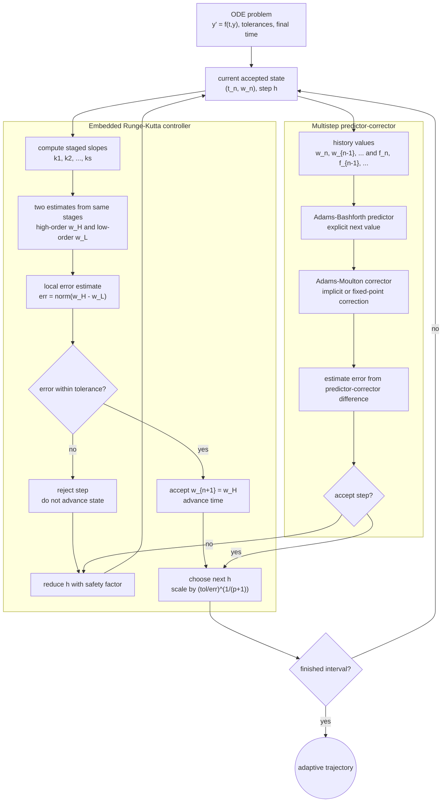

# Adaptive Runge Kutta and Multistep Methods

Fixed-step one-step methods are easy to explain, but real initial-value problems rarely need the same step size everywhere. Adaptive Runge-Kutta methods estimate the local error during a step and change $h$ automatically. Multistep methods use several previous solution values to reduce the cost per step after enough history has been built.

These two ideas answer different efficiency questions. Adaptive methods ask where effort should be spent. Multistep methods ask how to reuse information already computed. Many production ODE solvers combine both ideas with error control, order selection, and stiffness detection.

## Embedded pairs and the step-size controller

An **embedded Runge-Kutta pair** computes two approximations of different orders from nearly the same stages. If $w_{i+1}^{(p)}$ has order $p$ and $w_{i+1}^{(p+1)}$ has order $p+1$, then

$$
E_i=w_{i+1}^{(p+1)}-w_{i+1}^{(p)}
$$

estimates the local error of the lower-order approximation. A common step-size update is

$$
h_{new}=s h\left(\frac{\mathrm{tol}}{|E_i|}\right)^{1/(p+1)},
$$

where $s\lt 1$ is a safety factor.

The exponent comes from the error model. If the estimated local error behaves as

$$
|E(h)|\approx Ch^{p+1},
$$

and one wants $\vert E(h_{\text{new}})\vert \approx\mathrm{tol}$, then

$$
\frac{\mathrm{tol}}{|E(h)|}
\approx
\left(\frac{h_{\text{new}}}{h}\right)^{p+1}.
$$

Solving for $h_{\text{new}}$ gives the controller formula. Method conventions matter: some pairs label the accepted formula by order $p$ while the difference estimates an error of order $p+1$; others describe the pair by both orders. The exponent must match the actual power in the estimator, not a memorized label.

For a system of equations, one scalar error must summarize components with different units and magnitudes. A common scaled root-mean-square norm is

$$
\operatorname{err}
=\sqrt{\frac1d\sum_{j=1}^d
\left(
\frac{E_j}
{\mathrm{atol}_j+\mathrm{rtol}_j
\max(|w_{n,j}|,|w_{n+1,j}|)}
\right)^2}.
$$

The step is accepted when this dimensionless quantity is at most one. Separate absolute tolerances are useful when one component is a position in kilometers and another is a small concentration. A single raw norm can let the largest-scale component dominate the controller.

Local and global error are different. The embedded difference estimates the error committed by one proposed step, assuming the incoming value is exact. Previously accumulated errors enter later steps through the differential equation. For a stable order-$p$ method, controlling local errors of size roughly $h^{p+1}$ leads to global error of order $h^p$, but a local tolerance is not a direct guarantee on the final error.

Repeated rejections often signal more than a bad initial step size. Near a discontinuity in the forcing term, the solver should stop at the known breakpoint. In a stiff region, an explicit method may choose tiny steps for stability even when its accuracy estimate would permit larger ones. Logging accepted sizes, rejection count, and function evaluations helps separate these cases.

## Reusing accepted history

A **linear multistep method** has the form

$$
\sum_{j=0}^{k}a_j w_{i+j}=h\sum_{j=0}^{k}b_j f(t_{i+j},w_{i+j}).
$$

If $b_k=0$, the method is explicit. Adams-Bashforth methods are explicit predictors; Adams-Moulton methods are implicit correctors. Backward differentiation formulas are implicit methods designed especially for stiff problems.

Adams formulas arise by integrating an interpolant to the derivative. From

$$
y(t_{n+1})=y(t_n)+\int_{t_n}^{t_{n+1}}f(t,y(t))\,dt,
$$

replace $f$ by a polynomial through previously computed slope values. For AB2 on a uniform grid, the linear interpolant through $f_{n-1}$ and $f_n$ can be written with $s=(t-t_n)/h$ as

$$
p(s)=f_n+s(f_n-f_{n-1}).
$$

Integrating from $s=0$ to $1$ gives

$$
\int_0^1p(s)\,ds
=f_n+\frac12(f_n-f_{n-1})
=\frac32f_n-\frac12f_{n-1}.
$$

Multiplication by $h$ produces the AB2 coefficients. Adams-Moulton includes the new endpoint slope in the interpolant, which improves accuracy but makes the equation implicit when $f$ depends on $y$.

## Acceptance, startup, and stability

Adaptive Runge-Kutta methods depend on local error estimates. A rejected step is not wasted entirely: it supplies information that a smaller step is needed. A successful step with error far below tolerance suggests that $h$ can grow. Practical solvers limit how quickly $h$ changes to avoid unstable oscillation in the controller.

Modern controllers often use the previous error as well as the current one. A proportional-integral update damps the sawtooth pattern in which one very accurate step causes a large increase, followed immediately by rejection. Bounds such as one-quarter to twice the old step are algorithmic safeguards, not properties of the differential equation.

The higher-order member of an embedded pair is usually accepted because it costs the same stages and has better accuracy. Some formulas also have a first-same-as-last property: the final stage of an accepted step equals the first stage needed for the next step, saving one function evaluation. That reuse is lost after a rejection or a discontinuity.

Adaptive solvers must land exactly on endpoints where the model changes. Shortening the final step is better than stepping past a discontinuity and interpolating across it. For output at ordinary intermediate times, a method-specific dense-output polynomial can interpolate within an accepted step without forcing the internal mesh to match every requested output time. Event detection likewise uses dense output plus a root finder, and the event function should be checked only over accepted steps.

A multistep method needs starting values. A $k$-step method cannot begin from only $w_0$, so a one-step method such as RK4 is often used to generate the first $k-1$ values. Multistep stability is more complicated than one-step stability because parasitic roots of the characteristic polynomial can grow even when the differential equation itself is harmless.

For the homogeneous recurrence obtained by setting $f=0$, define the first characteristic polynomial

$$
\rho(\zeta)=\sum_{j=0}^k a_j\zeta^j.
$$

Zero-stability requires every root to satisfy $\vert \zeta\vert \le1$, with roots on the unit circle occurring only once. A repeated root of magnitude one permits a small perturbation in the starting data to grow polynomially with the number of steps. Consistency plus zero-stability gives convergence for a linear multistep method; formal truncation order without zero-stability is not enough.

Changing step size is also less routine for multistep formulas than for Runge--Kutta methods. The familiar Adams coefficients assume equally spaced history. With variable steps, coefficients must be recomputed from the actual node locations, and a large step change can degrade the quality of stored history. Production codes keep interpolation data in forms that support changing both step size and order.

The second-order Adams-Bashforth method is

$$
w_{i+1}=w_i+\frac{h}{2}\left(3f(t_i,w_i)-f(t_{i-1},w_{i-1})\right).
$$

The trapezoidal Adams-Moulton corrector is

$$
w_{i+1}=w_i+\frac{h}{2}\left(f(t_{i+1},w_{i+1})+f(t_i,w_i)\right).
$$

Together they form a predictor-corrector pair: predict explicitly, evaluate the endpoint slope, then correct.

One corrector evaluation does not generally solve the implicit Adams-Moulton equation exactly. It produces a PECE sequence: predict, evaluate, correct, evaluate. Additional fixed-point corrections may converge if $h$ times the relevant Lipschitz constant is small. For a genuinely stiff problem, Newton iteration or a BDF method with a Jacobian-based solve is more reliable. Calling a single corrected value “implicit” can hide this distinction.

The predictor-corrector difference is correlated with the local error, but its scaling constant depends on the pair. It should not be treated as a universal error bound. A code that changes step size from this difference needs the correct local-error constant or a calibrated controller.

Useful diagnostics include the local error estimate, rejected-step count, endpoint residuals, and agreement under tighter tolerances or step halving. Cost should be counted in right-hand-side evaluations, implicit solves, and stored history. Comparing formal order without those costs is misleading.

## How state and error estimates move through a solver



Embedded RK reuses staged slopes to produce high- and low-order estimates. Multistep methods instead reuse accepted history and compare predictor-corrector behavior. A rejected step changes the proposed step size but never advances the state.

| Family | Memory | Error control | Cost pattern | Typical use |
|---|---:|---|---|---|
| Embedded RK | one current state | direct embedded estimate | several stages per step | general nonstiff IVPs |
| Adams-Bashforth | previous states | predictor estimate or pair | one new $f$ per step | smooth nonstiff IVPs |
| Adams-Moulton | previous plus new state | predictor-corrector | implicit solve or correction | higher accuracy, mild stiffness |
| BDF | previous states | variable order controllers | implicit solve | stiff systems |

## Shrinking a rejected Runge-Kutta step

**Problem.** An embedded fourth-order method takes a step with $h=0.1$ and estimates the local error as $E=2\times 10^{-5}$. The tolerance is $10^{-6}$. With safety factor $s=0.9$, compute the suggested new step size.

**Method.** For a fourth-order controlled solution, use exponent $1/(4+1)=1/5$.

1. Form the tolerance ratio:

$$
\frac{\mathrm{tol}}{|E|}=\frac{10^{-6}}{2\times 10^{-5}}=0.05.
$$

2. Apply the controller:

$$
h_{new}=0.9(0.1)(0.05)^{1/5}.
$$

3. Compute the fifth root:

$$
(0.05)^{1/5}=0.54928\ldots.
$$

4. Therefore

$$
h_{new}=0.0494\ldots.
$$

**Checked answer.** The proposed step is about $0.0494$, roughly half the original step, because the estimated error was twenty times too large.

## One Adams-Bashforth step from accurate history

**Problem.** Use AB2 for $y'=y$ with $h=0.1$, $w_0=1$, and $w_1=e^{0.1}=1.105170186\ldots$ to approximate $y(0.2)$.

**Method.** Here $f(t,w)=w$.

1. Write AB2:

$$
w_2=w_1+\frac{h}{2}(3w_1-w_0).
$$

2. Substitute values:

$$
w_2=1.105170186+0.05(3(1.105170186)-1).
$$

3. Simplify the slope combination:

$$
3(1.105170186)-1=2.315510558.
$$

4. Then

$$
w_2=1.105170186+0.115775528=1.220945714.
$$

**Checked answer.** The exact value is $e^{0.2}=1.221402758\ldots$, so the AB2 error is about $4.57\times 10^{-4}$.

## Predicting and correcting one stiff-looking step

Take $y'=-10y$ with $h=0.1$ and suppose $w_0=1$, $w_1=e^{-1}=0.367879441\ldots$. AB2 predicts

$$
\begin{aligned}
w_2^{(p)}
&=w_1+\frac{h}{2}(3(-10w_1)-(-10w_0))\\
&=w_1+\frac12(1-3w_1)\\
&=0.316060279\ldots.
\end{aligned}
$$

The exact value at $t=0.2$ is $e^{-2}=0.135335283\ldots$, so the explicit prediction decays much too slowly. Apply one trapezoidal Adams-Moulton correction using the predicted endpoint slope:

$$
\begin{aligned}
w_2^{(c)}
&=w_1+\frac{h}{2}\left(-10w_2^{(p)}-10w_1\right)\\
&=w_1-\frac12\left(w_2^{(p)}+w_1\right)\\
&=0.025909581\ldots.
\end{aligned}
$$

The single correction overshoots in the other direction. Solving the implicit trapezoidal equation exactly gives

$$
w_2=w_1-\frac12(w_2+w_1),
$$

so

$$
\frac32w_2=\frac12w_1,
\qquad
w_2=\frac13w_1=0.122626480\ldots.
$$

That value is much closer to the exact solution. The calculation separates an implicit method from one fixed-point correction of it; they coincide only after the iteration has converged.

## Choosing between one-step and multistep families

Runge--Kutta methods are self-starting and tolerate step-size changes naturally because a step depends only on the current state. They also handle discontinuities and event restarts cleanly: after the event, begin another one-step calculation. Their cost is several new right-hand-side evaluations per accepted step.

Adams methods become attractive on long, smooth, nonstiff integrations. After startup, an explicit Adams step needs only one new function evaluation because older slopes are stored. The savings diminish when steps are rejected frequently, events reset the history, or the solution changes scale so rapidly that order and step size keep changing.

BDF methods trade explicit evaluations for nonlinear solves. Their favorable stability makes that trade worthwhile for stiff systems, especially when a Jacobian factorization can be reused across steps. For a small nonstiff problem, the setup and linear algebra are needless overhead. Solver family should follow observed stability behavior rather than formal order alone.

The test equation $y'=\lambda y$ separates accuracy from stability. An explicit method advances by $w_{n+1}=R(h\lambda)w_n$, where $R$ is its stability function. If $\vert R(h\lambda)\vert \gt 1$ for a mode whose exact solution decays, numerical values grow even if the local truncation error formula looks high order. An adaptive explicit solver then shrinks $h$ until the mode lies in its stability region. A long sequence of tiny accepted steps on a smooth solution is a common stiffness symptom.

## Error control does not enforce model invariants

An ODE may conserve mass, energy, positivity, or a norm. A generic embedded error controller monitors the difference between two formulas, not these invariants. Small local error can coexist with slow energy drift over a long Hamiltonian integration or with a slightly negative concentration near zero.

Projection can restore a constraint after each accepted step, but it changes the numerical method and may affect order. Geometric integrators are designed to preserve selected structure over long times. Positivity-preserving or monotonicity-preserving methods impose different restrictions. The appropriate error metric should include quantities the model regards as physically meaningful.

Dense output also needs its own order statement. Interpolating accepted endpoints with an arbitrary cubic does not automatically retain the step method's accuracy. Embedded solver implementations provide coefficients matched to their stages. Event times can be less accurate than state values if a low-order interpolant or loose root tolerance is used.

## A small adaptive controller and AB2 implementation

```python
import math

def adaptive_heun(f, a, b, alpha, tol=1e-6, h_initial=0.1):
    t = a
    w = alpha
    h = h_initial
    out = [(t, w)]
    while t < b:
        h = min(h, b - t)
        k1 = f(t, w)
        euler = w + h * k1
        k2 = f(t + h, euler)
        heun = w + h * (k1 + k2) / 2.0
        err = abs(heun - euler)
        if err <= tol or h <= 1e-14:
            t += h
            w = heun
            out.append((t, w))
        factor = 2.0 if err == 0 else 0.9 * (tol / err) ** 0.5
        factor = min(2.0, max(0.25, factor))
        h *= factor
    return out

def adams_bashforth2(f, ts, ws, h, steps):
    ts = list(ts)
    ws = list(ws)
    for _ in range(steps):
        f_i = f(ts[-1], ws[-1])
        f_prev = f(ts[-2], ws[-2])
        ws.append(ws[-1] + h * (3.0 * f_i - f_prev) / 2.0)
        ts.append(ts[-1] + h)
    return list(zip(ts, ws))

f = lambda t, y: y
print(adaptive_heun(f, 0.0, 1.0, 1.0, tol=1e-5, h_initial=0.25)[-1])
print(adams_bashforth2(f, [0.0, 0.1], [1.0, math.exp(0.1)], 0.1, 3))
```

## Failure patterns worth logging

- A step whose error is too large must be recomputed; changing only the following step silently accepts a bad state.
- Step-size updates need upper and lower factors so one noisy estimate cannot cause an extreme jump.
- A multistep method inherits error from its startup values, so the one-step startup method must be sufficiently accurate.
- Explicit multistep formulas still have stability restrictions even when their truncation order looks adequate.
- Function evaluations and rejected steps are part of the comparison between Runge-Kutta and multistep methods.

Stopping because $h$ falls below a threshold should be reported as failure, not returned as an ordinary solution. The threshold should relate to floating-point spacing in $t$: if $t+h=t$ numerically, the solver cannot advance. Likewise, a maximum-step setting may be needed when output or event resolution matters even though the error controller would allow a very large step.

Backward integration uses a negative step and reverses the endpoint tests, but the error scale depends on the magnitude of the step. Multistep history must be ordered consistently in the reversed direction. Problems that are stable forward in time can be unstable backward, so successful forward integration does not imply that retracing the numerical solution will recover the initial state.

<div className="see-also">

See also: [Euler Taylor and Runge Kutta methods](/math/numerical-analysis/euler-taylor-runge-kutta) · [ODE stability stiffness and systems](/math/numerical-analysis/ode-stability-stiffness-systems) · [boundary value problems](/math/numerical-analysis/boundary-value-problems) · [finite difference methods for PDEs](/math/numerical-analysis/finite-difference-pdes)

</div>
