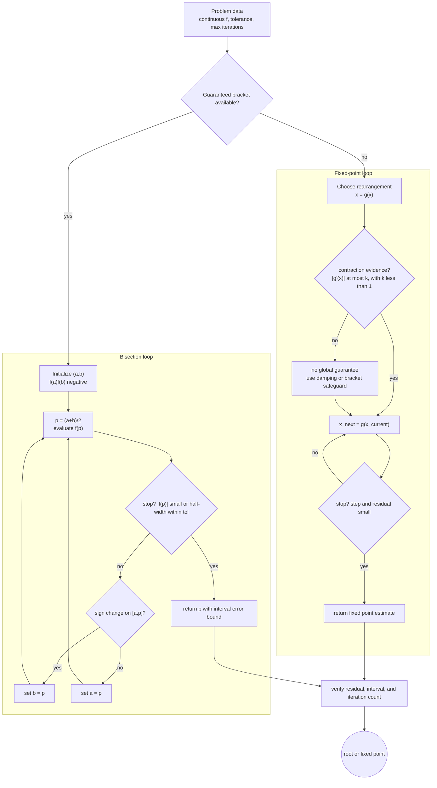

# Bisection and Fixed Point Iteration

Bisection and fixed-point iteration are the first two root-finding methods worth separating carefully. Bisection asks for very little: a continuous function and a sign change. In exchange, it gives a guaranteed shrinking interval. Fixed-point iteration can be much faster, but only after the equation has been rearranged into a map whose repeated application actually pulls guesses toward the solution.


*Figure: Bisection is a robust root-finding method built from the intermediate value theorem. Image: [Wikimedia Commons](https://commons.wikimedia.org/wiki/File:Bisection_method.svg), Tokuchan after Dake, CC BY-SA 3.0.*

The pair also introduces a pattern that appears throughout numerical analysis. A robust method usually has a theorem that protects it from bad initial guesses, while a fast method usually needs local assumptions. Good practical solvers often combine both ideas: first locate a safe region, then switch to a faster local iteration.

## Bisection preserves a sign-changing bracket

A **root** of $f$ is a number $p$ such that $f(p)=0$. A **bracket** for a scalar root is an interval $[a,b]$ with $f(a)f(b)\lt 0$. If $f$ is continuous, the Intermediate Value Theorem guarantees at least one root in $(a,b)$. The guarantee is existential: it does not say the root is unique, and it does not say the graph behaves nicely inside the interval.

The bisection method forms midpoints

$$
p_n=\frac{a_n+b_n}{2}
$$

and keeps the half interval on which the sign change remains. The method does not estimate the slope or curvature of $f$; it only asks which subinterval still contains a guaranteed sign change. That is why it is slow but difficult to break.

## Fixed-point iteration depends on the rearrangement

A **fixed point** of a function $g$ is a number $p$ such that $g(p)=p$. To solve $f(x)=0$, one may rewrite the equation as $x=g(x)$ and iterate

$$
p_{n+1}=g(p_n).
$$

The rearrangement matters. The same equation can produce a convergent fixed-point map, a divergent map, or an oscillating map depending on how $g$ is chosen. Fixed-point iteration is therefore a method for a pair consisting of the equation and a map, not merely for the equation alone.

## Error bounds and contraction tests

For bisection, after $n$ iterations the root is contained in an interval of length

$$
b_n-a_n=\frac{b_0-a_0}{2^n}.
$$

The midpoint approximation therefore satisfies

$$
|p-p_n|\le \frac{b_0-a_0}{2^{n+1}}.
$$

To guarantee $\vert p-p_n\vert \le \varepsilon$, it is enough to choose $n$ so that

$$
\frac{b_0-a_0}{2^{n+1}}\le \varepsilon.
$$

Taking logarithms gives the iteration estimate

$$
n\ge \log_2\left(\frac{b_0-a_0}{\varepsilon}\right)-1.
$$

This is a worst-case guarantee, not merely an observed trend. It remains valid even if the function is flat, steep, or badly scaled, provided the sign change and continuity assumptions hold.

For fixed-point iteration, a standard contraction theorem says: if $g$ maps $[a,b]$ into itself and there is a constant $k\lt 1$ with

$$
|g'(x)|\le k \quad \text{for all }x\in[a,b],
$$

then $g$ has a unique fixed point in $[a,b]$, and iteration from any starting value in the interval converges to it. A local version says that if $\vert g'(p)\vert \lt 1$, convergence is expected near $p$; if $\vert g'(p)\vert \gt 1$, the fixed point is locally repelling. When $g'(p)=0$, fixed-point iteration can be faster than linear, which is one way to understand why Newton's method has quadratic convergence at simple roots.

The input record should contain the bracket or fixed-point map, starting value, and stopping rule. Useful diagnostics are interval width, residual size, iterate change, and a derivative or contraction estimate. Bisection's interval gives a certified geometric bound; fixed-point iteration needs both a small step and a small residual before its result is convincing.

## Two loops with different guarantees



Bisection keeps an explicit sign-changing interval and returns an error bound. Fixed-point iteration depends on the contraction behavior of the chosen map $g$. Both routes end with a residual or interval-based check.

| Method | Required input | Guarantee | Typical rate | Main weakness |
|---|---|---|---|---|
| Bisection | sign-changing bracket | interval always shrinks | linear, factor $1/2$ in width | slow near simple roots |
| Fixed point | map $g$ and starting value | contraction gives convergence | linear unless special structure | bad rearrangements diverge |
| Hybrid use | bracket plus local iteration | safety plus speed | method-dependent | more implementation logic |

## Bracketing a cubic to a prescribed width

**Problem.** Solve

$$
f(x)=x^3+4x^2-10=0
$$

on $[1,2]$ by bisection until the interval width is at most $1/8$.

**Method.** Track signs and keep the subinterval with a sign change.

1. Start with

$$
f(1)=1+4-10=-5,
\qquad
f(2)=8+16-10=14.
$$

So a root lies in $(1,2)$.

2. First midpoint:

$$
p_1=1.5,
\qquad
f(1.5)=3.375+9-10=2.375.
$$

Since $f(1)f(1.5)\lt 0$, keep $[1,1.5]$.

3. Second midpoint:

$$
p_2=1.25,
\qquad
f(1.25)=1.953125+6.25-10=-1.796875.
$$

Now the sign change is in $[1.25,1.5]$.

4. Third midpoint:

$$
p_3=1.375,
\qquad
f(1.375)=2.599609375+7.5625-10=0.162109375.
$$

Keep $[1.25,1.375]$.

**Checked answer.** The interval width is $0.125=1/8$, so the root is in $[1.25,1.375]$ and the midpoint $1.3125$ has error at most $1/16=0.0625$. Continuing the same process gives the more accurate root $p\approx 1.365230013$.

## Testing a rearrangement near the same root

**Problem.** Use a fixed-point map for the same cubic and check whether convergence is plausible near the root.

**Method.** Rearrange the equation as

$$
x=\sqrt{\frac{10-x^3}{4}}=g(x).
$$

1. Evaluate from $p_0=1.5$:

$$
p_1=g(1.5)=\sqrt{\frac{10-3.375}{4}}=\sqrt{1.65625}=1.287953\ldots.
$$

2. Next iterate:

$$
p_2=g(1.287953\ldots)=\sqrt{\frac{10-2.136\ldots}{4}}=1.402\ldots.
$$

3. The derivative is

$$
g'(x)=\frac{-3x^2}{8\sqrt{(10-x^3)/4}}.
$$

At the root $p\approx 1.36523$,

$$
|g'(p)|\approx 0.512.
$$

4. Because this value is well below $1$, errors are reduced by about half per iteration once the iterates are near the fixed point.

**Checked answer.** The derivative magnitude is below $1$ near the solution, so local convergence is plausible. It will be linear and slower than Newton's method, but it is a valid fixed-point rearrangement near this root.

## Implementations with explicit stopping rules

```python
import math

def bisection(f, a, b, tol=1e-12, max_iter=100):
    fa = f(a)
    fb = f(b)
    if fa * fb > 0:
        raise ValueError("bisection requires a sign change")
    for iteration in range(1, max_iter + 1):
        p = 0.5 * (a + b)
        fp = f(p)
        if abs(fp) < tol or 0.5 * (b - a) < tol:
            return p, iteration
        if fa * fp < 0:
            b, fb = p, fp
        else:
            a, fa = p, fp
    return 0.5 * (a + b), max_iter

def fixed_point(g, p0, tol=1e-12, max_iter=100):
    p = float(p0)
    for iteration in range(1, max_iter + 1):
        q = g(p)
        if abs(q - p) < tol:
            return q, iteration
        p = q
    raise RuntimeError("fixed-point iteration did not converge")

f = lambda x: x**3 + 4 * x**2 - 10
g = lambda x: math.sqrt((10 - x**3) / 4)
print(bisection(f, 1.0, 2.0))
print(fixed_point(g, 1.5))
```

## What the stopping tests do not guarantee

- Starting bisection without a sign change. Continuity plus opposite signs is the guarantee.
- Assuming bisection finds every root in the interval. If there are multiple roots, it only guarantees at least one sign-changing root.
- Using $\vert p_{n+1}-p_n\vert $ alone for fixed-point iteration. Slow or stalled iterations can make this test misleading.
- Choosing a fixed-point form without checking $\vert g'(p)\vert $ or a contraction bound.
- Forgetting that a repeated root may not create a sign change, so bisection may not apply even when a root is present.
- Ignoring domain restrictions in $g$. A square-root rearrangement, for example, can become undefined even when the original polynomial is defined.

<div className="see-also">

See also: [Newton Secant and polynomial roots](/math/numerical-analysis/newton-secant-polynomial-roots) · [mathematical preliminaries and error analysis](/math/numerical-analysis/mathematical-preliminaries-error-analysis) · [nonlinear systems](/math/numerical-analysis/nonlinear-systems) · [floating point conditioning and stability](/math/numerical-analysis/floating-point-conditioning-stability)

</div>
