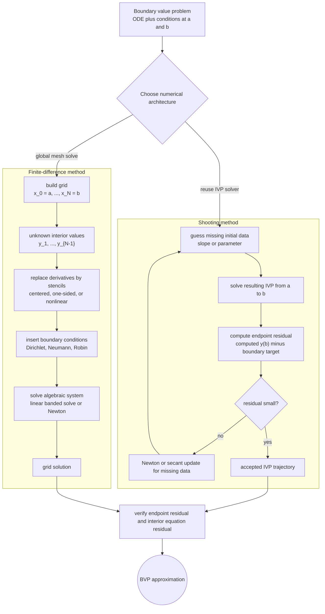

# Boundary Value Problems

Boundary value problems prescribe conditions at two or more points instead of giving all initial data at one point. This changes the numerical character of the problem. An initial-value method marches forward, while a boundary value method must coordinate the whole interval so that the endpoint conditions are satisfied together.

Two standard approaches are shooting and finite differences. Shooting guesses missing initial data and solves IVPs until the far boundary matches. Finite differences replace derivatives by algebraic equations at grid points, producing a linear or nonlinear system for all unknown values at once.

A BVP can fail before discretization. Depending on the differential equation and boundary conditions, it may have one solution, no solution, or many. For example,

$$
y''+y=0,\qquad y(0)=0,\qquad y(\pi)=0
$$

has the family $y(x)=C\sin x$. Replacing the right boundary by $y(\pi)=1$ gives no solution. A small residual from a numerical method has meaning only after the continuous problem is known or expected to be well posed.

## Turning endpoint conditions into unknowns

A second-order two-point boundary value problem has the form

$$
y''=f(x,y,y'),\qquad a\le x\le b,
$$

with boundary conditions

$$
y(a)=\alpha,
\qquad y(b)=\beta.
$$

The **shooting method** introduces a missing initial slope $s$ and solves the IVP

$$
y(a)=\alpha,
\qquad y'(a)=s.
$$

The value of $s$ is adjusted until the computed endpoint satisfies $y(b;s)=\beta$.

Define the shooting residual

$$
F(s)=y(b;s)-\beta.
$$

Bisection can be used when a sign-changing bracket is available and $F$ is continuous. The secant method avoids derivatives and usually converges faster. Newton's method needs $F'(s)$, which can be obtained from a sensitivity equation rather than a finite difference.

For a general equation $y''=f(x,y,y')$, let

$$
z(x)=\frac{\partial y(x;s)}{\partial s}.
$$

Differentiating the ODE with respect to $s$ gives

$$
z''=f_y(x,y,y')z+f_{y'}(x,y,y')z',
$$

with initial conditions

$$
z(a)=0,\qquad z'(a)=1.
$$

Then $F'(s)=z(b)$, and Newton updates the slope by

$$
s_{\text{new}}=s-\frac{y(b;s)-\beta}{z(b)}.
$$

The state and sensitivity equations can be integrated together. If $z(b)$ is tiny, the endpoint barely responds to the initial slope and Newton's step becomes unreliable; this is a conditioning warning for shooting.

A finite difference method uses grid points $x_i=a+ih$ and replaces derivatives by formulas such as

$$
y''(x_i)\approx \frac{w_{i-1}-2w_i+w_{i+1}}{h^2}.
$$

The boundary values are known, and the interior values become unknowns in a system of algebraic equations.

The centered formula follows from Taylor expansions:

$$
\begin{aligned}
y(x_i+h)&=y_i+hy_i'+\frac{h^2}{2}y_i''
+\frac{h^3}{6}y_i'''+\frac{h^4}{24}y_i^{(4)}+O(h^5),\\
y(x_i-h)&=y_i-hy_i'+\frac{h^2}{2}y_i''
-\frac{h^3}{6}y_i'''+\frac{h^4}{24}y_i^{(4)}+O(h^5).
\end{aligned}
$$

Adding cancels the odd derivatives. After rearrangement,

$$
\frac{y(x_i-h)-2y(x_i)+y(x_i+h)}{h^2}
=y''(x_i)+\frac{h^2}{12}y^{(4)}(x_i)+O(h^4).
$$

The local truncation error is second order. Under stability and sufficient smoothness, the global nodal error is also $O(h^2)$.

## Choosing between shooting and a mesh solve

For linear problems of the form

$$
y''=p(x)y'+q(x)y+r(x),
$$

finite differences usually lead to a tridiagonal linear system. This structure should be exploited with a tridiagonal solver rather than dense elimination.

Writing the coefficients shows the structure. Substitute centered differences for both derivatives:

$$
\frac{w_{i-1}-2w_i+w_{i+1}}{h^2}
=p_i\frac{w_{i+1}-w_{i-1}}{2h}+q_iw_i+r_i.
$$

Collecting terms gives

$$
\left(1+\frac{hp_i}{2}\right)w_{i-1}
+(-2-h^2q_i)w_i
+\left(1-\frac{hp_i}{2}\right)w_{i+1}
=h^2r_i.
$$

Each row touches only a node and its two neighbors. Dirichlet values at the ends move into the first and last right-hand-side entries.

Shooting is intuitive and easy to implement when the IVP is stable with respect to the missing slope. It can be unreliable for unstable or stiff problems because small changes in the guessed slope may cause huge endpoint changes. Multiple solutions can also make the shooting residual nonlinear and difficult.

Multiple shooting divides the interval into several segments and introduces unknown initial data at each segment. Continuity equations join neighboring trajectories. This costs a larger nonlinear system, but it limits the exponential growth that a single unstable IVP can accumulate across the whole interval.

Finite difference methods are more global. For nonlinear BVPs, the finite difference equations form a nonlinear system that can be solved by Newton's method. The Jacobian is often banded because each equation involves only neighboring grid values.

If the discrete equations are denoted by $\mathbf{F}(\mathbf{w})=\mathbf{0}$, Newton's method solves

$$
J(\mathbf{w}^{(k)})\boldsymbol{\delta}^{(k)}
=-\mathbf{F}(\mathbf{w}^{(k)})
$$

and sets $\mathbf{w}^{(k+1)}=\mathbf{w}^{(k)}+\boldsymbol{\delta}^{(k)}$. The initial guess matters when several solutions exist. Continuation can help: solve an easier nearby problem first, then vary a parameter gradually and reuse each solution as the next initial guess.

Boundary conditions affect accuracy. A second-order centered difference in the interior may not give second-order global accuracy if boundary approximations are only first order.

Dirichlet conditions specify values. Neumann conditions specify derivatives, while Robin conditions combine value and derivative:

$$
\alpha y(a)+\beta y'(a)=\gamma.
$$

A first-order one-sided derivative,

$$
y'(a)\approx\frac{w_1-w_0}{h},
$$

can reduce the overall order. A second-order formula such as

$$
y'(a)\approx\frac{-3w_0+4w_1-w_2}{2h}
$$

preserves second-order consistency but widens the first matrix row. Ghost points offer another route: extend the centered stencil beyond the boundary and eliminate the ghost value with the boundary equation.

The relevant costs are IVP solves for shooting and banded linear solves or Newton steps for finite differences. Endpoint mismatch is the natural shooting diagnostic; the algebraic residual and mesh-refinement behavior check a finite difference solution.

A useful BVP check is to compare the boundary residual with the interior residual. If the boundary values are satisfied to high accuracy while the interior equations are poor, the mesh equations or nonlinear solve are suspect. If the interior residual is small but the boundary residual is large, inspect the shooting parameter, boundary insertion, or endpoint discretization first. Mesh endpoints and unknown indexing should be written down because off-by-one grid errors are common in BVP codes.



Shooting becomes a sequence of IVP solves driven by an endpoint residual. Finite differences instead build a grid, stencil equations, boundary insertions, and a global algebraic solve. Both routes need boundary and interior residual checks.

| Method | Unknowns | Strength | Weakness |
|---|---|---|---|
| Shooting | missing initial data | reuses IVP solvers | sensitive to unstable IVPs |
| Linear finite difference | grid values | structured linear system | lower local detail unless grid refined |
| Nonlinear finite difference | grid values | handles nonlinear BVPs globally | requires Newton or nonlinear solver |
| Collocation | coefficients or nodal values | high accuracy | more complex assembly |

## A one-node finite difference solve

**Problem.** Solve

$$
y''=0,
\qquad y(0)=1,
\qquad y(1)=3
$$

using one interior grid point at $x=0.5$.

**Method.** Let $h=0.5$, $w_0=1$, $w_2=3$, and $w_1\approx y(0.5)$.

1. The centered second difference equation is

$$
\frac{w_0-2w_1+w_2}{h^2}=0.
$$

2. Multiply by $h^2$:

$$
w_0-2w_1+w_2=0.
$$

3. Substitute boundary values:

$$
1-2w_1+3=0.
$$

4. Solve:

$$
4-2w_1=0 \Rightarrow w_1=2.
$$

**Checked answer.** The exact solution is the line $y=1+2x$, so $y(0.5)=2$. The finite difference value is exact for this linear solution.

## Recovering the missing shooting slope

**Problem.** For

$$
y''=-\pi^2\sin(\pi x),
\qquad y(0)=0,
\qquad y(1)=0,
$$

find the initial slope required by shooting.

**Method.** Solve analytically with an unknown slope $s=y'(0)$.

1. Integrate twice. A particular solution is $\sin(\pi x)$, so

$$
y(x)=\sin(\pi x)+Cx+D.
$$

2. Apply $y(0)=0$:

$$
0+0+D=0 \Rightarrow D=0.
$$

3. Differentiate:

$$
y'(x)=\pi\cos(\pi x)+C.
$$

Thus

$$
s=y'(0)=\pi+C.
$$

4. Apply $y(1)=0$:

$$
0+C=0 \Rightarrow C=0.
$$

So $s=\pi$.

**Checked answer.** Shooting must use $y'(0)=\pi$ to satisfy the right boundary. The resulting solution is $y(x)=\sin(\pi x)$.

For this linear equation, the shooting residual is affine in the missing slope. Let $u$ solve the equation with $u(0)=0$, $u'(0)=0$, and let $v$ solve the homogeneous equation $v''=0$ with $v(0)=0$, $v'(0)=1$. Then

$$
y(x;s)=u(x)+sv(x).
$$

Here $u(x)=\sin(\pi x)-\pi x$, $v(x)=x$, so

$$
y(1;s)=-\pi+s.
$$

The boundary equation $y(1;s)=0$ gives $s=\pi$ in one scalar solve. Linear shooting generally needs only two IVP integrations: one particular trajectory and one homogeneous sensitivity trajectory.

## Mesh refinement as an accuracy check

Suppose a centered finite difference method is second order and gives values $W_h$ and $W_{h/2}$ at a grid point common to both meshes. Write

$$
W_h=y+Ch^2+O(h^4),
\qquad
W_{h/2}=y+\frac{Ch^2}{4}+O(h^4).
$$

Their difference estimates three quarters of the coarse-grid leading error:

$$
W_{h/2}-W_h\approx-\frac34Ch^2.
$$

An improved estimate is

$$
W_{\mathrm{ext}}
=W_{h/2}+\frac{W_{h/2}-W_h}{3}.
$$

With three meshes, the observed ratio

$$
\frac{\|W_h-W_{h/2}\|}
{\|W_{h/2}-W_{h/4}\|}
$$

should approach $4$ in the asymptotic second-order regime. A very different ratio can indicate a coarse mesh, a nonsmooth solution, a first-order boundary stencil, or an algebraic solve that has not converged tightly enough.

## Collocation and finite elements

Finite differences are not the only global discretization. Collocation represents the unknown by a piecewise polynomial and forces the differential equation to hold at selected points. Continuity conditions join neighboring pieces, and an adaptive collocation solver can refine intervals where a residual estimate is large. The output is a continuous approximation rather than values only at grid nodes.

Finite elements begin from a weak form. For a problem such as $-y''=f$ with zero endpoint values, multiply by a test function $v$ and integrate:

$$
\int_a^b -y''v\,dx
=\int_a^b fv\,dx.
$$

Integration by parts transfers one derivative from $y$:

$$
\int_a^b y'v'\,dx
=\int_a^b fv\,dx,
$$

because the boundary term vanishes for suitable test functions. Piecewise linear trial and test functions then produce a sparse system. The weak form needs fewer classical derivatives and extends naturally to irregular geometries in higher-dimensional PDEs.

Collocation, finite differences, and finite elements can all reach high accuracy, but their error indicators and solution representations differ. A finite difference residual is tied to a stencil. A collocation residual can be evaluated between nodes. A finite element method has energy-norm and elementwise estimators derived from the weak form. Comparing methods only by the number of stored unknowns overlooks these differences.

## Conditioning and boundary layers

A well-posed continuous problem can still yield a difficult discrete system. Fine meshes introduce coefficients proportional to $1/h^2$, and the condition number of a basic second-derivative matrix grows as the mesh is refined. Stable banded solvers handle moderate one-dimensional problems well, while large systems may need preconditioned iterative methods.

Singularly perturbed equations can contain boundary layers: thin regions where the solution changes rapidly near an endpoint. A uniform grid fine enough to resolve the layer wastes points elsewhere. Shooting may also be unstable because one solution mode grows exponentially while another decays. Nonuniform meshes, fitted transformations, or methods designed for the perturbation are preferable.

Residual-based mesh adaptation estimates where the differential equation is poorly satisfied and inserts points there. Refinement should consider both the residual and the mesh scale; a large derivative alone does not prove large error. After changing the mesh, interpolating the old solution supplies an initial guess for a new nonlinear solve.

## A mixed boundary condition by a ghost point

Consider $y''=0$ on $[0,1]$ with $y'(0)=2$ and $y(1)=3$. The exact solution is $y=1+2x$. On a grid with spacing $h$, introduce a ghost value $w_{-1}$ and use centered formulas at the left endpoint:

$$
\frac{w_1-w_{-1}}{2h}=2,
\qquad
\frac{w_{-1}-2w_0+w_1}{h^2}=0.
$$

The derivative condition gives

$$
w_{-1}=w_1-4h.
$$

Substitution into the differential equation gives

$$
2w_1-2w_0-4h=0,
$$

or $w_1-w_0=2h$. This is the correct slope relation. Together with the interior second-difference equations and $w_N=3$, it recovers the linear solution exactly.

The ghost value is not an extra physical unknown after elimination. It is a bookkeeping device that lets the centered interior formula reach the boundary. Signs in the normal derivative need attention in higher dimensions because the outward normal points in opposite coordinate directions at opposite ends.

## Assembling the finite difference system

```python
import numpy as np

def finite_difference_poisson(a, b, alpha, beta, source, n):
    h = (b - a) / n
    xs = np.linspace(a, b, n + 1)
    m = n - 1
    A = np.zeros((m, m))
    rhs = np.zeros(m)
    for i in range(m):
        x = xs[i + 1]
        A[i, i] = -2.0
        if i > 0:
            A[i, i - 1] = 1.0
        if i < m - 1:
            A[i, i + 1] = 1.0
        rhs[i] = h * h * source(x)
    rhs[0] -= alpha
    rhs[-1] -= beta
    interior = np.linalg.solve(A, rhs)
    return xs, np.r_[alpha, interior, beta]

xs, ys = finite_difference_poisson(0.0, 1.0, 0.0, 0.0,
                                   lambda x: -np.pi**2 * np.sin(np.pi * x), 10)
print(max(abs(ys - np.sin(np.pi * xs))))
```

## Boundary and stability failures

- Treating a BVP like an IVP without accounting for the far boundary condition.
- Using shooting on an unstable IVP and blaming the root finder for sensitivity.
- Forgetting to insert boundary values into the finite difference right-hand side.
- Destroying tridiagonal or banded structure with dense assembly.
- Applying centered interior formulas but lower-order boundary formulas without checking global accuracy.

A small algebraic residual alone does not measure discretization error. It says the computed grid values solve the discrete equations, not that those equations approximate the continuous solution accurately on the chosen mesh. Residual checks and mesh refinement answer different questions and both belong in a trustworthy calculation.

Linear boundary value operators also have a null-space test. If the corresponding homogeneous problem has only the zero solution, a compatible linear problem has at most one solution. A nonzero homogeneous solution signals either nonuniqueness or a solvability condition on the forcing. Discretizations inherit an analogous warning through a singular or nearly singular system matrix.

For nonlinear problems, convergence of Newton's method proves only that one discrete solution was found. Different initial guesses may converge to different branches. Parameter continuation, plots of a diagnostic against the parameter, and repeated solves from distinct initial guesses help reveal multiplicity. Mesh refinement should track the same branch; a sudden jump may be a branch switch rather than ordinary discretization error.

Boundary residuals need units and scaling just as interior residuals do. A derivative condition and a value condition can have very different numerical magnitudes. Scaling each equation by a characteristic size prevents the nonlinear solver from satisfying one class of conditions while effectively ignoring another.

Finally, a visually smooth curve through the boundary values is weak evidence. The differential operator may amplify a small shape error, especially when second derivatives are involved. Verification should evaluate the equation and boundary conditions quantitatively, then repeat on a finer mesh or with an independent method when possible.

Adaptive BVP meshes should retain the boundary points exactly. Moving or smoothing endpoints changes the stated conditions. Interior node movement is acceptable when the solution is transferred consistently and the new discrete equations are rebuilt. Reporting the final mesh is useful because two approximations with the same number of nodes may have very different resolution near a layer.

<div className="see-also">

See also: [Euler Taylor and Runge Kutta methods](/math/numerical-analysis/euler-taylor-runge-kutta) · [nonlinear systems](/math/numerical-analysis/nonlinear-systems) · [matrix factorizations and special systems](/math/numerical-analysis/matrix-factorizations-special-systems) · [finite difference methods for PDEs](/math/numerical-analysis/finite-difference-pdes)

</div>
