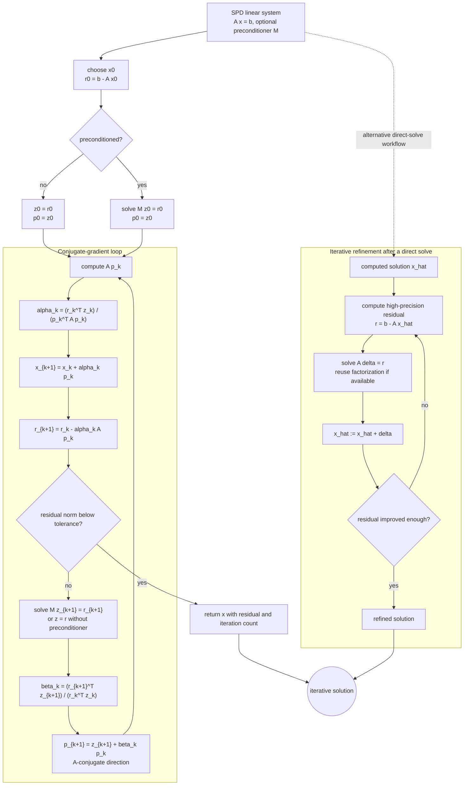

# Conjugate Gradient and Iterative Refinement

Conjugate gradient is an iterative method designed for symmetric positive definite linear systems. It improves on stationary iterations by choosing search directions that are conjugate with respect to the matrix $A$, which prevents the method from repeatedly correcting the same error component. For large sparse SPD systems, CG is often the first serious method to try.

Iterative refinement is a different idea: compute a solution, form the residual, solve for a correction, and update the solution. It can improve the accuracy of a direct solve when the residual is computed accurately enough and the original problem is not too ill-conditioned.

## CG as quadratic minimization

For an SPD matrix $A$, solving $Ax=b$ is equivalent to minimizing the quadratic function

$$
\phi(x)=\frac12x^TAx-b^Tx.
$$

The residual is

$$
r^{(k)}=b-Ax^{(k)}.
$$

The gradient is

$$
\nabla\phi(x)=Ax-b=-r.
$$

Thus the residual points in the steepest-descent direction. Ordinary steepest descent repeatedly searches along the current residual, but its directions can undo part of earlier progress and zigzag across elongated level ellipses. CG modifies each new residual by a multiple of the previous search direction so that the resulting directions are $A$-orthogonal.

CG starts from $x^{(0)}$, sets $r^{(0)}=b-Ax^{(0)}$, and chooses the first search direction $p^{(0)}=r^{(0)}$. The basic recurrences are

$$
\alpha_k=\frac{(r^{(k)})^Tr^{(k)}}{(p^{(k)})^TAp^{(k)}},
$$

$$
x^{(k+1)}=x^{(k)}+\alpha_kp^{(k)},
\qquad
r^{(k+1)}=r^{(k)}-\alpha_kAp^{(k)},
$$

$$
\beta_k=\frac{(r^{(k+1)})^Tr^{(k+1)}}{(r^{(k)})^Tr^{(k)}},
\qquad
p^{(k+1)}=r^{(k+1)}+\beta_kp^{(k)}.
$$

The step length $\alpha_k$ is an exact line minimizer. Put $x(\alpha)=x^{(k)}+\alpha p^{(k)}$. Differentiating gives

$$
\frac{d}{d\alpha}\phi(x(\alpha))
=(p^{(k)})^T(Ax^{(k)}+\alpha Ap^{(k)}-b).
$$

Setting this to zero yields

$$
\alpha_k
=\frac{(p^{(k)})^Tr^{(k)}}{(p^{(k)})^TAp^{(k)}}.
$$

CG's orthogonality relations imply $(p^{(k)})^Tr^{(k)}=(r^{(k)})^Tr^{(k)}$, giving the stated formula. The denominator is positive for every nonzero search direction because $A$ is positive definite.

The coefficient $\beta_k$ is chosen so that

$$
(p^{(k+1)})^TAp^{(k)}=0.
$$

Substituting $p^{(k+1)}=r^{(k+1)}+\beta_kp^{(k)}$ and using the residual update leads, after applying residual orthogonality, to the Fletcher--Reeves ratio shown above. These short recurrences are special to the symmetric positive definite structure.

## Why the spectrum controls convergence

In exact arithmetic, CG terminates in at most $n$ steps for an $n\times n$ SPD matrix. In floating-point arithmetic it is used as an iterative method, and convergence depends strongly on the eigenvalue distribution of $A$. A standard bound is

$$
\|x^{(k)}-x\|_A
\le
2\left(\frac{\sqrt{\kappa(A)}-1}{\sqrt{\kappa(A)}+1}\right)^k
\|x^{(0)}-x\|_A.
$$

The $A$-norm is defined by $\|v\|_A=\sqrt{v^TAv}$. The bound shows why preconditioning matters: reducing the effective condition number can dramatically reduce iteration count.

The deeper description uses Krylov subspaces:

$$
\mathcal{K}_k(A,r^{(0)})
=\operatorname{span}\{r^{(0)},Ar^{(0)},\ldots,A^{k-1}r^{(0)}\}.
$$

After $k$ steps, CG chooses the vector in $x^{(0)}+\mathcal{K}_k$ with the smallest $A$-norm error. Equivalently, the error has the form

$$
e^{(k)}=p_k(A)e^{(0)},
$$

where $p_k$ is a degree-$k$ polynomial satisfying $p_k(0)=1$. CG implicitly chooses a polynomial that is small on the eigenvalues of $A$. If the spectrum forms a few tight clusters, a low-degree polynomial can be small there even when the extreme-eigenvalue condition number is pessimistic. CG often converges faster than the standard bound predicts.

Exact termination follows from the same view. A polynomial that vanishes at every distinct eigenvalue present in the initial error annihilates that error. Therefore termination may occur in fewer than $n$ steps when $A$ has few distinct eigenvalues.

CG search directions satisfy $p_i^TAp_j=0$ for $i\ne j$ in exact arithmetic, and residuals are mutually orthogonal. These properties explain the method's efficiency. They also explain why roundoff can eventually slow progress; finite precision gradually erodes exact orthogonality.

The work per CG iteration is dominated by a sparse matrix-vector product and, when present, a preconditioner solve. Residual norms and iteration counts should be reported together; a small iterate change alone is weak evidence of convergence.

For a residual-based stop, scale matters. A common test is

$$
\|r^{(k)}\|_2
\le \mathrm{atol}+\mathrm{rtol}\,\|b\|_2.
$$

The residual and error satisfy

$$
e^{(k)}=A^{-1}r^{(k)}.
$$

Consequently a small residual can coexist with a larger error when $A^{-1}$ has a large norm. Energy-norm error bounds can be formed if spectral estimates are available, but most implementations report the residual and rely on conditioning knowledge from the application.

Recursive residual updates gradually drift from the true residual $b-Ax^{(k)}$ in floating point. Recomputing the true residual occasionally can detect false convergence. Restarting from it may restore accuracy, although frequent replacement disturbs the ideal Krylov recurrence.

### What a preconditioner must preserve

A preconditioner $M$ approximates $A$ while being much cheaper to solve with. One can view preconditioned CG as applying ordinary CG to the symmetrically transformed system

$$
M^{-1/2}AM^{-1/2}\mathbf{y}
=M^{-1/2}\mathbf{b},
\qquad
\mathbf{x}=M^{-1/2}\mathbf{y}.
$$

Both $A$ and $M$ should be symmetric positive definite so the transformed matrix remains SPD. Implementations avoid forming square roots: they solve $M\mathbf{z}_k=\mathbf{r}_k$ and use $\mathbf{r}_k^T\mathbf{z}_k$ in the recurrence.

The aim is not to make $M^{-1}A$ entrywise close to the identity. The useful target is a clustered spectrum at low application cost. Jacobi preconditioning uses the diagonal of $A$ and is cheap but limited. Incomplete Cholesky captures more coupling at greater setup and solve cost. For a sequence of systems with the same matrix, setup can be amortized over many right-hand sides.

A preconditioner can reduce iteration count while increasing total time if its triangular solves, communication, or memory traffic are expensive. Iterations, matrix-vector products, setup time, and solve time should be reported separately.

## Refinement as a correction equation

Iterative refinement computes $r=b-A\hat{x}$, solves $Ad=r$, and replaces $\hat{x}$ by $\hat{x}+d$. It improves a computed solution when the residual and correction are accurate enough relative to the conditioning. It is especially useful when factorization is done once and corrections are cheap triangular solves.

To see the mechanism, let $x$ be the exact solution and $e=x-\widehat{x}$. In exact arithmetic,

$$
r=b-A\widehat{x}=A(x-\widehat{x})=Ae.
$$

Solving $Ad=r$ gives $d=e$, so one correction recovers $x$. Real refinement is interesting only because residual formation and correction solves contain rounding errors. If the factorization solve returns an approximate correction

$$
\widehat d=(I+E)e+\boldsymbol{\eta},
$$

then the new error is roughly $-Ee-\boldsymbol{\eta}$. Refinement contracts when the solve error is small enough relative to the condition number and the residual is formed accurately enough.

Mixed precision exploits this asymmetry. One may factor $A$ in a lower precision, reuse that inexpensive factorization for every correction, form the residual in a higher precision, and accumulate the solution in the higher precision. Success depends roughly on the product of the matrix condition number and the lower-precision unit roundoff being below one. The exact bound depends on the solver and error model, so failure should be detected through residual and correction histories rather than assumed away.

Refinement can stagnate for several reasons. The residual may round to zero even though the solution still has error, the correction solve may be too inaccurate, or the matrix may be too ill-conditioned for the available precisions. Componentwise scaling matters too: normwise backward stability can hide poor relative accuracy in a tiny solution component.

The two workflows carry different state:



The CG loop carries residuals, optional preconditioned residuals, search directions, matrix-vector products, step lengths, and conjugacy updates. The refinement branch starts from a direct solve and uses a high-quality residual to drive a correction equation. Both paths end with an explicit residual report.

| Method | Matrix class | Main cost | Strength | Limitation |
|---|---|---|---|---|
| CG | SPD | sparse matrix-vector products | fast for large sparse SPD | needs preconditioning for hard spectra |
| Jacobi/GS | special convergence cases | sparse sweeps | simple smoothers | slow alone |
| Iterative refinement | already factored systems | residual plus correction solves | improves direct solution | limited by conditioning and residual precision |
| Preconditioned CG | SPD with preconditioner | solve with $M$ plus matvec | reduces effective condition number | preconditioner design is problem-specific |

## Checking whether CG is the right Krylov method

Symmetry and positive definiteness are mathematical requirements, not optional hints. A matrix may look symmetric in a printed sample while small assembly errors make $A-A^T$ nonzero. Testing a few random quadratic forms for positivity can reveal an obvious failure but does not prove positive definiteness. A successful Cholesky factorization is a stronger numerical check for an explicitly stored matrix.

When $A$ is symmetric indefinite, the denominator $p^TAp$ can vanish or change sign and the minimization interpretation fails. MINRES is designed for symmetric indefinite systems. Nonsymmetric systems call for methods such as GMRES or BiCGSTAB. Applying CG anyway may appear to work on one right-hand side and then break on another.

Normal equations turn a rectangular least-squares problem into the SPD system $A^TAx=A^Tb$, but they square the condition number. CG on the normal equations is therefore sensitive to ill-conditioning. Methods based on LSQR or LSMR use products with $A$ and $A^T$ while avoiding explicit formation of $A^TA$ and usually give more reliable stopping information.

## Storage and cost on sparse problems

CG's appeal comes from its memory footprint. Apart from the sparse matrix or matrix-vector operator, it keeps only a few vectors of length $n$. There is no growing basis as in unrestarted GMRES. A matrix-free implementation needs a routine that computes $A\mathbf{p}$ and a preconditioner application; it need not store matrix entries if the operator can be evaluated from the model.

One iteration includes a matrix-vector product, several vector updates, and inner products. On a distributed machine, inner products require global synchronization and can dominate even when the arithmetic count is low. Communication-avoiding variants reorganize recurrences to reduce synchronization, at some cost in numerical robustness.

The initial guess can matter. If a sequence of nearby systems is solved, the previous solution may remove much of the new error before the first iteration. Only eigencomponents present in the initial error need to be reduced. Reusing a guess does not alter the exact solution and is often cheaper than constructing a more elaborate preconditioner for every solve.

## Backward error and refinement stopping

The normwise relative backward error asks how much the data must change to make a computed vector exact. A common estimate is

$$
\eta
=\frac{\|b-A\widehat{x}\|}
{\|A\|\,\|\widehat{x}\|+\|b\|}.
$$

A small $\eta$ says the computed solution exactly solves a nearby system. Forward accuracy then depends on conditioning. Iterative refinement is often stopped when backward error reaches the level expected from the residual precision, when corrections cease to decrease, or when an iteration limit is reached.

Correction size alone can mislead. A tiny correction may mean the solution is accurate, but it can also mean the low-precision factorization cannot resolve the remaining error. Residual, correction, and backward-error histories together distinguish contraction from stagnation.

Refinement reuses a direct factorization, so its cost model differs from CG. It is attractive when a factorization already exists or when many right-hand sides justify the setup. CG avoids fill-in and can be superior for a single huge sparse SPD problem. The two ideas can also be combined: an iterative Krylov solve may serve as the correction equation solver when an exact triangular solve is unavailable, provided each correction is accurate enough to reduce the outer error.

## Exact termination on a two-dimensional SPD system

**Problem.** Use CG from $x^{(0)}=(0,0)^T$ for

$$
A=\begin{bmatrix}4&1\\1&3\end{bmatrix},
\qquad
b=\begin{bmatrix}1\\2\end{bmatrix}.
$$

**Method.** Start with $r^{(0)}=b$ and $p^{(0)}=b$.

1. Compute

$$
Ap^{(0)}=\begin{bmatrix}6\\7\end{bmatrix},
\qquad
\alpha_0=\frac{b^Tb}{b^TA b}=\frac{5}{20}=0.25.
$$

2. Update

$$
x^{(1)}=\begin{bmatrix}0.25\\0.5\end{bmatrix},
\qquad
r^{(1)}=b-0.25\begin{bmatrix}6\\7\end{bmatrix}
=\begin{bmatrix}-0.5\\0.25\end{bmatrix}.
$$

3. Compute

$$
\beta_0=\frac{(r^{(1)})^Tr^{(1)}}{(r^{(0)})^Tr^{(0)}}=\frac{0.3125}{5}=0.0625.
$$

4. The next direction is

$$
p^{(1)}=r^{(1)}+0.0625p^{(0)}
=\begin{bmatrix}-0.4375\\0.375\end{bmatrix}.
$$

5. Compute the second matrix-vector product and step length:

$$
Ap^{(1)}
=\begin{bmatrix}-11/8\\11/16\end{bmatrix},
$$

$$
(p^{(1)})^TAp^{(1)}
=\frac{77}{128}+\frac{33}{128}
=\frac{55}{64}.
$$

Since $(r^{(1)})^Tr^{(1)}=5/16$,

$$
\alpha_1
=\frac{5/16}{55/64}
=\frac4{11}.
$$

6. Update the iterate:

$$
\begin{aligned}
x^{(2)}
&=\begin{bmatrix}1/4\\1/2\end{bmatrix}
+\frac4{11}
\begin{bmatrix}-7/16\\3/8\end{bmatrix}\\
&=\begin{bmatrix}1/11\\7/11\end{bmatrix}.
\end{aligned}
$$

The new residual is

$$
r^{(2)}
=\begin{bmatrix}-1/2\\1/4\end{bmatrix}
-\frac4{11}
\begin{bmatrix}-11/8\\11/16\end{bmatrix}
=\begin{bmatrix}0\\0\end{bmatrix}.
$$

**Checked answer.** Direct solution gives $(1/11,7/11)^T$, matching the CG result after two steps in exact arithmetic.

## One residual-driven correction

**Problem.** For the same matrix and right-hand side, suppose

$$
\hat{x}=\begin{bmatrix}0.09\\0.64\end{bmatrix}.
$$

Compute one refinement correction.

**Method.** Form $r=b-A\hat{x}$.

1. Multiply:

$$
A\hat{x}=\begin{bmatrix}4(0.09)+0.64\\0.09+3(0.64)\end{bmatrix}
=\begin{bmatrix}1.00\\2.01\end{bmatrix}.
$$

2. Residual:

$$
r=\begin{bmatrix}1\\2\end{bmatrix}-\begin{bmatrix}1.00\\2.01\end{bmatrix}
=\begin{bmatrix}0\\-0.01\end{bmatrix}.
$$

3. Solve $Ad=r$. Since $A^{-1}=\frac1{11}\begin{bmatrix}3&-1\\-1&4\end{bmatrix}$,

$$
d=\frac1{11}\begin{bmatrix}0.01\\-0.04\end{bmatrix}
=\begin{bmatrix}0.000909\\-0.003636\end{bmatrix}.
$$

4. Correct:

$$
\hat{x}+d=\begin{bmatrix}0.090909\\0.636364\end{bmatrix}.
$$

**Checked answer.** One correction recovers the exact solution to the displayed precision.

## Minimal CG and refinement routines

```python
import numpy as np

def conjugate_gradient(A, b, x0=None, tol=1e-10, max_iter=None):
    A = np.asarray(A, dtype=float)
    b = np.asarray(b, dtype=float)
    n = len(b)
    x = np.zeros(n) if x0 is None else np.asarray(x0, dtype=float)
    max_iter = n if max_iter is None else max_iter
    r = b - A @ x
    p = r.copy()
    rs_old = float(r @ r)
    for k in range(1, max_iter + 1):
        Ap = A @ p
        alpha = rs_old / float(p @ Ap)
        x = x + alpha * p
        r = r - alpha * Ap
        rs_new = float(r @ r)
        if rs_new**0.5 < tol:
            return x, k
        p = r + (rs_new / rs_old) * p
        rs_old = rs_new
    return x, max_iter

def iterative_refinement(A, b, x, steps=1):
    A = np.asarray(A, dtype=float)
    b = np.asarray(b, dtype=float)
    x = np.asarray(x, dtype=float).copy()
    for _ in range(steps):
        r = b - A @ x
        d = np.linalg.solve(A, r)
        x = x + d
    return x

A = np.array([[4.0, 1.0], [1.0, 3.0]])
b = np.array([1.0, 2.0])
print(conjugate_gradient(A, b, max_iter=2))
print(iterative_refinement(A, b, np.array([0.09, 0.64])))
```

## Requirements that are easy to violate

- Using CG on a nonsymmetric or indefinite matrix. The standard method requires SPD structure.
- Monitoring only iterate changes instead of residual norms.
- Expecting the exact $n$-step termination property in floating-point arithmetic.
- Ignoring preconditioning for ill-conditioned SPD systems.
- Performing refinement with a residual computed at the same low precision that caused the original error.

Loss of symmetry can enter through the preconditioner as well as the matrix. An approximate solve whose action changes from one iteration to the next does not fit ordinary preconditioned CG. Flexible Krylov variants are designed for variable preconditioners. Likewise, applying a nonsymmetric triangular preconditioner on only one side can destroy the self-adjoint structure on which CG relies.

Reproducibility is another numerical detail. Parallel reductions may sum inner products in different orders, changing low bits and eventually the iteration path. Two runs can have slightly different residual histories while both satisfy the tolerance. Exact agreement is a poor regression criterion for large parallel solves; residual bounds and problem-level quantities are more robust checks.

A zero right-hand side needs a scale-independent branch in the stopping test. If $b=0$, a purely relative criterion based on $\|b\|$ requests a zero residual, which floating-point iteration may never reach. An absolute tolerance or an immediate return for a zero initial residual handles the case. The same issue appears when the true solution is zero but the initial guess is not.

<div className="see-also">

See also: [Jacobi Gauss Seidel and SOR](/math/numerical-analysis/iterative-linear-systems) · [matrix factorizations and special systems](/math/numerical-analysis/matrix-factorizations-special-systems) · [Gaussian elimination pivoting and LU](/math/numerical-analysis/gaussian-elimination-pivoting-lu) · [finite difference methods for PDEs](/math/numerical-analysis/finite-difference-pdes)

</div>
