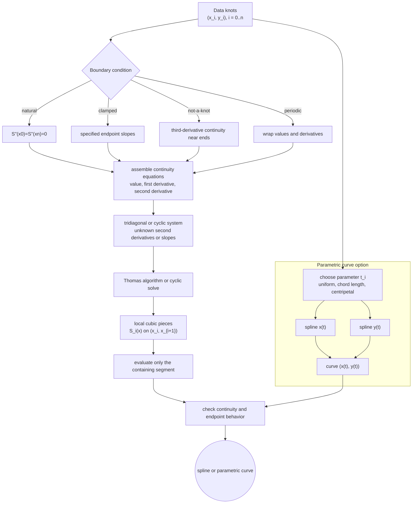

# Cubic Splines and Parametric Curves

Cubic splines replace one high-degree interpolating polynomial by many low-degree pieces joined smoothly. This gives the local flexibility of piecewise approximation while preserving enough smoothness for plotting, differentiation, and physical modeling. The result is usually more stable and visually reasonable than forcing a single polynomial through many points.

Parametric curves use the same idea when the data describe a path rather than a single-valued function. Instead of writing $y=f(x)$, a curve is represented by $x=x(t)$ and $y=y(t)$. This is essential for loops, vertical tangents, closed curves, and computer graphics paths.

## Joining local cubics at the knots

Given nodes

$$
a=x_0\lt x_1\lt \cdots \lt x_n=b,
$$

a cubic spline $S$ is a function such that each restriction $S_i$ on $[x_i,x_{i+1}]$ is a cubic polynomial, $S(x_i)=f(x_i)$ at every node, and the first and second derivatives match at interior nodes:

$$
S_{i-1}'(x_i)=S_i'(x_i),\qquad S_{i-1}''(x_i)=S_i''(x_i).
$$

A **natural cubic spline** additionally satisfies

$$
S''(x_0)=0,\qquad S''(x_n)=0.
$$

A **clamped cubic spline** instead prescribes endpoint slopes $S'(x_0)$ and $S'(x_n)$. Natural conditions model a relaxed curve with zero endpoint bending, while clamped conditions are better when endpoint derivatives are known.

Counting conditions explains why two endpoint constraints are needed. There are $n$ intervals and four coefficients per cubic, hence $4n$ unknown coefficients. Interpolation at both ends of every interval gives $2n$ equations. Matching first and second derivatives at the $n-1$ interior knots gives another $2n-2$. Two degrees of freedom remain, and the boundary conditions determine them.

The word “smooth” needs qualification. A cubic spline is normally $C^2$: its value, first derivative, and second derivative are continuous. The third derivative is piecewise constant and may jump at a knot. A piecewise cubic that only matches values is not a cubic spline in the usual interpolation sense.

Natural splines have a variational characterization. Among twice-differentiable interpolants with the same nodal values, the natural cubic spline minimizes the bending energy

$$
\int_a^b(S''(x))^2\,dx.
$$

This property explains the mechanical language of a relaxed thin strip. It does not say that natural boundary conditions match the unknown function best near an endpoint; zero endpoint curvature can be a poor model when the underlying curve bends strongly there.

## Parameterizing a path

For a parametric curve, two splines are constructed using a common parameter:

$$
x=x(t),\qquad y=y(t).
$$

The parameter may be uniform, chord length, or centripetal. Chord-length parameterization often reduces artifacts when points are unevenly spaced.

For data points $\mathbf{P}_i$, the common choices are

$$
t_{i+1}=t_i+1
$$

for uniform spacing,

$$
t_{i+1}=t_i+\|\mathbf{P}_{i+1}-\mathbf{P}_i\|
$$

for chord length, and

$$
t_{i+1}=t_i+\sqrt{\|\mathbf{P}_{i+1}-\mathbf{P}_i\|}
$$

for centripetal spacing. Uniform parameters ignore geometric separation. If two consecutive data points are close while the next pair is far apart, uniform spacing can force the coordinate splines to traverse unequal distances in equal parameter time and create overshoot. Chord length is often calmer; centripetal spacing reduces the influence of a long chord further.

These parameterizations change speed, and because ordinary cubic interpolation depends on its parameter, they can also change the geometric path. Reparameterizing an already known exact curve would preserve its image, but fitting new coordinate splines after changing the node parameters is a different approximation problem.

## The tridiagonal system for second derivatives

The spline conditions lead to a tridiagonal linear system for the second derivative values $M_i=S''(x_i)$. Let $h_i=x_{i+1}-x_i$. For a natural spline, $M_0=M_n=0$, and the interior equations are

$$
h_{i-1}M_{i-1}+2(h_{i-1}+h_i)M_i+h_iM_{i+1}
=6\left(\frac{y_{i+1}-y_i}{h_i}-\frac{y_i-y_{i-1}}{h_{i-1}}\right).
$$

Once the $M_i$ are known, the spline on $[x_i,x_{i+1}]$ can be written as

$$
\begin{aligned}
S_i(x)&=\frac{M_i(x_{i+1}-x)^3}{6h_i}+\frac{M_{i+1}(x-x_i)^3}{6h_i} \\
&\quad+\left(y_i-\frac{M_i h_i^2}{6}\right)\frac{x_{i+1}-x}{h_i}
+\left(y_{i+1}-\frac{M_{i+1} h_i^2}{6}\right)\frac{x-x_i}{h_i}.
\end{aligned}
$$

The tridiagonal equation comes from first-derivative continuity. Differentiating the segment formula and evaluating from the right and left of $x_i$ gives

$$
S_{i-1}'(x_i)
=\frac{y_i-y_{i-1}}{h_{i-1}}
+\frac{h_{i-1}}6(M_{i-1}+2M_i),
$$

$$
S_i'(x_i)
=\frac{y_{i+1}-y_i}{h_i}
-\frac{h_i}6(2M_i+M_{i+1}).
$$

Equating these derivatives and multiplying by six produces

$$
h_{i-1}M_{i-1}
+2(h_{i-1}+h_i)M_i
+h_iM_{i+1}
=6\left(
\frac{y_{i+1}-y_i}{h_i}
-\frac{y_i-y_{i-1}}{h_{i-1}}
\right).
$$

Thus the right-hand side measures the change in neighboring secant slopes. If the data lie on a straight line, every secant slope agrees, the right-hand side is zero, and the natural solution has all $M_i=0$.

The tridiagonal structure is important. A spline with many knots can be built in linear time using the Thomas algorithm instead of a dense solve. For smooth $f$ and well-spaced knots, cubic splines often achieve fourth-order accuracy in function values, but endpoint behavior depends strongly on the boundary conditions.

Not-a-knot conditions require the first two cubic pieces to be restrictions of one cubic and likewise for the last two. Equivalently, the third derivative is continuous at $x_1$ and $x_{n-1}$. Many general interpolation libraries use this default because it avoids imposing an artificial zero curvature or asking for endpoint slopes.

A periodic spline requires compatible endpoint data, beginning with $y_0=y_n$, and matches first and second derivatives across the join. Its system is cyclic rather than simply tridiagonal because the first and last unknowns couple. Repeating the endpoint as a separate unrelated point is not enough to obtain a smooth closed curve.

Once coefficients are built, evaluating many query points should use a binary search or a monotone scan to find the containing interval, followed by one local cubic evaluation. Extrapolation needs an explicit policy. Extending the first or last cubic can grow rapidly; clamping to endpoint values or rejecting out-of-range queries may be safer depending on the model.

The construction can be organized as follows:



Boundary choices feed a structured continuity system, usually tridiagonal, whose solution defines one cubic per knot interval. The parametric branch splines both coordinates against a common parameter, so parameter spacing affects the resulting geometry.

| Boundary condition | Extra information | Best use | Risk |
|---|---|---|---|
| Natural | $S''(x_0)=S''(x_n)=0$ | relaxed interpolation | endpoint curvature may be wrong |
| Clamped | endpoint slopes | known derivative data | bad slopes distort the curve |
| Not-a-knot | third derivative continuity near ends | general-purpose libraries | less intuitive physically |
| Periodic | values and derivatives wrap | closed curves | requires compatible endpoints |

## Solving the only interior equation for three knots

**Problem.** Find the natural spline second derivatives for

$$
(0,0),\quad (1,1),\quad (2,0).
$$

**Method.** Here $h_0=h_1=1$ and the natural conditions are $M_0=M_2=0$.

1. The single interior equation is

$$
h_0M_0+2(h_0+h_1)M_1+h_1M_2
=6\left(\frac{0-1}{1}-\frac{1-0}{1}\right).
$$

2. Substitute $M_0=M_2=0$:

$$
4M_1=6(-1-1)=-12.
$$

3. Therefore

$$
M_1=-3.
$$

**Checked answer.** The second derivative values are

$$
M_0=0,\qquad M_1=-3,\qquad M_2=0.
$$

The negative middle value matches the visual shape: the data rise to a peak at $x=1$ and bend downward there.

## Recovering the first cubic segment

**Problem.** Use the result above to write the spline on $[0,1]$.

**Method.** Use $x_0=0$, $x_1=1$, $h_0=1$, $y_0=0$, $y_1=1$, $M_0=0$, and $M_1=-3$.

1. Substitute into the cubic spline formula:

$$
S_0(x)=\frac{0(1-x)^3}{6}+\frac{-3x^3}{6}
+\left(0-0\right)(1-x)+\left(1-\frac{-3}{6}\right)x.
$$

2. Simplify:

$$
S_0(x)=-\frac{x^3}{2}+\frac{3x}{2}.
$$

3. Check the endpoints:

$$
S_0(0)=0,
\qquad
S_0(1)=-\frac12+\frac32=1.
$$

4. Check the second derivatives:

$$
S_0''(x)=-3x,
\qquad
S_0''(0)=0,
\qquad
S_0''(1)=-3.
$$

**Checked answer.** The first segment is $S_0(x)=3x/2-x^3/2$. It matches the data and the computed second derivative values.

The second segment can be obtained without resolving the system. Use $x_1=1$, $x_2=2$, $M_1=-3$, and $M_2=0$:

$$
S_1(x)
=-\frac{(2-x)^3}{2}
+\frac32(2-x).
$$

Expanding gives

$$
S_1(x)
=\frac{x^3}{2}-3x^2+\frac{9x}{2}-1.
$$

At the join,

$$
S_0'(1)=0,
\qquad
S_1'(1)=0,
$$

and both second derivatives equal $-3$. At $x=2$, $S_1(2)=0$ and $S_1''(2)=0$, so the interpolation, joining, and natural endpoint conditions all check.

## A parametric quarter-turn through three points

Take

$$
\mathbf{P}_0=(1,0),\qquad
\mathbf{P}_1=(1,1),\qquad
\mathbf{P}_2=(0,1)
$$

with uniform parameters $t=0,1,2$. Build natural splines for $x(t)$ and $y(t)$. The second-derivative equation for the $x$ coordinates $1,1,0$ is

$$
4M_1^x
=6\bigl((0-1)-(1-1)\bigr)
=-6,
$$

so $M_1^x=-3/2$. For the $y$ coordinates $0,1,1$,

$$
4M_1^y
=6\bigl((1-1)-(1-0)\bigr)
=-6,
$$

so $M_1^y=-3/2$ as well.

On the first interval, the segment formula gives

$$
x(t)=1+\frac14t-\frac14t^3,
\qquad
y(t)=\frac54t-\frac14t^3.
$$

At $t=1/2$,

$$
x(1/2)=\frac{35}{32},
\qquad
y(1/2)=\frac{19}{32}.
$$

The fitted path overshoots to $x\gt 1$ even though all three data points lie in the unit square. Cubic coordinate interpolation does not preserve the convex hull. For shape-sensitive drawing, monotone or shape-preserving piecewise cubics may be preferable to an unconstrained natural spline.

## Derivatives, speed, and arc length

For a parametric spline $\mathbf{r}(t)=(x(t),y(t))$, the velocity is $\mathbf{r}'(t)$ and the speed is

$$
v(t)=\sqrt{x'(t)^2+y'(t)^2}.
$$

A regular curve has nonzero speed. If both coordinate derivatives vanish at the same parameter, the tangent direction is undefined and the fitted curve may have a cusp or pause. Checking the coordinate splines separately does not reveal this; their derivatives must be considered together.

The arc length from $t=a$ to $t=b$ is

$$
L=\int_a^b\|\mathbf{r}'(t)\|\,dt.
$$

Although each coordinate is cubic on a segment, the speed contains a square root of a quartic and usually has no convenient elementary antiderivative. Numerical quadrature is used segment by segment. Arc-length parameterization would make speed constant, but chord-length parameters only approximate it.

Curvature in the plane is

$$
\kappa(t)
=\frac{|x'(t)y''(t)-y'(t)x''(t)|}
{(x'(t)^2+y'(t)^2)^{3/2}}.
$$

It becomes unstable when speed is near zero. A visually smooth $C^2$ coordinate spline can therefore still have undesirable curvature spikes if the parameterization nearly stops.

## Interpolation is not smoothing

An interpolating spline passes through every data point. If observations contain noise, exact interpolation reproduces that noise and can create rapid local bending. A smoothing spline balances data misfit against bending:

$$
\sum_i(y_i-S(x_i))^2
+\lambda\int_a^b(S''(x))^2\,dx.
$$

At $\lambda=0$ the fit interpolates. As $\lambda$ grows, curvature is penalized more strongly and the result approaches a least-squares straight line. Choosing $\lambda$ is a statistical modeling decision, often based on validation or a noise model. It should not be confused with choosing natural versus clamped endpoint conditions.

Repeated measurements at the same $x$ are impossible for ordinary function interpolation when their $y$ values disagree. They can be averaged, handled in a smoothing or regression model, or represented parametrically if they occur at different points along a path. Simply perturbing duplicate knots to make them distinct creates very small intervals and poor conditioning.

## Preserving shape instead of second derivatives

Cubic splines can overshoot between monotone data values. The continuity conditions control derivatives across knots but do not enforce monotonicity or positivity. In tabulated cumulative probabilities, concentrations, or calibration curves, an overshoot may violate the meaning of the data.

Shape-preserving piecewise cubic Hermite methods choose knot slopes subject to monotonicity constraints. They are usually only $C^1$, sacrificing continuous second derivatives to prevent new extrema. Neither method dominates: a natural cubic spline is appropriate when smooth curvature is central, while a monotone Hermite interpolant is better when range and order constraints must hold.

Convexity also needs separate constraints. Positive second differences in the data do not guarantee that an unconstrained cubic spline remains convex on every interval. Checking a spline's derivative polynomial on each segment can locate extrema or curvature sign changes exactly enough for validation.

## Solving the structured system carefully

The natural-spline matrix is symmetric, strictly diagonally dominant for positive interval widths, and positive definite after the boundary values are handled. These properties support stable linear-time solution. A Thomas algorithm modifies diagonal and right-hand-side entries in place; overwriting the original data is efficient but makes later diagnostics harder unless copies are kept.

Widely varying interval lengths can produce scaling issues. Normalizing the independent variable to a moderate range improves coefficient magnitudes without changing the geometric interpolant after mapping back. Polynomial coefficients should be evaluated in local coordinates such as $x-x_i$, not expanded into large global powers, because local coordinates reduce cancellation.

For many data channels sampled at the same knots, the spline matrix is shared. Factor it once and solve with a separate right-hand side for each channel. Parametric curves use exactly this opportunity: $x(t)$ and $y(t)$ have the same system matrix when their parameter knots and boundary-condition types match.

## Building and evaluating a natural spline

```python
import numpy as np

def natural_spline_second_derivatives(xs, ys):
    xs = np.asarray(xs, dtype=float)
    ys = np.asarray(ys, dtype=float)
    n = len(xs) - 1
    h = np.diff(xs)
    A = np.zeros((n + 1, n + 1))
    rhs = np.zeros(n + 1)
    A[0, 0] = 1.0
    A[n, n] = 1.0
    for i in range(1, n):
        A[i, i - 1] = h[i - 1]
        A[i, i] = 2.0 * (h[i - 1] + h[i])
        A[i, i + 1] = h[i]
        rhs[i] = 6.0 * ((ys[i + 1] - ys[i]) / h[i]
                        - (ys[i] - ys[i - 1]) / h[i - 1])
    return np.linalg.solve(A, rhs)

def spline_eval(xs, ys, M, x):
    xs = np.asarray(xs, dtype=float)
    ys = np.asarray(ys, dtype=float)
    i = np.searchsorted(xs, x) - 1
    i = min(max(i, 0), len(xs) - 2)
    h = xs[i + 1] - xs[i]
    left = xs[i + 1] - x
    right = x - xs[i]
    return (M[i] * left**3 / (6 * h) + M[i + 1] * right**3 / (6 * h)
            + (ys[i] - M[i] * h * h / 6) * left / h
            + (ys[i + 1] - M[i + 1] * h * h / 6) * right / h)

xs = [0.0, 1.0, 2.0]
ys = [0.0, 1.0, 0.0]
M = natural_spline_second_derivatives(xs, ys)
print(M)
print(spline_eval(xs, ys, M, 0.5))
```

## Boundary choices and geometric artifacts

- Using a single high-degree polynomial where a spline is intended. The local nature of splines is the main benefit.
- Forgetting boundary conditions. Function values and smooth joining are not enough to determine a unique cubic spline.
- Assuming natural endpoints are always best. If endpoint slopes are known, clamped conditions may be more accurate.
- Parameterizing a curve uniformly when points are very unevenly spaced. Chord-length parameters often behave better.
- Solving the tridiagonal spline system as a dense system for large data sets.

Repeated or nearly repeated knots are another failure mode. Every interval width $h_i$ must be positive, and very small widths produce poorly scaled secant slopes and system coefficients. Sorting points by the independent variable is valid for function interpolation, but it can destroy the intended order of a parametric path; path data must retain their traversal order and receive a separate parameter.

Endpoint extrapolation deserves a separate decision from interpolation. The last cubic segment can bend sharply once it leaves the data range even when the fitted interval looks harmless. A linear continuation using the endpoint slope, a constant continuation, or no extrapolation may better reflect the model. Software should not silently choose among these meanings.

For closed parametric data, the first point is often repeated at the end only to express topology. Duplicate parameter values are still invalid. Assign the repeated endpoint a new final parameter and use periodic boundary conditions so value and derivatives join across the seam.

Knot insertion can subdivide an existing spline representation without changing its curve when a suitable spline basis is used. Re-interpolating with an added data point is a different operation and can change every segment because the global continuity system changes. That distinction matters in interactive editing: refining the representation should not unexpectedly alter the shape, while adding a new constraint is expected to do so.

<div className="see-also">

See also: [divided differences and Hermite interpolation](/math/numerical-analysis/divided-differences-hermite) · [Lagrange interpolation and Neville method](/math/numerical-analysis/interpolation-lagrange-neville) · [matrix factorizations and special systems](/math/numerical-analysis/matrix-factorizations-special-systems) · [finite difference methods for PDEs](/math/numerical-analysis/finite-difference-pdes)

</div>
