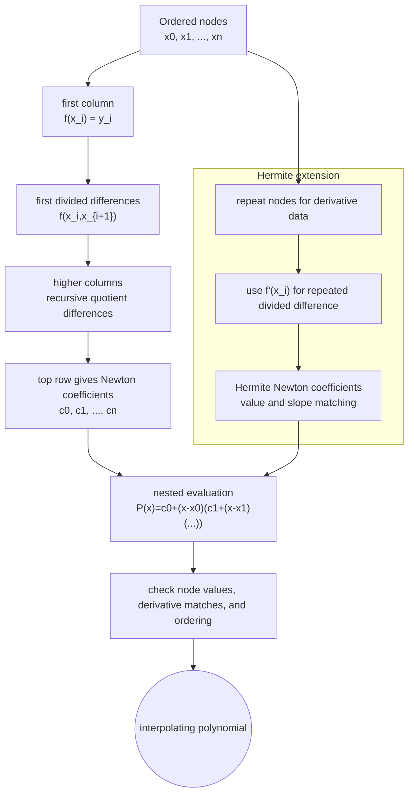

# Divided Differences and Hermite Interpolation

Divided differences reorganize polynomial interpolation so that new data can be added without rebuilding the entire polynomial. Instead of writing the interpolant in the Lagrange basis, the Newton form writes it as a nested polynomial whose coefficients are computed from a triangular table. This is especially convenient for hand computation, incremental data, and error analysis.

Hermite interpolation extends the same idea to derivative data. A Hermite polynomial can match both function values and derivative values at selected nodes, so it captures local slope as well as height. This makes it a natural bridge from ordinary interpolation to cubic splines, finite elements, and high-order initial-value methods.

## Building the Newton table

The first divided difference through two nodes is

$$
f[x_i,x_j]=\frac{f(x_j)-f(x_i)}{x_j-x_i}.
$$

Higher divided differences are defined recursively by

$$
f[x_i,\ldots,x_{i+k}]
=\frac{f[x_{i+1},\ldots,x_{i+k}]-f[x_i,\ldots,x_{i+k-1}]}{x_{i+k}-x_i}.
$$

The Newton interpolating polynomial through distinct nodes $x_0,\ldots,x_n$ is

$$
P_n(x)=f[x_0]+f[x_0,x_1](x-x_0)+\cdots+f[x_0,\ldots,x_n]\prod_{j=0}^{n-1}(x-x_j).
$$

The triangular construction follows from adding one node at a time. Suppose $P_{k-1}$ already interpolates $x_0,\ldots,x_{k-1}$. Any degree-$k$ extension that leaves those values unchanged must have the form

$$
P_k(x)=P_{k-1}(x)+c_k\prod_{j=0}^{k-1}(x-x_j),
$$

because the added term vanishes at every old node. Enforcing $P_k(x_k)=f(x_k)$ determines a unique $c_k$. The recursive divided-difference formula evaluates this coefficient efficiently, and one obtains

$$
c_k=f[x_0,\ldots,x_k].
$$

This argument also proves uniqueness. If two degree-at-most-$n$ polynomials interpolate the same $n+1$ distinct nodes, their difference has $n+1$ roots but degree at most $n$, so it must be the zero polynomial.

Divided differences generalize derivatives. The mean value theorem gives

$$
f[x_0,x_1]=f'(\xi)
$$

for some $\xi$ between the nodes. More generally, if $f$ is $k$ times differentiable, then

$$
f[x_0,\ldots,x_k]
=\frac{f^{(k)}(\xi)}{k!}
$$

for some $\xi$ in the smallest interval containing the nodes. As nodes coalesce, the divided difference tends to the corresponding derivative divided by a factorial.

## Repeated nodes carry derivative data

Hermite interpolation allows repeated nodes. If a node $x_i$ is repeated to encode derivative information, then the divided difference involving identical nodes is interpreted by a derivative, for example

$$
f[x_i,x_i]=f'(x_i).
$$

Higher multiplicities use

$$
f[\underbrace{x_i,\ldots,x_i}_{k+1\text{ copies}}]
=\frac{f^{(k)}(x_i)}{k!}.
$$

These are called confluent divided differences. Repetition is an algebraic convention for inserting derivative conditions; a direct use of the ordinary quotient would divide by zero.

A first-derivative Hermite interpolant through $m$ nodes has $2m$ conditions: $H(x_i)=f(x_i)$ and $H'(x_i)=f'(x_i)$. The resulting polynomial has degree at most $2m-1$.

There is also a direct Hermite basis for first-derivative data. Let $\ell_i(x)$ be the Lagrange cardinal polynomial, so $\ell_i(x_j)=\delta_{ij}$. Define

$$
h_i(x)
=\left(1-2\ell_i'(x_i)(x-x_i)\right)\ell_i(x)^2,
$$

$$
k_i(x)=(x-x_i)\ell_i(x)^2.
$$

Then $h_i$ has value one and derivative zero at $x_i$, while $k_i$ has value zero and derivative one there; both vanish with zero derivative at the other nodes. Hence

$$
H(x)=\sum_i f(x_i)h_i(x)+\sum_i f'(x_i)k_i(x).
$$

This form proves existence directly. The confluent Newton form is usually better for incremental construction, while the basis form exposes how each value and slope contributes.

## Extending the polynomial and tracking its error

The Newton form is algebraically the same interpolating polynomial as the Lagrange form, but it is organized for extension. If a new node $x_{n+1}$ is added, the previous polynomial $P_n$ remains intact and only one new term is appended:

$$
P_{n+1}(x)=P_n(x)+f[x_0,\ldots,x_{n+1}]\prod_{j=0}^{n}(x-x_j).
$$

The interpolation error for distinct nodes is

$$
f(x)-P_n(x)=\frac{f^{(n+1)}(\xi)}{(n+1)!}\prod_{j=0}^{n}(x-x_j).
$$

A standard proof fixes the evaluation point $x$ and introduces

$$
g(t)=f(t)-P_n(t)-C\prod_{j=0}^n(t-x_j),
$$

where $C$ is chosen so that $g(x)=0$. The function $g$ vanishes at every interpolation node and at $x$. Repeated applications of Rolle's theorem produce a point $\xi$ where $g^{(n+1)}(\xi)=0$. Since $P_n^{(n+1)}=0$ and the nodal product has derivative $(n+1)!$ at that order, solving for $C$ gives the error formula.

For Hermite interpolation with each node repeated twice, the product has squared factors:

$$
f(x)-H(x)=\frac{f^{(2m)}(\xi)}{(2m)!}\prod_{j=0}^{m-1}(x-x_j)^2.
$$

The squared factors explain the improved local behavior near a Hermite node: the polynomial passes through the point with the prescribed tangent. High-degree Hermite interpolation can still oscillate, and derivative data are often noisier than function values.

The error formula separates two design questions. The derivative factor describes the function; the nodal product describes the node placement. Equally spaced nodes over a long interval can make the product large near the ends, producing Runge-type oscillation even when all data are exact. Chebyshev-like nodes reduce the maximum product. If data arrive at fixed locations, piecewise interpolation or splines are often safer than raising the global degree.

Node ordering changes the Newton coefficients and intermediate products but not the exact interpolating polynomial. In floating-point arithmetic, it can change rounding error. Keeping nearby nodes together during incremental evaluation often reduces large intermediate factors. The barycentric Lagrange form is generally preferred when the same fixed interpolant will be evaluated many times; Newton form remains convenient when nodes are appended.

The table columns and evaluation flow line up directly:

| Divided-difference table | Column meaning | Used in Newton polynomial |
|---|---|---|
| $f[x_0]$ | function value | coefficient of $1$ |
| $f[x_0,x_1]$ | first divided difference | coefficient of $(x-x_0)$ |
| $f[x_0,x_1,x_2]$ | second divided difference | coefficient of $(x-x_0)(x-x_1)$ |
| $f[x_0,\ldots,x_n]$ | highest listed difference | coefficient of full product |



Ordered nodes fill the value column, recursive differences fill higher columns, and the top row becomes the Newton-form coefficients. Repeated nodes and derivative values fit into the same table. Node ordering and repeated-node handling determine the polynomial being built, so both belong in the verification record.

## A divided-difference table that collapses to a line

**Problem.** Construct the interpolating polynomial for

$$
(1,0),\quad (2,1),\quad (4,3).
$$

**Method.** Build the divided-difference table.

1. Zeroth differences are the function values:

$$
f[1]=0,\qquad f[2]=1,\qquad f[4]=3.
$$

2. First differences:

$$
f[1,2]=\frac{1-0}{2-1}=1,
\qquad
f[2,4]=\frac{3-1}{4-2}=1.
$$

3. Second difference:

$$
f[1,2,4]=\frac{f[2,4]-f[1,2]}{4-1}=\frac{1-1}{3}=0.
$$

4. Newton form:

$$
P_2(x)=0+1(x-1)+0(x-1)(x-2)=x-1.
$$

**Checked answer.** The three points all lie on the line $y=x-1$, so the second divided difference is zero and the interpolant is $P_2(x)=x-1$.

## Four value-and-slope conditions determine a cubic

**Problem.** Find the cubic $H(x)=a+bx+cx^2+dx^3$ satisfying

$$
H(0)=1,\quad H'(0)=0,\quad H(1)=2,\quad H'(1)=3.
$$

**Method.** Translate the four Hermite conditions into equations for the coefficients.

1. From $H(0)=1$, get $a=1$.

2. Since $H'(x)=b+2cx+3dx^2$, the condition $H'(0)=0$ gives $b=0$.

3. Use $H(1)=2$:

$$
1+0+c+d=2,\qquad c+d=1.
$$

4. Use $H'(1)=3$:

$$
0+2c+3d=3.
$$

5. Solve the two-by-two system. From $c=1-d$,

$$
2(1-d)+3d=3 \quad \Rightarrow \quad d=1,
$$

and therefore $c=0$.

**Checked answer.** The Hermite interpolant is

$$
H(x)=1+x^3.
$$

It satisfies $H(0)=1$, $H'(0)=0$, $H(1)=2$, and $H'(1)=3$ exactly.

The same result can be obtained from a confluent divided-difference table. Repeat each node:

$$
z_0=0,\quad z_1=0,\quad z_2=1,\quad z_3=1.
$$

The value column is

$$
f[z_0]=1,\quad f[z_1]=1,\quad f[z_2]=2,\quad f[z_3]=2.
$$

At repeated nodes, insert the slopes:

$$
f[z_0,z_1]=f'(0)=0,
\qquad
f[z_2,z_3]=f'(1)=3.
$$

The remaining first difference is

$$
f[z_1,z_2]=\frac{2-1}{1-0}=1.
$$

Second differences are

$$
f[z_0,z_1,z_2]
=\frac{1-0}{1-0}=1,
$$

$$
f[z_1,z_2,z_3]
=\frac{3-1}{1-0}=2.
$$

The third difference is

$$
f[z_0,z_1,z_2,z_3]
=\frac{2-1}{1-0}=1.
$$

Reading the top diagonal gives the Newton coefficients $1,0,1,1$:

$$
\begin{aligned}
H(x)
&=1+0(x-0)+1(x-0)^2\\
&\quad+1(x-0)^2(x-1)\\
&=1+x^3.
\end{aligned}
$$

The repeated factors encode the value and tangent agreement at zero without requiring an expanded monomial solve.

## Reading a table without expanding the polynomial

A divided-difference table is triangular because a difference of order $k$ needs $k+1$ consecutive nodes. Depending on layout, Newton coefficients appear on the top edge or the main diagonal. Before copying coefficients from a source, check its node order and table convention; formulas that look different may encode the same polynomial from opposite ends.

Vanishing higher differences reveal low polynomial degree. If all second differences are zero, the data lie on a line. If all third differences are zero, they lie on a quadratic, assuming distinct nodes and exact arithmetic. With rounded data, the entries will be small rather than exactly zero, so their size should be compared with the data scale.

Adding a new node appends one coefficient, but changing an old data value affects a whole triangular region of the table. Newton form is incremental in the nodes, not immune to revised data. If observations are corrected frequently, rebuilding the $O(n^2)$ table may be simpler than maintaining complicated updates.

Divided differences can suffer cancellation when nodes are close and function values nearly equal. The quotient subtracts similar numbers and divides by a small spacing. If derivatives are available analytically, a Taylor or Hermite formulation may retain more information. If values come from measurement, the large divided difference may reflect amplified noise rather than true high curvature.

## Local cubic Hermite interpolation

Global Hermite interpolation uses all values and slopes in one high-degree polynomial. A common alternative treats each interval independently with a cubic determined by its two endpoint values and slopes. On $[x_i,x_{i+1}]$, put

$$
s=\frac{x-x_i}{h_i},
\qquad h_i=x_{i+1}-x_i.
$$

Then

$$
\begin{aligned}
H_i(x)
&=(2s^3-3s^2+1)y_i
+(s^3-2s^2+s)h_im_i\\
&\quad+(-2s^3+3s^2)y_{i+1}
+(s^3-s^2)h_im_{i+1},
\end{aligned}
$$

where $m_i$ and $m_{i+1}$ are endpoint slopes. The four basis functions are chosen so that value and derivative conditions hold at $s=0$ and $s=1$.

Adjacent pieces share the same knot value and slope, so the result is $C^1$. Second derivatives generally jump. Compared with a cubic spline, local Hermite interpolation gives direct control of slopes and local edits affect only neighboring intervals. A spline instead chooses slopes or second derivatives globally to obtain $C^2$ continuity.

If slopes are not given, they must be estimated. Centered differences are simple but can overshoot monotone data. Shape-preserving algorithms limit slopes according to neighboring secants. Once slopes are estimated, their uncertainty becomes part of the interpolation error; the exact Hermite remainder assumes exact derivative data from a smooth function.

## Choosing an interpolation representation

Lagrange, Newton, and monomial forms describe the same unique polynomial for distinct nodes. They differ in construction and evaluation. Lagrange cardinal functions show how each data value contributes. Newton form supports appended nodes and nested evaluation. Monomial coefficients are convenient for symbolic integration or differentiation but are often the least stable numerical representation.

For fixed nodes and many changing data vectors, barycentric interpolation is attractive because its node-dependent weights can be precomputed. For sequentially arriving nodes, divided differences fit the workflow. For many nodes on a wide interval, piecewise methods avoid high global degree. Representation choice should follow how the data change and which operations are repeated.

Extrapolation is hazardous in every form. Outside the node interval, the nodal product grows and the highest-degree coefficient eventually dominates. Matching values and derivatives inside the interval does not validate the polynomial outside it. A model-based asymptotic formula or a lower-degree fit is usually more defensible for extrapolation.

The interpolation remainder is also not an a posteriori error estimate because it contains an unknown derivative at an unknown point. It gives a theoretical bound when a derivative bound is available. Comparing degrees or node sets can provide evidence, but two interpolants may agree because both share the same bias. Independent information about smoothness remains important.

## Incremental coefficients and nested evaluation

```python
import numpy as np

def divided_difference_coefficients(xs, ys):
    xs = np.asarray(xs, dtype=float)
    coeffs = np.asarray(ys, dtype=float).copy()
    n = len(xs)
    for level in range(1, n):
        for i in range(n - 1, level - 1, -1):
            coeffs[i] = (coeffs[i] - coeffs[i - 1]) / (xs[i] - xs[i - level])
    return coeffs

def newton_eval(xs, coeffs, x):
    value = coeffs[-1]
    for k in range(len(coeffs) - 2, -1, -1):
        value = value * (x - xs[k]) + coeffs[k]
    return value

def cubic_hermite_coefficients(f0, fp0, f1, fp1):
    # H(x)=a+b*x+c*x**2+d*x**3 on [0,1]
    a = f0
    b = fp0
    rhs1 = f1 - a - b
    rhs2 = fp1 - b
    d = rhs2 - 2 * rhs1
    c = rhs1 - d
    return np.array([a, b, c, d], dtype=float)

xs = [1.0, 2.0, 4.0]
ys = [0.0, 1.0, 3.0]
coeffs = divided_difference_coefficients(xs, ys)
print(coeffs)
print(newton_eval(xs, coeffs, 3.0))
print(cubic_hermite_coefficients(1.0, 0.0, 2.0, 3.0))
```

The coefficient routine above assumes distinct nodes. Passing repeated Hermite nodes to it would divide by zero because it has no derivative-data interface. A confluent-table implementation must detect a repeated-node entry and insert the appropriate derivative divided by its factorial. Keeping these two APIs separate is often clearer than overloading one array of values with hidden conventions.

## Ordering, repeated nodes, and noisy slopes

- Mixing the order of nodes after building the divided-difference table. The coefficients depend on the listed order.
- Treating repeated Hermite nodes like ordinary distinct nodes. Repeated-node entries require derivative values.
- Expanding the Newton polynomial too early. Nested evaluation is usually more stable and cheaper.
- Assuming derivative data are exact. Measured slopes can amplify noise more than measured function values.
- Using a high-degree Hermite polynomial over a wide interval when piecewise Hermite or splines would be safer.

Nested Newton evaluation is a generalized Horner scheme. For coefficients $c_0,\ldots,c_n$ it rewrites

$$
P_n(x)
=c_0+(x-x_0)\left(
c_1+(x-x_1)\left(
\cdots+(x-x_{n-1})c_n
\right)\right).
$$

It needs $n$ multiplications and $n$ additions after the shifted factors are formed, whereas expanding to monomials adds work and often worsens cancellation. The divided-difference table itself should still be treated as preprocessing; recomputing it for every evaluation discards Newton form's main computational advantage.

Differentiating a Newton-form polynomial is possible without expansion by carrying the derivative alongside the nested value. At each nested step, apply the product rule to the accumulated expression. This paired recurrence costs linear time and is useful when an interpolated value and slope are both needed.

Integrating the Newton form term by term is less convenient because each basis term is a growing product of shifted factors. For repeated definite integrals, converting once to a piecewise representation or precomputing antiderivatives may be worthwhile. The best representation can therefore change after construction.

Exact arithmetic examples can hide the effect of data precision. Interpolating rounded decimal values produces a polynomial that matches those rounded values exactly, not the unknown underlying function. Reporting many digits from the polynomial does not recover digits absent from the data. Derivative matching makes this issue sharper because slope errors influence the curve between nodes even when every listed value is reproduced.

Permutation of distinct nodes leaves the exact interpolant unchanged, but it changes which partial interpolants appear during incremental construction. If intermediate polynomials are themselves reported or used before all data arrive, ordering becomes part of the algorithmic result. A sequence that alternates across the interval often controls product growth better than marching monotonically from one endpoint.

<div className="see-also">

See also: [Lagrange interpolation and Neville method](/math/numerical-analysis/interpolation-lagrange-neville) · [cubic splines and parametric curves](/math/numerical-analysis/cubic-splines-parametric-curves) · [numerical differentiation and Richardson extrapolation](/math/numerical-analysis/numerical-differentiation-richardson) · [least squares and Chebyshev approximation](/math/numerical-analysis/least-squares-chebyshev-approximation)

</div>
