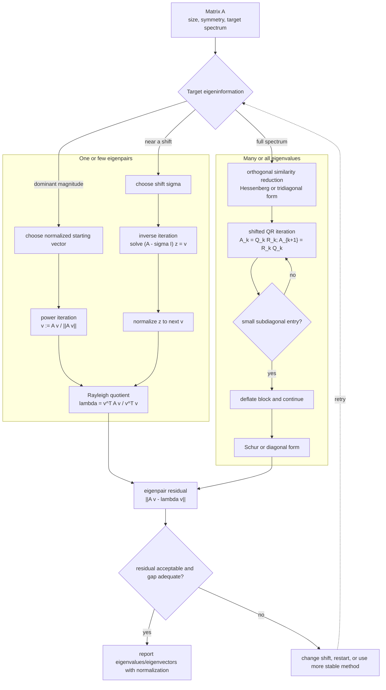

# Eigenvalue Methods

Eigenvalue algorithms approximate scalars and vectors satisfying $Av=\lambda v$. They are central because eigenvalues describe stability, vibration modes, principal components, graph connectivity, and convergence rates of iterative methods. Numerical eigenvalue methods are built from the same matrix transformations used in linear systems, but their goal is spectral information rather than a solution to one right-hand side.

The power method finds a dominant eigenvalue. Inverse iteration targets an eigenvalue near a shift. Householder reductions and QR iteration form the backbone of dense eigenvalue software. The algorithms differ in scope, but they all try to reveal eigenvalues while controlling the effect of roundoff.

There are really two numerical problems hiding under the same notation. One may want a few eigenpairs of a very large sparse matrix, in which case storing or factorizing the whole matrix may be impossible. Or one may want the complete spectrum of a dense matrix, in which case an initial reduction followed by QR iteration is usually the right model. Treating both cases as ``compute the roots of the characteristic polynomial'' is a serious mistake. Forming $det(A-\lambda I)$ magnifies rounding error, discards sparsity, and turns a structured matrix problem into an ill-conditioned polynomial root problem.

## Iterating toward one eigenpair

An **eigenpair** of $A$ is a scalar-vector pair $(\lambda,v)$ with $v\ne 0$ such that

$$
Av=\lambda v.
$$

The Rayleigh quotient of a nonzero vector $x$ is

$$
\rho(x)=\frac{x^TAx}{x^Tx}.
$$

For symmetric matrices, the Rayleigh quotient is a natural eigenvalue estimate associated with $x$.

The power method repeats

$$
y^{(k)}=Ax^{(k)},
\qquad
x^{(k+1)}=\frac{y^{(k)}}{\|y^{(k)}\|}.
$$

To see the convergence mechanism, suppose for the moment that $A$ is diagonalizable with eigenvectors $v_1,\ldots,v_n$, and order the eigenvalues so that $\vert \lambda_1\vert \gt \vert \lambda_2\vert \geq\cdots$. Expand the starting vector in that basis:

$$
x^{(0)}=c_1v_1+c_2v_2+\cdots+c_nv_n.
$$

After $k$ unnormalized steps,

$$
\begin{aligned}
A^kx^{(0)}
&=c_1\lambda_1^kv_1+\sum_{j=2}^n c_j\lambda_j^kv_j\\
&=\lambda_1^k\left(c_1v_1+
\sum_{j=2}^n c_j\left(\frac{\lambda_j}{\lambda_1}\right)^kv_j\right).
\end{aligned}
$$

Normalization removes the common factor $\lambda_1^k$. If $c_1\ne0$, every remaining ratio tends to zero, and the direction approaches $v_1$. The derivation also exposes the failure cases. An exactly orthogonal starting vector has $c_1=0$; equal dominant magnitudes prevent one direction from winning; a tiny gap makes the decay slow. With a negative dominant eigenvalue the normalized vectors alternate sign, although their one-dimensional subspace still converges.

For a symmetric matrix the eigenvectors form an orthonormal basis, so the coefficient argument is especially clean. For a defective or strongly nonnormal matrix, transient behavior can be much less orderly. Powers of a Jordan block contain polynomial factors in $k$, and nearly parallel eigenvectors can amplify perturbations even when the eigenvalues themselves look well separated.

Inverse iteration with shift $\mu$ solves

$$
(A-\mu I)y^{(k)}=x^{(k)}
$$

and normalizes $y^{(k)}$. It converges toward an eigenvector whose eigenvalue is near $\mu$ when the shifted system is well defined.

The reason follows by applying the power method to $(A-\mu I)^{-1}$. Its eigenvalues are

$$
\frac{1}{\lambda_j-\mu}.
$$

The eigenvalue nearest $\mu$ becomes largest in magnitude after inversion. One should never form the inverse explicitly. Factor $A-\mu I$ once, then reuse the factors for every solve. A shift very close to an eigenvalue makes the system ill-conditioned, but that does not automatically spoil the eigenvector iteration: the solve produces a large component in precisely the desired direction. What matters is a backward-stable linear solver and subsequent normalization.

Rayleigh quotient iteration updates the shift as well as the vector:

$$
\mu_k=\rho(x^{(k)}),\qquad
(A-\mu_k I)y^{(k)}=x^{(k)},\qquad
x^{(k+1)}=\frac{y^{(k)}}{\|y^{(k)}\|_2}.
$$

Near a simple eigenpair of a real symmetric matrix, the vector error contracts cubically. The cost is that the shift changes, so the factorization generally cannot be reused. Far from the target, the method can converge to a different eigenpair than expected; it is a local refinement method rather than a global spectrum finder.

## Transforming the whole spectrum

The QR algorithm forms

$$
A_k=Q_kR_k,
\qquad
A_{k+1}=R_kQ_k.
$$

Applied directly to a dense $n\times n$ matrix, every QR factorization costs $O(n^3)$, which is too much to repeat many times. The standard preparation is an orthogonal similarity reduction

$$
H=Q^TAQ,
$$

where $H$ is upper Hessenberg: $h_{ij}=0$ whenever $i\gt j+1$. Householder reflectors create those zeros in $O(n^3)$ work. A QR step on Hessenberg form preserves the shape and costs $O(n^2)$. If $A$ is symmetric, the reduction produces a symmetric tridiagonal matrix, and subsequent implicit QR steps are cheaper still.

A shifted QR step factors $A_k-\mu_kI=Q_kR_k$ and sets

$$
A_{k+1}=R_kQ_k+\mu_kI=Q_k^TA_kQ_k.
$$

The shift changes the convergence speed without changing the similarity argument. When a subdiagonal entry satisfies a scale-aware test such as

$$
|a_{i+1,i}|\leq \varepsilon\bigl(|a_{ii}|+|a_{i+1,i+1}|\bigr),
$$

it may be set to zero. The matrix splits into smaller blocks, a step called deflation. For a real nonsymmetric matrix, complex-conjugate eigenvalues appear as $2\times2$ blocks in the real Schur form; insisting on a real diagonal form would be impossible.

## Spectral gaps, similarity, and residuals

If $A$ has eigenvalues ordered by magnitude with

$$
|\lambda_1|\gt |\lambda_2|\ge \cdots,
$$

and the starting vector has a nonzero component in the dominant eigenvector direction, the power method converges linearly with asymptotic factor

$$
\left|\frac{\lambda_2}{\lambda_1}\right|.
$$

A small spectral gap leads to slow convergence.

QR iteration preserves eigenvalues because

$$
A_{k+1}=R_kQ_k=Q_k^TA_kQ_k,
$$

so $A_{k+1}$ is orthogonally similar to $A_k$. Orthogonal similarity is preferred because it preserves norms and is numerically stable. Practical QR algorithms first reduce a dense matrix to Hessenberg form, or to tridiagonal form in the symmetric case, and then use shifts to accelerate convergence.

For any computed eigenpair $(\hat\lambda,\hat v)$, the residual

$$
r=A\hat v-\hat\lambda\hat v
$$

is an essential diagnostic. A small residual is necessary, but eigenvalue sensitivity also depends on eigenvector conditioning, especially for nonsymmetric matrices. Rayleigh quotients and changes in invariant subspaces provide additional checks.

For symmetric $A$ and a unit vector $\hat v$, the residual gives a direct statement:

$$
\min_j|\hat\lambda-\lambda_j|\leq \|r\|_2.
$$

Thus some exact eigenvalue lies within the residual norm of the estimate. Identifying *which* eigenvalue requires separation. If $\hat\lambda$ is isolated by a gap $\delta$ from the rest of the spectrum, the angle to the corresponding eigenvector is on the order of $\|r\|_2/\delta$. A small residual beside a clustered eigenvalue may certify the invariant subspace well while leaving individual eigenvectors poorly determined.

For a nonsymmetric simple eigenvalue, let $v$ and $w$ be right and left eigenvectors, $Av=\lambda v$ and $w^TA=\lambda w^T$. Its first-order sensitivity contains

$$
\kappa(\lambda)=\frac{\|w\|_2\|v\|_2}{|w^Tv|}.
$$

When $w^Tv$ is small, a tiny matrix perturbation can move the eigenvalue far. Residual reporting remains useful, but the symmetric error bound cannot be borrowed unchanged. The Schur form is often safer than a full eigenvector decomposition because orthogonal Schur vectors stay well conditioned even when eigenvectors do not.

Cost depends on the target: matrix-vector products dominate power iterations, shifted solves dominate inverse iteration, and orthogonal reductions dominate dense full-spectrum work.

Large sparse problems add another constraint: even the Householder reduction may destroy sparsity and require too much memory. Krylov-subspace methods address that case. Starting from $x$, they build the span of $x,Ax,A^2x,\ldots$ and project $A$ onto a much smaller matrix. Arnoldi iteration handles general matrices; Lanczos iteration exploits symmetry and obtains a tridiagonal projection. Ritz values, the eigenvalues of the projection, approximate selected eigenvalues of $A$. These methods can be viewed as a careful version of the power method that retains information from earlier directions rather than normalizing everything down to one vector.

Which end of the spectrum converges first depends on the projection, restart strategy, and any spectral transformation. Shift-and-invert Arnoldi replaces multiplication by $A$ with solves involving $A-\mu I$, bringing interior eigenvalues near $\mu$ to the outside of the transformed spectrum. The factorization can dominate both memory and time, so matrix structure and available preconditioners often decide the algorithm before asymptotic convergence estimates do.

Repeated or tightly clustered eigenvalues are naturally described by an invariant subspace. If $AV=VB$ for a matrix $V$ with several columns, the span of those columns is preserved by $A$ even though the individual basis vectors are not unique. Reporting a basis for that space is more meaningful than trying to assign a reproducible eigenvector to each member of a cluster. Principal-angle or projector comparisons then give stable tests across different implementations.

Eigenvalue computations should also report normalization and phase conventions for eigenvectors. The vector $v$ and any nonzero multiple of $v$ represent the same eigenvector, so comparisons must use angles, residuals, or normalized signs rather than raw component equality. This is especially important when testing iterative methods against library routines.

## Choosing an algorithm by spectral target



Power and inverse iteration feed a Rayleigh-quotient and residual check. The QR path first reduces the matrix by similarity transformations and then deflates converged blocks. In both cases, residual size must be interpreted alongside spectral gaps and matrix conditioning.

| Method | Target | Main cost | Convergence driver | Warning |
|---|---|---|---|---|
| Power method | largest magnitude eigenvalue | matrix-vector products | $\vert \lambda_2/\lambda_1\vert $ | fails if no dominant magnitude |
| Inverse iteration | eigenvalue near shift | linear solves | closeness to shift | shifted system may be ill-conditioned |
| Rayleigh quotient iteration | symmetric eigenpair | linear solves | often cubic locally | needs good starting vector |
| QR algorithm | many eigenvalues | factorizations | similarity transformations | unshifted version can be slow |

## The first power step toward the dominant mode

**Problem.** Apply one power-method step to

$$
A=\begin{bmatrix}2&1\\1&2\end{bmatrix}
$$

from $x^{(0)}=(1,0)^T$ using the Euclidean norm.

**Method.** Multiply and normalize.

1. Compute

$$
y^{(0)}=Ax^{(0)}=\begin{bmatrix}2\\1\end{bmatrix}.
$$

2. Its norm is

$$
\|y^{(0)}\|_2=\sqrt{2^2+1^2}=\sqrt5.
$$

3. Normalize:

$$
x^{(1)}=\frac1{\sqrt5}\begin{bmatrix}2\\1\end{bmatrix}
=\begin{bmatrix}0.894427\\0.447214\end{bmatrix}.
$$

4. The Rayleigh quotient is

$$
\rho(x^{(1)})=(x^{(1)})^TAx^{(1)}=2.8.
$$

**Checked answer.** The dominant eigenvalue is $3$, with eigenvector proportional to $(1,1)^T$. The first Rayleigh estimate $2.8$ is already moving toward $3$.

Continuing one more step shows the rate rather than only the direction:

$$
Ax^{(1)}=\frac1{\sqrt5}\begin{bmatrix}5\\4\end{bmatrix},
\qquad
x^{(2)}=\frac1{\sqrt{41}}\begin{bmatrix}5\\4\end{bmatrix}.
$$

The new Rayleigh quotient is

$$
\rho(x^{(2)})=
\frac{[5\;4]\begin{bmatrix}14\\13\end{bmatrix}}{41}
=\frac{122}{41}\approx2.97561.
$$

Here the eigenvalues are $3$ and $1$, so the unwanted eigenvector component shrinks by a factor $1/3$ per multiplication. The Rayleigh quotient error decreases faster because its first-order error vanishes at a symmetric eigenvector.

## Why a QR step preserves the eigenvalues

**Problem.** For

$$
A=\begin{bmatrix}2&1\\1&2\end{bmatrix},
$$

state why a QR step preserves eigenvalues.

**Method.** Factor $A=QR$ with $Q$ orthogonal, then set $A_1=RQ$.

1. Since $A=QR$, multiply by $Q^T$ on the left:

$$
R=Q^TA.
$$

2. The next QR iterate is

$$
A_1=RQ=Q^TAQ.
$$

3. This is a similarity transformation because $Q^{-1}=Q^T$.

4. Similar matrices have the same characteristic polynomial:

$$
\det(A_1-\lambda I)=\det(Q^T(A-\lambda I)Q)=\det(A-\lambda I).
$$

**Checked answer.** A QR step changes the matrix entries but preserves the eigenvalues. Repeated shifted QR steps drive the matrix toward triangular or diagonal form where eigenvalues are visible.

## Shifted inverse iteration by hand

Consider

$$
A=\begin{bmatrix}2&1\\1&2\end{bmatrix},
\qquad \mu=1.2,
\qquad x^{(0)}=\begin{bmatrix}1\\0\end{bmatrix}.
$$

The shift is nearer the eigenvalue $1$ than the eigenvalue $3$, so inverse iteration should select the eigenvector proportional to $(1,-1)^T$. First form the shifted matrix:

$$
A-1.2I=\begin{bmatrix}0.8&1\\1&0.8\end{bmatrix}.
$$

The first solve is

$$
\begin{bmatrix}0.8&1\\1&0.8\end{bmatrix}
\begin{bmatrix}y_1\\y_2\end{bmatrix}
=\begin{bmatrix}1\\0\end{bmatrix}.
$$

From the second equation, $y_1=-0.8y_2$. Substitution into the first gives $0.36y_2=1$, hence

$$
y^{(0)}=\begin{bmatrix}-20/9\\25/9\end{bmatrix}.
$$

The overall sign is irrelevant. Normalizing with the Euclidean norm gives

$$
x^{(1)}=\frac1{\sqrt{1025}}\begin{bmatrix}-20\\25\end{bmatrix}
\approx\begin{bmatrix}-0.6247\\0.7809\end{bmatrix}.
$$

Its Rayleigh quotient can be evaluated without rounding:

$$
\rho(x^{(1)})=
\frac{[-20\;25]\begin{bmatrix}-15\\30\end{bmatrix}}{1025}
=\frac{1050}{1025}
\approx1.02439.
$$

The first estimate is already close to $1$. Under the shifted inverse, the transformed eigenvalues are

$$
\frac1{1-1.2}=-5,
\qquad
\frac1{3-1.2}=\frac59.
$$

Their magnitude ratio is $1/9$, so the unwanted component shrinks rapidly. The near singularity of $A-1.2I$ is not an accident; it creates the large spectral separation that makes the iteration effective.

There is also a useful stopping check. With $\hat\lambda=1050/1025$ and the normalized vector above, compute $r=A x^{(1)}-\hat\lambda x^{(1)}$. Its norm is about $0.2195$. That is not yet a high-accuracy eigenpair, despite the plausible eigenvalue estimate. Another solve would reduce the angular error sharply. The example shows why a rounded eigenvalue alone is a weak convergence test.

## Power iteration and a bare QR loop

```python
import numpy as np

def power_method(A, x0=None, tol=1e-12, max_iter=1000):
    A = np.asarray(A, dtype=float)
    n = A.shape[0]
    x = np.ones(n) if x0 is None else np.asarray(x0, dtype=float)
    x = x / np.linalg.norm(x)
    last = None
    for k in range(1, max_iter + 1):
        y = A @ x
        x = y / np.linalg.norm(y)
        lam = float(x @ A @ x)
        if last is not None and abs(lam - last) < tol:
            return lam, x, k
        last = lam
    return last, x, max_iter

def qr_algorithm(A, tol=1e-12, max_iter=1000):
    Ak = np.array(A, dtype=float, copy=True)
    for _ in range(max_iter):
        Q, R = np.linalg.qr(Ak)
        Ak = R @ Q
        if np.linalg.norm(np.tril(Ak, -1)) < tol:
            break
    return np.diag(Ak), Ak

A = np.array([[2.0, 1.0], [1.0, 2.0]])
print(power_method(A, [1.0, 0.0]))
print(qr_algorithm(A)[0])
```

## Residuals, shifts, and sensitive spectra

- The power method has no preferred direction when two eigenvalues share the largest magnitude. Subspace iteration or an Arnoldi/Lanczos method can retain several competing directions instead of discarding all but one.
- Stopping only because successive Rayleigh quotients are close can be misleading. A slowly changing estimate may still have a large residual, so both quantities should be checked with a tolerance scaled to $\|A\|_2$.
- Nonsymmetric spectra can be far more sensitive than symmetric spectra. A backward-stable routine can return exact eigenvalues of a nearby matrix while the forward error in the reported eigenvalues remains large.
- Unshifted QR is mainly explanatory. Dense eigensolvers use Hessenberg or tridiagonal reduction, implicit shifts, and deflation; the bare loop above should not be treated as a replacement for `numpy.linalg.eig` or LAPACK.
- Repeated inverse iterations with a fixed shift should reuse one factorization. Refactoring at every step wastes the dominant $O(n^3)$ cost.
- Eigenvectors have arbitrary sign, phase, and basis within a repeated eigenspace. Tests should compare residuals and subspace angles, not raw arrays component by component.

<div className="see-also">

See also: [ODE stability stiffness and systems](/math/numerical-analysis/ode-stability-stiffness-systems) · [conjugate gradient and iterative refinement](/math/numerical-analysis/conjugate-gradient-iterative-refinement) · [matrix factorizations and special systems](/math/numerical-analysis/matrix-factorizations-special-systems) · [least squares and Chebyshev approximation](/math/numerical-analysis/least-squares-chebyshev-approximation)

</div>
