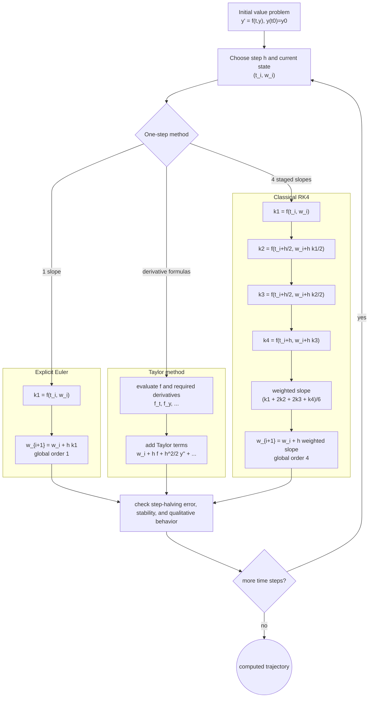

# Euler Taylor and Runge Kutta Methods

Initial-value problems ask for a function whose derivative is prescribed by an equation and whose starting value is known. Numerical ODE methods turn that continuous problem into a sequence of time steps. Euler's method is the simplest step, Taylor methods use analytic derivative information, and Runge-Kutta methods imitate Taylor accuracy using only evaluations of the right-hand side.

These methods are the foundation for later adaptive, multistep, stiff, and system solvers. The main questions are always the same: how much local error is made in one step, how does that error accumulate globally, and how many right-hand-side evaluations are worth spending per step?

## Advancing one step from slope information

An initial-value problem has the form

$$
y'=f(t,y),\qquad y(a)=\alpha.
$$

A one-step method computes approximations $w_i\approx y(t_i)$ on a grid $t_i=a+ih$. Euler's method is

$$
w_{i+1}=w_i+h f(t_i,w_i).
$$

It follows by replacing the exact integral

$$
y(t_i+h)=y(t_i)+\int_{t_i}^{t_i+h}f(s,y(s))\,ds
$$

with a left-endpoint rectangle. Geometrically, the method follows the tangent line at $(t_i,w_i)$. Analytically, Taylor's theorem gives

$$
y(t_i+h)=y(t_i)+hy'(t_i)+\frac{h^2}{2}y''(\xi_i)
$$

for some $\xi_i$ in the step. Since $y'=f(t,y)$, dropping the final term produces Euler's update and leaves a one-step defect proportional to $h^2$. This argument assumes enough smoothness for the derivative bound; a discontinuous forcing term or an event inside the step breaks that estimate.

A Taylor method of order $m$ expands the exact solution:

$$
w_{i+1}=w_i+h y'(t_i)+\frac{h^2}{2}y''(t_i)+\cdots+\frac{h^m}{m!}y^{(m)}(t_i),
$$

where the higher derivatives are rewritten using $f$ and its partial derivatives.

For example, the chain rule gives

$$
y''=\frac{d}{dt}f(t,y(t))=f_t+f_y y'=f_t+f_yf.
$$

The second-order Taylor method is therefore

$$
w_{i+1}=w_i+h f(t_i,w_i)
+\frac{h^2}{2}\left[f_t(t_i,w_i)+f_y(t_i,w_i)f(t_i,w_i)\right].
$$

Higher orders require longer chains of partial derivatives. Symbolic formulas can be efficient when $f$ has a simple special form, but they become cumbersome for large systems or code in which $f$ is supplied as a black box.

The classical fourth-order Runge-Kutta method, usually called RK4, is

$$
\begin{aligned}
k_1&=f(t_i,w_i),\\
k_2&=f(t_i+h/2,w_i+hk_1/2),\\
k_3&=f(t_i+h/2,w_i+hk_2/2),\\
k_4&=f(t_i+h,w_i+hk_3),\\
w_{i+1}&=w_i+\frac{h}{6}(k_1+2k_2+2k_3+k_4).
\end{aligned}
$$

The intermediate arguments are predicted states, not independent solution values. Each stage samples the slope at a point chosen using earlier stages. The final weights act like a high-order quadrature formula for the integral of the slope, with extra conditions because the slope depends on $y$ as well as $t$.

A two-stage example shows how the coefficients are chosen. The explicit midpoint method uses

$$
k_1=f(t_i,w_i),\qquad
k_2=f\left(t_i+\frac h2,w_i+\frac h2k_1\right),\qquad
w_{i+1}=w_i+hk_2.
$$

Expanding $k_2$ about $(t_i,w_i)$ gives

$$
k_2=f+\frac h2f_t+\frac h2f_yf+O(h^2).
$$

Multiplication by $h$ reproduces the exact Taylor expansion through the $h^2$ term. The derivatives have been matched without evaluating them explicitly. RK4 extends the idea through fourth order; its conditions include mixed and nested derivatives and are compactly organized with a Butcher tableau.

## From local truncation error to global order

Euler's method has local truncation error $O(h^2)$ and global error $O(h)$ under standard Lipschitz assumptions. RK4 has local truncation error $O(h^5)$ and global error $O(h^4)$. The difference between local and global order comes from taking about $(b-a)/h$ steps.

That counting argument omits propagation, so an error recurrence is more informative. Let $e_i=y(t_i)-w_i$. If $f$ is Lipschitz in $y$ with constant $L$, the Euler update and exact Taylor step imply

$$
|e_{i+1}|\leq(1+hL)|e_i|+Ch^2.
$$

Starting from $e_0=0$ and iterating,

$$
\begin{aligned}
|e_n|
&\leq Ch^2\sum_{j=0}^{n-1}(1+hL)^j\\
&=\frac{Ch}{L}\left((1+hL)^n-1\right)\\
&\leq\frac{Ch}{L}\left(e^{L(t_n-a)}-1\right).
\end{aligned}
$$

The global error is $O(h)$ on a fixed interval. The exponential factor is an upper stability bound, not a prediction that every problem amplifies errors at that rate. The same structure applies to order $p$: an $O(h^{p+1})$ local defect becomes $O(h^p)$ globally when perturbations remain controlled.

A one-step method is **consistent** if its local truncation error tends to zero fast enough as $h\to 0$. It is **convergent** if the numerical solution approaches the exact solution on a fixed interval as $h\to 0$. For well-posed nonstiff IVPs, consistency plus stability gives convergence.

Runge-Kutta methods can be represented by a Butcher tableau, which records the internal stages and final weights. Order conditions, embedded pairs, and stability functions are all expressed through those coefficients. RK4 is popular because it gives high accuracy for smooth nonstiff problems without requiring derivatives of $f$.

For an explicit $s$-stage method the tableau has strictly lower-triangular stage coefficients. Consistency requires $\sum_j b_j=1$. Second order additionally requires $\sum_j b_jc_j=1/2$ and $c_i=\sum_j a_{ij}$. These equations explain why one explicit stage cannot exceed first order and why several different two-stage, second-order formulas exist.

Step halving is the simplest empirical order check when the exact solution is unavailable. The computational comparison should count right-hand-side evaluations and any derivative formulas, not steps alone.

Suppose the endpoint error is $E(h)=Ch^p+O(h^{p+1})$. Then $E(h)/E(h/2)\approx2^p$. Without an exact solution, use three meshes and compare $W_h-W_{h/2}$ with $W_{h/2}-W_{h/4}$. The estimate becomes unreliable once roundoff dominates or the steps are not yet small enough to enter the asymptotic regime.

## Accuracy does not imply stability

Apply a one-step method to $y'=\lambda y$. It produces

$$
w_{n+1}=R(z)w_n,\qquad z=h\lambda,
$$

where $R$ is the stability function. Euler has $R(z)=1+z$, while RK4 has

$$
R(z)=1+z+\frac{z^2}{2}+\frac{z^3}{6}+\frac{z^4}{24}.
$$

Numerical decay agrees with exact decay only where $\vert R(z)\vert \leq1$. Along the negative real axis Euler requires $-2\leq h\lambda\leq0$. For $y'=-100y$, this means $h\leq0.02$, even if the desired output varies slowly after the initial transient.

RK4 has a larger stability region, but it remains bounded. Raising formal order does not remove the small-step restriction for stiff equations. Implicit methods are designed with different stability regions and are usually preferable when fast decaying modes force explicit steps far below the accuracy requirement.

## Comparing the work inside one step

| Method | Stages per step | Global order | Uses derivatives of $f$? | Typical role |
|---|---:|---:|---|---|
| Euler | 1 | 1 | no | teaching, rough predictor |
| Taylor order 2 | 1 plus derivative formulas | 2 | yes | analysis and special problems |
| Midpoint RK | 2 | 2 | no | cheap improvement over Euler |
| Classical RK4 | 4 | 4 | no | reliable fixed-step baseline |



Euler uses one slope, Taylor methods add analytic derivatives, and RK4 combines four staged slopes. A trajectory that looks smooth still needs a step-halving, stability, or qualitative check.

## Two Euler steps and their accumulated error

**Problem.** Apply Euler's method with $h=0.5$ to

$$
y'=y-t^2+1,
\qquad y(0)=0.5,
$$

through $t=1$.

**Method.** Use $w_{i+1}=w_i+h(w_i-t_i^2+1)$.

1. At $t_0=0$, $w_0=0.5$:

$$
f(0,0.5)=0.5-0+1=1.5.
$$

$$
w_1=0.5+0.5(1.5)=1.25.
$$

2. At $t_1=0.5$, $w_1=1.25$:

$$
f(0.5,1.25)=1.25-0.25+1=2.0.
$$

$$
w_2=1.25+0.5(2.0)=2.25.
$$

3. The exact solution is

$$
y(t)=(t+1)^2-\frac12e^t.
$$

At $t=1$,

$$
y(1)=4-\frac12e=2.640859\ldots.
$$

**Checked answer.** Euler's approximation at $t=1$ is $2.25$, with absolute error about $0.390859$.

## Four staged slopes over the same interval

**Problem.** Use one RK4 step of size $h=0.5$ for the same IVP from $t=0$ to $t=0.5$.

**Method.** Use $f(t,y)=y-t^2+1$ and $w_0=0.5$.

1. Stage values:

$$
k_1=f(0,0.5)=1.5.
$$

$$
k_2=f(0.25,0.5+0.25k_1)=f(0.25,0.875)=1.8125.
$$

$$
k_3=f(0.25,0.5+0.25k_2)=f(0.25,0.953125)=1.890625.
$$

$$
k_4=f(0.5,0.5+0.5k_3)=f(0.5,1.4453125)=2.1953125.
$$

2. Combine stages:

$$
w_1=0.5+\frac{0.5}{6}(1.5+2(1.8125)+2(1.890625)+2.1953125).
$$

3. Therefore

$$
w_1=1.4251302083\ldots.
$$

**Checked answer.** The exact value is $y(0.5)=2.25-0.5e^{0.5}=1.425639364\ldots$, so the one-step RK4 error is about $5.09\times 10^{-4}$.

## Fixed-step Euler and RK4 routines

```python
import math

def euler(f, a, b, alpha, n):
    h = (b - a) / n
    t = a
    w = alpha
    values = [(t, w)]
    for _ in range(n):
        w = w + h * f(t, w)
        t = t + h
        values.append((t, w))
    return values

def rk4(f, a, b, alpha, n):
    h = (b - a) / n
    t = a
    w = alpha
    values = [(t, w)]
    for _ in range(n):
        k1 = f(t, w)
        k2 = f(t + h / 2, w + h * k1 / 2)
        k3 = f(t + h / 2, w + h * k2 / 2)
        k4 = f(t + h, w + h * k3)
        w = w + h * (k1 + 2*k2 + 2*k3 + k4) / 6
        t = t + h
        values.append((t, w))
    return values

f = lambda t, y: y - t*t + 1
exact = lambda t: (t + 1)**2 - 0.5 * math.exp(t)
for t, w in rk4(f, 0.0, 2.0, 0.5, 10):
    print(t, w, exact(t), abs(w - exact(t)))
```

## Two second-order routes

The explicit midpoint method is not the only two-stage, second-order formula. Heun's method first predicts with Euler and then averages the starting and predicted slopes:

$$
k_1=f(t_n,w_n),\qquad
k_2=f(t_n+h,w_n+hk_1),\qquad
w_{n+1}=w_n+\frac h2(k_1+k_2).
$$

For the earlier equation $f(t,y)=y-t^2+1$, start from $t_0=0$, $w_0=0.5$, and take $h=0.5$. The first slope is $k_1=1.5$, so the Euler predictor at $t=0.5$ is $0.5+0.5(1.5)=1.25$. The endpoint slope is

$$
k_2=f(0.5,1.25)=2.
$$

Heun's correction gives

$$
w_1=0.5+\frac{0.5}{2}(1.5+2)=1.375.
$$

The exact value $1.425639\ldots$ leaves error about $0.05064$. Explicit midpoint instead samples at the predicted half-step. Its midpoint state is $0.5+0.25(1.5)=0.875$, its midpoint slope is $1.8125$, and its update is

$$
w_1=0.5+0.5(1.8125)=1.40625.
$$

Both formulas have global order two, yet their errors at a fixed coarse step differ. Order describes the asymptotic power of $h$, not the error constant or performance on every equation.

The second-order Taylor method uses $f_t=-2t$, $f_y=1$, and $f=y-t^2+1$. At the initial point, $y''=f_t+f_yf=1.5$. It therefore gives

$$
w_1=0.5+0.5(1.5)+\frac{0.5^2}{2}(1.5)=1.4375.
$$

This value is closer than either displayed RK2 result for this step, but it relied on a derivative formula specialized to the equation. A different problem changes that formula, while the Runge--Kutta code changes only the supplied function.

## Systems, autonomous form, and qualitative checks

All formulas extend componentwise to a vector state $y\in\mathbb R^d$. Each $k_i$ becomes a vector, and the right-hand side can couple every component. A higher-order scalar equation is first rewritten as a first-order system. For example, $u''+u=0$ becomes $y_1'=y_2$, $y_2'=-y_1$. No new RK coefficients are needed.

Time dependence can be absorbed into the state by adjoining $y_{d+1}=t$ with derivative $1$. This autonomous representation is useful in theory, though implementations normally pass time separately. It also emphasizes that stage times and stage states must use the same tableau; mixing an endpoint time with a midpoint state silently defines another method.

Formal convergence does not guarantee preservation of qualitative structure at coarse steps. The harmonic oscillator conserves $y_1^2+y_2^2$, but explicit Euler multiplies its energy by $1+h^2$ each step and creates artificial growth. RK4 controls that drift far better for modest steps, but it is not exactly energy preserving. Long-time Hamiltonian simulations often use symplectic methods whose geometric behavior matters more than high local order.

Positivity is another constraint. Euler applied to a decaying population may produce a negative value if the step is too large, even while a later value would be algebraically computable. State constraints, invariant regions, and conservation laws should be checked independently of the endpoint error estimate.

## Where formal order stops helping

- A local truncation error is the defect made when a step starts from the exact value. The global error contains all earlier defects after the dynamics have propagated them.
- RK4 can be unstable on a stiff equation even when its truncation-error formula looks excellent. Its stability polynomial must still contain $h\lambda$ for every relevant mode.
- Taylor methods shift work into analytic or automatic derivatives. Counting one Taylor update as one function evaluation hides that cost.
- Equal step sizes are not equal budgets. One RK4 step uses four evaluations, while an implicit step may use nonlinear iterations and matrix factorizations.
- A state discontinuity, switched forcing, or event inside a step invalidates the smooth Taylor model. Locate the event, stop there, update the state, and restart the integrator.
- Very small steps eventually expose cancellation and accumulated roundoff. Step halving should reveal the expected order before that regime, not continue indefinitely.

## Choosing a fixed step deliberately

A fixed-step computation should state how $h$ was selected. One route is a refinement table: compute the quantity of interest with $h$, $h/2$, and $h/4$, then verify that successive differences shrink by the expected factor. For RK4, a factor near sixteen supports fourth-order behavior. If the ratio is erratic, the step may be too large, roundoff may dominate, or the solution may lack the assumed smoothness.

Error at one endpoint does not control the entire path. A trajectory used for peak detection, threshold crossing, or accumulated cost needs checks at the relevant times. Dense output formulas interpolate between accepted steps using stage data; plain linear interpolation can lower the effective order even when step endpoints are accurate.

Roundoff sets a lower limit on useful $h$. More steps mean more additions of small increments and more function evaluations. On Euler's method, reducing $h$ initially lowers truncation error linearly, but eventually accumulated floating-point error stops the improvement. Higher-order methods often reach a target tolerance before that regime because they need fewer steps.

Discontinuous right-hand sides should be split at known breakpoints. If a forcing changes at $t=1$, integrate exactly to $1$, apply any state update, and restart. Letting one RK step straddle the jump asks a smooth polynomial construction to approximate a nonsmooth integral and can spoil the nominal order over that step.

Finally, reproducibility requires the time grid convention. Repeatedly adding a floating-point $h$ can miss the requested endpoint; computing $t_i=a+ih$ or adjusting the final step avoids ambiguity. The short routines above choose $h=(b-a)/n$, so the endpoint is part of the design rather than a stopping accident.

Function evaluation counts also need context. If evaluating $f$ requires a matrix factorization, an optimization solve, or an expensive simulation, four RK4 stages may dominate everything else. If $f$ is a few arithmetic operations, interpreter overhead and memory layout may matter instead. Vectorized evaluation can help for ensembles of independent trajectories, but stages within one explicit Runge--Kutta step remain sequential because each depends on earlier stage values.

Dense output, event location, and adaptive control are therefore part of a full integrator rather than cosmetic wrappers around the update formula. The fixed-step methods here remain useful as derivations, baselines, and controlled experiments where the grid itself has meaning.

<div className="see-also">

See also: [adaptive Runge Kutta and multistep methods](/math/numerical-analysis/adaptive-runge-kutta-multistep) · [ODE stability stiffness and systems](/math/numerical-analysis/ode-stability-stiffness-systems) · [boundary value problems](/math/numerical-analysis/boundary-value-problems) · [finite difference methods for PDEs](/math/numerical-analysis/finite-difference-pdes)

</div>
