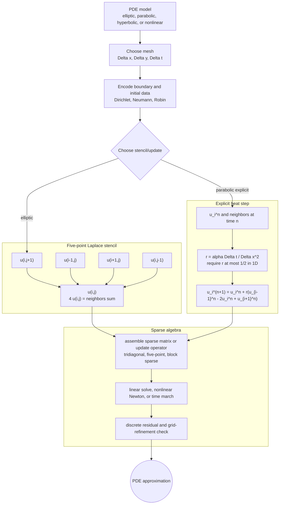

# Finite Difference Methods for PDEs

Finite difference methods approximate partial derivatives on a grid. They turn differential equations into algebraic equations that can be solved step by step or as large linear systems. The method is conceptually simple, but accuracy, stability, boundary handling, and matrix structure must all be managed carefully.

PDE type matters. Elliptic problems such as Laplace's equation usually produce coupled spatial systems. Parabolic problems such as the heat equation involve time stepping with smoothing. Hyperbolic problems such as wave and advection equations require special attention to propagation speed and numerical dispersion.

## From derivatives to stencils

For a grid point $x_i=x_0+i\Delta x$, centered differences include

$$
u_x(x_i)\approx \frac{u_{i+1}-u_{i-1}}{2\Delta x},
$$

and

$$
u_{xx}(x_i)\approx \frac{u_{i-1}-2u_i+u_{i+1}}{\Delta x^2}.
$$

For the heat equation

$$
u_t=\alpha u_{xx},
$$

the forward-time centered-space scheme is

$$
u_i^{n+1}=u_i^n+r(u_{i-1}^n-2u_i^n+u_{i+1}^n),
\qquad
r=\frac{\alpha\Delta t}{\Delta x^2}.
$$

For Laplace's equation

$$
u_{xx}+u_{yy}=0,
$$

the five-point stencil on a square grid is

$$
4u_{i,j}=u_{i-1,j}+u_{i+1,j}+u_{i,j-1}+u_{i,j+1}.
$$

## What consistency and stability say

Consistency means the finite difference formula approaches the PDE as the mesh spacings go to zero. Stability means errors do not grow uncontrollably under the numerical update. Convergence follows when a consistent scheme is stable for a well-posed linear problem; this is the practical message of the Lax equivalence theorem.

The explicit heat scheme is stable in one spatial dimension under the condition

$$
r=\frac{\alpha\Delta t}{\Delta x^2}\le \frac12.
$$

This restriction can be severe on fine grids because halving $\Delta x$ requires roughly quartering $\Delta t$. Implicit methods remove this parabolic time-step restriction but require solving a linear system each step.

Finite difference matrices are sparse. A one-dimensional second derivative gives a tridiagonal matrix; a two-dimensional five-point Laplacian gives a sparse block structure. Preserving sparsity is essential for large grids.

Boundary conditions are not afterthoughts. Dirichlet values enter the right-hand side, Neumann values require derivative approximations, and mixed conditions can change both the matrix and the accuracy near the boundary.

The centered second derivative follows by expanding on both sides of $x_i$:

$$
\begin{aligned}
u(x_i+h)&=u_i+hu_i'+\frac{h^2}{2}u_i''+\frac{h^3}{6}u_i'''+\frac{h^4}{24}u_i^{(4)}+O(h^5),\\
u(x_i-h)&=u_i-hu_i'+\frac{h^2}{2}u_i''-\frac{h^3}{6}u_i'''+\frac{h^4}{24}u_i^{(4)}+O(h^5).
\end{aligned}
$$

Adding cancels the odd derivatives. After subtracting $2u_i$ and dividing by $h^2$,

$$
\frac{u_{i-1}-2u_i+u_{i+1}}{h^2}
=u_i''+\frac{h^2}{12}u_i^{(4)}+O(h^4).
$$

The stencil is therefore second-order accurate when the fourth derivative is bounded. The qualifier matters. A solution with a corner singularity or a jump in a derivative need not display second-order convergence even though the algebra of the stencil is unchanged.

For the explicit heat method, a Fourier mode gives a clean stability calculation. Write the error as $e_i^n=g^n e^{\mathrm{i}i\theta}$. Substitution into the update yields

$$
g=1+r(e^{-\mathrm{i}\theta}-2+e^{\mathrm{i}\theta})
=1-4r\sin^2(\theta/2).
$$

Stability requires $\vert g\vert \le1$ for every wave number. Its smallest possible value is $1-4r$, so $1-4r\ge-1$, or $r\le1/2$. High-frequency error produces the binding restriction. In two dimensions with equal spacings, the same calculation gives $r_x+r_y\le1/2$; when $r_x=r_y=r$, this becomes $r\le1/4$.

Consistency alone does not prevent a calculation from blowing up. Stability controls the accumulation of roundoff, initial error, and local truncation error. For a well-posed linear initial-value problem, the Lax equivalence theorem turns those two statements into convergence. It applies to a specified problem and scheme, not to finite differences as a whole.

## Boundary rows are part of the method

Dirichlet data are the easiest case. If $u(0)=a$ and the first interior equation contains $u_0$, move its known contribution to the right-hand side. For the one-dimensional Poisson equation $-u''=f$,

$$
-u_{i-1}+2u_i-u_{i+1}=h^2f_i.
$$

At $i=1$, the right-hand side becomes $h^2f_1+a$. Nothing is “patched” after the solve; the boundary value has already changed the algebraic equation.

A Neumann condition needs a derivative formula. The first-order row

$$
\frac{u_1-u_0}{h}=q
$$

is simple but can reduce the global order. A second-order one-sided formula,

$$
\frac{-3u_0+4u_1-u_2}{2h}=q,
$$

keeps the boundary truncation error aligned with a second-order interior stencil. Ghost points offer another route: extend the centered derivative across the boundary, use the boundary condition to eliminate the ghost value, and substitute into the PDE row.

Pure Neumann Poisson problems have a structural complication. Adding a constant to a solution changes no derivative, so the discrete matrix is singular. A solution exists only when the source and boundary flux satisfy a compatibility condition, and one normalization such as zero mean is needed to select a unique representative.

## Explicit, backward Euler, and Crank--Nicolson

Let $L_h$ denote the discrete Laplacian. Three common heat updates are

$$
\begin{aligned}
\text{forward Euler: }&u^{n+1}=(I+\alpha\Delta tL_h)u^n,\\
\text{backward Euler: }&(I-\alpha\Delta tL_h)u^{n+1}=u^n,\\
\text{Crank--Nicolson: }&(I-\tfrac12\alpha\Delta tL_h)u^{n+1}
=(I+\tfrac12\alpha\Delta tL_h)u^n.
\end{aligned}
$$

Forward Euler is first order in time and second order in space, conditional on the stability limit. Backward Euler has the same formal orders but is unconditionally stable for the linear heat equation and damps short waves strongly. Crank--Nicolson is second order in time and unconditionally stable in the usual norm, yet it can preserve oscillatory signs for very large time steps. “Unconditionally stable” therefore does not mean that any time step gives an accurate or visually smooth solution.

The algebraic cost changes with the choice. An explicit step is a sparse matrix-vector update. An implicit step solves a tridiagonal system in one dimension or a large sparse system in higher dimensions. Since the matrix is unchanged when coefficients and step sizes are fixed, its factorization or preconditioner can be reused over all time levels.

## From stencil to sparse matrix

Numbering a two-dimensional $m\times m$ interior grid row by row turns the five-point Laplacian into a matrix with $m^2$ rows and at most five nonzeros per row. It can be written with Kronecker products:

$$
A=I_m\otimes T+T\otimes I_m,
\qquad
T=\operatorname{tridiag}(-1,2,-1).
$$

The matrix has $O(m^2)$ unknowns but only $O(m^2)$ nonzeros. A dense representation would require $O(m^4)$ storage. Direct sparse factorization can create fill-in, so large three-dimensional problems usually call for iterative methods and preconditioning rather than dense elimination.

The following map keeps the PDE classification tied to its numerical consequence.

## Advection exposes a different stability problem

For the transport equation

$$
u_t+cu_x=0,
$$

the exact solution is $u(x,t)=u_0(x-ct)$: the initial profile travels at speed $c$ without changing shape. A forward-time centered-space update is

$$
u_i^{n+1}=u_i^n-
\frac{c\Delta t}{2\Delta x}(u_{i+1}^n-u_{i-1}^n).
$$

Although each derivative approximation is consistent, von Neumann analysis gives amplification magnitude greater than one for nonconstant modes. The method is unconditionally unstable. Centering, which works well for diffusion, does not automatically suit one-way propagation.

For $c\gt 0$, the first-order upwind scheme uses information from the left:

$$
u_i^{n+1}=u_i^n-
\nu(u_i^n-u_{i-1}^n),
\qquad
\nu=\frac{c\Delta t}{\Delta x}.
$$

It is stable for $0\le\nu\le1$. The number $\nu$ is the Courant number: physical information travels distance $c\Delta t$ during one step, while the numerical stencil reaches one cell, distance $\Delta x$. If $\nu\gt 1$, the physical domain of dependence extends beyond the numerical one.

Upwinding pays for stability with numerical diffusion. A sharp front spreads over several cells. Higher-order schemes can reduce smearing but may create oscillations near discontinuities; flux limiters and other nonlinear devices balance those effects. The lesson from the heat scheme cannot be transferred by changing only the PDE name. Diffusion and transport have different characteristic behavior.

For the wave equation, centered differences in both space and time give

$$
u_i^{n+1}=2u_i^n-u_i^{n-1}
+\nu^2(u_{i-1}^n-2u_i^n+u_{i+1}^n),
$$

with $\nu=c\Delta t/\Delta x\le1$ in one dimension. Even when stable, different discrete wavelengths travel at slightly different speeds. That numerical dispersion can shift wave phases without producing obvious growth.

## Measuring convergence on a known solution

A manufactured solution separates implementation mistakes from modeling difficulty. Choose, for example,

$$
u(x,y)=\sin(\pi x)\sin(\pi y)
$$

on the unit square. Then define the Poisson source from the chosen function:

$$
-\Delta u=2\pi^2\sin(\pi x)\sin(\pi y),
$$

with zero Dirichlet boundary data. The exact grid error can now be measured even though the source was selected artificially.

If $E_h$ is an error norm on spacing $h$ and the method is order $p$, then $E_h\approx Ch^p$. Two grids give an observed order

$$
p_{\mathrm{obs}}=
\frac{\log(E_h/E_{h/2})}{\log 2}.
$$

Suppose the maximum errors are $1.20\times10^{-3}$ and $3.05\times10^{-4}$. Then

$$
p_{\mathrm{obs}}
=\frac{\log(1.20\times10^{-3}/3.05\times10^{-4})}{\log2}
\approx1.98,
$$

consistent with a second-order stencil. If the linear solver tolerance is too loose, its algebraic error eventually masks the discretization error and the observed order falls. Solver tolerances should therefore be tightened enough that refinement measures the stencil rather than the stopping rule.

For transient problems, refine space and time in a way that separates their contributions. Forward Euler for heat has error $O(\Delta t+\Delta x^2)$. Taking $\Delta t$ proportional to $\Delta x^2$ respects stability and balances the two terms. Crank--Nicolson has $O(\Delta t^2+\Delta x^2)$, so $\Delta t$ proportional to $\Delta x$ balances formal orders. Comparing solutions at unmatched times or grid points requires interpolation, which adds another error source that should be stated.

Qualitative invariants supply checks even when no exact solution is known. With $0\le r\le1/2$, the explicit heat update is a convex combination

$$
u_i^{n+1}=r u_{i-1}^n+(1-2r)u_i^n+r u_{i+1}^n.
$$

It cannot create a new interior maximum above all three contributing values or a new minimum below them. Unexpected overshoots under nonnegative Dirichlet data therefore point to a violated stability bound, a boundary error, or a different scheme whose coefficients are not monotone.

Conservative equations should be discretized in flux form. For $u_t+f(u)_x=0$,

$$
u_i^{n+1}=u_i^n-
\frac{\Delta t}{\Delta x}
(F_{i+1/2}^n-F_{i-1/2}^n).
$$

Summing over cells cancels internal numerical fluxes pairwise; only boundary fluxes change the total mass. A pointwise residual can be small while a nonconservative discretization drifts in total mass, so conservation is an independent diagnostic.



The finite-difference diagram turns PDE discretization into a mesh, boundary-condition, stencil, sparse-algebra, and verification pipeline. The Laplace subgraph shows the five-point stencil with the center node coupled to its four neighbors, while the heat subgraph shows the explicit time update and CFL stability restriction. The final residual and grid-refinement checks are part of the architecture because stencil order alone does not guarantee a trustworthy PDE solve.

| PDE type | Example | Common finite difference issue | Matrix/update pattern |
|---|---|---|---|
| Elliptic | Laplace, Poisson | boundary coupling | sparse linear system |
| Parabolic | heat equation | time-step stability | marching plus smoothing |
| Hyperbolic | wave, advection | CFL and dispersion | propagation-sensitive update |
| Nonlinear | reaction-diffusion | nonlinear solves | Newton or splitting |

## Worked example 1: one explicit heat step

**Problem.** Use the explicit heat scheme with $r=0.25$ for one interior value $u_1^0=1$ and boundary values $u_0^0=u_2^0=0$.

**Method.** Apply

$$
u_1^{1}=u_1^0+r(u_0^0-2u_1^0+u_2^0).
$$

1. Substitute the values:

$$
u_1^{1}=1+0.25(0-2(1)+0).
$$

2. Simplify the second-difference term:

$$
0-2+0=-2.
$$

3. Update:

$$
u_1^{1}=1+0.25(-2)=0.5.
$$

4. Check stability condition:

$$
r=0.25\le 0.5.
$$

**Checked answer.** The new interior value is $0.5$. The scheme is stable for this $r$ in the one-dimensional heat equation.

## Worked example 2: one-point Laplace solve

**Problem.** A square has boundary values $100$ on the top side and $0$ on the other three sides. With one interior grid point, approximate the steady temperature.

**Method.** The five-point formula says the interior value equals the average of its four neighbors.

1. Let the interior value be $u$.

2. The four neighboring boundary values are

$$
0,\quad 0,\quad 0,\quad 100.
$$

3. The Laplace equation gives

$$
4u=0+0+0+100.
$$

4. Therefore

$$
u=25.
$$

**Checked answer.** The one-point finite difference approximation gives temperature $25$ at the center.

## A small solver and its checks

```python
import numpy as np

def heat_explicit(u0, alpha, dx, dt, steps):
    r = alpha * dt / (dx * dx)
    if r > 0.5:
        raise ValueError("explicit heat scheme unstable for r > 1/2")
    u = np.array(u0, dtype=float)
    history = [u.copy()]
    for _ in range(steps):
        new = u.copy()
        new[1:-1] = u[1:-1] + r * (u[:-2] - 2*u[1:-1] + u[2:])
        u = new
        history.append(u.copy())
    return history

def laplace_jacobi(top, bottom, left, right, n, iterations=5000, tol=1e-10):
    u = np.zeros((n + 2, n + 2))
    u[0, :] = top
    u[-1, :] = bottom
    u[:, 0] = left
    u[:, -1] = right
    for _ in range(iterations):
        old = u.copy()
        u[1:-1, 1:-1] = 0.25 * (old[:-2, 1:-1] + old[2:, 1:-1]
                                  + old[1:-1, :-2] + old[1:-1, 2:])
        if np.linalg.norm(u - old, ord=np.inf) < tol:
            break
    return u

print(heat_explicit([0.0, 1.0, 0.0], alpha=1.0, dx=1.0, dt=0.25, steps=1)[-1])
print(laplace_jacobi(100.0, 0.0, 0.0, 0.0, n=1))
```

## Failure patterns worth recognizing

- Choosing $\Delta t$ for accuracy but violating the CFL or heat stability condition.
- Treating boundary conditions as values to patch in after solving instead of building them into the scheme.
- Converting sparse PDE matrices into dense arrays for large grids.
- Using centered differences for advection-dominated hyperbolic problems without stabilization.
- Refining space without refining time consistently for transient problems.

## Related pages

- [boundary value problems](/math/numerical-analysis/boundary-value-problems)
- [matrix factorizations and special systems](/math/numerical-analysis/matrix-factorizations-special-systems)
- [iterative linear systems](/math/numerical-analysis/iterative-linear-systems)
- [ODE stability stiffness and systems](/math/numerical-analysis/ode-stability-stiffness-systems)
