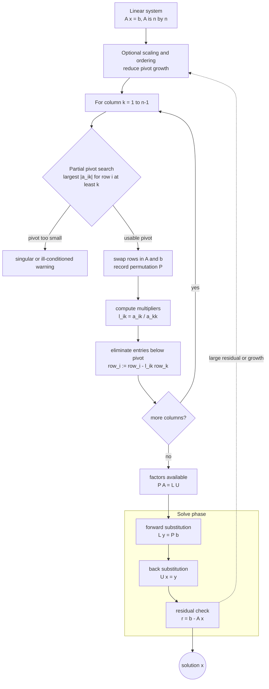

# Gaussian Elimination Pivoting and LU

Gaussian elimination solves a linear system by eliminating unknowns until the system is triangular. LU factorization records the elimination steps as matrix factors so that the same coefficient matrix can be reused for many right-hand sides. Pivoting makes the process reliable by avoiding zero or dangerously small pivots.

This topic is the entry point for direct linear algebra in numerical analysis. Later factorizations, iterative methods, least squares solvers, eigenvalue algorithms, and implicit differential equation methods all rely on the same ideas: preserve algebraic equivalence while controlling rounding error and computational cost.

## Elimination recorded as triangular factors

A linear system is

$$
Ax=b,
$$

where $A\in\mathbb{R}^{n\times n}$ is the coefficient matrix, $x$ is the unknown vector, and $b$ is the right-hand side. Gaussian elimination uses row operations to transform $A$ into an upper triangular matrix $U$.

An LU factorization writes

$$
A=LU,
$$

where $L$ is lower triangular and $U$ is upper triangular. With row pivoting, the factorization is usually written

$$
PA=LU,
$$

where $P$ is a permutation matrix representing row swaps. To solve $Ax=b$, compute $Pb$, solve

$$
Ly=Pb,
$$

by forward substitution, then solve

$$
Ux=y
$$

by back substitution.

A **pivot** is the entry used to eliminate entries below it in a column. Partial pivoting chooses the largest available entry in magnitude in the current column and swaps it into the pivot position.

The factorization can be derived from elementary elimination matrices. For a $3\times3$ matrix, suppose the first pivot is nonzero and set $\ell_{21}=a_{21}/a_{11}$ and $\ell_{31}=a_{31}/a_{11}$. The first step is multiplication by

$$
M_1=\begin{bmatrix}1&0&0\\-\ell_{21}&1&0\\-\ell_{31}&0&1\end{bmatrix}.
$$

After later steps, $M_{n-1}\cdots M_1A=U$, and hence

$$
A=M_1^{-1}M_2^{-1}\cdots M_{n-1}^{-1}U=LU.
$$

The inverses merely change the signs below the diagonal, so the multipliers fit into the strict lower triangle of $L$. Implementations exploit that identity: once an entry below a pivot is eliminated, its array location stores the multiplier instead of an explicit zero. The unit diagonal of $L$ need not be stored.

Row swaps complicate only the bookkeeping. When a later pivot swap exchanges rows $k$ and $p$, the already computed entries in columns $1$ through $k-1$ of $L$ must be swapped too. Swapping only the active part of $U$ is a common hand-coded error; the returned arrays then reconstruct neither $PA$ nor $A$.

## Why pivoting and factor reuse matter

Gaussian elimination without pivoting can fail on a nonsingular matrix if a zero pivot appears. It can also be unstable when a pivot is nonzero but tiny relative to entries below it. Partial pivoting avoids many of these failures and is the default dense direct strategy for general matrices.

The operation count for dense Gaussian elimination is about

$$
\frac{2}{3}n^3
$$

floating-point operations for the factorization, plus $O(n^2)$ for each triangular solve. This cost pattern is why LU is valuable when the same $A$ is used with several right-hand sides: factor once, solve many times.

The leading count comes from trailing-matrix updates. At step $k$, roughly $(n-k)^2$ entries receive one multiplication and one subtraction. Therefore

$$
2\sum_{j=1}^{n-1}j^2
=\frac{(n-1)n(2n-1)}{3}
=\frac23n^3+O(n^2).
$$

Forward and back substitution each use about $n^2$ operations. Several right-hand sides can be assembled as $B$ and solved as $LY=PB$, then $UX=Y$. Dense libraries use blocked LU: they factor a panel of columns and update the remaining matrix with fast matrix-matrix multiplication. The algebra stays the same, but the memory access is much better. For sparse matrices, fill-in replaces the dense flop count as the main concern, so reorderings that limit new nonzeros can dominate performance.

Backward stability with partial pivoting is excellent in typical cases, although pathological growth factors exist. The residual

$$
r=b-A\hat{x}
$$

is easy to compute and should be used, but forward accuracy also depends on the condition number of $A$. A small residual does not guarantee a small forward error when $A$ is ill-conditioned. Pivot sizes, growth factors, and a condition estimate complete the diagnostic picture.

Write $e=x-\hat x$. Since $Ae=r$,

$$
\frac{\|e\|}{\|x\|}
\leq\kappa(A)\frac{\|r\|}{\|b\|},
\qquad \kappa(A)=\|A\|\|A^{-1}\|,
$$

assuming $b\ne0$. A residual near machine precision may coexist with several lost digits when $\kappa(A)$ is large. A scale-aware backward error is

$$
\eta=\frac{\|b-A\hat x\|_\infty}
{\|A\|_\infty\|\hat x\|_\infty+\|b\|_\infty}.
$$

It estimates the relative perturbation needed to make $\hat x$ exact. Iterative refinement computes $r$, solves $A\delta=r$ with the existing factors, and updates $\hat x\leftarrow\hat x+\delta$. Accumulating the residual in higher precision can recover digits when the factorization is stable and the condition number is not too large.

Pivot growth measures another hazard. If $\rho=\max\vert u_{ij}\vert /\max\vert a_{ij}\vert $, a large $\rho$ says that intermediate entries greatly exceeded the input scale. Partial pivoting keeps elimination multipliers at most one in magnitude, yet rare matrices still cause large growth. Complete pivoting searches the entire remaining submatrix and swaps columns as well as rows. It gives stronger control but requires more comparisons and a second permutation.

## From pivot search to repeated solves



Factorization is a pivot-search, row-swap, multiplier, and elimination loop followed by triangular solves. Because the factors satisfy $PA=LU$, the right side must become $Pb$ before forward substitution. A residual check alone is insufficient when pivot growth or conditioning is poor.

| Strategy | Factorization | Main benefit | Main risk |
|---|---|---|---|
| No pivoting | $A=LU$ | fastest simple form | zero or tiny pivots |
| Partial pivoting | $PA=LU$ | robust general default | row swaps and growth possible |
| Complete pivoting | $PAQ=LU$ | stronger pivot control | more search and bookkeeping |
| Cholesky | $A=LL^T$ | faster for SPD matrices | requires symmetry and positivity |

## Recording one elimination multiplier in $L$

**Problem.** Solve

$$
\begin{bmatrix}2&1\\4&3\end{bmatrix}
\begin{bmatrix}x_1\\x_2\end{bmatrix}
=
\begin{bmatrix}1\\2\end{bmatrix}
$$

using elimination.

**Method.** Eliminate the entry below the first pivot.

1. The pivot is $2$, and the multiplier is

$$
\ell_{21}=\frac{4}{2}=2.
$$

2. Row 2 becomes row 2 minus $2$ times row 1:

$$
[4,3]-2[2,1]=[0,1].
$$

Thus

$$
L=\begin{bmatrix}1&0\\2&1\end{bmatrix},
\qquad
U=\begin{bmatrix}2&1\\0&1\end{bmatrix}.
$$

3. Forward solve $Ly=b$:

$$
y_1=1,
\qquad
2y_1+y_2=2 \Rightarrow y_2=0.
$$

4. Back solve $Ux=y$:

$$
x_2=0,
\qquad
2x_1+x_2=1 \Rightarrow x_1=\frac12.
$$

**Checked answer.** The solution is $x=(0.5,0)^T$, and $A x=(1,2)^T$.

## A nonsingular matrix with a zero first pivot

**Problem.** Explain how to start elimination for

$$
A=\begin{bmatrix}0&1\\2&3\end{bmatrix}.
$$

**Method.** The first pivot entry is zero, so elimination without pivoting cannot divide by it.

1. Inspect the first column below and including the pivot position:

$$
\begin{bmatrix}0\\2\end{bmatrix}.
$$

2. The largest magnitude entry is $2$ in row 2, so swap rows 1 and 2.

3. The permuted matrix is

$$
PA=\begin{bmatrix}2&3\\0&1\end{bmatrix}.
$$

4. This matrix is already upper triangular.

**Checked answer.** Partial pivoting changes an impossible first pivot into a valid pivot. The original matrix is nonsingular, but elimination without row swaps would fail immediately.

## What a tiny pivot does to arithmetic

Consider

$$
\begin{bmatrix}10^{-4}&1\\1&1\end{bmatrix}
\begin{bmatrix}x_1\\x_2\end{bmatrix}
=\begin{bmatrix}1\\2\end{bmatrix}.
$$

Without pivoting, the first multiplier is $10^4$. Row 2 minus $10^4$ times row 1 gives

$$
[1,1]-10^4[10^{-4},1]=[0,-9999],
$$

and the new right side is $-9998$. Exact back substitution yields

$$
x_2=\frac{9998}{9999},\qquad x_1=\frac{10000}{9999}.
$$

In decimal arithmetic retaining three significant digits, both $-9999$ and $-9998$ round to $-1.00\times10^4$. Then $x_2$ rounds to $1.00$, the subtraction $1-x_2$ becomes zero, and the computed $x_1$ is lost entirely.

Partial pivoting swaps the rows first. The pivot is $1$, the multiplier is $10^{-4}$, and the second row becomes

$$
[10^{-4},1]-10^{-4}[1,1]=[0,0.9999],
$$

with right side $1-2\times10^{-4}=0.9998$. Intermediate values remain at the input scale, so the same low-precision arithmetic retains useful digits. Pivoting changes neither the exact solution nor the condition number; it changes the numerical stability of elimination.

## Partial-pivot LU with an explicit permutation

```python
import numpy as np

def lu_partial_pivot(A):
    A = np.array(A, dtype=float, copy=True)
    n = A.shape[0]
    P = np.eye(n)
    L = np.zeros((n, n))
    U = A.copy()
    pivot_tol = np.finfo(float).eps * max(1.0, np.linalg.norm(A, ord=np.inf))
    for k in range(n):
        pivot = k + np.argmax(np.abs(U[k:, k]))
        if abs(U[pivot, k]) <= pivot_tol:
            raise np.linalg.LinAlgError("matrix is singular to working precision")
        if pivot != k:
            U[[k, pivot], :] = U[[pivot, k], :]
            P[[k, pivot], :] = P[[pivot, k], :]
            L[[k, pivot], :k] = L[[pivot, k], :k]
        L[k, k] = 1.0
        for i in range(k + 1, n):
            L[i, k] = U[i, k] / U[k, k]
            U[i, k:] -= L[i, k] * U[k, k:]
    return P, L, U

def solve_lu(P, L, U, b):
    pb = P @ np.asarray(b, dtype=float)
    y = np.linalg.solve(L, pb)
    return np.linalg.solve(U, y)

A = np.array([[2.0, 1.0], [4.0, 3.0]])
b = np.array([1.0, 2.0])
P, L, U = lu_partial_pivot(A)
x = solve_lu(P, L, U, b)
print(P)
print(L)
print(U)
print(x, "residual", b - A @ x)
```

## Scaling, singularity, and what the factors reveal

Partial pivoting compares entries within the active column, so badly scaled rows can still distort what counts as a large pivot. Scaled partial pivoting compares $\vert a_{ik}\vert /s_i$, where $s_i$ is the largest magnitude in row $i$. More generally, equilibration multiplies by diagonal row and column scalings so that entries have comparable magnitudes. The solution is converted back afterward. Scaling can improve arithmetic and condition estimation, but it cannot turn an intrinsically nearly singular problem into a well-conditioned one.

A tiny final pivot indicates that the matrix is singular or close to singular relative to the working scale. If elimination reaches an all-zero row in $U$, consistency depends on the corresponding transformed right-hand side. A zero there permits infinitely many solutions; a nonzero value makes the system inconsistent. Standard square LU solvers usually report singularity rather than selecting a free-variable solution. Rank-revealing QR or the singular value decomposition is a better tool when rank deficiency is part of the problem rather than an error condition.

The determinant follows cheaply from the factors. Since triangular determinants are products of diagonal entries and each row swap changes sign,

$$
\det(A)=(-1)^s\prod_{i=1}^nu_{ii},
$$

where $s$ is the number of swaps. For large matrices the product may overflow or underflow even when its logarithm is representable, so software often reports the sign and sum of logarithms of absolute pivots. A determinant near zero is a poor standalone conditioning test: scaling one row scales the determinant without changing the essential geometry of the solution map.

The factors also solve transposed systems. From $PA=LU$, one has $A^TP^T=U^TL^T$. Solving $A^Tx=b$ therefore uses triangular solves in reversed order plus the stored permutation. Condition estimators exploit such solves without forming $A^{-1}$ explicitly.

## A complete three-by-three solve

Consider

$$
A=\begin{bmatrix}1&2&0\\2&1&1\\-1&1&2\end{bmatrix},
\qquad b=\begin{bmatrix}3\\4\\2\end{bmatrix}.
$$

Partial pivoting selects row 2 first because $\vert 2\vert $ is largest in column 1. After swapping rows 1 and 2, the first pivot row is $[2,1,1]$. The multipliers are $1/2$ for the original first row and $-1/2$ for the third row. Eliminating gives rows

$$
[0,3/2,-1/2],\qquad [0,3/2,5/2],
$$

and transformed right sides $1$ and $4$. The second-column entries tie; keep their order. Subtracting the second row from the third produces $[0,0,3]$ with right side $3$. Back substitution gives $x_3=1$, then

$$
\frac32x_2-\frac12=1,
$$

so $x_2=1$. The first pivot equation $2x_1+x_2+x_3=4$ gives $x_1=1$. Direct multiplication returns $(3,4,2)^T$.

The example also shows why permutations are part of the factorization, not an optional prelude. The transformed right side followed the same first row swap, while the solution variables did not move because partial pivoting swaps equations rather than columns.

For many right sides, residual computation should use the original $A$ and $b$, not the overwritten factor-storage array. Keeping or reconstructing the original operator is necessary for a meaningful backward-error check.

## Bookkeeping and accuracy traps

- A zero or tiny pivot must be detected before division. The threshold should be relative to matrix scale; a fixed absolute cutoff can label a harmless scaled problem singular.
- Every row permutation applies to the right-hand side, and every column permutation from complete pivoting applies inversely to the unknown vector. Losing either permutation silently solves a different system.
- New right-hand sides need triangular solves, not new factorizations. Keep the factors and pivot indices while $A$ remains unchanged.
- A small residual certifies backward error only after scaling. Forward accuracy also depends on conditioning, so sensitive systems need a condition estimate beside the residual.
- Symmetric positive definite matrices should normally use Cholesky. It takes about half the factorization work and preserves structure that general LU ignores.
- Forming $A^{-1}$ to compute $x=A^{-1}b$ adds work and usually worsens rounding. Solve with the factors instead.

## Structure can change the right factorization

General pivoted LU is a default, not a mandate. A banded matrix should use band storage and elimination confined to the band; dense storage throws away both memory and speed. A tridiagonal system can be solved in linear work when its pivots are safe. Symmetric indefinite matrices need symmetric pivoting schemes so that row and column permutations preserve symmetry. Positive definite matrices admit Cholesky without general pivoting.

Sparse LU faces fill-in: entries that were zero in $A$ become nonzero in the factors. Graph orderings seek to reduce that fill before numeric factorization. Numerical pivoting may still alter the planned pattern, so sparse solvers separate symbolic analysis from numeric values and often reuse the symbolic phase across matrices with the same sparsity structure.

Mixed precision offers another reuse pattern. Factors may be computed in a lower precision for speed, while residuals and refinement updates use higher precision. Success depends on conditioning and on the quality of the low-precision solve. The final high-precision residual does not retroactively guarantee accuracy if refinement stagnates; the convergence history belongs with the result.

<div className="see-also">

See also: [matrix factorizations and special systems](/math/numerical-analysis/matrix-factorizations-special-systems) · [iterative linear systems](/math/numerical-analysis/iterative-linear-systems) · [floating point conditioning and stability](/math/numerical-analysis/floating-point-conditioning-stability) · [least squares and Chebyshev approximation](/math/numerical-analysis/least-squares-chebyshev-approximation)

</div>
