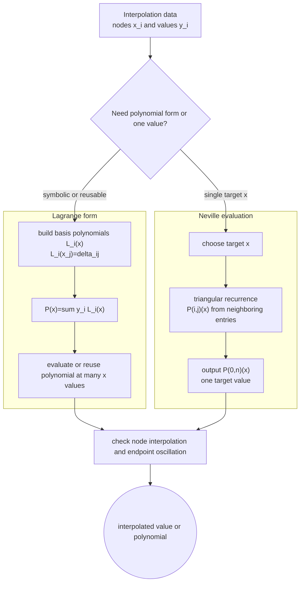

# Lagrange Interpolation and Neville Method

Polynomial interpolation constructs a polynomial that passes through prescribed data points. Lagrange interpolation gives the polynomial explicitly as a weighted sum of basis polynomials, while Neville's method evaluates the same interpolating polynomial at a chosen point without first expanding all coefficients. The two views are algebraically equivalent but computationally different.

Interpolation is the local model behind numerical differentiation, Newton-Cotes integration, finite elements, and many approximation schemes. It is powerful because a polynomial is easy to evaluate, differentiate, and integrate. It is dangerous when high degree or badly spaced nodes produce oscillation that is not present in the underlying function.

## The Lagrange basis selects node values

Given distinct nodes $x_0,x_1,\ldots,x_n$ and data values $y_i=f(x_i)$, the **interpolating polynomial** $P_n$ is the unique polynomial of degree at most $n$ satisfying

$$
P_n(x_i)=y_i, \qquad i=0,1,\ldots,n.
$$

The Lagrange basis polynomial associated with node $x_i$ is

$$
L_i(x)=\prod_{\substack{0\le j\le n\\ j\ne i}}\frac{x-x_j}{x_i-x_j}.
$$

It has the cardinal property $L_i(x_j)=1$ if $i=j$ and $0$ otherwise. The Lagrange interpolant is

$$
P_n(x)=\sum_{i=0}^n y_iL_i(x).
$$

The cardinal property proves interpolation immediately: $P_n(x_k)=\sum_i y_iL_i(x_k)=y_k$. It also shows linearity in the data. If values are perturbed by $\delta_i$, then

$$
|\delta P_n(x)|\leq\left(\sum_{i=0}^n|L_i(x)|\right)\max_i|\delta_i|.
$$

The maximum of the parenthesized quantity over the interval is the Lebesgue constant. It measures amplification caused by node geometry independently of the sampled function. Equally spaced nodes have rapidly growing Lebesgue constants, while Chebyshev-distributed nodes grow only logarithmically. Exact agreement at the nodes says nothing about this between-node sensitivity.

## Neville's triangular evaluation

Neville's method defines recursive quantities $P_{i,j}(x)$, where $P_{i,j}$ is the value at $x$ of the interpolating polynomial through nodes $x_i,\ldots,x_j$. The recurrence is

$$
P_{i,j}(x)=\frac{(x-x_i)P_{i+1,j}(x)-(x-x_j)P_{i,j-1}(x)}{x_j-x_i}.
$$

The recurrence fills a triangular table. The left edge contains the data values, each next diagonal combines neighboring lower-degree interpolants, and the final top entry is the desired value.

The recurrence follows from uniqueness. Let $Q=P_{i,j-1}$ and $R=P_{i+1,j}$. The combination

$$
S(z)=\frac{(z-x_i)R(z)-(z-x_j)Q(z)}{x_j-x_i}
$$

has degree at most $j-i$. At an interior node both $Q$ and $R$ equal the same datum, while at each endpoint one term vanishes. Thus $S$ interpolates every node from $i$ through $j$. Uniqueness identifies it with $P_{i,j}$, and evaluation at the target $x$ gives Neville's formula.

Consecutive table diagonals compare interpolants built from different numbers of nearby nodes. Their difference is not a rigorous error bound, but failure to settle warns that adding degree is not improving the chosen target.

## Uniqueness, error, and node geometry

Uniqueness follows from a simple polynomial argument. If two polynomials of degree at most $n$ interpolate the same $n+1$ distinct data points, their difference has $n+1$ roots. A nonzero polynomial of degree at most $n$ cannot have that many distinct roots, so the difference must be zero.

If $f$ has $n+1$ continuous derivatives on an interval containing the nodes and $x$, then the interpolation error is

$$
f(x)-P_n(x)=\frac{f^{(n+1)}(\xi)}{(n+1)!}\prod_{i=0}^n (x-x_i)
$$

for some $\xi$ in the interval. This formula separates the smoothness of $f$ from the geometry of the nodes. Even for a smooth function, the product term can be large near the ends of an interval when high-degree equally spaced interpolation is used.

A proof sketch explains the point $\xi$. Fix a target $x$ distinct from the nodes and define

$$
\omega(t)=\prod_{i=0}^n(t-x_i),
\qquad C=\frac{f(x)-P_n(x)}{\omega(x)}.
$$

The function $g(t)=f(t)-P_n(t)-C\omega(t)$ vanishes at all $n+1$ nodes and at $x$. Repeated Rolle's theorem gives a point $\xi$ where $g^{(n+1)}(\xi)=0$. Since $P_n^{(n+1)}=0$ and $\omega^{(n+1)}=(n+1)!$,

$$
0=f^{(n+1)}(\xi)-C(n+1)!.
$$

Solving for $C$ gives the remainder. If $x$ is a node, both sides vanish directly. For a usable bound, replace the unknown derivative by $M=\max\vert f^{(n+1)}\vert $ on the interval. The factorial does not guarantee small error by itself; derivatives may grow and poor nodes can make $\vert \omega(x)\vert $ large.

Neville's method organizes evaluation without changing the interpolating polynomial or explicitly forming expanded coefficients. When many evaluations are needed for the same data, barycentric Lagrange formulas are usually preferred because they precompute weights and evaluate in $O(n)$ time per point.

Define barycentric weights

$$
\lambda_i=\frac{1}{\prod_{j\ne i}(x_i-x_j)}.
$$

For a target distinct from every node,

$$
P_n(x)=
\frac{\displaystyle\sum_{i=0}^n\frac{\lambda_i y_i}{x-x_i}}
{\displaystyle\sum_{i=0}^n\frac{\lambda_i}{x-x_i}}.
$$

Weights cost $O(n^2)$ to form naively, then each evaluation costs $O(n)$. The formula avoids products of many target-dependent factors. If $x=x_i$, return $y_i$ directly; the quotient divides by zero although its limit is defined. All weights may be multiplied by a common nonzero scale, which helps avoid overflow and underflow.

Before interpolating, decide whether the data should be matched exactly; noisy measurements usually call for approximation. Piecewise low-degree interpolation or a spline is often safer than one high-degree polynomial on a long interval.

## Why equally spaced high degree can fail

The standard example is Runge's function

$$
f(x)=\frac{1}{1+25x^2},\qquad -1\leq x\leq1.
$$

Interpolants on increasingly many equally spaced nodes develop large endpoint oscillations even though $f$ is smooth. Convergence at every sampled node coexists with divergence of the maximum error. The nearby complex singularities at $\pm i/5$ limit how well polynomial information propagates from uniform real nodes near the endpoints.

Chebyshev nodes cluster toward those endpoints. One common set is

$$
x_k=\cos\left(\frac{2k+1}{2n+2}\pi\right),
\qquad k=0,\ldots,n.
$$

They minimize the maximum magnitude of a monic nodal polynomial up to scaling and sharply reduce endpoint growth in the error factor. An affine change maps them from $[-1,1]$ to any finite interval. When measurement times impose the nodes, a spline or local polynomial avoids forcing one high-degree global fit through them.

Outside the node interval every factor $\vert x-x_i\vert $ grows together. Small data errors may then be amplified severely. Good interpolation residuals inside the observed range provide little evidence for far extrapolation.

## Choosing the computational form

| Feature | Lagrange form | Neville method | Practical note |
|---|---|---|---|
| Output | symbolic or evaluable polynomial form | value at one target $x$ | Neville is evaluation-focused |
| Work for one point | $O(n^2)$ if basis built directly | $O(n^2)$ recurrence | both fine for small $n$ |
| Reuse for many points | basis can be reused | recurrence repeated per point | barycentric form is better |
| Numerical risk | large basis products | triangular recurrence | node choice still dominates |



Lagrange builds reusable basis polynomials that select node values, while Neville builds a triangular table for one target value. Either form can oscillate strongly near endpoints even while matching every node.

## Reconstructing a quadratic in the Lagrange basis

**Problem.** Interpolate the data

$$
(1,1),\quad (2,4),\quad (3,9)
$$

and evaluate the polynomial at $x=2.5$.

**Method.** Build the three Lagrange basis polynomials.

1. The basis polynomial for $x_0=1$ is

$$
L_0(x)=\frac{x-2}{1-2}\frac{x-3}{1-3}=\frac{(x-2)(x-3)}{2}.
$$

2. For $x_1=2$,

$$
L_1(x)=\frac{x-1}{2-1}\frac{x-3}{2-3}=-(x-1)(x-3).
$$

3. For $x_2=3$,

$$
L_2(x)=\frac{x-1}{3-1}\frac{x-2}{3-2}=\frac{(x-1)(x-2)}{2}.
$$

4. The interpolant is

$$
P_2(x)=1L_0(x)+4L_1(x)+9L_2(x).
$$

Since the data come from $f(x)=x^2$, simplification gives $P_2(x)=x^2$.

5. Therefore

$$
P_2(2.5)=2.5^2=6.25.
$$

**Checked answer.** The interpolating polynomial is exactly $x^2$, so the value at $2.5$ is $6.25$.

## Evaluating the same quadratic without expanding it

**Problem.** Use Neville's method on the same data to compute $P(2.5)$ without expanding the polynomial.

**Method.** Let $x=2.5$ and start with

$$
P_{0,0}=1,\quad P_{1,1}=4,\quad P_{2,2}=9.
$$

1. First linear interpolation:

$$
P_{0,1}=\frac{(2.5-1)P_{1,1}-(2.5-2)P_{0,0}}{2-1}
=\frac{1.5(4)-0.5(1)}{1}=5.5.
$$

2. Second linear interpolation:

$$
P_{1,2}=\frac{(2.5-2)P_{2,2}-(2.5-3)P_{1,1}}{3-2}
=0.5(9)+0.5(4)=6.5.
$$

3. Quadratic interpolation:

$$
P_{0,2}=\frac{(2.5-1)P_{1,2}-(2.5-3)P_{0,1}}{3-1}
=\frac{1.5(6.5)+0.5(5.5)}{2}=6.25.
$$

**Checked answer.** Neville's recurrence gives the same value, $P(2.5)=6.25$, while keeping the computation focused on the target point.

## Direct Lagrange and Neville evaluators

```python
import numpy as np

def lagrange_eval(xs, ys, x):
    xs = np.asarray(xs, dtype=float)
    ys = np.asarray(ys, dtype=float)
    total = 0.0
    n = len(xs)
    for i in range(n):
        basis = 1.0
        for j in range(n):
            if i != j:
                basis *= (x - xs[j]) / (xs[i] - xs[j])
        total += ys[i] * basis
    return total

def neville(xs, ys, x):
    xs = np.asarray(xs, dtype=float)
    table = np.asarray(ys, dtype=float).copy()
    n = len(xs)
    for width in range(1, n):
        for i in range(n - width):
            j = i + width
            table[i] = ((x - xs[i]) * table[i + 1]
                        - (x - xs[j]) * table[i]) / (xs[j] - xs[i])
    return table[0]

xs = [1.0, 2.0, 3.0]
ys = [1.0, 4.0, 9.0]
print(lagrange_eval(xs, ys, 2.5))
print(neville(xs, ys, 2.5))
```

## Local interpolation and data error

If values come from measurement, write the observed data as $\tilde y_i=y_i+\delta_i$. Linearity gives

$$
\tilde P_n(x)-P_n(x)=\sum_i\delta_iL_i(x).
$$

Suppose every measurement error is at most $\varepsilon$. At a target where $\sum_i\vert L_i(x)\vert =20$, the worst possible interpolation error from data alone is $20\varepsilon$, before accounting for approximation error in replacing the underlying function by a polynomial. Adding nodes can reduce the latter while increasing the former. Degree selection balances both effects.

Local interpolation uses only nearby nodes for each target. A linear interpolant on $[x_i,x_{i+1}]$ has error

$$
f(x)-P_1(x)=\frac{f''(\xi)}{2}(x-x_i)(x-x_{i+1}),
$$

so on an interval of width $h$ its magnitude is at most $Mh^2/8$. Piecewise linear interpolation is continuous but has slope jumps at nodes. Piecewise cubics can arrange derivative continuity while retaining local support. One changed datum then affects only nearby pieces instead of every value across the domain.

Locality also changes computational cost. After locating the interval, a fixed-degree local polynomial costs constant work per target. A global degree-$n$ formula costs at least linear work even with barycentric weights, and all weights may need rebuilding when a node is added. Global spectral interpolation remains attractive for smooth functions on a fixed interval because its error can decay extremely fast with well-chosen nodes; local methods are more forgiving of irregular data and updates.

## Interpolating before differentiating or integrating

Once $P_n$ is known, differentiation and integration are algebraic. Their numerical behavior differs. Integration smooths error, so integrating an interpolant often gives accurate quadrature. Differentiation amplifies high-frequency and data error; a polynomial that matches noisy values exactly may have a wildly inaccurate derivative. Node spacing, degree, and regularization therefore matter more for derivative estimates.

For the quadratic through $(1,1),(2,4),(3,9)$, differentiation gives $P_2'(x)=2x$, so the derivative at $2.5$ is $5$. Integrating over $[1,3]$ gives

$$
\int_1^3P_2(x)\,dx=\left.\frac{x^3}{3}\right|_1^3=\frac{26}{3}.
$$

These are exact because the source function lies in the interpolation space. For a general smooth function, applying the same operations to the remainder explains the corresponding differentiation and quadrature error, provided enough derivatives exist.

## Stable evaluation details

Node equality in a barycentric evaluator should use the same representation that created the nodes. A target generated as `xs[i]` can be detected exactly; an independently computed value may differ by a few ulps. A tolerance-based equality test must be scaled carefully because declaring two distinct close nodes equal changes the mathematical problem.

Naive barycentric weights can overflow for many nodes even though their common scale cancels. Closed-form weights exist for standard Chebyshev grids. For arbitrary nodes, rescaling intermediate products or computing signs and logarithms can extend the safe range. At very high degree, established interpolation libraries are preferable to a short double loop.

Neville's method overwrites a one-dimensional table in the supplied code. That saves memory but discards the full triangle. Retaining the triangle is useful when one wants intermediate-degree comparisons or a teaching trace; the final value is unchanged.

## Node placement, noise, and extrapolation

- High-degree equally spaced interpolation can oscillate near interval ends. Chebyshev nodes, local polynomials, or splines address the geometry rather than merely adding points.
- Matching every datum does not control values between nodes. Inspect amplification or compare with withheld values when the data are empirical.
- Expanded monomial coefficients are often badly scaled and unnecessary. Neville serves one target; barycentric form serves repeated evaluations.
- Ordinary Lagrange formulas require distinct nodes. Repeated nodes encode derivative conditions and belong to Hermite interpolation.
- The remainder contains an unknown $\xi$. Usually one bounds the derivative over an interval instead of claiming an exact error.
- Far extrapolation magnifies approximation and measurement error. A polynomial that behaves well inside the nodes may grow rapidly just outside them.

## Choosing nodes when they are under control

Uniform spacing is attractive because it simplifies indexing, not because it is optimal for a global polynomial. On $[-1,1]$, Chebyshev roots cluster near both endpoints, where the nodal product tends to grow. Chebyshev extrema include the endpoints and are useful when endpoint values must be interpolated exactly. The two grids serve slightly different boundary requirements but share favorable stability.

Nested nodes matter when degree is increased adaptively. Ordinary Chebyshev grids of consecutive sizes are not fully nested, so raising the degree may require all new function evaluations. Other cosine-based sequences reuse many earlier nodes. When function evaluation is expensive, reuse can outweigh a small difference in interpolation constants.

For uneven empirical nodes, centering and scaling the coordinate to roughly $[-1,1]$ reduces unnecessary arithmetic range. It does not alter the interpolating polynomial in exact arithmetic, but it makes products, divided differences, and coefficient conversions safer. Reporting the transformation prevents later evaluation in the wrong coordinate.

Repeated target evaluations should be tested at the nodes as well as between them. The cardinal property supplies exact expected values at nodes, while a known low-degree polynomial tests whether the implementation reproduces its whole function. Random data alone may miss an index-order or weight-sign error because no simple answer is available.

<div className="see-also">

See also: [divided differences and Hermite interpolation](/math/numerical-analysis/divided-differences-hermite) · [cubic splines and parametric curves](/math/numerical-analysis/cubic-splines-parametric-curves) · [numerical differentiation and Richardson extrapolation](/math/numerical-analysis/numerical-differentiation-richardson) · [Newton Cotes and Romberg integration](/math/numerical-analysis/newton-cotes-romberg-integration)

</div>
