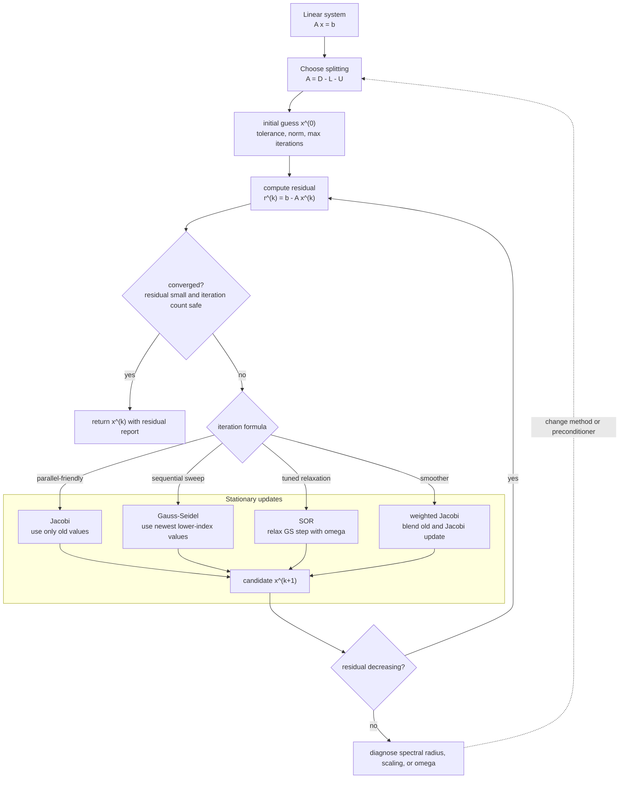

# Jacobi Gauss Seidel and SOR

Iterative methods for linear systems generate a sequence of approximate solutions instead of factoring the matrix directly. They are attractive when the matrix is large, sparse, and structured, because each iteration may be cheap and memory efficient. The tradeoff is that convergence is not automatic.

Jacobi, Gauss-Seidel, and successive over-relaxation are classical stationary iterations. They are easy to derive from a matrix splitting and they remain useful as smoothers, preconditioners, and teaching models for more advanced Krylov methods such as conjugate gradient.

## Three splittings of the same equations

Let

$$
Ax=b
$$

and split the matrix as

$$
A=D-L-U,
$$

where $D$ is the diagonal, $-L$ is the strictly lower triangular part, and $-U$ is the strictly upper triangular part. The Jacobi method is

$$
x^{(k+1)}=D^{-1}(L+U)x^{(k)}+D^{-1}b.
$$

In component form,

$$
x_i^{(k+1)}=\frac{1}{a_{ii}}\left(b_i-\sum_{j\ne i}a_{ij}x_j^{(k)}\right).
$$

Gauss-Seidel uses newest available components immediately:

$$
x^{(k+1)}=(D-L)^{-1}Ux^{(k)}+(D-L)^{-1}b.
$$

SOR introduces a relaxation parameter $\omega$:

$$
x_i^{(k+1)}=(1-\omega)x_i^{(k)}+\frac{\omega}{a_{ii}}\left(b_i-\sum_{j\lt i}a_{ij}x_j^{(k+1)}-\sum_{j\gt i}a_{ij}x_j^{(k)}\right).
$$

## Error propagation and the spectral-radius test

A stationary iteration has the form

$$
x^{(k+1)}=Bx^{(k)}+c.
$$

It converges for every starting vector if and only if the spectral radius satisfies

$$
\rho(B)\lt 1.
$$

This condition is exact but may be expensive to check. Practical sufficient conditions include strict diagonal dominance and symmetry positive definiteness for Gauss-Seidel.

Jacobi is naturally parallel because all new components use only old values. Gauss-Seidel is often faster in iteration count because it uses updated values immediately, but that data dependence makes parallelization harder. SOR can accelerate Gauss-Seidel when $0\lt\omega\lt 2$ for suitable SPD systems, with $\omega=1$ reducing to Gauss-Seidel. Choosing $\omega$ well is problem dependent.

Residuals are essential. The change between iterates may become small even if the current vector is not accurate for an ill-conditioned system or a poorly scaled norm. A solver should report both an iteration count and a residual norm such as $\|b-Ax^{(k)}\|$.

Let $x^*$ be the exact solution and define $e^{(k)}=x^{(k)}-x^*$. Since $x^*=Bx^*+c$, subtracting the fixed-point equation from the iteration gives

$$
e^{(k+1)}=Be^{(k)}=B^{k+1}e^{(0)}.
$$

Thus convergence from every start is equivalent to $B^k\to0$, which occurs exactly when every eigenvalue of $B$ lies inside the unit disk. The spectral radius condition $\rho(B)\lt 1$ is sharper than a norm bound. A convenient sufficient test is $\|B\|\lt 1$ in any induced norm, because $\rho(B)\le\|B\|$, but a method can converge even when a chosen norm of $B$ exceeds one.

Strict row diagonal dominance,

$$
|a_{ii}|>\sum_{j\ne i}|a_{ij}|,
$$

guarantees convergence of Jacobi and Gauss--Seidel. Gauss--Seidel also converges for every symmetric positive definite matrix. Jacobi does not inherit that entire SPD guarantee without an additional condition. These are sufficient structural tests, not necessary ones; a matrix that fails them may still have an iteration matrix with spectral radius below one.

The ordering of unknowns matters for Gauss--Seidel and SOR because it changes which components count as “new.” Reordering a sparse PDE system can alter the convergence rate and parallel schedule even though it represents the same exact equations. Jacobi is less sensitive to sweep order because all components come from the previous vector.

## Residual, error, and scaling

The residual is $r^{(k)}=b-Ax^{(k)}$. Since $Ae^{(k)}=-r^{(k)}$,

$$
e^{(k)}=-A^{-1}r^{(k)}.
$$

A small residual implies a small error only relative to the conditioning and scale of the problem. More explicitly,

$$
\frac{\|e^{(k)}\|}{\|x^*\|}
\lesssim \kappa(A)
\frac{\|r^{(k)}\|}{\|A\|\,\|x^{(k)}\|+\|b\|}.
$$

The denominator in the right-hand ratio gives a scale-aware backward error. Testing only $\|x^{(k+1)}-x^{(k)}\|$ is weaker: an iteration can stagnate because of rounding, or move slowly while still far from the solution. A sensible stopping rule checks a relative residual and retains a maximum-iteration guard.

Row scaling can improve the meaning of componentwise updates when diagonal entries differ greatly. It cannot repair a fundamentally divergent splitting. Likewise, permuting rows to place nonzero elements on the diagonal is necessary when some $a_{ii}=0$, but the resulting iteration still needs a convergence argument.

## What relaxation changes

SOR blends the old value with the Gauss--Seidel candidate. With $0\lt \omega\lt 1$, under-relaxation takes a shorter step and can calm an unstable-looking nonlinear outer process. With $1\lt \omega\lt 2$, over-relaxation extrapolates past the Gauss--Seidel value. For SPD matrices, SOR converges for $0\lt \omega\lt 2$; the best $\omega$ depends on the spectrum and ordering.

For the standard one-dimensional Poisson matrix with $n$ interior points, Jacobi has

$$
\rho(B_J)=\cos\left(\frac{\pi}{n+1}\right).
$$

As the grid is refined, this approaches one, so low-frequency error decays very slowly. Gauss--Seidel roughly squares that factor for this model problem, but it also slows under refinement. The often quoted near-optimal SOR value is

$$
\omega_{\mathrm{opt}}
=\frac{2}{1+\sqrt{1-\rho(B_J)^2}}
=\frac{2}{1+\sin(\pi/(n+1))}.
$$

This formula belongs to the model Poisson problem, not to an arbitrary matrix. Blindly carrying it to another system can make convergence worse.

## Why these old methods remain useful

One sweep costs one visit to the nonzeros of $A$, so sparse Jacobi or Gauss--Seidel costs $O(\operatorname{nnz}(A))$ per iteration and stores no dense factors. Their weakness is the number of sweeps needed for tightly coupled or fine-grid systems. Modern solvers often use them inside something stronger: weighted Jacobi as a parallel smoother in multigrid, Gauss--Seidel as a relaxation step, or a small number of sweeps as a preconditioner.

The table and flow below compare updates rather than presenting them as interchangeable formulas.

## A nonsingular system can still diverge

Take

$$
A=\begin{bmatrix}1&2\\2&1\end{bmatrix},
\qquad
b=\begin{bmatrix}3\\3\end{bmatrix}.
$$

The exact solution is $(1,1)^T$, and $A$ is nonsingular because its determinant is $-3$. Jacobi nevertheless has

$$
B_J=\begin{bmatrix}0&-2\\-2&0\end{bmatrix},
$$

whose eigenvalues are $2$ and $-2$. Starting from zero gives

$$
x^{(1)}=(3,3)^T,
\qquad
x^{(2)}=(-3,-3)^T,
\qquad
x^{(3)}=(9,9)^T.
$$

The iterates alternate and grow because $\rho(B_J)=2$. Nonsingularity guarantees a unique exact solution; it says nothing about whether a particular fixed-point splitting reaches it.

The same equations can sometimes be reordered or rescaled into a convergent form, but not every failure is cosmetic. When off-diagonal coupling dominates, a Krylov method with a suitable preconditioner may be the better algorithm rather than further tuning a stationary iteration.

## Error components decay at different rates

For the one-dimensional Poisson problem, eigenvectors of the Jacobi iteration matrix are discrete sine waves. The eigenvalue associated with mode $j$ is

$$
\lambda_j=\cos\left(\frac{j\pi}{n+1}\right).
$$

Modes near the grid scale have small amplification after weighted relaxation, while smooth low-frequency modes can have amplification close to one. A few Jacobi or Gauss--Seidel sweeps therefore remove oscillatory error quickly but leave a smooth error curve behind. Watching only the residual norm can hide this change in error character.

Multigrid exploits the observation. Error that is smooth on a fine grid becomes more oscillatory relative to a coarser grid, where it can be corrected cheaply. A typical cycle performs a few pre-smoothing sweeps, transfers the residual to a coarse grid, solves or approximates the coarse error equation, prolongs the correction, and post-smooths. Stationary iterations survive in modern solvers largely because they are effective smoothers, not because thousands of standalone sweeps are competitive.

Weighted Jacobi uses

$$
x^{(k+1)}=x^{(k)}+\omega D^{-1}(b-Ax^{(k)}).
$$

Here $\omega$ is often below one when the purpose is smoothing. This weighted Jacobi parameter should not be confused mechanically with the optimal SOR parameter: the iteration matrices and goals differ.

## Work, storage, and parallel communication

For a sparse matrix, one Jacobi sweep reads the old vector and writes a separate new vector. Rows can be processed concurrently, which suits GPUs and distributed memory, but every sweep needs exchange of vector entries belonging to neighboring subdomains. Gauss--Seidel overwrites in place and uses less vector storage, yet its within-sweep dependencies restrict parallelism.

Coloring can expose concurrency. On a five-point grid, red points depend only on black points and black points only on red points. Red--black Gauss--Seidel updates one color at a time, allowing all points of a color to run together. Its convergence behavior is not identical to lexicographic Gauss--Seidel because ordering changes the splitting.

Iteration count alone is therefore a weak performance measure. Compare total sparse operations, synchronization rounds, memory traffic, and time to a verified residual. SOR may use fewer sweeps while taking longer on parallel hardware; Jacobi may require more arithmetic while achieving better throughput.

## Residual histories as diagnostics

A well-behaved stationary solve often shows an approximately geometric residual decrease after an initial transient. If

$$
\frac{\|r^{(k+1)}\|}{\|r^{(k)}\|}\to q,
$$

then $q$ estimates the dominant asymptotic convergence factor. A ratio near one predicts many remaining iterations. Ratios above one signal divergence or a transient that needs investigation.

Residuals can also stagnate at a floor set by floating-point arithmetic, inconsistent stopping scales, or an inaccurate matrix-vector operation. Recomputing $b-Ax$ periodically is safer than relying forever on a recursively updated residual. A report should retain the initial residual, final relative residual, iteration count, and reason for termination; returning a vector after hitting the iteration limit without a warning turns nonconvergence into silent data.

Stationary splittings also introduce preconditioning. If $A=M-N$, the update can be written

$$
x^{(k+1)}=x^{(k)}+M^{-1}(b-Ax^{(k)}).
$$

Jacobi takes $M=D$ and Gauss--Seidel takes $M=D-L$. The operator $M^{-1}$ approximately removes easy parts of $A$. Used inside a Krylov method, the same idea seeks a transformed system whose eigenvalues or singular values are more favorable. The preconditioner must be cheap enough to apply repeatedly; an exact $M=A$ would converge immediately but costs the original solve.

For SPD problems, incomplete Cholesky retains selected entries of a Cholesky factor and drops others to control storage. For general sparse matrices, incomplete LU plays a similar role. Dropping too aggressively weakens the preconditioner, while allowing too much fill approaches the cost of a direct factorization.

| Method | Uses newest values? | Parallel friendly? | Tuning parameter | Typical behavior |
|---|---|---|---|---|
| Jacobi | no | yes | none | simple, often slow |
| Gauss-Seidel | yes | less so | none | often faster than Jacobi |
| SOR | yes | less so | $\omega$ | can accelerate or destabilize |
| Weighted Jacobi | no | yes | weight | common smoother |



The iterative-solver diagram keeps the residual test outside the update formula, which allows a fair comparison of Jacobi, Gauss-Seidel, SOR, and weighted Jacobi. The stationary-update subgraph identifies which values each method uses to build $x^{(k+1)}$. The divergence branch states the convergence hypothesis instead of hiding it behind a fixed iteration count.

## Worked example 1: Jacobi iteration

**Problem.** Perform two Jacobi iterations from $x^{(0)}=(0,0)^T$ for

$$
\begin{bmatrix}4&1\\2&3\end{bmatrix}
\begin{bmatrix}x\\y\end{bmatrix}
=
\begin{bmatrix}1\\2\end{bmatrix}.
$$

**Method.** Rearrange each equation using old values:

$$
x^{(k+1)}=\frac{1-y^{(k)}}{4},
\qquad
y^{(k+1)}=\frac{2-2x^{(k)}}{3}.
$$

1. From $(0,0)$:

$$
x^{(1)}=\frac14=0.25,
\qquad
y^{(1)}=\frac23=0.666666\ldots.
$$

2. Second iteration:

$$
x^{(2)}=\frac{1-0.666666\ldots}{4}=0.083333\ldots,
$$

$$
y^{(2)}=\frac{2-2(0.25)}{3}=0.5.
$$

3. The exact solution is obtained from $4x+y=1$ and $2x+3y=2$:

$$
x=0.1,
\qquad y=0.6.
$$

**Checked answer.** After two Jacobi iterations, the approximation is $(0.083333,0.5)^T$, moving toward $(0.1,0.6)^T$.

For comparison, one Gauss--Seidel sweep uses the new $x^{(1)}=0.25$ immediately:

$$
y^{(1)}=\frac{2-2(0.25)}{3}=0.5.
$$

The second sweep gives

$$
x^{(2)}=\frac{1-0.5}{4}=0.125,
\qquad
y^{(2)}=\frac{2-2(0.125)}{3}=0.583333\ldots.
$$

Its second iterate is closer here, though this comparison does not prove that Gauss--Seidel wins on every matrix or in wall-clock time.

## Worked example 2: spectral radius test

**Problem.** Check Jacobi convergence for the same matrix using the iteration matrix.

**Method.** The Jacobi matrix is

$$
B_J=\begin{bmatrix}0&-1/4\\-2/3&0\end{bmatrix}.
$$

1. For a matrix of the form

$$
\begin{bmatrix}0&a\\b&0\end{bmatrix},
$$

the eigenvalues satisfy $\lambda^2=ab$.

2. Here

$$
ab=\left(-\frac14\right)\left(-\frac23\right)=\frac16.
$$

3. Therefore

$$
\lambda=\pm \sqrt{\frac16}.
$$

4. The spectral radius is

$$
\rho(B_J)=\sqrt{\frac16}=0.408248\ldots\lt 1.
$$

**Checked answer.** Jacobi converges for this system from any starting vector because the spectral radius is less than one.

## Sparse-sweep implementation

```python
import numpy as np

def jacobi(A, b, x0=None, tol=1e-10, max_iter=500):
    A = np.asarray(A, dtype=float)
    b = np.asarray(b, dtype=float)
    x = np.zeros_like(b) if x0 is None else np.asarray(x0, dtype=float)
    D = np.diag(A)
    R = A - np.diagflat(D)
    for k in range(1, max_iter + 1):
        x_new = (b - R @ x) / D
        if np.linalg.norm(b - A @ x_new, ord=np.inf) < tol:
            return x_new, k
        x = x_new
    return x, max_iter

def gauss_seidel(A, b, x0=None, omega=1.0, tol=1e-10, max_iter=500):
    A = np.asarray(A, dtype=float)
    b = np.asarray(b, dtype=float)
    x = np.zeros_like(b) if x0 is None else np.asarray(x0, dtype=float)
    n = len(b)
    for k in range(1, max_iter + 1):
        old = x.copy()
        for i in range(n):
            sigma = A[i, :i] @ x[:i] + A[i, i+1:] @ old[i+1:]
            candidate = (b[i] - sigma) / A[i, i]
            x[i] = (1.0 - omega) * old[i] + omega * candidate
        if np.linalg.norm(b - A @ x, ord=np.inf) < tol:
            return x, k
    return x, max_iter

A = np.array([[4.0, 1.0], [2.0, 3.0]])
b = np.array([1.0, 2.0])
print(jacobi(A, b))
print(gauss_seidel(A, b))
print(np.linalg.solve(A, b))
```

## When a stationary iteration disappoints

- Assuming an iterative method converges just because the matrix is nonsingular.
- Stopping on small iterate changes without checking the residual.
- Choosing an SOR parameter outside a stable range.
- Destroying sparsity by forming dense matrices inside each iteration.
- Comparing iteration counts without comparing cost per iteration and preconditioning.

<div className="see-also">

See also: [Gaussian elimination pivoting and LU](/math/numerical-analysis/gaussian-elimination-pivoting-lu) · [conjugate gradient and iterative refinement](/math/numerical-analysis/conjugate-gradient-iterative-refinement) · [matrix factorizations and special systems](/math/numerical-analysis/matrix-factorizations-special-systems) · [finite difference methods for PDEs](/math/numerical-analysis/finite-difference-pdes)

</div>
