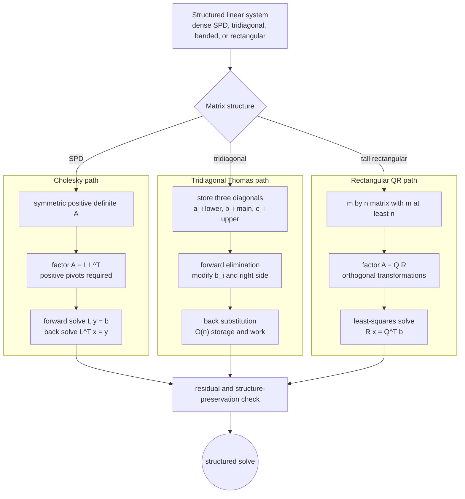

# Matrix Factorizations and Special Systems

General Gaussian elimination is a powerful default, but many matrices have structure that should not be ignored. Symmetric positive definite matrices, tridiagonal matrices, banded matrices, and orthogonal factorizations all allow algorithms that are faster, more stable, or more memory efficient than treating the matrix as dense and unstructured.

The main numerical lesson is to let the matrix structure choose the solver. A direct method that respects symmetry or bandwidth can reduce both arithmetic and roundoff. The discussion centers on Cholesky factorization for symmetric positive definite systems and the Thomas algorithm for tridiagonal systems, with QR as the stable workhorse for least squares.

## Recognizing the structure before factoring

A matrix $A$ is **symmetric positive definite** (SPD) if

$$
A=A^T
\quad \text{and} \quad
x^TAx\gt 0 \text{ for every nonzero }x.
$$

An SPD matrix has a Cholesky factorization

$$
A=LL^T,
$$

where $L$ is lower triangular with positive diagonal entries. Cholesky uses about half the work and storage of a general LU factorization.

A **tridiagonal matrix** has nonzero entries only on the main diagonal, first subdiagonal, and first superdiagonal. It can be written through three arrays:

$$
a_i x_{i-1}+b_i x_i+c_i x_{i+1}=d_i.
$$

The Thomas algorithm is specialized Gaussian elimination for tridiagonal systems.

A QR factorization writes

$$
A=QR,
$$

where $Q$ has orthonormal columns and $R$ is upper triangular. QR is especially important for least squares because orthogonal transformations preserve norms.

## Cholesky from the entries of $A$

Cholesky exists and is unique for SPD matrices when the diagonal of $L$ is required to be positive. The factorization is stable without pivoting for SPD matrices, which is one reason SPD structure is so valuable. In contrast, applying ordinary LU without recognizing symmetry can waste work and lose a useful diagnostic: a nonpositive Cholesky pivot indicates that the matrix is not SPD in working precision.

For a dense $n\times n$ matrix, Cholesky costs about $n^3/3$ floating-point operations, compared with about $2n^3/3$ for LU. For a tridiagonal system, the Thomas algorithm costs only $O(n)$ operations and stores only three diagonals. This difference is decisive in boundary value problems and finite difference PDEs, where tridiagonal or banded matrices occur naturally.

QR factorization is more expensive than normal equations for least squares, but it avoids squaring the condition number. If $A$ is ill-conditioned, solving $A^TAx=A^Tb$ can lose many digits, while Householder QR gives a more stable path.

Equating entries in $A=LL^T$ gives the Cholesky recurrence. For row $i$ and column $j\lt i$,

$$
\ell_{ij}=
\frac{a_{ij}-\sum_{k=1}^{j-1}\ell_{ik}\ell_{jk}}{\ell_{jj}},
$$

and the diagonal is

$$
\ell_{ii}=
\sqrt{a_{ii}-\sum_{k=1}^{i-1}\ell_{ik}^2}.
$$

The expression under the square root is the next Schur-complement pivot. Positive definiteness guarantees it is positive in exact arithmetic. A zero or negative value during a hand computation means the matrix is not SPD; in floating-point work, a tiny negative value can also signal severe ill-conditioning or loss of symmetry in the stored data.

Once $L$ is available, solving $Ax=b$ means two triangular solves:

$$
Ly=b,qquad L^Tx=y.
$$

Factoring costs about $n^3/3$ flops, but each new right-hand side costs only $O(n^2)$. That separation matters in simulations and optimization, where the same matrix may be used with many load vectors.

Symmetry alone is insufficient. The matrix

$$
\begin{bmatrix}1&2\\2&1\end{bmatrix}
$$

is symmetric but has eigenvalues $3$ and $-1$. Cholesky reaches $\ell_{11}=1$ and then asks for $\ell_{22}=\sqrt{1-4}$, exposing the missing definiteness assumption.

## The Thomas sweep for tridiagonal systems

For

$$
a_i x_{i-1}+b_i x_i+c_i x_{i+1}=d_i,
$$

eliminate the subdiagonal from top to bottom. At row $i$, the multiplier is

$$
m_i=\frac{a_i}{\tilde b_{i-1}},
$$

and the modified coefficients are

$$
\tilde b_i=b_i-m_ic_{i-1},
\qquad
\tilde d_i=d_i-m_i\tilde d_{i-1}.
$$

Back substitution starts with $x_n=\tilde d_n/\tilde b_n$ and proceeds upward. Only the three diagonals and right-hand side are touched, so both work and storage are linear in $n$.

Thomas elimination normally uses no pivoting. Strict diagonal dominance is a common sufficient condition preventing zero pivots, and SPD tridiagonal matrices are also safe. For a general tridiagonal matrix, partial pivoting may be required; a robust banded solver is preferable to a handwritten Thomas routine when the structure does not supply a stability guarantee.

## Bandwidth, fill-in, and ordering

A matrix with lower and upper bandwidth $w$ needs only $O(nw)$ storage. Banded elimination costs about $O(nw^2)$ rather than $O(n^3)$. Those savings survive only while operations stay inside the band. A careless dense conversion throws away the main advantage before the solve begins.

Sparse matrices introduce a further issue: fill-in. Entries that are zero in $A$ can become nonzero in $L$ and $U$. Reordering unknowns can reduce fill dramatically without changing the mathematical system. Grid problems are a standard example: natural ordering produces a recognizable band, while sparse nested-dissection-style orderings often give a much smaller factorization for large two-dimensional and three-dimensional meshes.

Structure can overlap. A finite-difference matrix may be sparse, banded, symmetric, and positive definite at once. “Use Cholesky” then identifies the algebraic factorization, while “use sparse storage and a fill-reducing ordering” determines whether that factorization fits in memory.

## Why QR is the least-squares default

For an overdetermined system $Ax\approx b$, the least-squares solution satisfies the normal equations

$$
A^TAx=A^Tb.
$$

They are cheap to form, but

$$
\kappa_2(A^TA)=\kappa_2(A)^2.
$$

The loss can be severe when columns of $A$ are nearly dependent. With $A=QR$ and $Q^TQ=I$,

$$
\|Ax-b\|_2
=\|Q^Tb-Rx\|_2
$$

after extending $Q$ appropriately. The minimizer comes from the triangular system $Rx=Q^Tb$ without squaring the condition number. Householder reflections are the standard dense construction because they apply orthogonal transformations stably; classical Gram--Schmidt is much more vulnerable to loss of orthogonality.

## Checking a factorization rather than trusting it

For a computed Cholesky factor, inspect a scaled factor residual such as

$$
\frac{\|A-LL^T\|}{\|A\|}.
$$

For the solved vector, also inspect $\|b-Ax\|$. A small factor residual shows that the algorithm factored a nearby matrix; a small solve residual shows that the returned vector solves the stored system backward stably. Neither guarantees a small forward error when $A$ is ill-conditioned. A condition estimate supplies the missing warning.

The decision map below summarizes which assumption earns which specialized algorithm.

## Symmetric indefinite systems need a different factorization

When $A$ is symmetric but not positive definite, forcing Cholesky is the wrong diagnostic response. A symmetric factorization of the form

$$
PAP^T=LDL^T
$$

preserves symmetry while allowing signed diagonal blocks in $D$. Stable algorithms may use both $1\times1$ and $2\times2$ pivot blocks. The permutation $P$ chooses pivots that control growth.

This case appears in constrained optimization. The Karush--Kuhn--Tucker matrix

$$
\begin{bmatrix}
H&C^T\\
C&0
\end{bmatrix}
$$

is often symmetric indefinite even when the Hessian block $H$ is positive definite on the feasible subspace. Ordinary Cholesky fails by design, not because the underlying optimization problem is necessarily ill-posed.

If symmetry is absent, pivoted LU remains the standard dense direct route. Partial pivoting exchanges rows to keep multipliers moderate. A specialized solver should be selected from properties actually established, rather than from a matrix that merely looks nearly symmetric when printed.

## Rank deficiency changes the least-squares question

For full-column-rank $A$, the triangular factor $R$ in a thin QR factorization has nonzero diagonal and the least-squares minimizer is unique. If columns are linearly dependent, $R$ is singular and many coefficient vectors may give the same fitted values. A small diagonal of $R$ relative to the leading scale warns of numerical rank deficiency.

QR with column pivoting factors

$$
AP=QR
$$

while moving informative columns forward. It provides a usable rank estimate and identifies dependent directions. The singular value decomposition

$$
A=U\Sigma V^T
$$

is more expensive but gives the clearest picture: small singular values correspond to directions that data barely determine. Truncating them produces a regularized, lower-rank solution; retaining them can magnify noise by division through tiny values.

Normal equations conceal this issue by squaring the singular values. A direction with relative scale $10^{-8}$ in $A$ appears at $10^{-16}$ in $A^TA$, near double-precision roundoff. QR or SVD is therefore essential when rank is uncertain.

## Reusing factors and solving many right-hand sides

Factorization and triangular solves have different costs. For dense Cholesky, building $L$ costs $O(n^3)$ while solving for one right-hand side costs $O(n^2)$. With $B$ containing many right-hand sides,

$$
AX=B,
$$

factor once and apply the two triangular solves to all columns. Recomputing a factor for every column wastes the dominant work and can introduce small inconsistencies between solutions.

If the matrix changes by a low-rank update, specialized update and downdate algorithms may modify a Cholesky factor faster than refactoring. Downdates require care because subtracting a positive semidefinite term can destroy positive definiteness. A failed downdate is meaningful: the updated matrix no longer supports the assumed SPD model in working precision.

For banded time-stepping systems with fixed coefficients, factor reuse is equally important. A backward-Euler discretization may solve the same tridiagonal matrix at every time level with a changing right-hand side. The Thomas forward coefficients can be prepared once, leaving only right-hand-side elimination and back substitution per step.

## Block structure can be more valuable than scalar bandwidth

Systems of PDEs often couple several variables at each grid point. Ordering by point creates a block-tridiagonal or block-banded matrix. Replacing scalar divisions in Thomas elimination with solves against small blocks gives a block Thomas algorithm. Its pivots are matrices, so nonsingularity and conditioning of the block Schur complements matter.

Alternatively, ordering all values of one variable together can expose a $2\times2$ block system. Eliminating one variable produces a Schur complement. That reduction may lead to a strong preconditioner, but explicitly forming a dense Schur complement can destroy sparsity. The useful structure is sometimes a formula for applying the Schur complement, not a stored matrix.

These choices are data-layout decisions as well as algebra. They influence cache use, parallel communication, and fill-in. The best ordering for a proof or a compact printed matrix need not be the best ordering for a large solve.



This diagram replaces the static tridiagonal sketch with the decision architecture for special matrix systems. Cholesky, Thomas, and QR each expose their required matrix structure, factorization substeps, and solve phase. The shared check emphasizes that preserving structure is the source of the speedup, so residuals and storage patterns should both be audited.

| Structure | Factorization or algorithm | Cost | Typical source |
|---|---|---:|---|
| SPD dense | Cholesky $A=LL^T$ | about $n^3/3$ | normal modes, covariance, energy systems |
| Tridiagonal | Thomas algorithm | $O(n)$ | 1D finite differences, splines |
| Banded | banded LU or Cholesky | depends on bandwidth | PDE grids, local coupling |
| Tall rectangular | QR | $O(mn^2)$ | least squares |

## Worked example 1: Cholesky factorization

**Problem.** Factor

$$
A=\begin{bmatrix}4&2\\2&3\end{bmatrix}
$$

as $A=LL^T$.

**Method.** Let

$$
L=\begin{bmatrix}\ell_{11}&0\\\ell_{21}&\ell_{22}\end{bmatrix}.
$$

1. From the $(1,1)$ entry:

$$
\ell_{11}^2=4 \Rightarrow \ell_{11}=2.
$$

2. From the $(2,1)$ entry:

$$
\ell_{21}\ell_{11}=2 \Rightarrow \ell_{21}=1.
$$

3. From the $(2,2)$ entry:

$$
\ell_{21}^2+\ell_{22}^2=3
\Rightarrow
1+\ell_{22}^2=3.
$$

Thus $\ell_{22}=\sqrt{2}$.

**Checked answer.**

$$
L=\begin{bmatrix}2&0\\1&\sqrt{2}\end{bmatrix},
\qquad
LL^T=\begin{bmatrix}4&2\\2&3\end{bmatrix}.
$$

## Worked example 2: tridiagonal solve

**Problem.** Solve

$$
\begin{bmatrix}
2&-1&0\\
-1&2&-1\\
0&-1&2
\end{bmatrix}
\begin{bmatrix}x_1\\x_2\\x_3\end{bmatrix}
=
\begin{bmatrix}1\\0\\1\end{bmatrix}.
$$

**Method.** Carry out the Thomas elimination, then verify the result.

1. The system is

$$
2x_1-x_2=1,
$$

$$
-x_1+2x_2-x_3=0,
$$

$$
-x_2+2x_3=1.
$$

2. Eliminate the first subdiagonal entry. The multiplier is

$$
m_2=\frac{-1}{2}=-\frac12.
$$

The modified second row has

$$
\tilde b_2=2-\left(-\frac12\right)(-1)=\frac32,
\qquad
\tilde d_2=0-\left(-\frac12\right)(1)=\frac12.
$$

3. For the third row,

$$
m_3=\frac{-1}{3/2}=-\frac23,
$$

so

$$
\tilde b_3=2-\left(-\frac23\right)(-1)=\frac43,
\qquad
\tilde d_3=1-\left(-\frac23\right)\left(\frac12\right)=\frac43.
$$

4. Back substitute:

$$
x_3=\frac{4/3}{4/3}=1,
$$

$$
x_2=\frac{1/2-(-1)(1)}{3/2}=1,
$$

$$
x_1=\frac{1-(-1)(1)}{2}=1.
$$

5. Symmetry of the right-hand side also suggests $x_1=x_3$, which is a useful independent check.

**Checked answer.** The solution is $(1,1,1)^T$. A Thomas algorithm would find the same solution in linear time for larger tridiagonal systems.

## Reference implementations

```python
import numpy as np

def cholesky_lower(A):
    A = np.asarray(A, dtype=float)
    n = A.shape[0]
    L = np.zeros_like(A)
    for i in range(n):
        for j in range(i + 1):
            s = np.dot(L[i, :j], L[j, :j])
            if i == j:
                value = A[i, i] - s
                if value <= 0:
                    raise np.linalg.LinAlgError("matrix is not positive definite")
                L[i, j] = np.sqrt(value)
            else:
                L[i, j] = (A[i, j] - s) / L[j, j]
    return L

def thomas(a, b, c, d):
    a = np.array(a, dtype=float)
    b = np.array(b, dtype=float)
    c = np.array(c, dtype=float)
    d = np.array(d, dtype=float)
    n = len(b)
    for i in range(1, n):
        m = a[i - 1] / b[i - 1]
        b[i] -= m * c[i - 1]
        d[i] -= m * d[i - 1]
    x = np.zeros(n)
    x[-1] = d[-1] / b[-1]
    for i in range(n - 2, -1, -1):
        x[i] = (d[i] - c[i] * x[i + 1]) / b[i]
    return x

A = np.array([[4.0, 2.0], [2.0, 3.0]])
print(cholesky_lower(A))
print(thomas([-1.0, -1.0], [2.0, 2.0, 2.0], [-1.0, -1.0], [1.0, 0.0, 1.0]))
```

## Failure patterns

- Running Cholesky on a matrix that is symmetric but not positive definite.
- Destroying banded sparsity by converting a structured system to a dense matrix.
- Solving least squares with normal equations when the matrix is ill-conditioned.
- Forgetting that a tridiagonal algorithm assumes nonzero modified pivots.
- Ignoring storage costs. For large structured systems, memory can matter as much as arithmetic.

<div className="see-also">

See also: [Gaussian elimination pivoting and LU](/math/numerical-analysis/gaussian-elimination-pivoting-lu) · [least squares and Chebyshev approximation](/math/numerical-analysis/least-squares-chebyshev-approximation) · [finite difference methods for PDEs](/math/numerical-analysis/finite-difference-pdes) · [cubic splines and parametric curves](/math/numerical-analysis/cubic-splines-parametric-curves)

</div>
