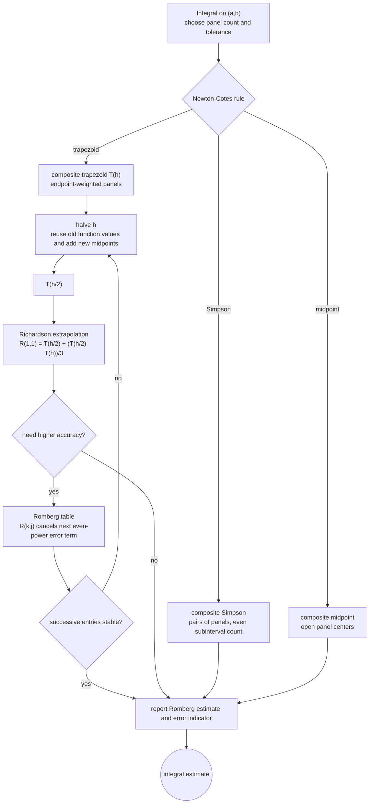

# Newton Cotes and Romberg Integration

Numerical integration, or quadrature, replaces an integral by a weighted sum of function values. Newton-Cotes formulas choose equally spaced nodes and integrate an interpolating polynomial through those nodes. The trapezoidal rule, midpoint rule, and Simpson's rule are the most common members of this family.

Romberg integration accelerates the composite trapezoidal rule by applying Richardson extrapolation to its even-power error expansion. It is a good example of a general numerical pattern: start with a simple approximation at several mesh sizes, then combine the approximations to cancel leading error terms.

## Quadrature as integrated interpolation

A quadrature rule has the form

$$
\int_a^b f(x)\,dx \approx \sum_{i=0}^n w_i f(x_i),
$$

where the $x_i$ are nodes and the $w_i$ are weights. A **closed Newton-Cotes** rule includes the endpoints. The trapezoidal rule is

$$
T(f)=\frac{b-a}{2}\left[f(a)+f(b)\right].
$$

Simpson's rule uses the midpoint $m=(a+b)/2$:

$$
S(f)=\frac{b-a}{6}\left[f(a)+4f(m)+f(b)\right].
$$

A **composite** rule divides $[a,b]$ into subintervals and applies a simple rule repeatedly. If $h=(b-a)/n$, the composite trapezoidal rule is

$$
T_n=\frac{h}{2}\left[f(x_0)+2\sum_{i=1}^{n-1}f(x_i)+f(x_n)\right].
$$

Romberg integration builds a triangular table from $R_{k,1}=T_{2^{k-1}}$ and

$$
R_{k,j}=R_{k,j-1}+\frac{R_{k,j-1}-R_{k-1,j-1}}{4^{j-1}-1}.
$$

## Where the familiar weights come from

The local trapezoidal error is proportional to $f''(\xi)(b-a)^3$, so the composite trapezoidal rule is second-order accurate for smooth functions. Simpson's rule is exact for polynomials of degree at most three and has fourth-order global accuracy when applied as a composite rule on an even number of subintervals.

The Euler-Maclaurin expansion explains why Romberg works. For sufficiently smooth $f$, the composite trapezoidal approximation has an error expansion of the form

$$
T(h)=I+c_2h^2+c_4h^4+c_6h^6+\cdots.
$$

Because only even powers appear under appropriate smoothness assumptions, replacing $h$ by $h/2$ and combining estimates can cancel $c_2h^2$, then $c_4h^4$, and so on. The first extrapolation is exactly

$$
R_{2,2}=T(h/2)+\frac{T(h/2)-T(h)}{3}.
$$

On one interval, replace $f$ by its interpolating polynomial and integrate that polynomial exactly. Linear interpolation through $a$ and $b$ gives

$$
p_1(x)=f(a)\frac{b-x}{b-a}+f(b)\frac{x-a}{b-a}.
$$

Both basis functions integrate to $(b-a)/2$, producing the trapezoidal weights. Quadratic interpolation through $a$, $m$, and $b$ produces weights in the ratio $1:4:1$, hence Simpson's rule. The weights are consequences of interpolation, not empirical constants.

Taylor expansion gives the one-panel error formulas

$$
I-T=-\frac{(b-a)^3}{12}f''(\xi)
$$

and

$$
I-S=-\frac{(b-a)^5}{2880}f^{(4)}(\xi)
$$

for suitable points $\xi$ when the needed derivatives are continuous. Composite rules sum local errors over shrinking panels. With uniform spacing $h$,

$$
I-T_n=-\frac{b-a}{12}h^2f''(\xi),
$$

while composite Simpson has global error

$$
I-S_n=-\frac{b-a}{180}h^4f^{(4)}(\xi).
$$

Simpson's rule integrates every cubic exactly even though it is built from quadratic interpolation on each pair of subintervals. Symmetry cancels the cubic error term. This extra degree of precision is a recurring feature of symmetric quadrature formulas.

High-degree closed Newton--Cotes rules are rarely the best next step. Their weights eventually alternate in sign and grow in magnitude, so data error and roundoff can be amplified. Repeating a low-degree rule locally is safer and lets refinement concentrate where the integrand is difficult.

## Building the Romberg triangle

Let $R_{k,1}=T_{2^{k-1}}$. If

$$
R_{k,1}=I+c_2h_k^2+c_4h_k^4+\cdots,
\qquad h_k=\frac{b-a}{2^{k-1}},
$$

then the first extrapolation cancels $c_2h^2$:

$$
R_{k,2}=\frac{4R_{k,1}-R_{k-1,1}}{3}.
$$

Its leading error is fourth order. Applying the same reasoning to adjacent entries in column two cancels the $h^4$ term, giving denominator $4^2-1=15$. Column $j$ has formal leading order $2j$ under the smooth even-power expansion.

Nested trapezoids avoid wasting function evaluations. If $T_n$ is known, then

$$
T_{2n}=\frac12T_n+h_{2n}
\sum_{i=1}^{n}f\bigl(a+(2i-1)h_{2n}\bigr).
$$

Only the new midpoints are evaluated. A Romberg implementation that recomputes every trapezoid row loses one of the method's cleanest advantages when $f$ is expensive.

The diagonal difference $\vert R_{k,k}-R_{k-1,k-1}\vert $ is a useful error indicator, but it is not a proof. Stop when the diagonal stabilizes relative to the requested absolute and relative tolerances, and also cap the number of levels. A table whose entries improve and then deteriorate is showing the onset of roundoff or a failure of the smooth error model.

## When smoothness assumptions fail

Endpoint singularities such as $f(x)=x^{-1/2}$ violate the bounded-derivative assumptions behind the quoted orders. The integral exists on $[0,1]$, but evaluating $f(0)$ is impossible and Romberg extrapolation on the original variable is unsuitable. The substitution $x=t^2$ turns

$$
\int_0^1x^{-1/2}\,dx
=\int_0^1 2\,dt=2,
$$

removing the singularity before quadrature.

Discontinuities and sharp interior layers call for splitting the interval or adaptive refinement. Oscillatory integrals may need rules designed around the oscillation rather than ever finer uniform panels. Conversely, the trapezoidal rule can converge exceptionally fast for smooth periodic functions sampled over a full period; its endpoint-derivative corrections cancel in the Euler--Maclaurin expansion.

Infinite intervals also require a transformation or a specialized rule. Truncating an infinite interval adds a tail error distinct from quadrature error, and the two should be controlled separately.

## Choosing among the low-order rules

Midpoint and trapezoidal rules are both second order, but their leading errors often have opposite signs for convex functions. For a convex $f$, chords lie above the graph, so trapezoidal overestimates; midpoint rectangles tend to underestimate. Their difference supplies a useful rough check. Simpson can be obtained by combining them on the same two-subinterval panel:

$$
S_{2n}=\frac{2M_n+T_n}{3}.
$$

The following comparison assumes smooth data. Function availability, singularities, and the cost of evaluation can overturn a ranking based only on formal order.

## Estimating error from two meshes

Suppose a composite rule has

$$
Q(h)=I+Ch^p+O(h^{p+q}).
$$

Then

$$
Q(h/2)-Q(h)
=C h^p(2^{-p}-1)+O(h^{p+q}).
$$

Solving for the leading error of the fine estimate gives

$$
I-Q(h/2)\approx
\frac{Q(h/2)-Q(h)}{2^p-1}.
$$

For trapezoidal $p=2$, divide the mesh difference by 3; for composite Simpson $p=4$, divide by 15. The estimate becomes credible only after successive refinements show the expected ratio. If trapezoidal errors are asymptotically second order, then

$$
\frac{Q(h)-Q(h/2)}{Q(h/2)-Q(h/4)}\approx4.
$$

A ratio wandering far from four says that the leading-error model has not settled, the integral lacks smoothness, or roundoff has entered. Reporting an error estimate without this check gives false precision.

As a small calculation, suppose Simpson estimates on spacings $h$ and $h/2$ are $1.718190$ and $1.718276$ for an integral whose value is unknown. The fine-grid correction is

$$
\frac{1.718276-1.718190}{15}
=0.00000573.
$$

The extrapolated estimate is about $1.71828173$. One more mesh is needed to see whether the ratio and stable digits support that many decimals.

## Adaptive Simpson as local error control

A uniform grid spends equal effort where the integrand is flat and where it bends sharply. Adaptive Simpson starts with one Simpson estimate $S_{ab}$ on $[a,b]$, then computes estimates $S_{am}$ and $S_{mb}$ on the two halves. Because Simpson is fourth order, the local error indicator is

$$
\frac{|S_{am}+S_{mb}-S_{ab}|}{15}.
$$

If the indicator is below the allocated tolerance, the corrected value

$$
S_{am}+S_{mb}
+\frac{S_{am}+S_{mb}-S_{ab}}{15}
$$

is accepted. Otherwise the two halves are treated recursively. A careful implementation reuses endpoint and midpoint evaluations, divides the tolerance across children, and imposes a maximum depth.

Local refinement is effective for a narrow smooth peak because the algorithm places panels around it. It can miss a feature that no sampled point sees, such as a very narrow spike between nodes. Breakpoints known from the model should be supplied explicitly rather than left to chance.

## Transformations before adding panels

Variable substitution can turn a difficult integral into an ordinary smooth one. For an infinite interval,

$$
\int_0^\infty f(x)\,dx,
$$

the map $x=t/(1-t)$ gives

$$
\int_0^1
f\left(\frac{t}{1-t}\right)
\frac{dt}{(1-t)^2}.
$$

Whether this helps depends on the tail of $f$; the transformed integrand may still be steep near $t=1$. For a square-root endpoint behavior, a quadratic substitution often smooths the derivative. For a known interior discontinuity at $c$, split

$$
\int_a^b f(x)\,dx
=\int_a^c f(x)\,dx+\int_c^b f(x)\,dx.
$$

No increase in polynomial order compensates for interpolating across a jump.

Scaling the interval can also improve bookkeeping. With $x=a+(b-a)t$,

$$
\int_a^b f(x)\,dx
=(b-a)\int_0^1f(a+(b-a)t)\,dt.
$$

The normalized interval makes panel counts and tolerances easier to compare across problems, while the outside factor preserves units.

## Roundoff and summation

Composite quadrature may add millions of terms with very different magnitudes. Straight left-to-right summation can lose low-order bits, particularly when the integrand changes sign and the true integral is much smaller than the positive and negative parts. Pairwise or compensated summation reduces that loss.

Refinement eventually reaches a point where truncation shrinks below evaluation and summation error. Romberg extrapolation then magnifies noise because it subtracts nearly equal table entries. A defensible routine stops when progress stalls; it does not continue to the maximum level merely because another row is available.

## Polynomial checks catch weight errors

Degree of precision gives a small, exact test suite. A trapezoidal implementation must integrate $1$ and $x$ exactly on any interval. Simpson must integrate $1$, $x$, $x^2$, and $x^3$ exactly, up to floating-point rounding. Failure on these cases points to incorrect endpoint weights, spacing, or panel indexing rather than insufficient refinement.

Composite Simpson's alternating weights require an even number of subintervals:

$$
S_n=\frac h3\left[f(x_0)+f(x_n)
+4\sum_{i\text{ odd}}f(x_i)
+2\sum_{i\text{ even},\,i\ne n}f(x_i)\right].
$$

An odd panel count leaves one interval unpaired. It can be handled by applying another rule to the final portion, but silently applying the alternating pattern changes the formula and its error behavior.

Dimensional analysis is another cheap check. If $x$ has units of seconds and $f$ has units of meters per second, the integral has units of meters. Every Newton--Cotes weight contains a factor of interval length. Omitting $h$ often produces a result whose numerical growth with panel count looks suspicious and whose units are plainly wrong.

When function values are tabulated rather than callable, refinement cannot invent midpoint data. Interpolating new values and then claiming a high-order quadrature error confuses interpolation uncertainty with integration error. A rule should use the available sampling geometry, and the error report should acknowledge measurement and interpolation error alongside truncation.

| Rule | Nodes on one panel | Degree of precision | Composite order | Best use |
|---|---:|---:|---:|---|
| Trapezoidal | endpoints | 1 | 2 | smooth periodic or cheap evaluations |
| Midpoint | center | 1 | 2 | simple open-panel estimate |
| Simpson | endpoints and midpoint | 3 | 4 | smooth functions, even subinterval count |
| Romberg | nested trapezoids | increases by column | high for smooth functions | smooth non-singular integrands |



This integration diagram shows Newton-Cotes rules as panel-based approximations and Romberg integration as a nested refinement controller. The trapezoid path explicitly reuses function values after halving $h$, then Richardson extrapolation cancels the leading even-power error terms. The stability check on the Romberg table is the diagnostic that decides whether more refinement is justified.

## Worked example 1: trapezoidal and Simpson rules for $x^2$

**Problem.** Approximate

$$
\int_0^2 x^2\,dx
$$

using the single-panel trapezoidal rule and Simpson's rule.

**Method.** The exact integral is

$$
\int_0^2x^2\,dx=\frac{x^3}{3}\bigg|_0^2=\frac{8}{3}.
$$

1. Trapezoidal rule:

$$
T=\frac{2-0}{2}\left[f(0)+f(2)\right]
=1(0+4)=4.
$$

2. Simpson's rule with midpoint $1$:

$$
S=\frac{2-0}{6}\left[f(0)+4f(1)+f(2)\right].
$$

3. Substitute values:

$$
S=\frac{1}{3}(0+4+4)=\frac{8}{3}.
$$

**Checked answer.** The trapezoidal estimate is $4$, while Simpson's rule gives $8/3$ exactly because $x^2$ has degree less than or equal to three.

## Worked example 2: first Romberg extrapolation for $\pi$

**Problem.** Approximate

$$
\int_0^1 \frac{4}{1+x^2}\,dx=\pi
$$

using $T(h)$, $T(h/2)$, and one Romberg extrapolation.

**Method.** Use $h=1$ and then $h=1/2$.

1. One-panel trapezoidal rule:

$$
T(1)=\frac12\left[f(0)+f(1)\right]=\frac12(4+2)=3.
$$

2. Two-panel trapezoidal rule uses $x=0,0.5,1$:

$$
f(0.5)=\frac{4}{1.25}=3.2.
$$

$$
T(1/2)=\frac{0.5}{2}\left[4+2(3.2)+2\right]=3.1.
$$

3. Extrapolate:

$$
R_{2,2}=3.1+\frac{3.1-3.0}{3}=3.133333333\ldots.
$$

**Checked answer.** One extrapolation moves the estimate from $3.1$ to $3.133333\ldots$, closer to $\pi\approx 3.141592654$.

Continuing one more row shows how the triangle develops. With four panels,

$$
T_4=3.1311764706\ldots.
$$

Then

$$
R_{3,2}=T_4+\frac{T_4-T_2}{3}
=3.1415686275\ldots,
$$

and

$$
R_{3,3}=R_{3,2}+\frac{R_{3,2}-R_{2,2}}{15}
=3.1421176471\ldots.
$$

The last entry overshoots $\pi$ slightly. Romberg rows need not approach the answer monotonically; stability across later rows matters more than the direction of a single correction.

## Reusing evaluations in code

```python
import math

def composite_trapezoid(f, a, b, n):
    h = (b - a) / n
    total = 0.5 * (f(a) + f(b))
    for i in range(1, n):
        total += f(a + i * h)
    return h * total

def composite_simpson(f, a, b, n):
    if n % 2:
        raise ValueError("Simpson's rule requires an even number of subintervals")
    h = (b - a) / n
    total = f(a) + f(b)
    for i in range(1, n):
        total += (4 if i % 2 else 2) * f(a + i * h)
    return h * total / 3.0

def romberg(f, a, b, levels):
    table = []
    for k in range(levels):
        row = [composite_trapezoid(f, a, b, 2**k)]
        for j in range(1, k + 1):
            row.append(row[j - 1] + (row[j - 1] - table[k - 1][j - 1]) / (4**j - 1))
        table.append(row)
    return table

f = lambda x: 4.0 / (1.0 + x * x)
for row in romberg(f, 0.0, 1.0, 5):
    print(row)
print("pi", math.pi)
```

## Failure patterns

- Applying Simpson's composite rule with an odd number of subintervals.
- Expecting high-order convergence when the integrand is not smooth enough.
- Using very high-degree Newton-Cotes rules instead of composite low-degree rules.
- Treating Romberg table entries as monotone. Extrapolation can overshoot.
- Ignoring endpoint singularities. Trapezoidal and Simpson error formulas assume bounded derivatives.

<div className="see-also">

See also: [adaptive and Gaussian quadrature](/math/numerical-analysis/adaptive-gaussian-quadrature) · [numerical differentiation and Richardson extrapolation](/math/numerical-analysis/numerical-differentiation-richardson) · [mathematical preliminaries and error analysis](/math/numerical-analysis/mathematical-preliminaries-error-analysis) · [finite difference methods for PDEs](/math/numerical-analysis/finite-difference-pdes)

</div>
