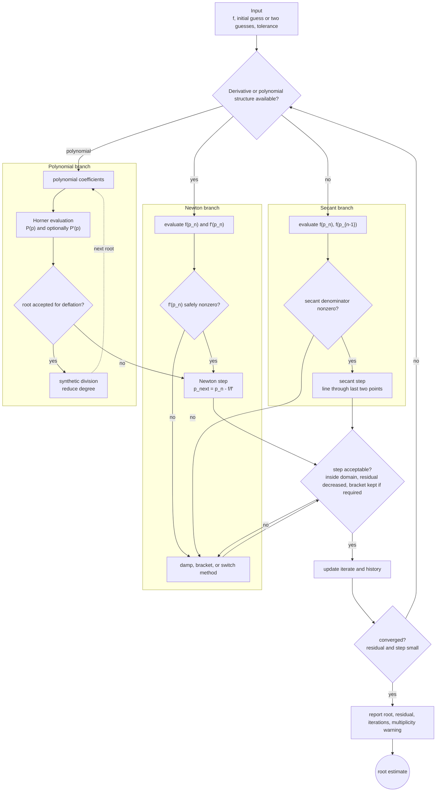

# Newton Secant and Polynomial Roots

Newton's method and the secant method are local root finders. Once an iterate is close to a simple root, both are much faster than bisection because they use slope information, either explicitly or through a finite secant. Polynomial problems add useful algebraic structure: Horner evaluation, derivative evaluation, and deflation can all be organized around the coefficient list.

Fast local convergence does not replace bracketing. Robust solvers often guard Newton or secant steps with interval checks, step limits, damping, or a fallback bisection step.

## Tangent steps and secant steps

Newton's iteration for $f(x)=0$ is

$$
p_{n+1}=p_n-\frac{f(p_n)}{f'(p_n)}.
$$

It comes from solving the tangent-line approximation to $f$ at $p_n$. A zero or very small derivative can produce an undefined or unreasonably large step. Damping replaces the full correction by

$$
p_{n+1}=p_n-\lambda\frac{f(p_n)}{f'(p_n)},
\qquad 0<\lambda\leq 1,
$$

which can improve behavior away from the root.

More explicitly, linearize around the current point:

$$
f(p_n+s)\approx f(p_n)+f'(p_n)s.
$$

Setting the right side to zero gives $s=-f(p_n)/f'(p_n)$. The approximation is trustworthy only when the step stays in a region where the derivative changes moderately. Newton is also fixed-point iteration for $g(x)=x-f(x)/f'(x)$; at a simple root $p$, $g'(p)=0$, which hints at the unusually fast local rate.

With a bracket $[a,b]$ satisfying $f(a)f(b)\lt 0$, a safeguarded update accepts the Newton point only if it lies inside the bracket and offers adequate progress. Otherwise it bisects. After evaluating the accepted point, replace the endpoint with the same sign. This retains bisection's existence guarantee while taking Newton steps when the local model is credible.

The secant method estimates the derivative from the last two iterates:

$$
p_{n+1}=p_n-f(p_n)
\frac{p_n-p_{n-1}}{f(p_n)-f(p_{n-1})}.
$$

After initialization it needs one new function evaluation per step and no analytic derivative. It is not a bracketing method unless separate logic preserves an interval, and nearly equal function values make its denominator dangerous.

The formula is symmetric in the two previous points and can also be read as inverse linear interpolation: fit $x$ as a linear function of $f$, then evaluate that line at $f=0$. Regula falsi uses the same intersection but keeps opposite-sign endpoints; its guarantee is stronger, though one endpoint can remain fixed for many iterations and slow convergence.

## What the local convergence rates promise

If $f$ is twice continuously differentiable, $p$ is a simple root, and $p_0$ is sufficiently close to $p$, Newton's method converges quadratically:

$$
|p_{n+1}-p|\leq C|p_n-p|^2.
$$

The number of correct digits can roughly double from one step to the next after the asymptotic regime begins. The secant method is superlinear with order

$$
\alpha=\frac{1+\sqrt{5}}{2}\approx 1.618
$$

under analogous simple-root assumptions. It takes more iterations than Newton's method but can still win when derivatives are unavailable or expensive.

Let $e_n=p_n-p$. Taylor expansion about $p_n$ gives

$$
0=f(p)=f(p_n)-f'(p_n)e_n+\frac12f''(\xi_n)e_n^2.
$$

Subtracting the Newton update from $p$ yields

$$
e_{n+1}=\frac{f''(\xi_n)}{2f'(p_n)}e_n^2.
$$

Near a simple root, the denominator remains bounded away from zero, producing the quadratic bound. The constant matters: a large ratio $\vert f''/f'\vert $ can delay the clean digit-doubling regime.

For the secant method, local expansion leads approximately to $\vert e_{n+1}\vert \approx C\vert e_n\vert \vert e_{n-1}\vert $. If errors behave like $\vert e_n\vert \approx K\vert e_{n-1}\vert ^\alpha$, consistency of exponents requires $\alpha^2=\alpha+1$. The positive solution is the golden ratio. This is an asymptotic argument; erratic early secant steps need not display that order.

A root of multiplicity $m\gt 1$ changes the picture. Ordinary Newton iteration is generally only linearly convergent, whereas

$$
p_{n+1}=p_n-m\frac{f(p_n)}{f'(p_n)}
$$

recovers quadratic convergence when $m$ is known. Estimating multiplicity reliably is itself a numerical task.

Write $f(x)=(x-p)^mh(x)$ with $h(p)\ne0$. Then $f/f'=(x-p)/m+O((x-p)^2)$, and ordinary Newton gives

$$
e_{n+1}=\left(1-\frac1m\right)e_n+O(e_n^2).
$$

The modified factor $m$ cancels the linear term. An alternative that does not require a known $m$ applies Newton to $u=f/f'$:

$$
p_{n+1}=p_n-\frac{f(p_n)f'(p_n)}{[f'(p_n)]^2-f(p_n)f''(p_n)}.
$$

It restores quadratic convergence near a multiple root but needs a second derivative and can have its own small denominator.

| Method | Data per step | Local order | Main advantage | Typical breakdown |
|---|---|---:|---|---|
| Newton | $f$ and $f'$ | $2$ for a simple root | very fast near the root | derivative zero or poor starting point |
| Secant | $f$ only | about $1.618$ | no analytic derivative | nearly zero secant denominator |
| Modified Newton | $f$, $f'$, and multiplicity | $2$ if $m$ is known | restores speed at multiple roots | multiplicity is usually unknown |
| Horner evaluation | polynomial coefficients | not iterative | cheap repeated evaluation | sensitive to coefficient scaling |

These rates describe local behavior, not a guarantee from arbitrary initial values. Function cost, derivative cost, and safeguards can matter more than the formal order.

## Exploiting polynomial structure

For

$$
P(x)=a_nx^n+a_{n-1}x^{n-1}+\cdots+a_0,
$$

Horner's method evaluates $P$ using $O(n)$ arithmetic operations. A second nested pass can evaluate $P'$ at the same point, which makes Newton iterations on polynomials cheap.

If the Horner recursion is $b_n=a_n$ and $b_k=a_k+xb_{k+1}$, then $P(x)=b_0$. A companion recursion $c_n=b_n$ and $c_k=b_k+xc_{k+1}$ for $k=n-1,\ldots,1$ gives $P'(x)=c_1$. This simultaneous evaluation uses linear work and avoids separately forming derivative coefficients.

Once an approximate root $r$ has been accepted, synthetic division can remove an approximate factor $x-r$. Deflation is not innocuous: error in an early root perturbs the coefficients of the reduced polynomial and can degrade every root found afterward. Closely spaced or multiple roots deserve particular caution.

Root sensitivity can be read from the same derivative. A coefficient perturbation changes the polynomial value near a simple root by $\delta P(p)$, so first-order expansion gives

$$
\delta p\approx-\frac{\delta P(p)}{P'(p)}.
$$

A small $\vert P'(p)\vert $ means that the root is sensitive. At a multiple root $P'(p)=0$, and the response is no longer linear: tiny coefficient perturbations can split one multiple root into a cluster. Scaling the variable and coefficients reduces avoidable arithmetic problems but cannot remove intrinsic sensitivity.

Computing all polynomial roots by repeated scalar Newton steps is rarely the best general algorithm. Companion-matrix eigenvalue methods find the full set without serial deflation, and specialized methods can update several roots simultaneously. Newton remains valuable for polishing roots once good approximations are known.

The full solver loop makes the safeguards explicit:



The Newton and secant branches differ in how they obtain a slope but share the same acceptance and convergence checks. The polynomial branch adds efficient evaluation and optional deflation at the point where error can propagate to later roots.

## Newton iteration for $\cos x-x$

For

$$
f(x)=\cos x-x,
\qquad
f'(x)=-\sin x-1,
$$

Newton's method from $p_0=1$ gives

$$
p_{n+1}=p_n-\frac{\cos p_n-p_n}{-\sin p_n-1}.
$$

At the first step,

$$
f(1)=-0.4596976941,
\qquad
f'(1)=-1.8414709848,
$$

so

$$
p_1=1-\frac{-0.4596976941}{-1.8414709848}
=0.7503638678.
$$

The second step uses

$$
f(p_1)=-0.0189230738,
\qquad
f'(p_1)=-1.6819049529
$$

and yields

$$
p_2=0.7391128909.
$$

A third step gives $p_3\approx0.7390851334$, whose residual is about $3.1\times10^{-10}$. One more step reaches the double-precision root $p\approx0.7390851332$.

## Horner evaluation before a Newton correction

Consider

$$
P(x)=x^3-6x^2+11x-6
$$

at $x=2.1$. Horner evaluation with coefficients $1,-6,11,-6$ produces

$$
b_3=1,
\qquad
b_2=-6+2.1b_3=-3.9,
$$

$$
b_1=11+2.1b_2=2.81,
\qquad
b_0=-6+2.1b_1=-0.099.
$$

Thus $P(2.1)=-0.099$. Since

$$
P'(x)=3x^2-12x+11,
\qquad
P'(2.1)=-0.97,
$$

one Newton correction gives

$$
p_1=2.1-\frac{-0.099}{-0.97}
=1.9979381443\ldots.
$$

The factorization $P(x)=(x-1)(x-2)(x-3)$ confirms that the nearby root is $2$.

## A double root slows ordinary Newton

Take $f(x)=(x-1)^2$ with $p_0=2$. Ordinary Newton gives

$$
p_{n+1}=p_n-\frac{(p_n-1)^2}{2(p_n-1)}
=\frac{p_n+1}{2}.
$$

Thus $p_1=1.5$, $p_2=1.25$, and $p_3=1.125$. The error is halved at every step, exactly matching the factor $1-1/m=1/2$. The residual, however, is squared error: at $p_3$ it is only $0.015625$, which can make progress look better than the root error really is.

Using the known multiplicity changes the update to

$$
p_1=2-2\frac{(2-1)^2}{2(2-1)}=1.
$$

For this exact quadratic it reaches the root in one step. On a general function with a double root, the same modification removes the linear error term and leaves quadratic convergence locally.

## Implementing the iterations with two stopping checks

```python
import math

def newton(f, fp, p0, tol=1e-12, max_iter=50):
    p = float(p0)
    for k in range(1, max_iter + 1):
        slope = fp(p)
        if slope == 0:
            raise ZeroDivisionError("Newton derivative vanished")
        q = p - f(p) / slope
        if abs(q - p) < tol and abs(f(q)) < tol:
            return q, k
        p = q
    raise RuntimeError("Newton method did not converge")

def secant(f, p0, p1, tol=1e-12, max_iter=50):
    f0, f1 = f(p0), f(p1)
    for k in range(2, max_iter + 1):
        denom = f1 - f0
        if denom == 0:
            raise ZeroDivisionError("secant denominator vanished")
        p2 = p1 - f1 * (p1 - p0) / denom
        f2 = f(p2)
        if abs(p2 - p1) < tol and abs(f2) < tol:
            return p2, k
        p0, p1 = p1, p2
        f0, f1 = f1, f2
    raise RuntimeError("secant method did not converge")

def horner(coeffs, x):
    value = coeffs[0]
    for c in coeffs[1:]:
        value = value * x + c
    return value

f = lambda x: math.cos(x) - x
fp = lambda x: -math.sin(x) - 1
print(newton(f, fp, 1.0))
print(secant(f, 0.5, 1.0))
print(horner([1.0, -6.0, 11.0, -6.0], 2.1))
```

For scaled production problems, the derivative, denominator, step, and residual checks should use scale-aware thresholds rather than comparisons with zero or a single absolute tolerance.

## Stopping rules and error estimates

The residual $\vert f(p_n)\vert $ has the units and scaling of the function, while the step $\vert p_{n+1}-p_n\vert $ has the units of the root. Either alone can mislead. Multiplying $f$ by a huge constant changes a residual test without changing the root. Near a multiple or flat root, a tiny residual can accompany a substantial root error. Conversely, a badly scaled function can have a large residual at an accurate root.

For a simple root with $\vert f'(x)\vert \geq m\gt 0$ on an interval containing $p_n$ and the root, the mean value theorem gives

$$
|p_n-p|\leq\frac{|f(p_n)|}{m}.
$$

This is a genuine error bound when such an $m$ is known. In routine computation, a combined condition such as small scaled residual and small relative step is more common. Iteration limits and finite-value checks remain necessary because neither test handles NaNs or wandering iterates.

The Newton correction itself estimates the remaining error near a well-conditioned simple root. If corrections shrink quadratically, the next error is much smaller than the current correction. That estimate should not be trusted before the local regime is evident.

## Dependence on the starting point

Newton's map can converge to an unintended root, enter a cycle, or escape. For $f(x)=x^3-2x+2$, starting at $0$ gives $p_1=1$, while starting at $1$ gives $p_1=0$; the method cycles between two nonroots. A line search that requires a residual decrease rejects these full steps, and a bracketed hybrid avoids the cycle if a sign-changing interval is available.

For $f(x)=\sqrt{x}-1$, a Newton step from a positive point can leave the domain if the model is not guarded. Transformed variables or interval constraints may be more natural than repeatedly clipping invalid iterates. Discontinuities are worse: a tangent or secant can cross a jump and report a small step where no zero exists.

Complex polynomial roots show the starting-point dependence vividly. Newton applied to $z^3-1$ partitions the complex plane into three basins, one for each cube root of unity, with intricate boundaries. The iteration formula is unchanged over complex arithmetic, but ordering and bracketing no longer apply.

## Deflation and polishing

Suppose synthetic division by $x-r$ returns quotient coefficients and remainder $P(r)$. A small remainder relative to coefficient and input scales is necessary before accepting the deflation. Even then, the reduced coefficients inherit error in $r$. Finding all roots by successive deflation tends to make later roots less accurate, especially when roots are clustered.

One remedy is to polish every computed root against the original polynomial after the full set is available. Another is to deflate conjugate pairs together for a real polynomial, preserving real coefficients through a quadratic factor. Companion-matrix methods avoid serial dependence but have their own scaling and conditioning issues.

Polynomial coefficients should be ordered and normalized explicitly. Horner code written for descending powers gives a different value if fed ascending coefficients. Scaling $x=sy$ can bring root magnitudes closer to one and reduce overflow in powers, while dividing all coefficients by a common scale leaves the roots unchanged.

## Where fast iterations go wrong

- A small derivative makes a Newton correction large and noise-sensitive. Damping, a trusted bracket, or a method switch is safer than accepting it blindly.
- Similar secant function values create the same problem in the finite-slope denominator.
- Small consecutive steps do not prove convergence, especially near a multiple root; inspect the residual as well.
- Deflating after an inaccurate root transfers that error into all subsequent polynomial factors.
- Initial guesses, safeguards, derivative magnitudes, residuals, and step sizes belong in the computation record. Without them, a reported root is hard to assess or reproduce.

## Brackets, multiplicity, and certification

A sign-changing bracket certifies at least one root only when $f$ is continuous. It may contain three or another odd number of roots, and it misses even-multiplicity roots because the sign does not change there. Plotting or sampling can suggest brackets but cannot prove that every root was found.

For polynomials, root counts on an interval can be certified with algebraic tools such as Sturm sequences. Interval arithmetic can certify that a Newton map sends an interval into itself and that the derivative stays away from zero. These methods cost more than a floating-point residual but answer a stronger question: existence and uniqueness of an exact root inside a stated interval.

Derivative evaluation by automatic differentiation can make Newton attractive when analytic formulas are tedious. Finite differences introduce a step-size tradeoff between truncation and cancellation; the resulting inexact slope can reduce convergence speed. The secant method builds its derivative approximation from iterates and naturally updates it, while multidimensional analogues lead toward quasi-Newton methods.

When function evaluation is noisy, superlinear convergence eventually stops because differences and residuals reach the noise floor. Tightening the iteration tolerance then produces unstable steps rather than new digits. A stopping threshold should reflect function uncertainty as well as machine precision.

<div className="see-also">

See also: [bisection and fixed point iteration](/math/numerical-analysis/bisection-fixed-point) · [nonlinear systems](/math/numerical-analysis/nonlinear-systems) · [floating point conditioning and stability](/math/numerical-analysis/floating-point-conditioning-stability) · [eigenvalue methods](/math/numerical-analysis/eigenvalue-methods)

</div>
