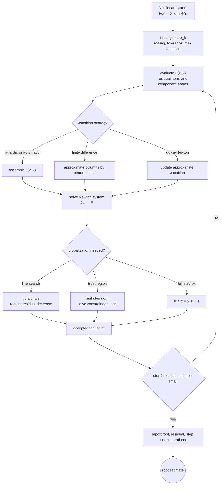

# Nonlinear Systems

A nonlinear system asks for a vector $x$ such that $F(x)=0$. Unlike scalar root finding, there is no simple sign-change bracket that guarantees a nearby solution in several dimensions. The geometry involves curves, surfaces, Jacobians, and local linear models.

Newton's method for systems generalizes the tangent-line idea: linearize all equations at the current point, solve a linear system for a correction, and update the vector. The method can be extremely fast near a regular solution, but globalization, scaling, and linear solve accuracy are central in practice.

## Linearizing several equations at once

Let

$$
F(x)=\begin{bmatrix}F_1(x)\\F_2(x)\\\vdots\\F_n(x)\end{bmatrix},
\qquad x\in\mathbb{R}^n.
$$

A root is a vector $p$ with $F(p)=0$. The Jacobian matrix is

$$
J_F(x)=\left[\frac{\partial F_i}{\partial x_j}(x)\right]_{i,j=1}^{n}.
$$

Newton's method solves

$$
J_F(x^{(k)})s^{(k)}=-F(x^{(k)})
$$

and updates

$$
x^{(k+1)}=x^{(k)}+s^{(k)}.
$$

A damped Newton method uses

$$
x^{(k+1)}=x^{(k)}+\lambda_k s^{(k)},\qquad 0\lt\lambda_k\le 1,
$$

where $\lambda_k$ is chosen to reduce a merit function such as $\|F(x)\|_2$.

A fixed-point system writes $x=G(x)$ and iterates $x^{(k+1)}=G(x^{(k)})$, but convergence requires a contraction condition in a vector norm.

## Where quadratic convergence comes from

If $F$ is continuously differentiable near a root $p$, $J_F(p)$ is nonsingular, and the initial guess is sufficiently close to $p$, then Newton's method converges quadratically. This is the same local promise as scalar Newton's method, with the derivative replaced by the Jacobian.

The linear solve is part of the nonlinear method. An inaccurate or unstable solution of

$$
J_F(x^{(k)})s=-F(x^{(k)})
$$

can spoil the Newton step. For large systems, the step may be computed by an iterative linear solver, leading to inexact Newton methods.

Newton's method is not globally convergent by default. The full step can increase the residual norm or move into a region where the Jacobian is singular. Line search and trust-region methods add safeguards by limiting the step or requiring actual residual decrease.

Scaling matters because components of $F$ and $x$ may have different units. A stopping rule should combine a residual test, a step-size test, and a maximum iteration guard.

The multivariable Taylor expansion at $x$ is

$$
F(x+s)=F(x)+J_F(x)s+O(\|s\|^2).
$$

Newton chooses $s$ so that the linear part vanishes. Near a root $p$ with nonsingular $J_F(p)$, the neglected term is quadratic in the current error. Under a Lipschitz condition on the Jacobian,

$$
\|x^{(k+1)}-p\|\le C\|x^{(k)}-p\|^2
$$

once the iterates enter a sufficiently small neighborhood. Roughly speaking, the number of correct digits then doubles each step. The result is local: neither nonsingularity at the root nor smoothness near it says that a remote initial guess will reach that neighborhood.

Never form $J^{-1}$ to compute the correction. Solve $Js=-F$ using a stable linear solver. The distinction saves work and avoids an unnecessary source of roundoff. If several Newton steps use similar Jacobians, a modified Newton method may reuse a factorization for a few iterations, trading quadratic speed for cheaper steps.

## What goes wrong with a full step

Consider the scalar equation $x^3-2x+2=0$, viewed as a one-dimensional system. Starting at $x_0=0$, Newton gives $x_1=1$; from $x_1=1$, it returns to $x_2=0$. The method cycles even though a real root exists. Systems add more ways to fail: the Jacobian can be singular, a step can cross into an invalid region, or the iteration can converge to a different root.

A line search treats the Newton direction as a proposal. With merit function

$$
\phi(x)=\frac12\|F(x)\|_2^2,
$$

its gradient is $\nabla\phi(x)=J_F(x)^TF(x)$. For an exact Newton step,

$$
\nabla\phi(x)^Ts
=F(x)^TJ_F(x)s
=-\|F(x)\|_2^2<0
$$

unless $F(x)=0$. So the Newton direction is a descent direction for the residual merit function when the Jacobian solve succeeds. Backtracking chooses $\lambda=1,1/2,1/4,\ldots$ until a sufficient decrease condition holds. Close to a regular root, the full step is usually accepted and quadratic convergence returns.

A trust-region method instead accepts only steps inside $\|s\|\le\Delta$. It compares the reduction predicted by the linear model with the reduction actually obtained. Poor agreement shrinks the region; good agreement permits a larger one. Trust regions are often better behaved when the Jacobian is nearly singular.

## Scaling changes the geometry

Suppose one residual is measured in pascals and another in meters. Minimizing the raw Euclidean norm can let the numerically larger unit dominate. Introduce diagonal scales $D_F$ and $D_x$ and monitor

$$
\|D_F^{-1}F(x)\|,
\qquad
\|D_x^{-1}s\|.
$$

The same issue affects finite-difference Jacobians. A column approximation

$$
J_{cdot j}(x)\approx
\frac{F(x+h_je_j)-F(x)}{h_j}
$$

needs a perturbation tied to the scale of $x_j$. A common starting magnitude is $h_j\approx\sqrt{u}\max(1,\vert x_j\vert )$ for forward differences, where $u$ is unit roundoff. Central differences are more accurate but cost twice as many residual evaluations per column.

Automatic differentiation computes derivatives of the implemented operations with machine-level accuracy and avoids the step-size choice. Analytic Jacobians may still be fastest and expose sparsity most clearly. Derivative checking against a directional finite difference is useful even when an analytic Jacobian is supplied:

$$
J(x)v\approx\frac{F(x+hv)-F(x)}{h}.
$$

This catches indexing and sign errors without constructing a second full Jacobian.

## Fixed points, Broyden updates, and large systems

A fixed-point iteration $x^{(k+1)}=G(x^{(k)})$ converges locally if a norm satisfies $\|J_G(x)\|\le q\lt 1$ in a neighborhood that maps into itself. Merely rearranging $F(x)=0$ as $x=G(x)$ provides no guarantee. Different rearrangements of the same equations can have radically different contraction factors.

Broyden's method begins with an approximate Jacobian and applies rank-one updates so that the new approximation satisfies the latest secant equation. It avoids a full Jacobian evaluation each step and can converge superlinearly, though it normally needs the same globalization care as Newton.

For a large sparse system, explicitly factoring the Jacobian may dominate the cost. Newton--Krylov methods solve the linear correction approximately and need only Jacobian-vector products. The forcing tolerance is loose when far from the root and tightened as the residual falls; oversolving early linear systems wastes work without improving the nonlinear path.

## Stopping with evidence

A small step can occur because the Jacobian is ill-conditioned or the line search has reduced $\lambda$ almost to zero. A small residual can be misleading when residual components are badly scaled. Use both:

$$
\|D_F^{-1}F(x^{(k)})\|\le \tau_F,
$$

$$
\|D_x^{-1}s^{(k)}\|\le \tau_x(1+\|D_x^{-1}x^{(k)}\|).
$$

Also record the linear-solve residual $\|Js+F\|$, accepted step length, and iteration limit. Multiple initial guesses are warranted when several roots are possible. They do not prove that every solution has been found, but they reveal basin dependence that a single successful run hides.

The following flow arranges those decisions around the Newton correction.

## Singular roots lose quadratic convergence

For the scalar equation $F(x)=x^2$, the root $p=0$ has derivative $F'(p)=0$. Newton gives

$$
x_{k+1}=x_k-\frac{x_k^2}{2x_k}=\frac{x_k}{2},
$$

so the error is halved rather than squared. Multiple roots in one dimension and singular Jacobians in several dimensions commonly reduce the local rate and make the correction system ill-conditioned.

The small residual near a multiple root can also flatter the result: $F(x)=x^2$ is tiny while $x$ may still have far fewer correct digits. Step and residual tests should be scaled with the conditioning of the root. When multiplicity $m$ is known for a scalar root, the modified update $x_{k+1}=x_k-mF/F'$ can restore quadratic convergence. Comparable remedies for systems require structural information and are less automatic.

A nearly singular Jacobian makes the Newton step sensitive to residual and derivative error. Solving the linear system accurately does not remove that sensitivity. Singular values or condition estimates can distinguish a failed factorization from a correction direction that is mathematically poorly determined.

## Continuation when the desired root is hard to reach

Many models contain a parameter $\lambda$ and are easy at one value but difficult at another. Continuation solves

$$
F(x,\lambda)=0
$$

first at an easy $\lambda_0$, then uses that solution as the initial guess at $\lambda_1$, proceeding in small parameter steps. The previous solution supplies more information than a generic starting vector.

Simple parameter stepping can fail at a fold, where $x$ ceases to be a single-valued function of $\lambda$ and the Jacobian with respect to $x$ becomes singular. Pseudo-arclength continuation adds an equation that advances along the solution curve rather than along the parameter axis. It can trace branches through turning points and reveal multiple steady states.

Continuation does not decide which mathematical branch is physically stable. That requires a stability analysis of the original dynamical or equilibrium model. It does, however, expose solutions that repeated Newton runs from arbitrary guesses may miss.

## Constraints and invalid trial points

Some equations are defined only for positive concentrations, probabilities inside $(0,1)$, or states satisfying geometric constraints. A Newton step can leave that domain even when the current point is valid. Backtracking should reject undefined trials, but a variable transformation can be cleaner: solve for $z$ with $x=e^z$ to enforce positivity, or use a logistic transformation for a probability.

Transformations change the Jacobian and conditioning. Near a probability boundary, the logistic derivative becomes small, so steps in transformed coordinates may correspond to tiny physical changes. Bound-constrained trust-region methods are another option when constraints are part of the problem rather than a convenient parameterization.

For overdetermined systems with more equations than unknowns, an exact root may not exist. Minimizing $\tfrac12\|F(x)\|^2$ leads to Gauss--Newton or Levenberg--Marquardt methods. Their target is a least-squares residual, so a nonzero final residual can be the correct optimum rather than solver failure.



The nonlinear-systems diagram exposes Newton's method as a sequence of residual evaluation, Jacobian construction, linear solve, globalization, and stopping tests. The Jacobian branch distinguishes exact, finite-difference, and quasi-Newton approximations, while the globalization branch shows why full Newton steps are sometimes damped or constrained. The output includes diagnostics because a small step alone does not prove that $F(x)=0$ has been solved.

| Method | Derivative information | Local speed | Global safeguard | Main cost |
|---|---|---|---|---|
| Newton | full Jacobian | quadratic | line search or trust region | factor or solve Jacobian system |
| Fixed point | map derivative bound | usually linear | contraction region | evaluating $G$ |
| Broyden | approximate Jacobian | superlinear possible | line search often used | rank-one updates |
| Steepest descent on residual | gradients | slow near solution | natural decrease | many small steps |

## Worked example 1: one Newton correction on a circle-line system

**Problem.** Solve near the first-quadrant intersection of

$$
F(x,y)=\begin{bmatrix}x^2+y^2-1\\x-y\end{bmatrix}=0
$$

starting from $(0.7,0.7)$.

**Method.** The Jacobian is

$$
J(x,y)=\begin{bmatrix}2x&2y\\1&-1\end{bmatrix}.
$$

1. Evaluate at $(0.7,0.7)$:

$$
F(0.7,0.7)=\begin{bmatrix}-0.02\\0\end{bmatrix},
\qquad
J(0.7,0.7)=\begin{bmatrix}1.4&1.4\\1&-1\end{bmatrix}.
$$

2. Solve $Js=-F$:

$$
1.4s_1+1.4s_2=0.02,
\qquad
s_1-s_2=0.
$$

3. From $s_1=s_2$,

$$
2.8s_1=0.02 \Rightarrow s_1=s_2=0.007142857.
$$

4. Update:

$$
(x_1,y_1)=(0.707142857,0.707142857).
$$

**Checked answer.** The exact intersection is $(1/\sqrt2,1/\sqrt2)\approx(0.707106781,0.707106781)$, so one Newton step is already very close.

## Worked example 2: symmetric two-equation system

**Problem.** Apply two Newton steps from $(1,1)$ to

$$
F(x,y)=\begin{bmatrix}x^2+y-3\\x+y^2-3\end{bmatrix}.
$$

**Method.** The Jacobian is

$$
J(x,y)=\begin{bmatrix}2x&1\\1&2y\end{bmatrix}.
$$

1. At $(1,1)$,

$$
F=(-1,-1)^T,
\qquad
J=\begin{bmatrix}2&1\\1&2\end{bmatrix}.
$$

Solving $Js=(1,1)^T$ gives $s=(1/3,1/3)^T$.

2. Update to $(4/3,4/3)$.

3. At this point each residual component is

$$
(4/3)^2+4/3-3=\frac{16}{9}+\frac{12}{9}-\frac{27}{9}=\frac19.
$$

4. The Jacobian has diagonal $8/3$ and off-diagonal $1$. By symmetry the correction has equal components $q$, satisfying

$$
\left(\frac83+1\right)q=-\frac19.
$$

Thus $q=-1/33$.

5. The next iterate is

$$
\frac43-\frac1{33}=1.303030\ldots.
$$

**Checked answer.** The symmetric solution satisfies $z^2+z-3=0$, so $z=(-1+\sqrt{13})/2=1.302775\ldots$. Two Newton steps are close.

## Damped implementation

```python
import numpy as np

def newton_system(F, J, x0, tol=1e-10, max_iter=30):
    x = np.asarray(x0, dtype=float)
    for k in range(1, max_iter + 1):
        Fx = np.asarray(F(x), dtype=float)
        if np.linalg.norm(Fx, ord=2) < tol:
            return x, k - 1
        step = np.linalg.solve(np.asarray(J(x), dtype=float), -Fx)
        phi = 0.5 * Fx @ Fx
        damping = 1.0
        while damping > 2.0**-20:
            trial = x + damping * step
            F_trial = np.asarray(F(trial), dtype=float)
            if 0.5 * F_trial @ F_trial < phi:
                break
            damping *= 0.5
        else:
            raise RuntimeError("line search failed to reduce the residual")
        x = trial
        if (np.linalg.norm(damping * step, ord=2) < tol
                and np.linalg.norm(F_trial, ord=2) < tol):
            return x, k
    raise RuntimeError("Newton iteration did not converge")

F = lambda z: np.array([z[0]**2 + z[1]**2 - 1.0, z[0] - z[1]])
J = lambda z: np.array([[2*z[0], 2*z[1]], [1.0, -1.0]])
print(newton_system(F, J, [0.7, 0.7]))
```

## Failure patterns

- Applying Newton's method when the Jacobian is singular or badly scaled.
- Trusting local quadratic convergence from a poor starting point.
- Stopping on small steps without checking the residual norm.
- Using finite-difference Jacobians with step sizes that are too large or too small.
- Forgetting that multiple solutions may exist and the initial guess influences which one is found.

<div className="see-also">

See also: [Newton Secant and polynomial roots](/math/numerical-analysis/newton-secant-polynomial-roots) · [Gaussian elimination pivoting and LU](/math/numerical-analysis/gaussian-elimination-pivoting-lu) · [ODE stability stiffness and systems](/math/numerical-analysis/ode-stability-stiffness-systems) · [least squares and Chebyshev approximation](/math/numerical-analysis/least-squares-chebyshev-approximation)

</div>
