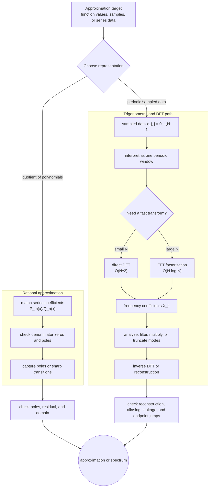

# Rational Trigonometric Approximation and FFT

Polynomial approximation is only one choice of model. Rational functions can represent poles, saturation, and sharp transitions at lower degree than polynomials. Trigonometric polynomials encode periodic behavior, and the fast Fourier transform makes their coefficients practical to compute for large sample sets.

These are three distinct choices: rational approximation changes the function class, trigonometric approximation changes the basis, and the FFT changes the cost of a discrete transform. They meet in scientific computing, signal processing, spectral methods, and data analysis.

## When a quotient is a better model

A rational approximation has the form

$$
R(x)=\frac{P_m(x)}{Q_n(x)},
$$

where $P_m$ and $Q_n$ are polynomials and $Q_n(x)\ne0$ on the interval of interest. A Padé approximant chooses the coefficients so that the Taylor series of $R$ agrees with a target function to high order near an expansion point.

Nearby singularities often limit polynomial approximation. A rational function can represent such behavior through its denominator, but that advantage introduces a new failure mode: an unintended zero of $Q_n$ creates a pole. Before trusting the quotient, inspect the denominator over the entire working interval, not only at the fitting points.

As a simple $[1/1]$ Padé approximation to $e^x$, consider

$$
R(x)=\frac{1+x/2}{1-x/2}.
$$

For small $x$,

$$
\frac{1}{1-x/2}=1+\frac{x}{2}+\frac{x^2}{4}+O(x^3).
$$

Multiplying by $1+x/2$ gives

$$
R(x)=1+x+\frac{x^2}{2}+O(x^3),
$$

which agrees with $e^x$ through the quadratic term. At $x=0.1$, the rational approximation is $1.105263\ldots$, compared with $e^{0.1}=1.105170\ldots$.

The coefficients can be derived rather than guessed. Write

$$
R(x)=\frac{a_0+a_1x}{1+b_1x},
$$

fixing the denominator constant at one to remove a common scale. Requiring $(1+b_1x)e^x-(a_0+a_1x)=O(x^3)$ gives

$$
1+(1+b_1)x+\left(\frac12+b_1\right)x^2-a_0-a_1x=O(x^3).
$$

Matching coefficients yields $a_0=1$, $b_1=-1/2$, and $a_1=1/2$. General $[m/n]$ Padé construction matches through degree $m+n$: first solve a linear system for denominator coefficients, then recover the numerator.

Padé approximation is local to its expansion point. Agreement of many Taylor coefficients does not promise uniform accuracy far away. A near-canceling numerator zero and denominator pole may also appear; finite precision can expose the pole even if exact factors cancel. Such pole-zero pairs need inspection before they are interpreted as features of the target function.

## From periodic functions to discrete coefficients

A real trigonometric polynomial of degree $N$ can be written as

$$
T_N(x)=a_0+\sum_{k=1}^{N}
\left(a_k\cos(kx)+b_k\sin(kx)\right).
$$

For samples $x_0,\ldots,x_{n-1}$, the discrete Fourier transform uses the complex basis

$$
X_k=\sum_{j=0}^{n-1}x_j e^{-2\pi i jk/n},
\qquad k=0,1,\ldots,n-1.
$$

With this unnormalized forward-transform convention, the inverse is

$$
x_j=\frac1n\sum_{k=0}^{n-1}X_k e^{2\pi i jk/n}.
$$

Libraries distribute the factor $1/n$ differently, so the normalization convention belongs with any reported coefficients.

The inverse follows from discrete orthogonality:

$$
\sum_{k=0}^{n-1}e^{2\pi i k(j-\ell)/n}
=\begin{cases}n,&j=\ell,\\0,&j\ne\ell.\end{cases}
$$

The off-diagonal case is a geometric series whose ratio is an $n$th root of unity other than one. Substituting the forward transform into the inverse leaves only $x_j$.

For real data, $X_{n-k}=\overline{X_k}$. Only roughly half the complex spectrum is independent. The zero coefficient is the sample sum; divided by $n$, it is the mean. If $n$ is even, the Nyquist coefficient $X_{n/2}$ is real.

The DFT treats the samples as one period of a periodic sequence. If the endpoints do not join smoothly, the periodic extension contains a jump and its coefficients decay slowly. Frequencies above the Nyquist limit alias into lower frequencies, so an index $k$ is not a physical frequency until the sample spacing is known.

With spacing $\Delta t$, the sampling rate is $f_s=1/\Delta t$ and bin $k$ corresponds to $k f_s/n$ cycles per unit time before negative-frequency wrapping. Samples cannot distinguish frequencies separated by an integer multiple of $f_s$ because

$$
e^{2\pi i(f+mf_s)j\Delta t}=e^{2\pi ifj\Delta t}.
$$

Frequencies above $f_s/2$ fold into the base band. An anti-alias filter must act before sampling; deleting high DFT bins afterward cannot recover the source frequency. Spectral leakage is different. A sinusoid with a noninteger number of cycles in the observation window fails the assumed periodic boundary, spreading energy across bins. A window reduces distant sidelobes at the cost of wider peaks and altered amplitude calibration.

| Representation | Form | Main strength | Main risk |
|---|---|---|---|
| Polynomial | powers or orthogonal polynomials | smooth nonperiodic functions | high-degree oscillation |
| Rational | quotient $P/Q$ | nearby poles and sharp transitions | denominator zeros |
| Trigonometric | sines, cosines, or complex exponentials | smooth periodic data | aliasing and endpoint jumps |
| FFT | algorithm for the DFT | fast coefficient computation | sampling assumptions can be overlooked |

Smooth periodic functions often have rapidly decaying Fourier coefficients and admit highly accurate spectral approximations. Nonsmooth data, endpoint jumps, or insufficient sampling destroy that favorable decay.

## How the FFT removes repeated work

A direct DFT costs $O(n^2)$ complex operations. Cooley--Tukey factorization splits a transform into smaller transforms and combines them with twiddle factors. For a radix-2 FFT, the even- and odd-indexed samples are transformed recursively, reducing the work to $O(n\log n)$ when $n$ is a power of two. Other FFT factorizations handle many non-power-of-two sizes.

Let $n=2m$ and $\omega_n=e^{-2\pi i/n}$. Splitting even and odd indices gives

$$
\begin{aligned}
X_k
&=\sum_{r=0}^{m-1}x_{2r}\omega_n^{2rk}
+\sum_{r=0}^{m-1}x_{2r+1}\omega_n^{(2r+1)k}\\
&=E_k+\omega_n^kO_k.
\end{aligned}
$$

Periodicity supplies $X_{k+m}=E_k-\omega_n^kO_k$. Two half-size transforms give every output with $O(n)$ combination work. The recurrence $T(n)=2T(n/2)+O(n)$ yields $O(n\log n)$. The FFT computes the same DFT; only the arithmetic factorization changes.

For circular convolution $c_j=\sum_ra_rb_{(j-r)\bmod n}$, the transform obeys $C_k=A_kB_k$. Linear convolution follows by zero-padding both inputs to the full output length, transforming, multiplying pointwise, and inverting. Insufficient padding wraps the tail around.



The two branches require different validation. Rational fitting ends with a denominator and domain check. Fourier work ends by reconstructing the data and examining aliasing, spectral leakage, endpoint behavior, and high-frequency coefficient decay.

## A four-point transform by hand

For

$$
x=[1,0,-1,0],
$$

only $x_0$ and $x_2$ are nonzero, so

$$
X_k=1-e^{-2\pi i(2)k/4}
=1-e^{-\pi i k}.
$$

Since $e^{-\pi i k}=(-1)^k$,

$$
X_k=1-(-1)^k.
$$

The even-index coefficients vanish and the odd-index coefficients equal $2$:

$$
X=[0,2,0,2].
$$

The result also reconstructs the input under the stated inverse-transform normalization.

If samples are spaced by $\Delta t=0.25$ seconds, then $f_s=4$ Hz and the bins represent $0,1,2,-1$ Hz. The conjugate pair at indices $1$ and $3$ represents a real cosine at $1$ Hz. Division by four in the inverse restores unit amplitude because the positive and negative components each carry coefficient $2$.

## Aliasing in four samples

Sample $x(t)=\cos(2\pi\cdot3t)$ at $4$ Hz, so $t_j=j/4$. Then

$$
x_j=\cos\left(\frac{3\pi j}{2}\right)=[1,0,-1,0].
$$

A $1$ Hz cosine gives $\cos(\pi j/2)=[1,0,-1,0]$ as well. The samples cannot distinguish $3$ Hz from $1$ Hz. Signed frequency $3$ Hz is congruent to $-1$ Hz modulo the sample rate, and a real cosine has identical samples at positive and negative frequencies. A longer record at the same rate does not remove the ambiguity; the input must be band-limited or sampled faster.

## A radix-2 implementation and cross-check

```python
import cmath
import numpy as np

def fft_recursive(x):
    x = list(map(complex, x))
    n = len(x)
    if n == 0 or n & (n - 1):
        raise ValueError("radix-2 FFT requires a nonzero power-of-two length")
    if n == 1:
        return x
    even = fft_recursive(x[0::2])
    odd = fft_recursive(x[1::2])
    out = [0j] * n
    for k in range(n // 2):
        twiddle = cmath.exp(-2j * cmath.pi * k / n) * odd[k]
        out[k] = even[k] + twiddle
        out[k + n // 2] = even[k] - twiddle
    return out

def pade_exp_11(x):
    denominator = 1.0 - 0.5 * x
    if denominator == 0:
        raise ZeroDivisionError("Padé approximant has a pole at x = 2")
    return (1.0 + 0.5 * x) / denominator

data = [1.0, 0.0, -1.0, 0.0]
print(fft_recursive(data))
print(np.fft.fft(data))
print(pade_exp_11(0.1), np.exp(0.1))
```

The recursive routine is intentionally radix-2, while production FFT libraries select among several algorithms. Comparing it with `numpy.fft.fft` checks both the coefficient ordering and the sign convention.

## Fourier approximation between sample points

The DFT coefficients define a trigonometric interpolant, not only a list of bins. For odd $n=2m+1$, one may write

$$
p(t)=\frac1n\sum_{k=-m}^{m}\widehat x_k e^{2\pi ikt/T},
$$

where $T=n\Delta t$ and indices above $m$ are interpreted as negative frequencies. At the sample times, $p$ reproduces the data exactly. Between them, it supplies the unique trigonometric polynomial in the chosen frequency range.

Smoothness controls coefficient decay. If a periodic function has several continuous derivatives, repeated integration by parts shows algebraic decay of its Fourier coefficients. Analytic periodic functions often give exponential decay. A jump produces coefficients of order $1/\vert k\vert $ and a persistent overshoot near the discontinuity, the Gibbs phenomenon. Adding more modes narrows the oscillatory region but does not remove the limiting relative overshoot. Filtering or summability can suppress ringing while smearing the jump.

Parseval's identity connects time-domain energy with coefficient energy. Under the stated forward convention,

$$
\sum_{j=0}^{n-1}|x_j|^2=\frac1n\sum_{k=0}^{n-1}|X_k|^2.
$$

It is a strong normalization check. If an inverse reconstruction is correct but an energy computation differs by a factor of $n$ or $n^2$, the transform convention has been mixed.

Truncating small high-frequency coefficients gives a least-squares approximation on the sample grid because the complex exponential vectors are orthogonal. Whether it approximates the underlying continuous signal depends on sampling, leakage, and noise. A low discrete residual cannot rule out aliasing.

## Fitting a rational function from data

Padé approximation starts from series coefficients. Rational fitting to scattered data is different. Equations

$$
y_iQ_n(x_i)\approx P_m(x_i)
$$

are linear in the polynomial coefficients after fixing one denominator coefficient, but minimizing these cross-multiplied residuals does not minimize $\vert y_i-P_m(x_i)/Q_n(x_i)\vert $. Points where $Q_n$ is small receive distorted weight. Direct nonlinear least squares targets the quotient residual but requires starting values and pole safeguards.

The numerator and denominator share a scale ambiguity, and common factors make the representation nonunique. Normalization removes the scale but not near-common factors. Pole locations should be reported with their sensitivity, especially when a fitted pole lies close to a fitted zero.

Rational models extrapolate according to their degree balance. If $m\lt n$, the quotient tends to zero at infinity; if $m=n$, it tends to the ratio of leading coefficients; if $m\gt n$, it grows polynomially. These constraints may be useful prior knowledge or an obvious mismatch with the modeled quantity.

## Linear convolution worked through transforms

Convolve $a=[1,2]$ and $b=[3,4]$. Directly,

$$
c=[1\cdot3,\;1\cdot4+2\cdot3,\;2\cdot4]=[3,10,8].
$$

The linear output has length three, so pad both inputs to at least length three; a length-four FFT is convenient. Transform $[1,2,0,0]$ and $[3,4,0,0]$, multiply corresponding coefficients, then invert. The inverse returns $[3,10,8,0]$ up to rounding.

Using length two instead would wrap the final $8$ into the first entry, producing circular convolution $[11,10]$. The error is not caused by the FFT. It comes from asking a length-two periodic transform to represent a length-three nonperiodic result.

## Diagnostics before interpreting the result

- For rational approximations, evaluate or bound the denominator throughout the domain; checking only the numerator residual misses spurious poles.
- For Fourier coefficients, record the sample spacing and transform normalization. Index values alone are not physical frequencies.
- Reconstruct the original samples and measure the reconstruction error.
- Inspect high-frequency coefficient magnitudes. Slow decay can indicate nonsmoothness, endpoint mismatch, or inadequate sampling.
- Treat aliased peaks as ambiguous unless the sampling rate rules out higher-frequency sources.
- At very small $n$, a direct DFT can be competitive because FFT setup and recursion have overhead; the asymptotic advantage matters as the data grow.

Coefficient magnitudes need the same normalization care as reconstruction. A one-sided amplitude spectrum for real data usually doubles non-DC, non-Nyquist bins after division by $n$. Power spectral density adds scaling by sample rate and window energy. A peak without these conventions cannot be compared reliably across record lengths or libraries.

## Frequency indexing without guesswork

For an $n$-point transform sampled every $\Delta t$, software commonly orders bins as nonnegative frequencies first and negative frequencies at the end. An `fftshift` operation only rearranges this order; it does not alter coefficients or create new resolution. The frequency spacing is $1/(n\Delta t)$, while the Nyquist range is set by $1/\Delta t$. A longer record narrows bin spacing; a faster sample rate widens the unaliased band.

Zero-padding a record samples its discrete-time Fourier transform on a denser frequency grid. It produces smoother-looking plots and can help locate a peak between original bins, but it does not add observations or separate frequencies that the original record cannot resolve. Confusing interpolation of the spectrum with added information is a common analysis error.

Phase depends on the time origin. Shifting a sequence by $j_0$ samples multiplies bin $k$ by $e^{-2\pi ikj_0/n}$ while leaving magnitude unchanged. Magnitude-only plots discard timing information and cannot reconstruct a general signal. For real data, conjugate symmetry helps, but phase is still needed except in special symmetric cases.

Numerical FFT error is usually small because standard algorithms are backward stable up to factors growing mildly with transform length. Interpretation errors are often larger: wrong axes, missing normalization, no detrending, or an unnoticed endpoint jump. Testing a library with a constant sequence, a single bin-centered sinusoid, and an inverse round trip identifies most convention mistakes quickly.

Rational and Fourier models can also be combined. A transfer function may be rational in a complex frequency variable, while measured periodic input and output are transformed by FFTs. Poles then describe system dynamics and DFT bins describe sampled steady-state response. Keeping continuous-model poles separate from discrete spectral peaks avoids treating two different objects as interchangeable.

<div className="see-also">

See also: [least squares and Chebyshev approximation](/math/numerical-analysis/least-squares-chebyshev-approximation) · [interpolation Lagrange and Neville method](/math/numerical-analysis/interpolation-lagrange-neville) · [finite difference methods for PDEs](/math/numerical-analysis/finite-difference-pdes) · [floating point conditioning and stability](/math/numerical-analysis/floating-point-conditioning-stability)

</div>
