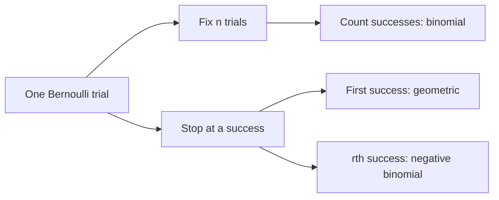

# Bernoulli, Binomial, Geometric, and Negative Binomial Laws

These four laws describe the same experiment viewed through different stopping rules. Start with independent trials, each having a designated success event of probability $p$ and failure probability $q=1-p$. A Bernoulli variable records one trial. A binomial variable fixes the number of trials and counts successes. A geometric variable fixes one required success and counts trials. A negative binomial variable fixes $r$ required successes and counts trials.

That distinction between a fixed horizon and a random stopping time settles most classification questions before any algebra begins. It also exposes the assumptions: trials must have the same success probability, and their outcomes must be independent. Sampling without replacement, fatigue across attempts, or a changing environment can invalidate the model even when every outcome is binary.



## One trial and its indicator

A Bernoulli random variable $I\sim\operatorname{Bernoulli}(p)$ takes the values zero and one:

$$
P(I=1)=p,\qquad P(I=0)=q.
$$

The notation is useful because an indicator converts an event into arithmetic. If $A$ is an event, write $I_A=1$ when $A$ occurs and $I_A=0$ otherwise. Then

$$
E[I_A]=1\cdot P(A)+0\cdot P(A^c)=P(A).
$$

Since $I_A^2=I_A$,

$$
\operatorname{Var}(I_A)=E[I_A^2]-E[I_A]^2=p-p^2=pq.
$$

Indicator sums often replace awkward counting arguments. The count of occupied boxes, defective components, or matching positions can be written as a sum of Bernoulli variables even when those variables are dependent. Linearity of expectation still applies; the simple variance formula does not unless the covariance terms vanish.

## Fixing the number of trials: the binomial law

Let $I_1,\ldots,I_n$ be independent Bernoulli$(p)$ variables and let

$$
X=I_1+\cdots+I_n.
$$

Then $X\sim\operatorname{Binomial}(n,p)$. For $X=k$, exactly $k$ trials succeed. Every particular success/failure sequence with that count has probability $p^kq^{n-k}$, and there are $\binom nk$ possible locations for the successes. Hence

$$
P(X=k)=\binom nk p^kq^{n-k},\qquad k=0,1,\ldots,n.
$$

Normalization is the binomial theorem:

$$
\sum_{k=0}^n\binom nkp^kq^{n-k}=(p+q)^n=1.
$$

The indicator representation gives the moments without manipulating this sum:

$$
E[X]=\sum_{i=1}^nE[I_i]=np,
$$

and independence gives

$$
\operatorname{Var}(X)=\sum_{i=1}^n\operatorname{Var}(I_i)=npq.
$$

If the trials are dependent, the expectation remains $np$ when their marginal success probabilities are all $p$, but

$$
\operatorname{Var}(X)=npq+2\sum_{i<j}\operatorname{Cov}(I_i,I_j).
$$

Positive dependence produces more dispersion than the binomial model predicts; negative dependence produces less. Sampling $n$ objects without replacement from a finite population is the standard negative-dependence example and leads to the hypergeometric law.

The ratio of adjacent binomial probabilities is useful for locating the mode and computing a PMF stably:

$$
\frac{P(X=k+1)}{P(X=k)}=\frac{n-k}{k+1}\frac{p}{q}.
$$

The probabilities increase while this ratio exceeds one. It follows that a mode is $\lfloor(n+1)p\rfloor$; when $(n+1)p$ is an integer, there are two adjacent modes, $(n+1)p-1$ and $(n+1)p$.

## Fixing the success count: waiting-time laws

Under the **trial-count convention**, a geometric variable $G\sim\operatorname{Geometric}(p)$ records the trial on which the first success occurs:

$$
P(G=k)=q^{k-1}p,\qquad k=1,2,\ldots.
$$

The first $k-1$ trials must fail and the $k$th must succeed. Its tail has an even simpler form:

$$
P(G>k)=q^k,
$$

because $G\gt k$ means that all of the first $k$ trials failed. The tail-sum identity for a positive integer-valued variable gives

$$
E[G]=\sum_{k=0}^{\infty}P(G>k)=\sum_{k=0}^{\infty}q^k=\frac1p.
$$

For the variance, differentiating the geometric series twice gives $E[G(G-1)]=2q/p^2$. Therefore

$$
\begin{aligned}
E[G^2]&=E[G(G-1)]+E[G]=\frac{2q}{p^2}+\frac1p,\\
\operatorname{Var}(G)&=E[G^2]-E[G]^2=\frac{q}{p^2}.
\end{aligned}
$$

Some texts define the geometric variable as the **number of failures before** the first success. That variable is $G-1$, has support $0,1,\ldots$, mean $q/p$, and the same variance $q/p^2$. A formula can be correct and still be off by one if the convention is not stated.

For $r$ required successes, let $T_r$ be the trial of the $r$th success. The last trial must succeed, while exactly $r-1$ of the preceding $k-1$ trials succeed. Thus

$$
P(T_r=k)=\binom{k-1}{r-1}p^rq^{k-r},\qquad k=r,r+1,\ldots.
$$

This is the negative binomial law under the trial-count convention. Another common parameterization counts failures before success $r$; it uses $F=T_r-r$ and

$$
P(F=j)=\binom{j+r-1}{r-1}p^rq^j,\qquad j=0,1,\ldots.
$$

The gaps between successive successes are independent geometric variables. Writing them as $G_1,\ldots,G_r$ gives

$$
T_r=G_1+\cdots+G_r.
$$

Therefore

$$
E[T_r]=\frac rp,\qquad \operatorname{Var}(T_r)=\frac{rq}{p^2}.
$$

This sum representation is the discrete counterpart of representing a gamma waiting time as a sum of independent exponential waiting times.

## Memorylessness and what it assumes

The geometric law satisfies

$$
P(G>m+n\mid G>m)=\frac{q^{m+n}}{q^m}=q^n=P(G>n).
$$

After $m$ failures, the conditional distribution of the additional wait is unchanged. This depends on independent trials with constant $p$. If repeated failures reveal that the task is harder than expected, or if equipment deteriorates, the updated success probability need not equal the original one.

Among nonnegative integer-valued distributions, memorylessness characterizes the geometric family, apart from degenerate boundary cases. If $a_n=P(G\gt n)$ and memorylessness holds, then $a_{m+n}=a_ma_n$. With $a_0=1$ and $a_1=q$, induction gives $a_n=q^n$.

The negative binomial law is not memoryless when $r\gt 1$. The remaining wait depends on how many successes have already occurred, not merely on elapsed time. It becomes Markovian if the state includes the current success count.

## Two inverse descriptions of one experiment

Let $S_n$ count successes among the first $n$ trials. Then $S_n\sim\operatorname{Binomial}(n,p)$, while $T_r$ is the time of success $r$. The events

$$
\{T_r\le n\}\quad\text{and}\quad\{S_n\ge r\}
$$

are identical: the $r$th success has occurred by time $n$ exactly when at least $r$ successes have accumulated. Consequently,

$$
P(T_r\le n)=P(S_n\ge r)=\sum_{k=r}^n\binom nkp^kq^{n-k}.
$$

This identity is often easier than summing negative binomial probabilities. It also supplies a direct check when implementing distribution functions.

| Law | Random quantity | Support | Mean | Variance |
|---|---|---:|---:|---:|
| Bernoulli$(p)$ | success indicator for one trial | $0,1$ | $p$ | $pq$ |
| Binomial$(n,p)$ | successes in $n$ trials | $0,\ldots,n$ | $np$ | $npq$ |
| Geometric$(p)$ | trial of first success | $1,2,\ldots$ | $1/p$ | $q/p^2$ |
| Negative binomial$(r,p)$ | trial of $r$th success | $r,r+1,\ldots$ | $r/p$ | $rq/p^2$ |

## Worked example: a quality-control batch

A production line independently produces a defective item with probability $0.03$. Twenty items are inspected. Let $X$ be the number of defectives. Find the probability of at most one defective and compare it with the expected count.

Here a defective item is the designated “success,” so $X\sim\operatorname{Binomial}(20,0.03)$. The event at most one is the disjoint union of zero and one:

$$
\begin{aligned}
P(X\le1)
&=P(X=0)+P(X=1)\\
&=(0.97)^{20}+20(0.03)(0.97)^{19}\\
&=(0.97)^{19}(0.97+0.60)\\
&\approx0.8850.
\end{aligned}
$$

The mean and variance are

$$
E[X]=20(0.03)=0.6,\qquad \operatorname{Var}(X)=20(0.03)(0.97)=0.582.
$$

The mean is not a possible count, nor does it claim that most batches contain $0.6$ defectives. It is the long-run average across many batches. The large value of $P(X\le1)$ is consistent with that small mean.

If inspection is performed without replacement from a single finite batch known to contain a fixed number of defectives, independence fails. The hypergeometric model would then be appropriate.

## Worked example: the fifth successful transmission

Packets are transmitted independently, each succeeding with probability $p=0.4$. Let $T_5$ be the transmission on which the fifth success occurs. Find $P(T_5=9)$, $P(T_5\le9)$, and the mean waiting time.

For $T_5=9$, the ninth transmission must succeed and exactly four of the first eight must succeed:

$$
\begin{aligned}
P(T_5=9)&=\binom84(0.4)^5(0.6)^4\\
&=70(0.01024)(0.1296)\\
&=0.09289728.
\end{aligned}
$$

For the cumulative probability, use the inverse relationship with a binomial count $S_9$:

$$
\begin{aligned}
P(T_5\le9)&=P(S_9\ge5)\\
&=\sum_{k=5}^{9}\binom9k(0.4)^k(0.6)^{9-k}\\
&\approx0.26657.
\end{aligned}
$$

Finally, decompose the total wait into five geometric gaps:

$$
E[T_5]=\frac{5}{0.4}=12.5,\qquad
\operatorname{Var}(T_5)=\frac{5(0.6)}{0.4^2}=18.75.
$$

The noninteger mean is ordinary for an integer-valued random variable; it averages possible trial numbers over repetitions.

## Worked example: choosing the convention correctly

Roll a fair die until a six appears. Let $F$ count failures before the first six and $G$ count total rolls. Then $p=1/6$, $F=G-1$, and

$$
P(F=3)=P(G=4)=\left(\frac56\right)^3\frac16=\frac{125}{1296}.
$$

Their expectations differ by one:

$$
E[F]=\frac{q}{p}=5,\qquad E[G]=\frac1p=6.
$$

Suppose the first four rolls were not sixes. The probability of needing more than three additional rolls is

$$
P(G>7\mid G>4)=P(G>3)=\left(\frac56\right)^3.
$$

The four observed failures do not make a six “due.” Independent rolls carry no compensating mechanism.

## Computation without unnecessary overflow

Direct factorials become enormous even when the final probability is moderate. Standard numerical libraries evaluate these probabilities with recurrences or logarithms. For a short calculation, adjacent-probability recurrences avoid factorials:

```python
def binomial_probabilities(n, p):
    """Return P(X=k), k=0,...,n, using adjacent probabilities."""
    if not 0 < p < 1:
        raise ValueError("this recurrence assumes 0 < p < 1")
    q = 1 - p
    probabilities = [q**n]
    for k in range(n):
        next_value = probabilities[-1] * (n - k) / (k + 1) * p / q
        probabilities.append(next_value)
    return probabilities

pmf = binomial_probabilities(20, 0.03)
print(sum(pmf[:2]))
print(sum(pmf))
```

Starting at $P(X=0)=q^n$ can underflow for large $n$ or large $p$. Production code should use a distribution routine with log-probability and survival-function support, especially for extreme tails where subtracting a CDF from one loses precision.

## Modeling checks and recurring errors

### Likelihood from repeated trials

The same binomial formula can be read in two directions. When $p$ is known and $X$ is random, it is a probability mass function. After observing $X=k$, regarding the expression as a function of unknown $p$ gives the likelihood

$$
L(p)\propto p^k(1-p)^{n-k}.
$$

The combinatorial factor does not depend on $p$, so it can be omitted when maximizing. Taking logs,

$$
\ell(p)=k\log p+(n-k)\log(1-p)+C.
$$

For $0\lt k\lt n$,

$$
\ell'(p)=\frac{k}{p}-\frac{n-k}{1-p}=0
$$

gives $\widehat p=k/n$. The second derivative is negative, so this is the maximum. At the boundary cases $k=0$ and $k=n$, the maximizing estimates are $0$ and $1$. Probability and likelihood use the same algebra but answer different questions: a PMF sums over possible data for fixed $p$, while a likelihood is compared across parameter values for fixed observed data.

### Mixtures create dependence

Suppose a coin's bias $P$ is first drawn at random, and then the coin is tossed repeatedly conditional on that bias. Tosses are independent given $P$, but they are generally dependent after $P$ is hidden. For two success indicators,

$$
E[I_1I_2]=E[P^2],\qquad E[I_1]E[I_2]=E[P]^2.
$$

Their covariance is therefore $\operatorname{Var}(P)\ge0$. A random success probability produces more variable counts than a single binomial model with $p=E[P]$. This mechanism, often called heterogeneity, explains why observed count data can be overdispersed relative to the binomial variance $npq$.

The distinction also matters for prediction. After several successes, information about the hidden $P$ raises the predicted chance of another success. The trials have not influenced one another causally; they share an unobserved parameter.

- Mixing the two geometric conventions changes the support and mean by one. State whether the successful trial is counted.
- In a negative binomial calculation, the terminal trial is forced to be a success. Only the preceding $k-1$ positions are chosen.
- Independence and constant $p$ are separate assumptions. Independent trials with different probabilities lead to a Poisson-binomial rather than a binomial count.
- Memorylessness does not say the total wait has been reset. Given $G\gt m$, the *additional* wait has the distribution of $G$; the conditional total is $m+G$.
- For $p=0$, waiting times are infinite rather than ordinary geometric variables. For $p=1$, $G=1$ and $T_r=r$ with probability one.

## Further deductions

Exchangeability is the symmetry left in a random-bias mixture: the probability of an outcome sequence depends on its number of successes, not their order. Independent identically distributed Bernoulli trials are exchangeable, but an exchangeable sequence need not be independent. Reordering data may leave a likelihood unchanged even while observations remain dependent through a shared latent bias. For a finite batch, constant marginal probabilities settle neither property; joint probabilities are needed.

### Approximation regimes

Exact binomial probabilities become cumbersome when $n$ is large. Two approximations cover different regimes. If $n$ is large, $p$ is small, and $\lambda=np$ is moderate, then

$$
\binom nkp^k(1-p)^{n-k}\approx e^{-\lambda}\frac{\lambda^k}{k!}.
$$

The Poisson approximation preserves the mean and nearly preserves the variance because $npq\approx np$ when $p$ is small. It is best for counts near the lower edge of the binomial support. Replacing $p$ by $1-p$ handles a count of rare failures near the upper edge.

When both $np$ and $nq$ are comfortably large, a normal approximation uses mean $np$ and variance $npq$. Integer endpoints should be moved by half a unit. For example,

$$
P(a\le X\le b)
\approx
\Phi\left(\frac{b+0.5-np}{\sqrt{npq}}\right)
-\Phi\left(\frac{a-0.5-np}{\sqrt{npq}}\right).
$$

Neither rule is exact, and “large” depends on the requested tail accuracy. Extreme tails can remain poorly approximated even when the center looks normal.

The negative binomial has a second role as an overdispersed count model. Under the failures-before-$r$-successes convention,

$$
E[F]=\frac{rq}{p},\qquad
\operatorname{Var}(F)=\frac{rq}{p^2},
$$

so its variance exceeds its mean when $p\lt 1$. Reparameterizing by a desired mean and dispersion gives a flexible alternative to Poisson counts. The waiting-time story and the count-model use are algebraically identical, though their parameters are often named differently in software.

Approximation does not repair a bad trial model. If success probabilities vary greatly or outcomes cluster, a normal or Poisson approximation to a binomial still inherits the wrong independence and constant-$p$ assumptions. Checking the empirical mean–variance relationship and the sampling mechanism comes before choosing a convenient limit formula.

<div className="see-also">

See also: [Counting and combinatorics](/math/probability-and-random-variables/counting-and-combinatorics) · [Discrete random variables, expectation, and variance](/math/probability-and-random-variables/discrete-random-variables-expectation-variance) · [Poisson random variables and processes](/math/probability-and-random-variables/poisson-random-variables-and-processes) · [Moment and characteristic functions](/math/probability-and-random-variables/moment-and-characteristic-functions) · [Normal, exponential, gamma, beta, and Cauchy laws](/math/probability-and-random-variables/normal-exponential-gamma-beta-cauchy)

</div>
