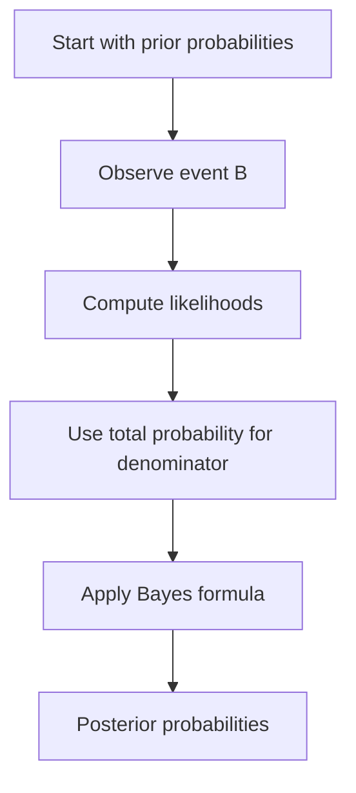

# Conditional Probability, Bayes, and Independence

Conditional probability is the mathematical operation of updating the sample space after learning information. If event $B$ has occurred, outcomes outside $B$ are no longer possible, and the probability measure is renormalized on $B$. This idea is simple in a finite picture, but it drives many subtle examples: witness reliability, medical testing, Monty Hall, repeated trials, and the difference between pairwise independence and full independence.

Bayes' formula is the algebra of probability revision, while independence is the special case in which conditioning changes nothing: $A$ and $B$ are independent exactly when $P(A\mid B)=P(A)$, provided $P(B)\gt 0$. The formulas are short. Most errors come from defining the events poorly, forgetting the population base rate, or assuming that a verbal lack of connection implies mathematical independence.

## Restricting the sample space

If $P(B)\gt 0$, the **conditional probability** of $A$ given $B$ is

$$
P(A\mid B)=\frac{P(A\cap B)}{P(B)}.
$$

Equivalently,

$$
P(A\cap B)=P(A\mid B)P(B)=P(B\mid A)P(A).
$$

The **multiplication rule** for events $E_1,\ldots,E_n$ is

$$
P(E_1\cap\cdots\cap E_n)
=
P(E_1)P(E_2\mid E_1)P(E_3\mid E_1\cap E_2)\cdots
P(E_n\mid E_1\cap\cdots\cap E_{n-1}),
$$

as long as the conditioning events have positive probability.

Events $A$ and $B$ are **independent** if

$$
P(A\cap B)=P(A)P(B).
$$

Events $E_1,\ldots,E_n$ are **mutually independent** if for every nonempty subset $I\subseteq\{1,\ldots,n\}$,

$$
P\left(\bigcap_{i\in I}E_i\right)=\prod_{i\in I}P(E_i).
$$

Pairwise independence only checks subsets of size $2$; it is weaker than mutual independence.

## Reversing the condition with Bayes' formula

**Bayes' formula** follows by writing $P(A\cap B)$ in two ways:

$$
P(A\mid B)=\frac{P(B\mid A)P(A)}{P(B)}.
$$

If $A_1,\ldots,A_n$ partition the sample space and each $P(A_i)\gt 0$, then the denominator can be expanded by the law of total probability:

$$
P(B)=\sum_{i=1}^{n}P(B\mid A_i)P(A_i).
$$

Thus

$$
P(A_j\mid B)=
\frac{P(B\mid A_j)P(A_j)}
{\sum_{i=1}^{n}P(B\mid A_i)P(A_i)}.
$$

This is the version used in base-rate problems. The prior $P(A_j)$ matters as much as the likelihood $P(B\mid A_j)$.

Conditional probability itself satisfies the probability axioms on the restricted space $B$: for fixed $B$ with $P(B)\gt 0$, the map $A\mapsto P(A\mid B)$ is a probability measure.

If $A$ and $B$ are independent and $0\lt P(B)\lt 1$, then $A$ is also independent of $B^c$:

$$
P(A\cap B^c)=P(A)-P(A\cap B)=P(A)-P(A)P(B)=P(A)P(B^c).
$$

This identity is often useful when independence is easier to state for the complementary event.

Bayes' formula is best understood as a ratio update. The posterior odds of $A$ versus $A^c$ are the prior odds multiplied by the likelihood ratio:

$$
\frac{P(A\mid B)}{P(A^c\mid B)}
=
\frac{P(A)}{P(A^c)}
\cdot
\frac{P(B\mid A)}{P(B\mid A^c)}.
$$

This form makes the base-rate effect explicit. Strong evidence can still lead to a modest posterior probability when the prior probability is small. Conversely, weak evidence can matter a lot when the competing hypotheses had similar prior probabilities.

The multiplication rule is the safest way to compute probabilities of sequential observations. For example, drawing cards without replacement should not be treated as independent trials. The probability of two aces in the first two cards is

$$
\frac{4}{52}\cdot\frac{3}{51},
$$

not $(4/52)^2$. The second factor is conditional on the first draw having already removed an ace. Independence would apply only if the card were replaced and the deck reshuffled between draws.

Independence is also a property of the probability model, not merely of the words in the story. Two events can sound unrelated but be dependent because of a hidden constraint. In two coin tosses, "first coin is heads" and "total number of heads is odd" are independent. But "first coin is heads" and "both coins have the same result" are also independent, even though the second event mentions the first coin indirectly. The definition, not intuition alone, decides.

For more than two events, mutual independence requires checking all nonempty subcollections. Pairwise independence means every pair factors, but it says nothing about triple intersections. This distinction becomes important in later random-variable settings, where variables may have zero pairwise covariance or pairwise independence while still being collectively constrained.

## A calculation map

| Concept | Formula | Interpretation |
|---|---|---|
| Conditional probability | $P(A\mid B)=P(A\cap B)/P(B)$ | renormalize on $B$ |
| Multiplication rule | $P(A\cap B)=P(A)P(B\mid A)$ | sequential probability |
| Independence | $P(A\cap B)=P(A)P(B)$ | learning $B$ does not change $A$ |
| Bayes' formula | $P(A\mid B)=P(B\mid A)P(A)/P(B)$ | reverse the conditioning |
| Total probability | $P(B)=\sum_iP(B\mid A_i)P(A_i)$ | average over cases |

## Worked example: the taxi witness problem

Problem: A town has two taxi companies. On the night of an accident, $85\%$ of taxis are green and $15\%$ are blue. A witness says the taxi was blue. Under similar conditions, the witness identifies taxi color correctly $80\%$ of the time. What is the probability the taxi was actually blue?

Method:

1. Let $B$ be the event "taxi is blue" and $W$ be "witness says blue".
2. Priors:

$$
P(B)=0.15,\qquad P(B^c)=0.85.
$$

3. Likelihoods:

$$
P(W\mid B)=0.80,\qquad P(W\mid B^c)=0.20.
$$

The second value is $0.20$ because a green taxi is mistakenly called blue when the witness is wrong.

4. Compute the denominator:

$$
\begin{aligned}
P(W)
&=P(W\mid B)P(B)+P(W\mid B^c)P(B^c)\\
&=0.80(0.15)+0.20(0.85)\\
&=0.12+0.17\\
&=0.29.
\end{aligned}
$$

5. Apply Bayes:

$$
P(B\mid W)=\frac{0.80(0.15)}{0.29}
=\frac{0.12}{0.29}
\approx 0.4138.
$$

Checked answer: even a fairly reliable witness does not overcome the base rate entirely. The posterior probability is about $41.4\%$, not $80\%$.

## Worked example: pairwise but not mutually independent

Problem: Toss two fair coins. Let $A$ be "first coin is heads", $B$ be "second coin is heads", and $C$ be "the number of heads is even". Are $A,B,C$ mutually independent?

Method:

1. The sample space is

$$
\{HH,HT,TH,TT\},
$$

with each outcome probability $1/4$.

2. The events are

$$
A=\{HH,HT\},\quad B=\{HH,TH\},\quad C=\{HH,TT\}.
$$

Each has probability $1/2$.

3. Pairwise intersections:

$$
A\cap B=\{HH\},\quad A\cap C=\{HH\},\quad B\cap C=\{HH\}.
$$

Each has probability $1/4$, which equals $(1/2)(1/2)$.

4. Thus the events are pairwise independent.

5. Check the triple intersection:

$$
A\cap B\cap C=\{HH\},
$$

so

$$
P(A\cap B\cap C)=\frac14.
$$

But

$$
P(A)P(B)P(C)=\frac12\cdot\frac12\cdot\frac12=\frac18.
$$

Checked answer: $A,B,C$ are pairwise independent but not mutually independent. Knowing any one of them alone gives no information about another one, but knowing two determines the third.

## A second positive test

Suppose a disease has prevalence $1\%$. A diagnostic test has sensitivity $0.95$ and specificity $0.90$. Sensitivity is $P(+\mid D)$; specificity is $P(-\mid D^c)$, so the false-positive probability is $P(+\mid D^c)=0.10$.

For one positive result,

$$
\begin{aligned}
P(D\mid +)
&=\frac{P(+\mid D)P(D)}{P(+\mid D)P(D)+P(+\mid D^c)P(D^c)}\\
&=\frac{0.95(0.01)}{0.95(0.01)+0.10(0.99)}\\
&=\frac{0.0095}{0.1085}\\
&\approx0.0876.
\end{aligned}
$$

A population-of-10,000 table says the same thing without symbolic manipulation. About $100$ people have the disease, of whom $95$ test positive. Of the other $9{,}900$, about $990$ test positive. Among the $1{,}085$ positive results, only $95$ are true positives.

Now suppose the same test is repeated on a fresh specimen and gives another positive result. It is tempting to square both likelihoods:

$$
P(D\mid +,+)
=\frac{0.95^2(0.01)}{0.95^2(0.01)+0.10^2(0.99)}
\approx0.4776.
$$

That answer requires the two test outcomes to be conditionally independent given disease status. It can fail when the same contamination, medication, calibration error, or biological feature affects both tests. Ordinary independence of the two results is neither expected nor needed; conditional independence under each hypothesis is the relevant assumption.

## Conditional independence and screening off

Events $A$ and $B$ are conditionally independent given $C$ when

$$
P(A\cap B\mid C)=P(A\mid C)P(B\mid C).
$$

Conditional independence does not imply unconditional independence, and unconditional independence does not imply conditional independence. A common-cause example shows the first point. Let $C$ denote whether a coin chosen at random is two-headed or two-tailed, and toss it twice. Given $C$, the two tosses are deterministic and hence conditionally independent. Without knowing $C$, the tosses are perfectly correlated.

For the reverse phenomenon, toss two independent fair coins, with indicators $X$ and $Y$, and condition on their sum being one. Before conditioning, $X$ and $Y$ are independent. Given $X+Y=1$, learning $X=1$ forces $Y=0$; conditioning has created dependence by selecting a constrained subset.

The idea often appears as “screening off”: once a sufficiently informative common cause is known, two observations may no longer provide information about each other. Bayesian networks encode such statements, but the probability equality remains the definition.

## Sequential information and the chain rule

The multiplication rule extends by repeated use of the two-event identity:

$$
\begin{aligned}
P(E_1\cap E_2\cap E_3)
&=P(E_3\mid E_1\cap E_2)P(E_1\cap E_2)\\
&=P(E_1)P(E_2\mid E_1)P(E_3\mid E_1\cap E_2).
\end{aligned}
$$

For a shuffled deck, consider the probability that the first three cards are all hearts:

$$
\begin{aligned}
P(H_1\cap H_2\cap H_3)
&=P(H_1)P(H_2\mid H_1)P(H_3\mid H_1\cap H_2)\\
&=\frac{13}{52}\frac{12}{51}\frac{11}{50}\\
&=\frac{11}{850}.
\end{aligned}
$$

The factors change because each observed heart removes one favorable card and one card overall. If cards were replaced and the deck reshuffled after every draw, every factor would instead be $13/52$.

The chain rule also clarifies likelihood calculations. For observations $x_1,\ldots,x_n$ under a hypothesis $H$,

$$
P(x_1,\ldots,x_n\mid H)
=\prod_{i=1}^nP(x_i\mid x_1,\ldots,x_{i-1},H).
$$

Replacing each conditional factor by $P(x_i\mid H)$ is an extra conditional-independence assumption, not a consequence of Bayes' formula.

## Zero-probability conditions

The elementary ratio $P(A\cap B)/P(B)$ is undefined when $P(B)=0$. This matters for continuous variables because events such as $X=x$ usually have probability zero. Nevertheless, expressions such as $P(Y\le y\mid X=x)$ can be defined through a conditional density:

$$
f_{Y\mid X}(y\mid x)=\frac{f_{X,Y}(x,y)}{f_X(x)},
$$

when $f_X(x)\gt 0$. More general conditional probabilities are defined as conditional expectations and are determined only up to sets of probability zero. One should not substitute zero into the elementary event ratio.

## Where calculations go wrong

### Odds form and sequential evidence

For two hypotheses $H_1$ and $H_0$, Bayes' formula can be written as

$$
\frac{P(H_1\mid E)}{P(H_0\mid E)}
=\frac{P(H_1)}{P(H_0)}
\frac{P(E\mid H_1)}{P(E\mid H_0)}.
$$

The three factors are posterior odds, prior odds, and the likelihood ratio. If evidence arrives in stages and $E_1,E_2$ are conditionally independent under each hypothesis, then

$$
\frac{P(H_1\mid E_1,E_2)}{P(H_0\mid E_1,E_2)}
=\frac{P(H_1)}{P(H_0)}
\prod_{j=1}^2\frac{P(E_j\mid H_1)}{P(E_j\mid H_0)}.
$$

Each observation multiplies the current odds. On a logarithmic scale these updates add, which is convenient when many likelihood ratios would overflow or underflow numerically.

As an example, take prior odds $1:9$ and evidence with likelihood ratio $6$. The posterior odds are $6:9=2:3$, corresponding to posterior probability $2/(2+3)=0.4$. A second conditionally independent observation with likelihood ratio $3$ changes the odds to $6:9\times3=2:1$, or probability $2/3$. Multiplying a probability directly by a likelihood ratio would give the wrong normalization; odds are the quantity that updates multiplicatively.

### Independence survives functions on separate sides

If $X$ and $Y$ are independent, then $g(X)$ and $h(Y)$ are independent for measurable functions $g$ and $h$. Events determined only by $X$ remain independent of events determined only by $Y$. The result follows because preimages reduce the claim to the defining factorization:

$$
P(g(X)\in A,h(Y)\in B)
=P(X\in g^{-1}(A),Y\in h^{-1}(B)).
$$

Applying a joint function can destroy the separation. Even when $X$ and $Y$ are independent, $X+Y$ is usually dependent on $X$. Independence belongs to collections of information, not merely to variables before algebraic manipulation.

- Ignoring the base rate in Bayes problems. $P(B\mid A)$ is not determined by test accuracy alone.
- Reversing conditional probabilities. In general $P(A\mid B)\ne P(B\mid A)$.
- Saying events are independent because they are disjoint. If disjoint events both have positive probability, then $P(A\cap B)=0$ while $P(A)P(B)\gt 0$, so they are dependent.
- Checking only pairwise independence when a problem asks for mutual independence.
- Conditioning on an event of probability zero. For continuous random variables this requires conditional densities or a limiting interpretation, not the elementary ratio formula.

## Subtleties of conditioning

### Conditioning can create or reverse associations

Conditioning changes the reference population, so an association may reverse after groups are combined. Suppose two clinics treat easy and difficult cases in different proportions. Clinic A succeeds on $90$ of $100$ easy cases and $1$ of $10$ difficult cases, for $91/110\approx82.7\%$ overall. Clinic B succeeds on $19$ of $20$ easy cases and $30$ of $100$ difficult cases, for $49/120\approx40.8\%$ overall. Within easy cases B has $95\%$ versus A's $90\%$; within difficult cases B has $30\%$ versus A's $10\%$. B is better in each stratum yet worse after aggregation because it handles far more difficult cases. This is Simpson's paradox.

There is no contradiction. The overall rates are weighted averages with different weights:

$$
P(S\mid A)=\sum_dP(S\mid A,d)P(d\mid A),
$$

and the distribution of difficulty $d$ differs by clinic. A comparison must decide whether the target is each clinic's actual case mix or a common standardized mix.

Conditioning can also create dependence between initially independent causes. Let two independent fair coins indicate whether two applicants meet separate criteria, and inspect only cases where at least one criterion is met. Before selection, the criteria are independent. Within the selected group, learning that the first criterion failed forces the second to have passed. The selection event acts as a common consequence, sometimes called a collider.

These examples matter because “control for another variable” is not automatically sound. Conditioning on a common cause can remove a spurious association; conditioning on a common effect can introduce one. Probability identities state what follows from a chosen model, but they do not decide which variables should be conditioned on in a causal question.

Natural-frequency tables remain a good arithmetic check. Choose a hypothetical population size that turns base rates into counts, pass each subgroup through its corresponding likelihood, and condition by restricting to the observed row. If the resulting denominator disagrees with the law of total probability, an event has likely been reversed or omitted.

See also: [Probability axioms and inclusion-exclusion](/math/probability-and-random-variables/probability-axioms-and-inclusion-exclusion) · [Discrete random variables, expectation, and variance](/math/probability-and-random-variables/discrete-random-variables-expectation-variance) · [Joint distributions, transformations, and independence](/math/probability-and-random-variables/joint-distributions-transformations-independence) · [Conditional expectation](/math/probability-and-random-variables/covariance-correlation-conditional-expectation)

