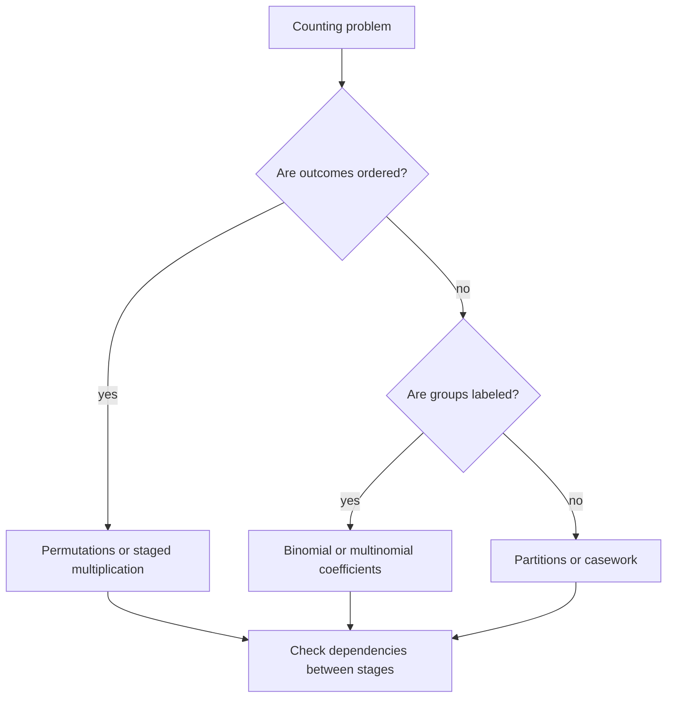

# Counting and Combinatorics

Probability begins with counting because many first models have finitely many equally likely outcomes. If every outcome in a sample space is equally likely, then probabilities reduce to ratios: favorable outcomes divided by total outcomes. The hard part is usually not the division; it is counting the numerator and denominator without double-counting, under-counting, or accidentally treating identical objects as distinct.

The first MIT 18.440 lectures use permutations, combinations, Pascal's triangle, multinomial coefficients, and partition-style problems as the basic language for finite probability. These methods remain useful after the course moves to random variables, since binomial, multinomial, hypergeometric, geometric, and many occupancy models use the same counting principles.

## What is being counted?

A **permutation** of $n$ distinct objects is an ordering of all $n$ objects. There are

$$
n! = n(n-1)(n-2)\cdots 2 \cdot 1
$$

such orderings. More generally, the number of injective assignments of $k$ labeled positions from $n$ distinct objects is

$$
n(n-1)\cdots(n-k+1)=\frac{n!}{(n-k)!}.
$$

A **combination** is an unordered selection. The number of $k$-element subsets of an $n$-element set is

$$
\binom{n}{k}=\frac{n!}{k!(n-k)!}.
$$

The factor $k!$ removes the orderings of the selected objects, and the factor $(n-k)!$ removes the orderings of the unselected objects if one starts from all $n!$ permutations.

A **multinomial coefficient** counts ways to divide $n$ distinct objects into labeled groups of sizes $n_1,\ldots,n_r$, where $n_1+\cdots+n_r=n$:

$$
\binom{n}{n_1,\ldots,n_r}
=
\frac{n!}{n_1!n_2!\cdots n_r!}.
$$

Equivalently, it counts words of length $n$ containing $n_1$ copies of one letter, $n_2$ copies of another, and so on.

An **integer partition** writes an integer as a sum of positive integers where order is ignored, such as $5=3+1+1=2+2+1$. Integer partitions differ from multinomial counting because the parts are not labeled by roles such as "breakfast", "lunch", and "dinner".

## Choosing a counting model

Write down the objects before writing a formula. "Choose three people" asks for a subset; "choose a first, second, and third person" asks for an ordered tuple with no repeated entries. Silently changing the object halfway through a solution is a common source of errors.



| Pattern | Typical question | Count |
|---|---:|---:|
| Order all $n$ distinct objects | Assign $n$ hats to $n$ people | $n!$ |
| Order $k$ of $n$ distinct objects | Award gold, silver, bronze among $n$ people | $n!/(n-k)!$ |
| Select $k$ of $n$ distinct objects | Choose a poker hand by ranks only | $\binom{n}{k}$ |
| Split into labeled sizes | Choose 3 breakfast, 2 lunch, 3 dinner items from 8 | $8!/(3!2!3!)$ |
| Repeated-letter word | Arrange AAABBCCC | $8!/(3!2!3!)$ |

The **multiplication principle** applies when a procedure has $a_1$ choices at stage 1, $a_2$ choices at stage 2 regardless of the first choice, and so on through $a_m$ choices at stage $m$. The total is

$$
a_1a_2\cdots a_m.
$$

If later counts depend on earlier choices, split the procedure into cases or track its state. The **addition principle** handles disjoint cases: sets of sizes $b_1,\ldots,b_m$ have total size $b_1+\cdots+b_m$. Overlapping cases require inclusion-exclusion.

Replacement and order produce three different models. For $k$ selections from $n$ possibilities, repeats allowed and order recorded gives $n^k$. With no repeats, an ordered selection gives $n!/(n-k)!$, while an unordered selection gives $\binom nk$.

Division by a symmetry factor is valid only when every final object has been counted the same number of times. Labels matter too: assigning three foods to breakfast and two to lunch differs from splitting foods into unlabeled piles of sizes three and two.

Symmetry simplifies probability only after the equally likely outcomes are identified. In a shuffled deck, all card orders are equally likely, but descriptions such as "one pair", "two pair", and "full house" are not equally likely. Define a uniform sample space first, usually all ordered shuffles or all unordered hands, and count the favorable subset inside it.

## Identities proved by counting twice

The **binomial theorem** is

$$
(x+y)^n=\sum_{k=0}^n \binom{n}{k}x^k y^{n-k}.
$$

Expanding $(x+y)^n$ means choosing either $x$ or $y$ from each of $n$ factors. A term $x^k y^{n-k}$ comes from choosing the $k$ factors that contribute $x$, so its coefficient is $\binom{n}{k}$.

The **Pascal identity** is

$$
\binom{n}{k}=\binom{n-1}{k-1}+\binom{n-1}{k}.
$$

Count $k$-subsets of $\{1,\ldots,n\}$ according to whether they contain $n$. Those that do require $k-1$ elements from the first $n-1$; those that do not require $k$ elements from the first $n-1$.

This habit extends beyond Pascal's identity. A committee with a chair can be counted by choosing the committee and then its chair, or by choosing the chair and then the other members. Equal formulas obtained from the two constructions confirm that both count the same objects.

The convention $0!=1$ is forced by the same interpretation: there is one way to arrange zero objects. It gives $\binom{n}{0}=\binom{n}{n}=1$ and lets the binomial theorem include the edges of Pascal's triangle. Multinomial coefficients likewise permit $n_i=0$ when a labeled group receives no elements.

## From binomial to multinomial expansion

The **multinomial theorem** is

$$
(x_1+\cdots+x_r)^n
=
\sum_{n_1+\cdots+n_r=n}
\frac{n!}{n_1!\cdots n_r!}
x_1^{n_1}\cdots x_r^{n_r}.
$$

Each term records how many times each symbol $x_i$ was chosen from the $n$ factors.

### Arranging a repeated-letter word

How many length-8 strings can be made from three A's, two B's, and three C's?

First label the letters $A_1,A_2,A_3,B_1,B_2,C_1,C_2,C_3$. Their $8!$ arrangements overcount every visible string by $3!2!3!$, since labels within a letter class can be permuted without changing the string. Therefore

$$
\frac{8!}{3!2!3!}
=
\frac{40320}{6\cdot 2\cdot 6}
=
560.
$$

Choosing positions for the letter classes gives the same count:

$$
\binom{8}{3}\binom{5}{2}\binom{3}{3}
=56\cdot 10\cdot 1
=560.
$$

The first calculation divides out internal symmetries; the second constructs each visible string once.

### Extracting a coefficient

To find the coefficient of $x^2y^3z$ in $(x+y+z)^6$, choose which two factors contribute $x$, which three contribute $y$, and which one contributes $z$:

$$
\binom{6}{2,3,1}
=
\frac{6!}{2!3!1!}
=
\frac{720}{2\cdot 6\cdot 1}
=60.
$$

Sequential choices agree:

$$
\binom{6}{2}\binom{4}{3}\binom{1}{1}
=15\cdot 4\cdot 1
=60.
$$

## Checking the identities in Python

```python
from math import factorial, comb

def multinomial(*parts):
    n = sum(parts)
    out = factorial(n)
    for p in parts:
        out //= factorial(p)
    return out

print("AAABBCCC strings:", multinomial(3, 2, 3))
print("Coefficient of x^2 y^3 z in (x+y+z)^6:", multinomial(2, 3, 1))

# Pascal identity check for a row
n = 10
for k in range(1, n):
    assert comb(n, k) == comb(n - 1, k - 1) + comb(n - 1, k)
print("Pascal identity verified for row", n)
```

<div className="see-also">

See also: [Probability axioms and inclusion-exclusion](/math/probability-and-random-variables/probability-axioms-and-inclusion-exclusion) · [Bernoulli, binomial, geometric, and negative binomial laws](/math/probability-and-random-variables/bernoulli-binomial-geometric-negative-binomial) · [Poisson random variables and Poisson processes](/math/probability-and-random-variables/poisson-random-variables-and-processes) · [Discrete probability in Rosen's style](/math/discrete/discrete-probability) · [Counting principles in the shorter probability section](/math/probability/counting-principles)

</div>
