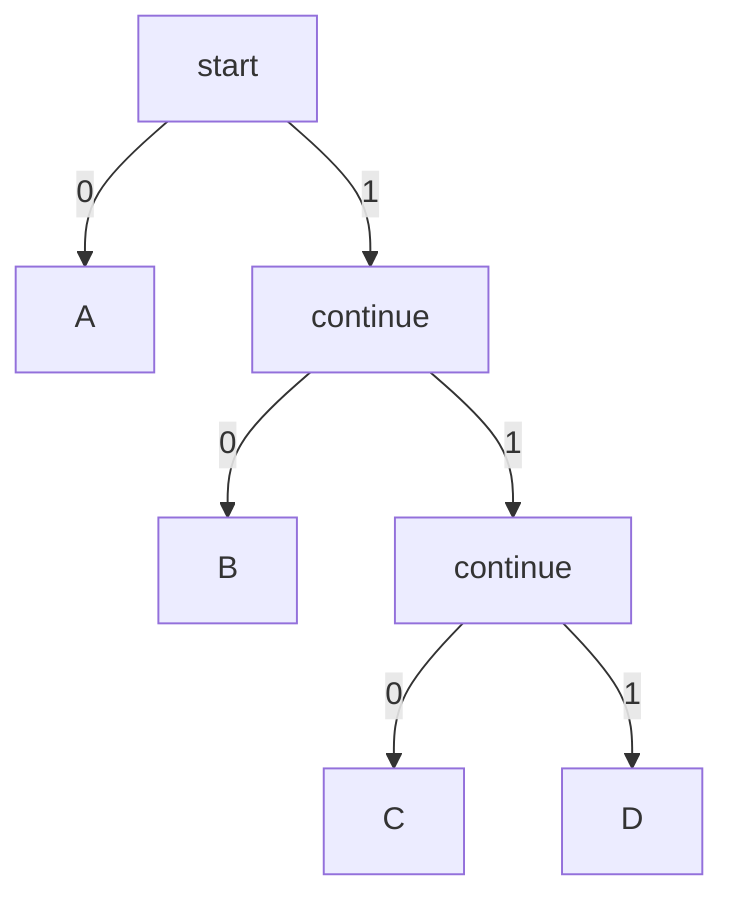

# Entropy and Coding

Suppose a sender must describe the outcome of a random experiment to a receiver who already knows its probability law. If all outcomes are equally likely, fixed-length labels are natural. If some outcomes occur much more often than others, shorter labels for common outcomes can reduce the average message length. Shannon entropy is the number that governs the best achievable average.

This coding interpretation separates entropy from a vague notion of “disorder.” Entropy belongs to a probability distribution and a choice of logarithm base. In the discrete binary setting, it measures uncertainty in bits and lower-bounds the expected length of a lossless code. The same algebra leads to conditional entropy and mutual information once side information is available.

## Information in one outcome

An outcome of probability $p$ carries **self-information**

$$
I(p)=-\log_2 p=\log_2\frac1p.
$$

The form of the logarithm follows from a natural composition rule. If two independent events have probabilities $p$ and $q$, their joint probability is $pq$. Information should add for independent observations, and

$$
I(pq)=-\log_2(pq)=I(p)+I(q).
$$

A certain event has information $I(1)=0$. A rare event has larger information than a common one. Doubling the reciprocal probability adds one bit: an event of probability $1/8$ carries three bits, while one of probability $1/4$ carries two.

Self-information is attached to the observed outcome. Entropy averages it before the outcome is known. If $X$ has PMF $p(x)$, its Shannon entropy is

$$
H(X)
=E[-\log_2 p(X)]
=-\sum_x p(x)\log_2 p(x).
$$

The convention $0\log 0=0$ is justified by the limit

$$
\lim_{p\downarrow0}p\log p=0.
$$

An impossible outcome contributes nothing to the average. Its self-information would be infinite if it somehow occurred, but it occurs with probability zero.

Base-$2$ logarithms give bits. Natural logarithms give nats, and base-$10$ logarithms give hartleys. Changing bases multiplies every entropy by a fixed constant:

$$
H_e(X)=(\ln2)H_2(X).
$$

The labels assigned to outcomes do not matter. Renaming red, green, and blue as $10$, $20$, and $1000$ leaves entropy unchanged because the probability vector is unchanged. Variance would react to those numerical distances; entropy does not.

## The extremes: certainty and a uniform law

If one outcome has probability one, then $H(X)=0$. There is nothing to communicate once sender and receiver know the distribution. At the other extreme, if $X$ is uniform on $n$ values,

$$
H(X)
=-n\frac1n\log_2\frac1n
=\log_2 n.
$$

The uniform law maximizes entropy among distributions on $n$ points. A compact proof uses the nonnegativity of relative entropy. For probability vectors $p$ and $q$, define

$$
D(p\|q)=\sum_i p_i\log_2\frac{p_i}{q_i}.
$$

Gibbs' inequality states that $D(p\|q)\ge0$, with equality exactly when $p=q$ on their support. Take $q$ to be uniform, so $q_i=1/n$. Then

$$
\begin{aligned}
D(p\|q)
&=\sum_i p_i\log_2(np_i)\\
&=\log_2 n+\sum_i p_i\log_2 p_i\\
&=\log_2 n-H(p).
\end{aligned}
$$

Nonnegativity gives $H(p)\le\log_2 n$. Equality requires $p_i=1/n$ for every $i$.

Relative entropy is not a distance: it is asymmetric and does not satisfy the triangle inequality. Its role here is to measure the penalty for using one probability law where another is correct. Gibbs' inequality can be proved from the concavity of the logarithm or from $\ln u\le u-1$.

### Coding with the wrong probability model

Suppose the true source distribution is $p$, but a code is designed around a model $q$. The ideal length assigned to symbol $i$ by that model is $-\log_2q_i$. Averaging under the distribution that actually generates symbols gives the **cross-entropy**

$$
H(p,q)=-\sum_i p_i\log_2q_i.
$$

Add and subtract the entropy of $p$:

$$
\begin{aligned}
H(p,q)
&=-\sum_i p_i\log_2p_i
+\sum_i p_i\log_2\frac{p_i}{q_i}\\
&=H(p)+D(p\|q).
\end{aligned}
$$

The extra expected length is relative entropy. It vanishes only when the model matches the source wherever $p_i\gt 0$. If a model assigns $q_i=0$ to an event that can occur, the penalty is infinite: the supposed code has made no provision for that symbol.

Take a source with true probabilities $(0.9,0.1)$. Its entropy is

$$
h_2(0.1)
=-0.9\log_2 0.9-0.1\log_2 0.1
\approx0.4690\text{ bit}.
$$

A model $q=(0.5,0.5)$ assigns one ideal bit to either result, so its cross-entropy is one bit and its mismatch penalty is about $0.5310$ bit. A closer model $q=(0.8,0.2)$ gives

$$
\begin{aligned}
H(p,q)
&=-0.9\log_2 0.8-0.1\log_2 0.2\\
&\approx0.5219\text{ bit},
\end{aligned}
$$

leaving a penalty of only about $0.0529$ bit. These are idealized average lengths; an actual one-symbol binary prefix code still needs integer lengths. Over long blocks, arithmetic-style or block codes can approach the cross-entropy rate. The calculation isolates two sources of inefficiency: integer coding overhead and an inaccurate probability model.

For a Bernoulli variable with $P(X=1)=p$, entropy becomes the binary entropy function

$$
h_2(p)=-p\log_2p-(1-p)\log_2(1-p).
$$

It is symmetric around $p=1/2$, equals zero at $0$ and $1$, and reaches one bit at $1/2$. A highly biased bit is predictable most of the time, so its average information is below one bit even though two outcomes remain possible.

### Mixing distributions increases uncertainty

Entropy is a concave function of the probability vector. If $p$ and $q$ are two distributions on the same alphabet and $0\le\lambda\le1$, then

$$
H(\lambda p+(1-\lambda)q)
\ge\lambda H(p)+(1-\lambda)H(q).
$$

One interpretation is to choose a source at random—use $p$ with probability $\lambda$ and $q$ otherwise—then hide which source was chosen. The receiver sees only the resulting symbol. Forgetting the source label cannot make the symbol easier to predict on average. Equality holds when the two distributions agree, with additional boundary cases when the mixture weight is zero or one.

Concavity also explains why averaging conditional distributions raises entropy. The marginal law satisfies

$$
p_X(x)=\sum_y p_Y(y)p_{X\mid Y}(x\mid y),
$$

so it is a mixture of the conditional laws. Applying concavity gives

$$
H(X)\ge\sum_y p_Y(y)H(X\mid Y=y)=H(X\mid Y).
$$

This proof establishes the average statement without claiming that every observed value of $Y$ lowers entropy. It also connects the shape of entropy to coding: uncertainty can be reduced by revealing which component generated a symbol, while hiding that label may require extra bits.

## Codes as binary decision trees

A binary code assigns a finite bit string to each source symbol. A code is **prefix-free** when no codeword begins with another complete codeword. For example,

| Symbol | Codeword |
|---|---|
| A | `0` |
| B | `10` |
| C | `110` |
| D | `111` |

is prefix-free. As soon as the decoder reads `0`, the symbol A is complete; reading `1` means more bits are required. A code containing both `0` and `01` would not have this property. A stream beginning `01...` could be parsed as the short word `0` followed by another symbol or as the longer word `01`.

Prefix-free codes correspond to binary trees whose source symbols occupy leaves. Each left or right branch contributes one bit, so a codeword length is the depth of its leaf.

The leaf structure imposes the **Kraft inequality**. If codeword $i$ has length $\ell_i$, every binary prefix-free code satisfies

$$
\sum_i 2^{-\ell_i}\le1.
$$

At depth $m$, a leaf at depth $\ell_i$ blocks all $2^{m-\ell_i}$ descendants beneath it. Distinct codewords block disjoint sets of depth-$m$ strings. Dividing the total number blocked by the $2^m$ available strings gives the inequality. Conversely, integer lengths satisfying Kraft's inequality can be realized by a prefix-free binary code.

The expected code length is

$$
L=\sum_i p_i\ell_i.
$$

Ideally one would choose

$$
\ell_i=-\log_2p_i,
$$

so that common symbols receive short words. These ideal lengths need not be integers. The coding problem is to choose integer leaf depths that respect Kraft's inequality while keeping $L$ small.

## Why entropy lower-bounds code length

Let a prefix-free code have lengths $\ell_i$, and put

$$
K=\sum_i2^{-\ell_i}\le1,
\qquad
q_i=\frac{2^{-\ell_i}}{K}.
$$

The $q_i$ form a probability distribution. Compare expected length with entropy:

$$
\begin{aligned}
L-H(X)
&=\sum_i p_i\ell_i+\sum_i p_i\log_2p_i\\
&=\sum_i p_i\log_2\frac{p_i}{2^{-\ell_i}}\\
&=\sum_i p_i\log_2\frac{p_i}{Kq_i}\\
&=D(p\|q)-\log_2K\\
&\ge0.
\end{aligned}
$$

Both final terms are nonnegative: relative entropy is nonnegative, and $K\le1$. Therefore every binary prefix-free code obeys

$$
L\ge H(X).
$$

The lower bound does not say that a one-symbol code always attains entropy. Integer lengths cause a gap unless the probabilities have a suitable dyadic form such as $1/2$, $1/4$, or $1/8$. A simple near-optimal construction chooses Shannon lengths

$$
\ell_i=\left\lceil-\log_2p_i\right\rceil.
$$

They satisfy Kraft's inequality because $2^{-\ell_i}\le p_i$, and their average obeys

$$
H(X)\le L<H(X)+1.
$$

For blocks of $n$ independent source symbols, entropy adds to $nH(X)$. Coding the entire block gives an overhead below one bit per block, hence below $1/n$ bit per source symbol:

$$
H(X)\le\frac{L_n}{n}<H(X)+\frac1n.
$$

The overhead can therefore be made arbitrarily small by coding long blocks. This is the operational content of the noiseless source coding theorem for an independent source.

## Huffman coding by hand

Huffman coding builds an optimal binary prefix code for a finite symbol distribution. Repeatedly merge the two least probable items, treating their sum as a new item. After one item remains, reverse the merges and assign a `0` and `1` to the two branches at each split.

Consider four symbols:

| Symbol | Probability |
|---|---:|
| A | $0.4$ |
| B | $0.3$ |
| C | $0.2$ |
| D | $0.1$ |

First merge D and C, with combined probability $0.3$. The active weights are now $0.3$ for B, $0.3$ for CD, and $0.4$ for A. Merge B and CD to obtain weight $0.6$. Finally merge A and BCD. One resulting code is

| Symbol | Codeword | Length |
|---|---|---:|
| A | `0` | $1$ |
| B | `10` | $2$ |
| C | `110` | $3$ |
| D | `111` | $3$ |

The expected length is

$$
\begin{aligned}
L
&=0.4(1)+0.3(2)+0.2(3)+0.1(3)\\
&=0.4+0.6+0.6+0.3\\
&=1.9\text{ bits per symbol}.
\end{aligned}
$$

The entropy is

$$
\begin{aligned}
H(X)
&=-0.4\log_2 0.4-0.3\log_2 0.3\\
&\quad-0.2\log_2 0.2-0.1\log_2 0.1\\
&\approx0.5288+0.5211+0.4644+0.3322\\
&\approx1.8465\text{ bits}.
\end{aligned}
$$

The gap is about $0.0535$ bit per symbol. A fixed-length code would use two bits for every symbol, so the Huffman code saves $0.1$ bit per symbol on average. No binary prefix code for individual symbols has a smaller expected length, although block coding can move the per-symbol average closer to entropy.

When probabilities are exactly $1/2$, $1/4$, $1/8$, and $1/8$, the same tree has lengths $1,2,3,3$ and expected length $1.75$. The entropy is also $1.75$, because every ideal information length is already an integer.

## Joint and conditional entropy

For a pair of discrete variables,

$$
H(X,Y)=-\sum_{x,y}p(x,y)\log_2p(x,y).
$$

The conditional entropy after observing $Y=y$ is

$$
H(X\mid Y=y)
=-\sum_x p(x\mid y)\log_2p(x\mid y).
$$

Before knowing which $y$ will occur, average over $Y$:

$$
H(X\mid Y)=\sum_y p(y)H(X\mid Y=y).
$$

Using $p(x,y)=p(y)p(x\mid y)$ gives the chain rule:

$$
\begin{aligned}
H(X,Y)
&=-\sum_{x,y}p(x,y)\log_2\bigl(p(y)p(x\mid y)\bigr)\\
&=-\sum_{x,y}p(x,y)\log_2p(y)
-\sum_{x,y}p(x,y)\log_2p(x\mid y)\\
&=H(Y)+H(X\mid Y).
\end{aligned}
$$

Symmetrically,

$$
H(X,Y)=H(X)+H(Y\mid X).
$$

The chain rule describes a two-stage code: communicate $Y$, then communicate $X$ using a code selected for the observed value of $Y$. If $X$ and $Y$ are independent, the conditional distribution of $X$ equals its marginal distribution and

$$
H(X,Y)=H(X)+H(Y).
$$

If $Y$ determines $X$, no further bits are required for $X$ once $Y$ is known, so $H(X\mid Y)=0$.

## Mutual information: uncertainty removed by observation

The mutual information between $X$ and $Y$ is

$$
\begin{aligned}
I(X;Y)
&=H(X)-H(X\mid Y)\\
&=H(Y)-H(Y\mid X)\\
&=H(X)+H(Y)-H(X,Y).
\end{aligned}
$$

It is symmetric despite the asymmetric appearance of the first line. It can also be written

$$
I(X;Y)
=\sum_{x,y}p(x,y)
\log_2\frac{p(x,y)}{p(x)p(y)}
=D\bigl(p_{X,Y}\|p_Xp_Y\bigr).
$$

Relative entropy is nonnegative, so $I(X;Y)\ge0$. Therefore

$$
H(X\mid Y)\le H(X).
$$

Conditioning reduces entropy **on average**. A particular observation can increase uncertainty. Suppose $P(X=1)=0.1$. Let $Y=1$ whenever $X=1$, and let $P(Y=1\mid X=0)=1/9$. Then $P(Y=1)=0.2$ and Bayes' rule gives $P(X=1\mid Y=1)=1/2$. Thus

$$
H(X\mid Y=1)=1>h_2(0.1)\approx0.469.
$$

When $Y=0$, however, $X=0$ with certainty. Averaging over the two observations gives $H(X\mid Y)=0.2$ bit, which is below the original entropy.

## Worked example: a noisy binary copy

Let $X$ be a fair bit. Independently flip it with probability $0.2$ to produce $Y$. Equivalently,

$$
P(Y=X)=0.8,
\qquad
P(Y\ne X)=0.2.
$$

The joint table is

| | $Y=0$ | $Y=1$ |
|---|---:|---:|
| $X=0$ | $0.4$ | $0.1$ |
| $X=1$ | $0.1$ | $0.4$ |

The row and column sums are both $(0.5,0.5)$, so

$$
H(X)=H(Y)=1\text{ bit}.
$$

After observing $Y=y$, the matching value of $X$ has conditional probability $0.8$ and the other value has probability $0.2$. Hence

$$
\begin{aligned}
H(X\mid Y)
&=h_2(0.2)\\
&=-0.8\log_2 0.8-0.2\log_2 0.2\\
&\approx0.2575+0.4644\\
&\approx0.7219\text{ bit}.
\end{aligned}
$$

The mutual information is

$$
I(X;Y)=H(X)-H(X\mid Y)
\approx1-0.7219
=0.2781\text{ bit}.
$$

The joint entropy can be checked through the chain rule:

$$
H(X,Y)=H(Y)+H(X\mid Y)
\approx1.7219\text{ bits}.
$$

At zero flip probability, $Y$ reveals $X$ and mutual information is one bit. At flip probability $1/2$, $Y$ is independent of $X$ and mutual information is zero. A flip probability above $1/2$ still carries information because the receiver can reverse the more likely relation.

## Boundaries and common confusions

- Entropy and variance answer different questions. Entropy ignores numerical spacing between labels; variance depends on it.
- The unit follows the logarithm base. Mixing natural logs with a claim in bits introduces a factor of $\ln2$.
- The convention $0\log0=0$ applies to the averaged entropy term. It does not say that $\log0$ is defined.
- $H(X\mid Y=y)$ may exceed $H(X)$ for a particular observation. Only the average $H(X\mid Y)$ is guaranteed not to exceed $H(X)$.
- Entropy lower-bounds expected length for lossless uniquely decodable coding. It is not generally the exact length of a one-symbol code.
- A source alphabet with infinitely many symbols may have infinite entropy. A valid probability distribution does not guarantee a finite coding rate.
- Differential entropy for continuous variables uses a density inside the logarithm. It can be negative and changes under rescaling, so discrete entropy intuitions cannot be transferred without adjustment.
- Huffman coding optimizes expected length among symbol-by-symbol prefix codes. It does not by itself account for model uncertainty, transmission errors, or dependencies between successive symbols.

See also: [Conditional probability, Bayes, and independence](/math/probability-and-random-variables/conditional-probability-bayes-independence) · [Discrete random variables, expectation, and variance](/math/probability-and-random-variables/discrete-random-variables-expectation-variance) · [Markov chains](/math/probability-and-random-variables/markov-chains) · [Strong law and Jensen's inequality](/math/probability-and-random-variables/strong-law-and-jensens-inequality)

