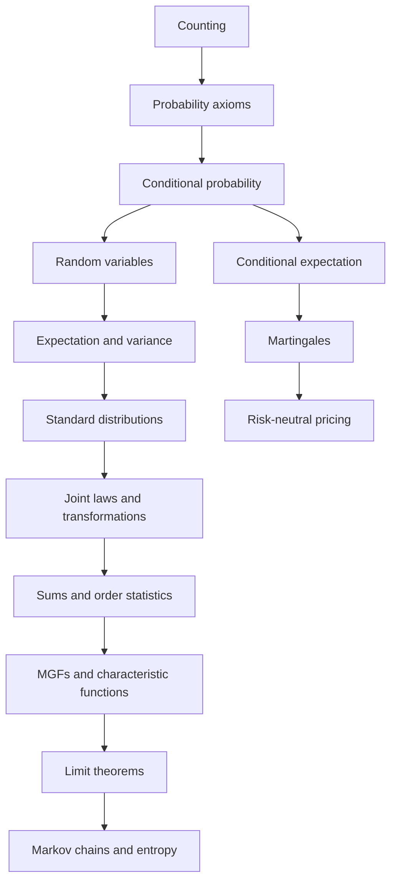

# Probability and Random Variables

This course map follows Scott Sheffield's MIT 18.440 *Probability and Random Variables* from Spring 2014. Counting and axioms lead into random variables, expectation, standard distributions, joint laws, transforms, limit theorems, Markov chains, entropy, martingales, and the risk-neutral viewpoint behind Black–Scholes.

The level sits between a short applied introduction and a measure-theoretic graduate course. Finite and countable models come first, continuous densities enter when needed, and proof sketches accompany results that recur across the subject.

## From events to distributions

**Probability** is a measure $P$ on events in a sample space. A **random variable** is a real-valued function on that space, and its **distribution** is the probability law induced on its values. Early problems use exact finite models; middle chapters work with densities and joint laws; later chapters study limits and stochastic processes.

For a finite sample space $S$ with equally likely outcomes,

$$
P(A)=\frac{|A|}{|S|}.
$$

The real work is choosing $S$ so that equiprobability holds. Permutations, binomial and multinomial coefficients, complements, and inclusion–exclusion then provide the numerator and denominator.

Conditioning changes the probability model when information arrives. For $P(B)\gt 0$,

$$
P(A\mid B)=\frac{P(A\cap B)}{P(B)}.
$$

Bayes' formula, independence, conditional distributions, conditional expectation, and martingales all extend this operation.

Random variables turn outcomes into quantities that can be added, transformed, and summarized. Two identities carry much of the elementary algebra:

$$
E[X+Y]=E[X]+E[Y]
$$

and

$$
\operatorname{Var}(X+Y)
=
\operatorname{Var}(X)+\operatorname{Var}(Y)+2\operatorname{Cov}(X,Y).
$$

The second identity does not require independence; independence is a sufficient condition for the covariance term to vanish when the variances exist.

## The dependency chain

Later topics reuse earlier mechanisms rather than starting over. Poisson processes connect binomial rare-event limits to exponential waiting times. Conditional expectation rests on conditional probability and joint distributions. Martingales rest on conditional expectation. Risk-neutral pricing combines martingales, expectation, and the normal law.

| Course block | Main question | Representative page |
|---|---|---|
| Counting and axioms | How are probabilities assigned consistently? | [Probability axioms and inclusion-exclusion](/math/probability-and-random-variables/probability-axioms-and-inclusion-exclusion) |
| Conditioning | How does information update probabilities? | [Conditional probability, Bayes, and independence](/math/probability-and-random-variables/conditional-probability-bayes-independence) |
| Random variables | How do numerical outcomes behave? | [Discrete random variables, expectation, and variance](/math/probability-and-random-variables/discrete-random-variables-expectation-variance) |
| Distributions | Which laws model common mechanisms? | [Normal, exponential, gamma, beta, and Cauchy laws](/math/probability-and-random-variables/normal-exponential-gamma-beta-cauchy) |
| Limit theory | What happens after many trials? | [Weak law, concentration, and the central limit theorem](/math/probability-and-random-variables/weak-law-concentration-central-limit-theorem) |
| Processes and information | How does randomness evolve or encode uncertainty? | [Markov chains](/math/probability-and-random-variables/markov-chains) |

When a calculation becomes opaque, trace backward until the sample space, conditioning event, or distributional mechanism is explicit.

## Exact formulas and limiting models

Inclusion–exclusion, conditioning, convolution, and transform identities give exact answers when their assumptions hold. Poisson and normal approximations instead describe limiting regimes. A solution should identify which mode it uses. The same problem family may admit an exact binomial probability, a rare-event Poisson approximation, and a large-sample normal approximation.

Asymptotic regularity explains why aggregated randomness becomes predictable. Under suitable hypotheses,

$$
\frac{X_1+\cdots+X_n}{n}\to \mu,
\qquad
\frac{X_1+\cdots+X_n-n\mu}{\sigma\sqrt n}\Rightarrow N(0,1).
$$

The laws of large numbers stabilize averages; the central limit theorem describes the scale and shape of their fluctuations.

## Lecture order

1. [Counting and combinatorics](/math/probability-and-random-variables/counting-and-combinatorics)
2. [Probability axioms and inclusion-exclusion](/math/probability-and-random-variables/probability-axioms-and-inclusion-exclusion)
3. [Conditional probability, Bayes, and independence](/math/probability-and-random-variables/conditional-probability-bayes-independence)
4. [Discrete random variables, expectation, and variance](/math/probability-and-random-variables/discrete-random-variables-expectation-variance)
5. [Bernoulli, binomial, geometric, and negative binomial laws](/math/probability-and-random-variables/bernoulli-binomial-geometric-negative-binomial)
6. [Poisson random variables and Poisson processes](/math/probability-and-random-variables/poisson-random-variables-and-processes)
7. [Continuous random variables and uniform laws](/math/probability-and-random-variables/continuous-random-variables-and-uniform-laws)
8. [Normal, exponential, gamma, beta, and Cauchy laws](/math/probability-and-random-variables/normal-exponential-gamma-beta-cauchy)
9. [Joint distributions, transformations, and independence](/math/probability-and-random-variables/joint-distributions-transformations-independence)
10. [Sums, convolutions, and order statistics](/math/probability-and-random-variables/sums-convolutions-order-statistics)
11. [Covariance, correlation, and conditional expectation](/math/probability-and-random-variables/covariance-correlation-conditional-expectation)
12. [Moment and characteristic functions](/math/probability-and-random-variables/moment-and-characteristic-functions)
13. [Weak law, concentration, and the central limit theorem](/math/probability-and-random-variables/weak-law-concentration-central-limit-theorem)
14. [Strong law and Jensen's inequality](/math/probability-and-random-variables/strong-law-and-jensens-inequality)
15. [Markov chains](/math/probability-and-random-variables/markov-chains)
16. [Entropy and coding](/math/probability-and-random-variables/entropy-and-coding)
17. [Martingales, risk-neutral probability, and Black-Scholes](/math/probability-and-random-variables/martingales-risk-neutral-probability-black-scholes)

## Derangements: counting before probability

Suppose $n$ hats are shuffled uniformly among $n$ people. To find the probability that nobody receives their own hat, let $E_i$ be the event that person $i$ does receive it. All $n!$ permutations form the equally likely sample space, and

$$
E_1^c\cap\cdots\cap E_n^c
=
(E_1\cup\cdots\cup E_n)^c.
$$

For any fixed set of $r$ people, exactly $(n-r)!$ permutations fix all of them, so that intersection has probability

$$
\frac{(n-r)!}{n!}.
$$

Inclusion–exclusion gives the exact derangement probability

$$
P(\text{nobody receives their own hat})
=
\sum_{r=0}^{n}(-1)^r\frac{1}{r!}.
$$

As $n$ grows, the sum approaches $e^{-1}$. The path through the notes is [counting and combinatorics](/math/probability-and-random-variables/counting-and-combinatorics), followed by [probability axioms and inclusion-exclusion](/math/probability-and-random-variables/probability-axioms-and-inclusion-exclusion).

## Four hundred coin tosses: exact model, asymptotic explanation

Let $X$ be the number of heads in 400 independent fair tosses. Then

$$
X\sim\operatorname{Binomial}(400,1/2),
$$

with

$$
E[X]=200,
\qquad
\operatorname{Var}(X)=100.
$$

The law of large numbers explains why $X/400$ should lie near $1/2$. To approximate the probability of 190 through 210 heads, use a normal variable $N$ with mean $200$ and standard deviation $10$. A continuity correction gives

$$
P(190\le X\le 210)
\approx
P(189.5\le N\le 210.5).
$$

After standardization,

$$
P(-1.05\le Z\le 1.05)
=
\Phi(1.05)-\Phi(-1.05)
\approx 0.706.
$$

The exact model belongs to [Bernoulli, binomial, geometric, and negative binomial laws](/math/probability-and-random-variables/bernoulli-binomial-geometric-negative-binomial); the approximation and its justification belong to [weak law, concentration, and the central limit theorem](/math/probability-and-random-variables/weak-law-concentration-central-limit-theorem).

## Checks before applying a formula

- Establish the sample space before counting, especially when outcomes may not be equally likely.
- $P(A\mid B)$ and $P(B\mid A)$ condition on different information and generally have different values.
- Choose distributions from their random mechanisms: fixed trial count, waiting time, rare-event count, and continuous measurement lead to different laws.
- State whether an answer is exact or approximate and verify the assumptions behind an approximation.
- Expectation and variance summarize a law but do not identify it; distinct distributions can share both.

See also: [Probability](/math/probability/intro) · [Statistics](/math/statistics/intro) · [Limits and Continuity](/math/calculus/limits-and-continuity) · [Linear Algebra](/math/linear-algebra/intro)

