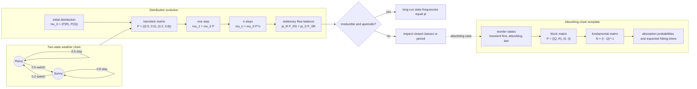

# Markov Chains

A Markov chain is a random process whose next state depends on the present state but not on the earlier history. This "memoryless given the present" property is a discrete-time counterpart of exponential waiting times. Instead of one random variable, a chain is a sequence $X_0,X_1,X_2,\ldots$ moving through a state space.

MIT 18.440 introduces finite-state chains through examples such as weather models, then turns to ergodicity and stationarity. The main long-run question is whether the chain forgets its starting state and settles into stable state frequencies.

## The state must contain the relevant memory

On the finite state space

$$
\{0,1,\ldots,M\},
$$

a sequence $X_0,X_1,X_2,\ldots$ is a **Markov chain** if there are transition probabilities $P_{ij}$ such that

$$
P(X_{n+1}=j\mid X_n=i,\ X_{n-1}=i_{n-1},\ldots,X_0=i_0)
=P_{ij}.
$$

The property does not mean that consecutive states are independent. It says that the current state summarizes everything in the past that is relevant to the next transition.

A poor state choice can destroy the Markov property. A relationship model with only "single" and "married" states may fail if transition probabilities depend on how long the current relationship has lasted. Adding duration to the state can restore a Markov description.

## From one-step transitions to $n$-step probabilities

The **transition matrix** is

$$
P=(P_{ij}),
$$

where row $i$ is the conditional distribution of the next state given the current state $i$. Each row sums to $1$:

$$
\sum_j P_{ij}=1.
$$

Representing the distribution of $X_n$ as a row vector $\mu_n$ gives

$$
\mu_{n+1}=\mu_nP.
$$

The orientation matters: with row distributions, the matrix multiplies on the right. Repeated transitions yield

$$
P(X_n=j\mid X_0=i)=(P^n)_{ij}.
$$

For two steps,

$$
(P^2)_{ij}=\sum_k P_{ik}P_{kj},
$$

which sums over every possible intermediate state. The same path-summing interpretation applies to higher powers.

More generally, the probability of a particular finite path $i_0,i_1,\ldots,i_n$, conditional on its starting state, factors as

$$
P(X_1=i_1,\ldots,X_n=i_n\mid X_0=i_0)
=\prod_{k=0}^{n-1}P_{i_ki_{k+1}}.
$$

This follows by the chain rule and repeated use of the Markov property. Summing these products over all paths with fixed endpoints yields $(P^n)_{ij}$. Splitting a path at time $r$ gives the Chapman--Kolmogorov identity

$$
P_{ij}^{(r+s)}=\sum_kP_{ik}^{(r)}P_{kj}^{(s)}.
$$

For a time-inhomogeneous chain, the transition matrix depends on the step. The update becomes $\mu_n=\mu_0P_0P_1\cdots P_{n-1}$, in that order; replacing the product with a single power would assert a transition law the model does not have.

| Concept | Formula | Meaning |
|---|---|---|
| Markov property | next depends only on current state | history is summarized by present |
| Transition matrix | $P_{ij}$ | chance to move from $i$ to $j$ |
| Distribution update | $\mu_{n+1}=\mu_nP$ | one-step evolution |
| Stationarity | $\pi P=\pi$ | distribution unchanged by transition |
| Ergodicity | some $P^k$ has positive entries | long-run forgetting of the start |

## Following the weather chain to equilibrium

Consider states $R$ for rainy and $S$ for sunny. Rain persists with probability $0.5$, while sun persists with probability $0.8$.



With state order $(R,S)$, the transition matrix is

$$
P=
\begin{pmatrix}
0.5&0.5\\
0.2&0.8
\end{pmatrix}.
$$

A distribution $\pi$ is **stationary** if

$$
\pi P=\pi,
\qquad
\sum_i\pi_i=1,
\qquad
\pi_i\ge0.
$$

Let $\pi=(r,s)$. The first coordinate of $\pi P=\pi$ gives

$$
r=0.5r+0.2s,
$$

or

$$
0.5r=0.2s
\quad\Rightarrow\quad
s=2.5r.
$$

Together with $r+s=1$,

$$
r=\frac27,
\qquad
s=\frac57.
$$

The same equation balances probability flow: $\pi_RP_{RS}=\pi_SP_{SR}$. Sun receives more stationary mass because sunny days are more persistent. Averaging the four transition probabilities would not produce the stationary distribution.

Stationarity concerns distributions rather than individual paths. A chain started from $\pi$ continues to move randomly, but every marginal distribution remains fixed:

$$
\mu_0=\pi
\quad\Rightarrow\quad
\mu_n=\pi P^n=\pi.
$$

For larger state spaces, finding $\pi$ means solving for a left eigenvector of $P$ with eigenvalue $1$ and normalizing its entries to sum to one.

For the two-state chain, the other eigenvalue is $0.3$. This gives an explicit convergence formula. Write the rainy probability at time $n$ as $r_n$. Since

$$
r_{n+1}=0.5r_n+0.2(1-r_n)=0.2+0.3r_n,
$$

and the fixed point is $2/7$,

$$
r_{n+1}-\frac27=0.3\left(r_n-\frac27\right).
$$

Therefore

$$
r_n=\frac27+0.3^n\left(r_0-\frac27\right).
$$

Starting from rain, $r_0=1$, so after two days

$$
r_2=\frac27+0.3^2\frac57=0.35.
$$

Direct multiplication confirms the same value. The factor $0.3^n$ quantifies how quickly the initial condition is forgotten. In a larger diagonalizable chain, eigenvalues other than $1$ play the same role; an eigenvalue close to the unit circle signals slow convergence.

The weather chain also satisfies detailed balance:

$$
\pi_RP_{RS}=\frac27\frac12=\frac17
=\frac57\frac15=\pi_SP_{SR}.
$$

Detailed balance says that, under stationarity, each pairwise probability flow is matched by its reverse. Summing over incoming states proves $\pi P=\pi$. Chains with detailed balance are reversible: a stationary path has the same finite-dimensional distribution when read backward. Stationarity alone does not require this pairwise symmetry; a three-state cycle can carry a persistent net current.

## When the chain forgets its start

In the lecture's finite-state terminology, a chain is **ergodic** if some power of $P$ has all positive entries. Equivalently for a finite chain, it is irreducible and aperiodic. The condition rules out separate closed classes and periodic oscillation.

States $i$ and $j$ communicate if each can reach the other with positive probability in some number of steps. Communication partitions the state space into classes. A class is closed when no transition leaves it. In a finite chain, every closed irreducible class is recurrent; states outside all closed classes are transient and are visited only finitely often with probability one.

The period of state $i$ is

$$
d(i)=\gcd\{n\geq1:(P^n)_{ii}>0\}.
$$

All states in one communicating class have the same period. A positive self-loop makes that period one, but aperiodicity can also arise from return cycles of coprime lengths. The deterministic alternation matrix

$$
\begin{pmatrix}0&1\\1&0\end{pmatrix}
$$

is irreducible with period two. It has stationary distribution $(1/2,1/2)$, yet a point-mass start alternates forever. Existence of $\pi$ and convergence to $\pi$ must not be conflated.

An ergodic finite chain has a unique stationary distribution, and every initial distribution converges to it:

$$
\mu_0P^n\to\pi.
$$

The stationary distribution need not be uniform. Nor does every finite chain converge from every start: reducibility can preserve dependence on the initial class, and periodicity can make the distribution oscillate.

Ergodicity also supports a dependent version of long-run averaging. The fraction of time spent in state $i$ converges to $\pi_i$. The samples along the path are dependent, but their empirical state frequencies still stabilize.

For a finite irreducible chain, the mean return time to state $i$ is $1/\pi_i$. In the weather example, stationary rain probability $2/7$ corresponds to a mean recurrence time of $7/2$ days between rainy-state visits when starting at rain and counting the next return. This statement concerns returns, not the waiting time from rain to sun computed later.

## Hitting times from first-step equations

If $h_i$ is the expected time to reach a target set from state $i$, conditioning on the first transition gives

$$
h_i=1+\sum_jP_{ij}h_j
$$

off the target, with $h_i=0$ on the target.

For the weather chain, let $h_R$ be the expected number of days from rain to the first sunny day and set $h_S=0$. Then

$$
h_R=1+0.5h_R+0.5h_S,
$$

so

$$
h_R=1+0.5h_R
\quad\Rightarrow\quad
h_R=2.
$$

This agrees with a geometric waiting time having success probability $0.5$.

For an absorbing chain, reorder transient states before absorbing states to obtain

$$
P=
\begin{pmatrix}
Q&R\\
0&I
\end{pmatrix}.
$$

The fundamental matrix

$$
N=(I-Q)^{-1}
$$

collects expected visits to transient states and leads to absorption probabilities and expected absorption times.

## Hitting probability in a short random walk

Let a walk on $\{0,1,2,3\}$ move one step left or right with probability $1/2$, and make $0$ and $3$ absorbing. Let $u_i$ be the probability of hitting $3$ before $0$ starting from $i$. Boundary values are $u_0=0$ and $u_3=1$. First-step conditioning gives

$$
u_1=\frac12u_0+\frac12u_2=\frac12u_2,
$$

$$
u_2=\frac12u_1+\frac12u_3=\frac12u_1+\frac12.
$$

Substitute the first equation into the second:

$$
u_2=\frac14u_2+\frac12,
$$

so $u_2=2/3$ and $u_1=1/3$. The linear pattern $u_i=i/3$ is the discrete harmonic function satisfying the boundary conditions. Expected hitting times obey a related equation with an added $1$ per step, whereas hitting probabilities have no added term.

This first-step method often avoids computing large powers of $P$. Boundary conditions encode what happens after the target is reached, and the remaining equations use only one-step transitions.

## Computing the weather model

```python
import numpy as np

P = np.array([[0.5, 0.5],
              [0.2, 0.8]])

# Stationary distribution solves (P.T - I) pi = 0 with sum pi = 1.
A = np.vstack([P.T - np.eye(2), np.ones(2)])
b = np.array([0.0, 0.0, 1.0])
pi, *_ = np.linalg.lstsq(A, b, rcond=None)
print("stationary distribution:", pi)

mu = np.array([1.0, 0.0])  # start rainy
for _ in range(20):
    mu = mu @ P
print("distribution after 20 days:", mu)

h_r = 1 / 0.5
print("expected days from rain to sun:", h_r)
```

A numerically correct stationary vector still needs a model check: the rows must define probabilities, the state description must support the Markov property, and convergence claims require the appropriate irreducibility and aperiodicity conditions.

## The fundamental matrix in a concrete chain

Take transient states $1$ and $2$ and absorbing states $A$ and $B$, with block matrices

$$
Q=\begin{pmatrix}1/2&1/4\\0&1/2\end{pmatrix},
\qquad
R=\begin{pmatrix}1/4&0\\1/4&1/4\end{pmatrix}.
$$

Every row of $[Q\;R]$ sums to one. The fundamental matrix is

$$
N=(I-Q)^{-1}
=\begin{pmatrix}2&1\\0&2\end{pmatrix}.
$$

Its first row says that a chain starting from state $1$ visits state $1$ an expected two times and state $2$ an expected one time before absorption. Expected absorption times are

$$
N\mathbf1=\begin{pmatrix}3\\2\end{pmatrix}.
$$

Absorption probabilities are

$$
NR=
\begin{pmatrix}3/4&1/4\\1/2&1/2\end{pmatrix}.
$$

Starting from state $1$, eventual absorption in $A$ has probability $3/4$ and in $B$ probability $1/4$. Each row sums to one, an immediate check that absorption is certain.

The matrix inverse encodes a geometric series. $Q^k$ records transient location after $k$ steps without absorption, and summing over $k$ counts expected visits. If a transient block actually contains a closed class, $Q^k$ does not tend to zero and $I-Q$ is singular; the advertised absorbing classification was wrong.

## Mixing and spectral rate

For distributions $\mu$ and $\nu$, total variation distance is

$$
\|\mu-\nu\|_{TV}=\frac12\sum_i|\mu_i-\nu_i|.
$$

It measures the largest discrepancy in probabilities assigned to one event. Saying that a chain has nearly reached stationarity should specify a distance such as this and a tolerance.

In the weather chain, the exact formula already shows that deviations shrink by $0.3$ per step. Starting from rain, the initial rainy-probability deviation from equilibrium is $5/7$, so after $n$ steps total variation distance is $(5/7)0.3^n$. After five steps it is about $0.00174$. The same stationary vector can coexist with much slower mixing in a chain whose second eigenvalue is $0.999$.

Spectral estimates are especially clean for reversible chains. For nonreversible or nonnormal matrices, eigenvalues may understate finite-time amplification, and direct bounds, coupling, or conductance arguments may be more informative.

## Building a chain from data

An observed path supplies transition counts $N_{ij}$. The row estimate

$$
\hat P_{ij}=\frac{N_{ij}}{\sum_kN_{ik}}
$$

is natural when every departure from state $i$ follows one fixed law. Rarely visited states yield uncertain rows, and a zero count does not prove that a transition is impossible. Domain constraints can set structural zeros; smoothing can reserve probability for possible but unseen moves.

Time homogeneity should be checked rather than assumed. Weather transitions may differ by season, and user behavior may change after an intervention. Comparing transition estimates across time blocks can reveal that a single $P$ averages incompatible regimes.

Observation noise creates another problem. If a hidden state follows a Markov chain but emits imperfect labels, the labels generally do not form a Markov chain. A hidden Markov model separates state dynamics from the observation process. Expanding the visible state with enough history may improve prediction, but it need not recover the hidden mechanism.

Simulation validation should compare transition counts, stationary proportions, and hitting-time distributions, not only one long-run average. Independent replications help expose slow mixing and rare closed-class entry that one path may miss.

## Checks before using a long-run answer

- A stationary vector must be nonnegative, normalized, and satisfy the equation at the working precision. Solving the singular eigenvector equations without a normalization constraint leaves an arbitrary scale.
- Reducible chains may have many stationary distributions. Each closed class contributes one, and mixtures reflect how mass is allocated among classes rather than a unique global equilibrium.
- Aperiodicity is needed for convergence of $\mu_0P^n$, but not for the long-run time-average theorem in a finite irreducible chain. Keeping those claims separate resolves the alternating-chain example.
- Very small transition probabilities create slow mixing and rare events. A simulation shorter than the associated time scale can look stationary in the wrong region of the state space.
- State aggregation can destroy the Markov property. If two hidden substates have different exit laws, merging them may make the next observed transition depend on how the aggregate state was entered.

Stationary calculations and path simulation check different aspects of a model. Matrix algebra verifies the proposed transition law; simulation checks code paths and illustrates variability. Agreement after a short run is weak evidence when mixing is slow, so run length should be compared with recurrence and mixing scales rather than chosen by a round number.

<div className="see-also">

See also: [Conditional probability, Bayes, and independence](/math/probability-and-random-variables/conditional-probability-bayes-independence) · [Strong law and Jensen's inequality](/math/probability-and-random-variables/strong-law-and-jensens-inequality) · [Martingales, risk-neutral probability, and Black-Scholes](/math/probability-and-random-variables/martingales-risk-neutral-probability-black-scholes) · [Entropy and coding](/math/probability-and-random-variables/entropy-and-coding) · [Markov chains in the shorter probability section](/math/probability/markov-chains)

</div>
