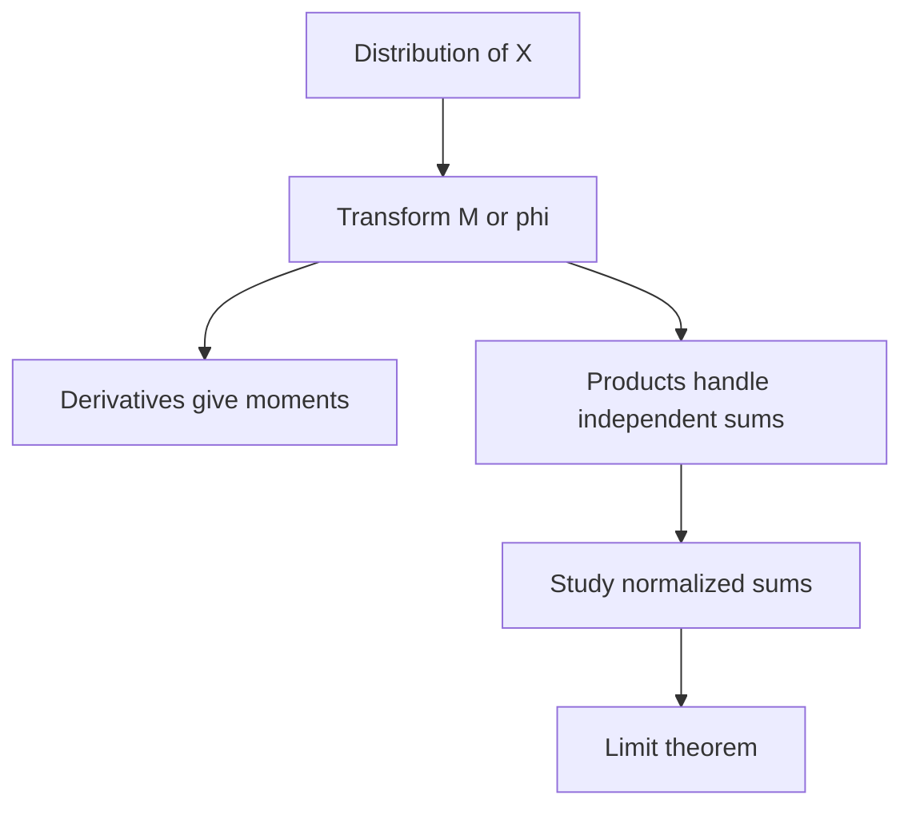

# Moment and Characteristic Functions

Moment generating functions and characteristic functions encode probability laws as functions. Multiplying independent transforms is easier than convolving densities or mass functions, so transforms are especially effective for sums and limit theorems.

Moment generating functions are intuitive because their derivatives generate moments, but they may fail to exist for heavy-tailed distributions. Characteristic functions insert the complex number $i$ and are always defined, making them more robust. They are Fourier transforms of probability distributions and are the standard tool behind convergence in distribution.

## Two exponential transforms

The **moment generating function** of a random variable $X$ is

$$
M_X(t)=E[e^{tX}],
$$

for values of $t$ where the expectation is finite.

If $X$ is discrete,

$$
M_X(t)=\sum_x e^{tx}p_X(x).
$$

If $X$ has density $f_X$,

$$
M_X(t)=\int_{-\infty}^{\infty} e^{tx}f_X(x)\,dx.
$$

The **characteristic function** of $X$ is

$$
\varphi_X(t)=E[e^{itX}],
$$

where $i^2=-1$. Since $\vert e^{itX}\vert =1$, this expectation always exists.

We say $X_n$ **converges in distribution** to $X$ if

$$
F_{X_n}(x)\to F_X(x)
$$

at every continuity point $x$ of $F_X$.

## The algebra of transforms

Moment generating functions generate moments when derivatives exist near zero:

$$
M_X'(0)=E[X],
\qquad
M_X''(0)=E[X^2],
$$

and more generally

$$
M_X^{(m)}(0)=E[X^m].
$$

Proof sketch: differentiate $e^{tX}$ with respect to $t$:

$$
\frac{d^m}{dt^m}e^{tX}=X^m e^{tX}.
$$

Then evaluate at $t=0$. Justifying interchange of derivative and expectation requires regularity, which is why existence near zero matters.

If $X$ and $Y$ are independent, then

$$
M_{X+Y}(t)=M_X(t)M_Y(t),
$$

because

$$
E[e^{t(X+Y)}]=E[e^{tX}e^{tY}]=E[e^{tX}]E[e^{tY}].
$$

The same identity holds for characteristic functions:

$$
\varphi_{X+Y}(t)=\varphi_X(t)\varphi_Y(t).
$$

Scaling satisfies

$$
M_{aX}(t)=M_X(at),
\qquad
\varphi_{aX}(t)=\varphi_X(at).
$$

Important examples:

| Distribution | MGF |
|---|---|
| Bernoulli$(p)$ | $q+pe^t$ |
| Binomial$(n,p)$ | $(q+pe^t)^n$ |
| Poisson$(\lambda)$ | $\exp(\lambda(e^t-1))$ |
| Normal$(\mu,\sigma^2)$ | $\exp(\mu t+\sigma^2t^2/2)$ |
| Exponential$(\lambda)$ | $\lambda/(\lambda-t)$ for $t\lt \lambda$ |

Levy's continuity theorem, in the form used in the lectures, says that convergence of characteristic functions to a characteristic function implies convergence in distribution. This makes characteristic functions a rigorous route to limit theorems.

Transforms are useful because they convert hard operations into easier ones. Convolution of densities becomes multiplication of transforms. Scaling a random variable becomes rescaling the transform argument. Moments become derivatives at zero. These rules allow one to prove distributional identities without performing difficult integrals directly.

The MGF may fail for two different reasons. It may be infinite for all nonzero $t$, as with very heavy-tailed distributions, or it may exist only on one side of zero. For an exponential random variable with rate $\lambda$, $M(t)=\lambda/(\lambda-t)$ exists only for $t\lt \lambda$. That restricted domain is still enough for many calculations, but one must not plug in arbitrary $t$ values.

Characteristic functions avoid this integrability problem because $e^{itX}$ has absolute value $1$. They can be complex-valued, but their real and imaginary parts are simply expectations of cosine and sine:

$$
\varphi_X(t)=E[\cos(tX)]+iE[\sin(tX)].
$$

This bounded oscillatory structure is why characteristic functions are always defined and why they are closely related to Fourier analysis.

For integer-valued random variables, characteristic functions contain periodic information. Since $e^{i2\pi X}=1$ whenever $X$ is an integer, $\varphi_X(2\pi)=1$. More generally, the pattern of $\varphi_X(t)$ reflects lattice structure in the distribution. This is one reason characteristic functions are more than a technical proof device.

In limit theorem proofs, the logarithm of a transform often exposes the first few moments. If $E[X]=0$ and $\operatorname{Var}(X)=1$, then near zero the transform behaves like $1+t^2/2$ for MGFs or $1-t^2/2$ for characteristic functions. Raising this expression to the $n$th power at argument $t/\sqrt n$ produces an exponential limit, which is the normal transform.

## Choosing between the MGF and characteristic function

| Feature | MGF $M_X(t)$ | Characteristic function $\varphi_X(t)$ |
|---|---|---|
| Definition | $E[e^{tX}]$ | $E[e^{itX}]$ |
| Always exists | no | yes |
| Moments by derivatives | direct when finite | with powers of $i$ |
| Independent sums | products | products |
| Limit theorem use | useful when it exists near zero | more general |
| Heavy-tail behavior | may fail | still defined |

The contrast in the table is the practical reason for learning both transforms. MGFs are friendlier in elementary calculations because derivatives at zero have no complex constants, and common distributions have simple MGFs. Characteristic functions require complex notation, but they work for every probability distribution. The later lectures use this extra generality to prove limit theorems under hypotheses where MGFs might not exist.

Transform uniqueness is the background principle. Under the standard hypotheses used in probability, a distribution is determined by its characteristic function, and an MGF determines the distribution when it exists in a neighborhood of zero. Therefore, showing two random variables have the same transform is a legitimate way to show they have the same distribution. This is what happens when proving that independent Poisson sums remain Poisson.

Transforms should remain connected to probability: each is an expectation of a function of $X$. Its value depends on the whole distribution, weighting every possible outcome by an exponential or oscillatory factor.

When using transforms, always record the interval of $t$ values where the calculation is valid. Two expressions that agree only outside the domain of an MGF do not prove anything about the distribution. Characteristic functions avoid this particular domain issue, but they require tracking complex arithmetic carefully. In proofs, this bookkeeping is part of the argument, not a cosmetic detail. It is also where many otherwise plausible transform solutions fail. Always state the transform and its domain together before comparing formulas.

## Worked example: binomial MGF from Bernoulli trials

Problem: Find the MGF of a binomial$(n,p)$ random variable and use it to compute the mean.

Method:

1. For a Bernoulli$(p)$ variable $B$,

$$
M_B(t)=E[e^{tB}]
=e^0P(B=0)+e^tP(B=1)
=q+pe^t.
$$

2. If $X\sim\operatorname{Binomial}(n,p)$, write

$$
X=B_1+\cdots+B_n
$$

with independent Bernoulli$(p)$ variables.

3. Therefore

$$
M_X(t)=\prod_{j=1}^n M_{B_j}(t)
=(q+pe^t)^n.
$$

4. Differentiate:

$$
M_X'(t)=n(q+pe^t)^{n-1}pe^t.
$$

5. Evaluate at $t=0$:

$$
M_X'(0)=n(q+p)^{n-1}p=np.
$$

Checked answer: the transform method agrees with the indicator decomposition result $E[X]=np$.

## Worked example: sum of independent Poisson variables

Problem: Use MGFs to show that if $X\sim\operatorname{Poisson}(\lambda_1)$ and $Y\sim\operatorname{Poisson}(\lambda_2)$ are independent, then $X+Y$ is Poisson with parameter $\lambda_1+\lambda_2$.

Method:

1. The Poisson MGF is

$$
M_X(t)=\exp(\lambda_1(e^t-1)),
\qquad
M_Y(t)=\exp(\lambda_2(e^t-1)).
$$

2. For $Z=X+Y$, independence gives

$$
M_Z(t)=M_X(t)M_Y(t).
$$

3. Multiply:

$$
\begin{aligned}
M_Z(t)
&=\exp(\lambda_1(e^t-1))\exp(\lambda_2(e^t-1))\\
&=\exp((\lambda_1+\lambda_2)(e^t-1)).
\end{aligned}
$$

4. This is exactly the MGF of a Poisson random variable with parameter $\lambda_1+\lambda_2$.

Checked answer: the result matches the Poisson process interpretation that independent event streams add their rates.

## Cumulants: logarithms turn products into sums

When the MGF exists near zero, its logarithm

$$
K_X(t)=\log M_X(t)
$$

is the **cumulant generating function**. Its first two derivatives have familiar meanings:

$$
K_X'(0)=E[X],\qquad K_X''(0)=\operatorname{Var}(X).
$$

For the second identity, differentiate twice:

$$
K_X''(t)=\frac{M_X''(t)M_X(t)-M_X'(t)^2}{M_X(t)^2}.
$$

Since $M_X(0)=1$, evaluation at zero gives $E[X^2]-E[X]^2$. For independent variables,

$$
K_{X+Y}(t)=\log(M_X(t)M_Y(t))=K_X(t)+K_Y(t).
$$

Cumulants therefore add under independent summation. The third cumulant is the third central moment; the fourth is the fourth central moment minus $3\sigma^4$. Standardized higher cumulants shrink for sums of many comparable independent terms, which anticipates normal approximation.

The logarithm also helps numerically because products of many transforms may overflow or underflow while their logs remain sums of moderate size. Complex logarithms have branch choices, so local expansions of characteristic functions around zero require more care than real MGFs.

## Worked example: standardizing a gamma sum

Let $X_1,\ldots,X_n$ be independent exponential variables with rate $\lambda$. Each has MGF

$$
M_{X_i}(t)=\frac{\lambda}{\lambda-t},\qquad t<\lambda.
$$

For $S_n=X_1+\cdots+X_n$,

$$
M_{S_n}(t)=\left(\frac{\lambda}{\lambda-t}\right)^n,
$$

which identifies $S_n$ as gamma with shape $n$ and rate $\lambda$. Standardize it as

$$
Z_n=\frac{S_n-n/\lambda}{\sqrt n/\lambda}.
$$

The affine-transform rule $M_{aX+b}(t)=e^{bt}M_X(at)$ gives

$$
\begin{aligned}
M_{Z_n}(t)
&=\exp(-t\sqrt n)
M_{S_n}\left(\frac{\lambda t}{\sqrt n}\right)\\
&=\exp(-t\sqrt n)
\left(1-\frac{t}{\sqrt n}\right)^{-n}.
\end{aligned}
$$

Take logarithms and use $-\log(1-u)=u+u^2/2+O(u^3)$ near zero:

$$
\begin{aligned}
\log M_{Z_n}(t)
&=-t\sqrt n-n\log\left(1-\frac{t}{\sqrt n}\right)\\
&=-t\sqrt n+n\left(\frac{t}{\sqrt n}+\frac{t^2}{2n}+O(n^{-3/2})\right)\\
&=\frac{t^2}{2}+O(n^{-1/2}).
\end{aligned}
$$

Hence $M_{Z_n}(t)\to e^{t^2/2}$, the standard normal MGF. The cancellation of the linear terms comes from centering; the surviving quadratic term comes from variance scaling.

## Characteristic functions and inversion

If $X$ has an integrable density and its characteristic function is also integrable, Fourier inversion recovers the density:

$$
f_X(x)=\frac{1}{2\pi}\int_{-\infty}^{\infty}e^{-itx}\varphi_X(t)\,dt.
$$

The hypotheses can be weakened, but this form states the main relationship. For an integer-valued variable, Fourier coefficients recover point probabilities:

$$
P(X=k)=\frac{1}{2\pi}\int_{-\pi}^{\pi}e^{-itk}\varphi_X(t)\,dt.
$$

These formulas explain transform uniqueness: the law can be reconstructed. They also explain the periodicity of lattice-valued characteristic functions.

Symmetry appears directly. If $X$ and $-X$ have the same law, the sine contribution cancels and

$$
\varphi_X(t)=E[\cos(tX)]
$$

is real and even. Conversely, a real characteristic function corresponds to a distribution symmetric about zero.

## Moments, derivatives, and what can fail

If $E[\vert X\vert ^m]\lt \infty$, then the characteristic function has $m$ derivatives and

$$
\varphi_X^{(m)}(0)=i^mE[X^m].
$$

The converse needs care: a derivative at zero need not supply the corresponding absolute moment in every borderline case. MGFs give stronger control. Finiteness throughout an open interval around zero implies finite moments of every order and a valid power-series expansion there.

Moment sequences can also be deceptive. Some distinct distributions share every moment, so matching moments alone need not prove equality in distribution. Equality of MGFs on a neighborhood of zero does prove equality, and equality of characteristic functions always does.

## Checks before using a transform

### Probability generating functions

For a nonnegative integer-valued variable, the probability generating function is

$$
G_X(s)=E[s^X]=\sum_{k=0}^{\infty}P(X=k)s^k,
\qquad |s|\le1.
$$

Its coefficients are the probabilities themselves, and derivatives at one give factorial moments:

$$
G_X'(1)=E[X],
\qquad
G_X''(1)=E[X(X-1)].
$$

Consequently,

$$
\operatorname{Var}(X)=G_X''(1)+G_X'(1)-G_X'(1)^2.
$$

The PGF is related to the MGF by $M_X(t)=G_X(e^t)$ wherever the MGF is finite. Unlike the MGF, $G_X(s)$ is automatically finite for $0\le s\le1$.

For a Poisson variable,

$$
G_X(s)=\exp(\lambda(s-1)).
$$

If every event is independently retained with probability $p$, and $Y$ counts retained events, then conditional on $X$,

$$
E[s^Y\mid X]=(1-p+ps)^X.
$$

Taking expectations gives

$$
G_Y(s)=G_X(1-p+ps)
=\exp(\lambda p(s-1)),
$$

so thinning a Poisson count yields Poisson$(p\lambda)$. The composition rule expresses random sums cleanly: if $S=X_1+\cdots+X_N$ with i.i.d. nonnegative integer summands independent of $N$, then

$$
G_S(s)=G_N(G_{X_1}(s)).
$$

Characteristic functions provide the same random-sum identity without the integer-support restriction.

### Centering before expansion

Taylor expansions are easiest after centering. For $Y=X-\mu$ with variance $\sigma^2$,

$$
\varphi_Y(t)=1-\frac{\sigma^2t^2}{2}+o(t^2).
$$

Without centering, an $i\mu t$ term appears and must later cancel against the normalization of a sum. Writing that cancellation explicitly prevents sign errors in CLT proofs. The remainder term must also be controlled at arguments $t/\sqrt n$; a merely formal polynomial expansion is not enough unless the required moments and interchange steps have been justified.

- Assuming an MGF exists for every distribution. Heavy-tailed laws such as Cauchy do not have finite MGFs near zero.
- Forgetting independence when multiplying transforms of sums.
- Confusing $M_X(t)$ and $\varphi_X(t)$. Characteristic functions use $e^{itX}$ and may be complex-valued.
- Thinking equality of moments automatically determines a distribution. Some laws are moment-indeterminate; a valid MGF near zero or a characteristic function carries more information.
- Applying a continuity theorem without checking that the limiting function is the transform of a probability law.

## Further uses of transforms

Numerical transform inversion is sensitive to oscillation, truncation, and roundoff. For ordinary named laws, direct CDF or survival-function routines are preferable. Transforms are strongest for proving identities, combining independent components, and studying limits. An expression that cannot be inverted may still determine moments and tail bounds. Differentiating an estimated transform near zero can amplify noise, so transform-based moment estimation needs more care than naive finite differences.

### Exponential tilting and tail bounds

MGFs also turn probability bounds into an optimization problem. For $t\gt 0$, Markov's inequality applied to $e^{tX}$ gives

$$
P(X\ge a)=P(e^{tX}\ge e^{ta})
\le e^{-ta}M_X(t).
$$

The inequality holds for every positive $t$ in the MGF's domain, so the best bound from this method is

$$
P(X\ge a)\le\inf_{t>0}e^{-ta}M_X(t).
$$

For $S_n=X_1+\cdots+X_n$ with independent summands, the MGF product makes the bound explicit. Take Bernoulli$(p)$ variables and write $a=nx$ with $x\gt p$:

$$
P(S_n\ge nx)
\le\inf_{t>0}\exp\left(n\log(1-p+pe^t)-tnx\right).
$$

Differentiating the exponent shows that the optimizer satisfies

$$
e^t=\frac{x(1-p)}{p(1-x)}.
$$

Substitution yields an exponentially small bound

$$
P(S_n\ge nx)\le e^{-nD(x\|p)},
$$

where

$$
D(x\|p)=x\log\frac{x}{p}+(1-x)\log\frac{1-x}{1-p}.
$$

The function $D$ is nonnegative and vanishes only at $x=p$. This Chernoff method explains why MGFs appear in concentration inequalities as well as distribution identification.

The optimizing operation has a probabilistic interpretation. Multiplying a density by $e^{tx}$ and renormalizing creates an exponentially tilted law under which the rare value $a$ is closer to typical. The normalizing constant is $M_X(t)$. Large-deviation calculations formalize this relation, but the elementary Markov step already contains the essential idea.

See also: [Sums, convolutions, and order statistics](/math/probability-and-random-variables/sums-convolutions-order-statistics) · [Poisson random variables and Poisson processes](/math/probability-and-random-variables/poisson-random-variables-and-processes) · [Weak law, concentration, and the central limit theorem](/math/probability-and-random-variables/weak-law-concentration-central-limit-theorem) · [Strong law and Jensen's inequality](/math/probability-and-random-variables/strong-law-and-jensens-inequality) · [Generating functions](/math/probability/generating-functions)

