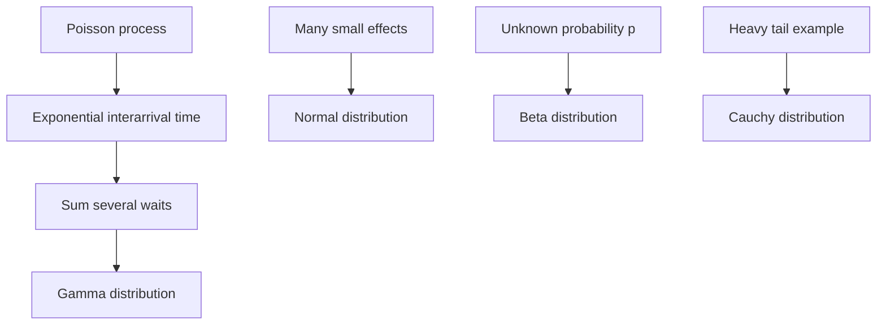

# Normal, Exponential, Gamma, Beta, and Cauchy Laws

The continuous distributions in the middle of MIT 18.440 each encode a different mechanism. The normal law describes the accumulated effect of many small mostly independent influences. The exponential law describes memoryless waiting times. The gamma law describes sums of exponential waits. The beta law describes random probabilities and order-statistic shapes. The Cauchy law is a warning: a natural density may fail to have a finite mean or variance.

Their formulas also mark the hypotheses needed later. The central limit theorem uses finite variance; the usual law of large numbers needs a finite mean; the Cauchy law violates both assumptions. Exponential and gamma laws connect densities to Poisson-process waiting times, while beta laws provide a natural calculus for unknown proportions.

## Five families and their parameters

A **standard normal** random variable has density

$$
\phi(x)=\frac{1}{\sqrt{2\pi}}e^{-x^2/2},
\qquad -\infty<x<\infty.
$$

A normal random variable with mean $\mu$ and variance $\sigma^2$ has density

$$
f(x)=\frac{1}{\sigma\sqrt{2\pi}}
e^{-(x-\mu)^2/(2\sigma^2)}.
$$

An **exponential** random variable with rate $\lambda\gt 0$ has density

$$
f(x)=
\begin{cases}
\lambda e^{-\lambda x},&x\ge0,\\
0,&x<0.
\end{cases}
$$

A **gamma** random variable with rate $\lambda\gt 0$ and shape $\alpha\gt 0$ has density

$$
f(x)=
\frac{\lambda^\alpha}{\Gamma(\alpha)}x^{\alpha-1}e^{-\lambda x},
\qquad x>0,
$$

where

$$
\Gamma(\alpha)=\int_0^\infty x^{\alpha-1}e^{-x}\,dx.
$$

A **beta** random variable with parameters $a,b\gt 0$ has density on $[0,1]$

$$
f(x)=\frac{\Gamma(a+b)}{\Gamma(a)\Gamma(b)}x^{a-1}(1-x)^{b-1}.
$$

A **standard Cauchy** random variable has density

$$
f(x)=\frac{1}{\pi(1+x^2)}.
$$

## Location, scale, and memorylessness

If $Z$ is standard normal, then

$$
E[Z]=0,\qquad \operatorname{Var}(Z)=1.
$$

If $X=\mu+\sigma Z$, then $X$ is normal with mean $\mu$ and variance $\sigma^2$. Standardization reverses this:

$$
Z=\frac{X-\mu}{\sigma}.
$$

If $X$ is exponential with rate $\lambda$, then

$$
P(X>t)=e^{-\lambda t},
\qquad
E[X]=\frac1\lambda,
\qquad
\operatorname{Var}(X)=\frac1{\lambda^2}.
$$

The exponential law is memoryless:

$$
P(X>s+t\mid X>s)=P(X>t).
$$

If $X_1,\ldots,X_n$ are independent exponential$(\lambda)$ random variables, then

$$
X_1+\cdots+X_n\sim\operatorname{Gamma}(\lambda,n).
$$

More generally, gamma random variables with the same rate add by shapes:

$$
\operatorname{Gamma}(\lambda,s)+\operatorname{Gamma}(\lambda,t)
\sim
\operatorname{Gamma}(\lambda,s+t),
$$

when the variables are independent.

The beta distribution appears naturally when a probability parameter is unknown. If $p$ is initially uniform on $[0,1]$ and then $n$ coin tosses produce $h$ heads and $t$ tails, the posterior density for $p$ is proportional to

$$
p^h(1-p)^t,
$$

which is beta$(h+1,t+1)$.

The Cauchy distribution has no finite expectation. The positive and negative tails are too heavy for $\int \vert x\vert f(x)\,dx$ to converge, so mean-based limit theorems do not apply.

The normal distribution is determined by location and scale. Translating changes the mean but not the shape; multiplying by a positive constant stretches the standard deviation by that constant and the variance by its square. Standardization therefore reduces every normal probability to one for the standard normal variable $Z$.

The exponential distribution is the continuous analogue of the geometric distribution. Both are memoryless, and both describe waiting for the first success or event. The parameter conventions are different: geometric uses success probability per trial, while exponential uses rate per unit time. In a Poisson process with rate $\lambda$, the exponential mean $1/\lambda$ is the average waiting time between events.

The gamma distribution keeps track of repeated exponential waiting. If the first event time is exponential, the time of the $n$th event is a sum of $n$ independent exponential interarrival times and is gamma with shape $n$. The formula with $\Gamma(\alpha)$ extends this distribution to non-integer shapes, but the waiting-time story is most literal for positive integer shape.

The beta distribution is flexible on $[0,1]$. When $a=b=1$, it is uniform. When $a$ and $b$ are large, it concentrates near $a/(a+b)$. When $a\lt 1$ or $b\lt 1$, it can pile density near the endpoints. In Bayesian coin-toss examples, $a$ and $b$ behave like prior counts plus observed successes and failures.

The Cauchy distribution shows why formulas must include hypotheses. It has a symmetric bell-like density, but its tails decay like $1/x^2$, too slowly for $E[\vert X\vert ]$ to be finite. A sample average of independent Cauchy variables does not settle down according to the usual law of large numbers; in fact, the average has the same Cauchy distribution as each summand. This is not a contradiction, because the theorem's finite-mean assumption fails.

## How the families relate

| Distribution | Support | Main mechanism | Mean | Variance |
|---|---|---|---:|---:|
| Normal$(\mu,\sigma^2)$ | all real numbers | accumulated small effects | $\mu$ | $\sigma^2$ |
| Exponential$(\lambda)$ | $[0,\infty)$ | memoryless waiting time | $1/\lambda$ | $1/\lambda^2$ |
| Gamma$(\lambda,\alpha)$ | $[0,\infty)$ | sum of exponential waits | $\alpha/\lambda$ | $\alpha/\lambda^2$ |
| Beta$(a,b)$ | $[0,1]$ | random probability or order statistic | $a/(a+b)$ | $ab/((a+b)^2(a+b+1))$ |
| Cauchy | all real numbers | heavy-tailed ratio or tangent angle | undefined | undefined |

The comparison table is meant to prevent formula memorization from replacing model recognition. A waiting-time story with no memory points to exponential; a waiting time for several events points to gamma; a proportion or unknown probability points to beta; accumulated small effects point to normal; a heavy-tailed angle or ratio story may produce Cauchy. Once the mechanism is identified, the support and parameter meanings usually follow.

These families also interact. Exponential waiting times come from Poisson processes, gamma variables are sums of exponentials, normal variables are stable under independent addition, and beta variables arise from uniform order statistics and Bayesian updating for Bernoulli trials. The Cauchy law is deliberately different: it is stable under averaging in a way that breaks the usual mean-based intuition.

## Worked example: a standardized normal probability

Problem: Let $X$ be normal with mean $10$ and variance $4$. Express $P(8\le X\le 13)$ in terms of the standard normal CDF $\Phi$.

Method:

1. The standard deviation is $\sigma=2$.
2. Standardize:

$$
Z=\frac{X-10}{2}.
$$

3. Convert the lower endpoint:

$$
X=8
\quad\Rightarrow\quad
Z=\frac{8-10}{2}=-1.
$$

4. Convert the upper endpoint:

$$
X=13
\quad\Rightarrow\quad
Z=\frac{13-10}{2}=1.5.
$$

5. Therefore

$$
P(8\le X\le13)=P(-1\le Z\le1.5).
$$

6. In CDF form,

$$
P(-1\le Z\le1.5)=\Phi(1.5)-\Phi(-1).
$$

Checked answer: using approximate values $\Phi(1.5)\approx0.9332$ and $\Phi(-1)\approx0.1587$, the probability is about $0.7745$.

## Worked example: competing exponential clocks

Problem: Two independent clocks ring after exponential waiting times. Clock 1 has rate $\lambda_1=2$ per hour, and clock 2 has rate $\lambda_2=3$ per hour. Find the distribution of the first ringing time and the probability clock 1 rings first.

Method:

1. Let $X_1\sim\operatorname{Exponential}(2)$ and $X_2\sim\operatorname{Exponential}(3)$.
2. The first ringing time is

$$
T=\min(X_1,X_2).
$$

3. For $t\ge0$,

$$
\begin{aligned}
P(T>t)
&=P(X_1>t,\ X_2>t)\\
&=P(X_1>t)P(X_2>t)\\
&=e^{-2t}e^{-3t}\\
&=e^{-5t}.
\end{aligned}
$$

Thus $T$ is exponential with rate $5$.

4. The probability clock 1 rings first is

$$
P(X_1<X_2)=\int_0^\infty P(X_2>x)f_{X_1}(x)\,dx.
$$

5. Substitute:

$$
\int_0^\infty e^{-3x}\cdot 2e^{-2x}\,dx
=2\int_0^\infty e^{-5x}\,dx
=\frac25.
$$

Checked answer: clock 1 has rate $2$ out of total rate $5$, so its chance of being first is $2/5$.

## Deriving the gamma moments

Parameter conventions cause more trouble for the gamma law than its calculus does. Here $\lambda$ is a **rate**, not a scale. Starting from

$$
f(x)=\frac{\lambda^\alpha}{\Gamma(\alpha)}x^{\alpha-1}e^{-\lambda x},
$$

the $k$th raw moment is

$$
\begin{aligned}
E[X^k]
&=\frac{\lambda^\alpha}{\Gamma(\alpha)}
\int_0^\infty x^{\alpha+k-1}e^{-\lambda x}\,dx\\
&=\frac{\lambda^\alpha}{\Gamma(\alpha)}
\frac{\Gamma(\alpha+k)}{\lambda^{\alpha+k}}\\
&=\frac{\Gamma(\alpha+k)}{\Gamma(\alpha)\lambda^k}.
\end{aligned}
$$

The substitution $u=\lambda x$ gives the second line. Since $\Gamma(\alpha+1)=\alpha\Gamma(\alpha)$,

$$
E[X]=\frac\alpha\lambda,
$$

and

$$
\begin{aligned}
E[X^2]&=\frac{\alpha(\alpha+1)}{\lambda^2},\\
\operatorname{Var}(X)&=E[X^2]-E[X]^2=\frac\alpha{\lambda^2}.
\end{aligned}
$$

Under the alternative scale parameter $\theta=1/\lambda$, the same quantities are written $E[X]=\alpha\theta$ and $\operatorname{Var}(X)=\alpha\theta^2$. Software documentation must be checked before passing the second parameter.

## Beta normalization and Bernoulli updating

The beta normalizing constant is the reciprocal of the beta integral

$$
B(a,b)=\int_0^1x^{a-1}(1-x)^{b-1}\,dx
=\frac{\Gamma(a)\Gamma(b)}{\Gamma(a+b)}.
$$

Its mean follows from a ratio of beta integrals:

$$
E[X]=\frac{B(a+1,b)}{B(a,b)}=\frac{a}{a+b}.
$$

Likewise,

$$
E[X^2]=\frac{a(a+1)}{(a+b)(a+b+1)},
$$

which yields

$$
\operatorname{Var}(X)=\frac{ab}{(a+b)^2(a+b+1)}.
$$

For a beta$(a,b)$ prior on an unknown Bernoulli probability $p$, observing $h$ successes and $t$ failures multiplies the density by $p^h(1-p)^t$. The posterior is beta$(a+h,b+t)$. For example, beta$(2,2)$ followed by $7$ successes and $3$ failures produces beta$(9,5)$, with posterior mean

$$
\frac{9}{14}\approx0.643.
$$

The observed fraction is $0.7$, while the prior mean is $0.5$; the posterior mean lies between them. The parameters act like prior success and failure counts for the algebra, though interpreting them as literal earlier observations is optional.

## Why the Cauchy mean is undefined

Symmetry may tempt one to declare the Cauchy mean zero. The ordinary expectation exists only if at least one of the positive and negative parts has a finite integral; equivalently, absolute integrability is a sufficient condition used in elementary probability. For standard Cauchy,

$$
\int_0^R x\frac{1}{\pi(1+x^2)}\,dx
=\frac{1}{2\pi}\log(1+R^2),
$$

which diverges as $R\to\infty$. The negative part diverges as well. A symmetric principal value equals zero, but it is not $E[X]$.

The stability claim can be checked with characteristic functions. A standard Cauchy variable has $\varphi_X(t)=e^{-\vert t\vert }$. For independent copies,

$$
\varphi_{(X_1+\cdots+X_n)/n}(t)
=\left[\varphi_X\left(\frac tn\right)\right]^n
=\left[e^{-|t|/n}\right]^n
=e^{-|t|}.
$$

Thus every sample mean has the same standard Cauchy distribution, however large $n$ becomes.

## Worked example: time of the fourth event

Events arrive according to a Poisson process at rate $3$ per hour. Let $T_4$ be the time of the fourth event. It is a sum of four independent exponential$(3)$ interarrival times, so

$$
T_4\sim\operatorname{Gamma}(\alpha=4,\lambda=3).
$$

Its mean and variance are

$$
E[T_4]=\frac43\text{ hours},\qquad
\operatorname{Var}(T_4)=\frac49\text{ hours}^2.
$$

To find the probability that the fourth event arrives within one hour, use the equivalent count event. If $N(1)\sim\operatorname{Poisson}(3)$, then $T_4\le1$ exactly when $N(1)\ge4$:

$$
\begin{aligned}
P(T_4\le1)
&=1-P(N(1)\le3)\\
&=1-e^{-3}\sum_{k=0}^3\frac{3^k}{k!}\\
&=1-e^{-3}\left(1+3+\frac92+\frac{27}{6}\right)\\
&=1-13e^{-3}\\
&\approx0.3528.
\end{aligned}
$$

This count/waiting-time equivalence often avoids integrating a gamma density.

## Parameter and modeling traps

### The normalizing constant of the Gaussian

The factor $1/\sqrt{2\pi}$ comes from the Gaussian integral. Let

$$
I=\int_{-\infty}^{\infty}e^{-x^2/2}\,dx.
$$

Squaring and switching to polar coordinates gives

$$
\begin{aligned}
I^2
&=\int_{\mathbb R^2}e^{-(x^2+y^2)/2}\,dx\,dy\\
&=\int_0^{2\pi}\int_0^\infty e^{-r^2/2}r\,dr\,d\theta\\
&=2\pi\left[-e^{-r^2/2}\right]_0^\infty\\
&=2\pi.
\end{aligned}
$$

Since $I\gt 0$, $I=\sqrt{2\pi}$. The substitution $z=(x-\mu)/\sigma$ then supplies the additional $1/\sigma$ in a general normal density.

Normal variables also have an exact closure property. If $X$ and $Y$ are independent normals, their MGFs multiply to

$$
\exp\left((\mu_X+\mu_Y)t+\frac{(\sigma_X^2+\sigma_Y^2)t^2}{2}\right),
$$

so $X+Y$ is normal with the summed mean and variance. The CLT concerns a different statement: sums of many nonnormal variables become approximately normal after centering and scaling.

### Hazard rates distinguish waiting-time models

For a nonnegative continuous lifetime with density $f$ and survival function $S(t)=P(X\gt t)$, the hazard rate is

$$
h(t)=\frac{f(t)}{S(t)}.
$$

An exponential variable has $h(t)=\lambda$, constant in age. A gamma lifetime with shape greater than one has an increasing hazard, reflecting several stages before failure or completion; with shape below one, its hazard decreases. Memorylessness and constant hazard are equivalent under ordinary regularity conditions. A mean waiting time alone cannot distinguish these models.

- Forgetting the normalizing factor $1/(\sigma\sqrt{2\pi})$ in a normal density.
- Confusing exponential rate $\lambda$ with mean $1/\lambda$.
- Applying the exponential memoryless property to normal, uniform, or gamma waiting times.
- Assuming every familiar-looking density has a finite mean. The Cauchy density is the standard warning example.
- Using a beta distribution outside $[0,1]$. It models proportions and probabilities, not arbitrary real-valued measurements.

## Structural relationships

Normal upper-tail probabilities should be computed with a survival function when the threshold is far above the mean. Subtracting a CDF extremely close to one can erase significant digits. Symmetry gives equal left and right tails at opposite cutoffs. The familiar “number of standard deviations” scale is meaningful only after the location and variance model has been justified; standardizing data does not make their distribution Gaussian.

### Ratios explain beta and Cauchy laws

Several families arise from simple transformations of independent variables. Let $G_1\sim\operatorname{Gamma}(a,1)$ and $G_2\sim\operatorname{Gamma}(b,1)$ be independent, and define

$$
R=\frac{G_1}{G_1+G_2},\qquad S=G_1+G_2.
$$

The inverse transformation is $g_1=rs$, $g_2=(1-r)s$, with absolute Jacobian $s$. The joint density becomes proportional to

$$
r^{a-1}(1-r)^{b-1}s^{a+b-1}e^{-s},
$$

on $0\lt r\lt 1$, $s\gt 0$. It factors into a beta$(a,b)$ density for $R$ and a gamma$(a+b,1)$ density for $S$. Hence $R$ and $S$ are independent. The result connects a random proportion to two competing positive totals.

The Cauchy law also comes from a ratio. If $Z_1,Z_2$ are independent standard normals, then $Z_1/Z_2$ is standard Cauchy. Rotational symmetry gives a geometric explanation: the angle of $(Z_2,Z_1)$ is uniform, and the ratio is its tangent. The denominator can fall arbitrarily close to zero, producing the heavy tails.

These representations help simulate the distributions, but they also clarify their shapes. Beta endpoint behavior corresponds to one gamma component being small relative to the other. Cauchy extremes come from division by a near-zero normal, not from unusually large numerators alone.

### Parameter checks from dimensions

Rates have units of inverse time; scales have units of time. If $X$ is exponential with rate $3$ per hour, $E[X]=1/3$ hour. Writing a mean of $3$ hours signals a rate/scale reversal. Gamma shape and beta parameters are dimensionless. A normal variance carries squared measurement units, while its standard deviation carries the original units. Dimensional checks cannot prove a formula, but they expose many parameter mistakes immediately.

## Related pages

- [Poisson random variables and Poisson processes](/math/probability-and-random-variables/poisson-random-variables-and-processes)
- [Continuous random variables and uniform laws](/math/probability-and-random-variables/continuous-random-variables-and-uniform-laws)
- [Sums, convolutions, and order statistics](/math/probability-and-random-variables/sums-convolutions-order-statistics)
- [Weak law, concentration, and the central limit theorem](/math/probability-and-random-variables/weak-law-concentration-central-limit-theorem)
- [Common continuous distributions](/math/probability/common-continuous-distributions)
