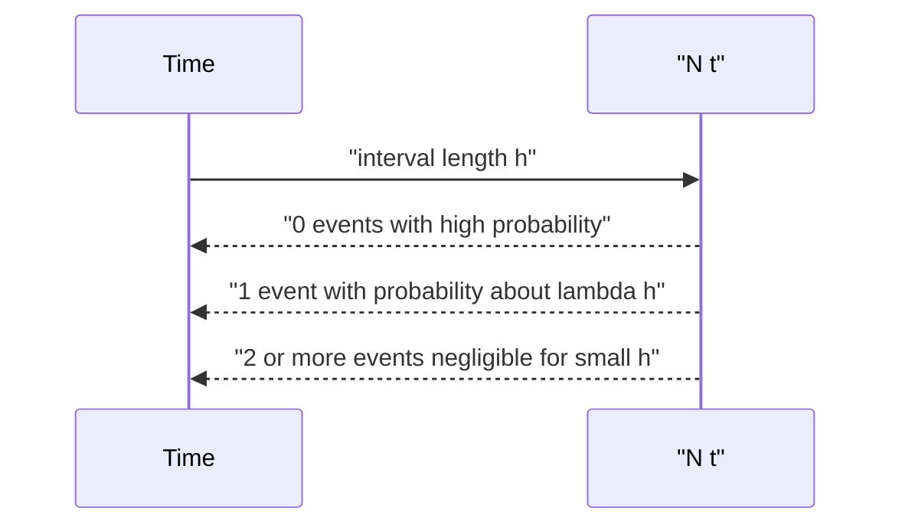

# Poisson Random Variables and Poisson Processes

The Poisson distribution models counts of rare events in a fixed region of time or space: emissions in a time interval, calls to a call center, goals in a match, or unusual events in a large number of trials. MIT 18.440 introduces it as a limit of binomial random variables where $n$ is large, $p$ is small, and $np$ remains near a fixed value $\lambda$.

The Poisson process extends this count model from one interval to an entire random counting function $N(t)$. Independent increments, stationary increments, and a constant rate produce Poisson counts over intervals and exponential gaps between events. The count and waiting-time descriptions are two coordinate systems for the same random arrival sequence.

## A count law with one parameter

A random variable $X$ has the **Poisson distribution** with parameter $\lambda\gt 0$ if

$$
P(X=k)=e^{-\lambda}\frac{\lambda^k}{k!},
\qquad k=0,1,2,\ldots.
$$

The parameter $\lambda$ is both the mean and the variance.

A **Poisson process** with rate $\lambda\gt 0$ is a random counting function $N(t)$, $t\ge0$, satisfying:

1. $N(0)=0$.
2. $N(t)$ is nondecreasing and integer-valued.
3. Counts in disjoint time intervals are independent.
4. The distribution of the number of events in an interval depends only on the interval length.
5. For interval length $t$, $N(t)$ has Poisson parameter $\lambda t$.

The waiting time $T_1$ until the first event satisfies

$$
P(T_1>t)=P(N(t)=0)=e^{-\lambda t},
$$

so $T_1$ is exponential with rate $\lambda$.

## The rare-event limit

The Poisson distribution arises from the binomial law. Let $X_n\sim\operatorname{Binomial}(n,\lambda/n)$. For fixed $k$,

$$
\begin{aligned}
P(X_n=k)
&=\binom nk\left(\frac{\lambda}{n}\right)^k
\left(1-\frac{\lambda}{n}\right)^{n-k}\\
&=
\frac{n(n-1)\cdots(n-k+1)}{k!n^k}
\lambda^k
\left(1-\frac{\lambda}{n}\right)^n
\left(1-\frac{\lambda}{n}\right)^{-k}.
\end{aligned}
$$

As $n\to\infty$, the first factor tends to $1/k!$, the middle exponential factor tends to $e^{-\lambda}$, and the last factor tends to $1$. Therefore

$$
P(X_n=k)\to e^{-\lambda}\frac{\lambda^k}{k!}.
$$

The probabilities sum to one because

$$
\sum_{k=0}^{\infty}e^{-\lambda}\frac{\lambda^k}{k!}
=
e^{-\lambda}e^\lambda
=1.
$$

The expectation is

$$
\begin{aligned}
E[X]
&=\sum_{k=0}^{\infty}k e^{-\lambda}\frac{\lambda^k}{k!}\\
&=\sum_{k=1}^{\infty}e^{-\lambda}\frac{\lambda^k}{(k-1)!}\\
&=\lambda e^{-\lambda}\sum_{j=0}^{\infty}\frac{\lambda^j}{j!}\\
&=\lambda.
\end{aligned}
$$

One can similarly show $\operatorname{Var}(X)=\lambda$, or use the binomial approximation with $np=\lambda$ and $np(1-p)\to\lambda$.

If $X\sim\operatorname{Poisson}(\lambda_1)$ and $Y\sim\operatorname{Poisson}(\lambda_2)$ are independent, then

$$
X+Y\sim\operatorname{Poisson}(\lambda_1+\lambda_2).
$$

This matches the process interpretation: joining independent event streams adds their rates.

The Poisson approximation is most reliable when the count is a sum of many indicators, each with small probability, and no single indicator has a large influence. In the binomial limit this is explicit: $n$ grows, $p$ shrinks, and $np$ stays fixed. The approximation can also work for events that are not literally independent if dependence is weak and local, but the lecture-level model is the clean independent-trial limit.

The ratio of successive probabilities is often useful:

$$
\frac{P(X=k+1)}{P(X=k)}
=
\frac{\lambda}{k+1}.
$$

The probabilities increase while $k+1\lt \lambda$ and decrease once $k+1\gt \lambda$. Thus the mass is centered near $\lambda$, consistent with the mean. This ratio is also a stable way to compute Poisson probabilities numerically without evaluating large factorials directly.

For a Poisson process, the phrase "rate $\lambda$" means expected events per unit time. Counts over an interval of length $t$ have parameter $\lambda t$, not $\lambda$ unless the interval length is one. This scaling is essential when changing units. A rate of $3$ per hour is the same as $1/20$ per minute, and a $20$ minute interval has parameter $1$.

Independent increments imply that what happens in disjoint intervals does not affect the count distribution in another interval. Stationary increments imply that only the length of the interval matters, not its location on the time axis. Together, these properties make the process mathematically tractable and lead to exponential interarrival times.

The no-event probability is the bridge between counts and waits. The event $\{T_1\gt t\}$ is exactly the event $\{N(t)=0\}$, so

$$
P(T_1>t)=P(N(t)=0)=e^{-\lambda t}.
$$

Differentiating $1-e^{-\lambda t}$ gives the exponential density $\lambda e^{-\lambda t}$. Poisson counts and exponential waits are therefore paired descriptions of one process.

## From local arrival rules to a process

| Object | Formula | Interpretation |
|---|---|---|
| Poisson count | $P(X=k)=e^{-\lambda}\lambda^k/k!$ | rare-event count |
| Mean | $E[X]=\lambda$ | expected count |
| Variance | $\operatorname{Var}(X)=\lambda$ | spread equals rate parameter |
| Process count | $N(t)-N(s)\sim\operatorname{Poisson}(\lambda(t-s))$ | events in interval |
| First wait | $P(T_1\gt t)=e^{-\lambda t}$ | exponential survival |
| Superposition | rates add | independent streams combine |

The sequence diagram describes a small-time heuristic. Over a tiny interval of length $h$, a rate $\lambda$ process has probability about $\lambda h$ of one event and much smaller probability of two or more events. Splitting a longer interval into many tiny pieces then resembles many Bernoulli trials with small success probability. Taking the limit gives the Poisson distribution with parameter $\lambda t$.

This heuristic also explains why simultaneous events have probability zero in the ideal continuous-time model. If the interval is made very small, the chance of two or more events in that interval is negligible compared with $h$. Real systems may have batching or dependence, but the mathematical Poisson process assumes events arrive singly in continuous time.

## Worked example: rare poker event approximation

Problem: Suppose the probability that a five-card poker hand is a royal flush is $1/649740$. In $1{,}000{,}000$ independent hands, approximate the probability of seeing exactly two royal flushes.

Method:

1. The exact count is binomial with

$$
n=1{,}000{,}000,\qquad p=\frac{1}{649740}.
$$

2. The Poisson parameter is

$$
\lambda=np=\frac{1{,}000{,}000}{649740}\approx 1.5391.
$$

3. Use the Poisson probability for $k=2$:

$$
P(X=2)\approx e^{-\lambda}\frac{\lambda^2}{2!}.
$$

4. Substitute:

$$
P(X=2)\approx e^{-1.5391}\frac{(1.5391)^2}{2}.
$$

5. Numerically,

$$
e^{-1.5391}\approx 0.2146,\qquad
\frac{(1.5391)^2}{2}\approx 1.1844.
$$

Thus

$$
P(X=2)\approx 0.2146\cdot 1.1844\approx 0.2542.
$$

Checked answer: the expected number is about $1.54$, so seeing exactly two is quite plausible.

## Worked example: waiting for the first event in a process

Problem: Calls arrive according to a Poisson process at rate $\lambda=3$ per hour. What is the probability that no call arrives in the next $20$ minutes, and what is the expected waiting time until the first call?

Method:

1. Convert $20$ minutes to hours:

$$
t=\frac{20}{60}=\frac13.
$$

2. The count in this interval is Poisson with parameter

$$
\lambda t=3\cdot\frac13=1.
$$

3. The probability of no call is

$$
P(N(t)=0)=e^{-1}\frac{1^0}{0!}=e^{-1}\approx 0.3679.
$$

4. The first waiting time $T_1$ is exponential with rate $3$ per hour.
5. Its expectation is

$$
E[T_1]=\frac1\lambda=\frac13\text{ hour}=20\text{ minutes}.
$$

Checked answer: the probability of waiting longer than the mean is $e^{-1}$ for an exponential random variable, exactly matching the no-call probability over $20$ minutes.

## Event times conditional on the count

There is more structure inside an interval than the count alone shows. Conditional on $N(t)=n$, the unordered event times behave as $n$ independent uniform points on $(0,t)$; the ordered arrival times are their order statistics.

For one event, divide $(0,t)$ into an early part of length $s$ and a late part of length $t-s$. Independent increments give

$$
\begin{aligned}
P(T_1\le s\mid N(t)=1)
&=\frac{P(N(s)=1,N(t)-N(s)=0)}{P(N(t)=1)}\\
&=\frac{(\lambda s)e^{-\lambda s}e^{-\lambda(t-s)}}{(\lambda t)e^{-\lambda t}}\\
&=\frac st.
\end{aligned}
$$

That is the CDF of a uniform variable on $(0,t)$. The general statement follows by partitioning the interval and comparing multinomial cell counts.

As an example, suppose a rate-$4$ process is observed for two hours and exactly three events occurred. Given that count, the rate no longer affects their relative locations. The probability that all three occurred in the first half hour is

$$
\left(\frac{0.5}{2}
ight)^3=\frac1{64}.
$$

Without conditioning on the total count, the corresponding event is $N(0.5)=3$ and $N(2)-N(0.5)=0$, whose probability is different.

## Splitting and superposition

Suppose every event of a rate-$\lambda$ process is independently labeled type A with probability $p$ and type B otherwise. The type-A count in time $t$ is Poisson with mean $p\lambda t$. Condition on the original count:

$$
\begin{aligned}
P(N_A(t)=k)
&=\sum_{n=k}^{\infty}P(N_A(t)=k\mid N(t)=n)P(N(t)=n)\\
&=\sum_{n=k}^{\infty}\binom nkp^k(1-p)^{n-k}
e^{-\lambda t}\frac{(\lambda t)^n}{n!}\\
&=e^{-p\lambda t}\frac{(p\lambda t)^k}{k!}.
\end{aligned}
$$

In the last step, set $m=n-k$ and recognize an exponential series. The type-B process has rate $(1-p)\lambda$, and the two thinned processes are independent. Random routing of calls, radioactive decay detection with imperfect efficiency, and category labels on arrivals use this construction.

The reverse operation is superposition. If independent processes have rates $\lambda_1$ and $\lambda_2$, then their combined count over length $t$ is the sum of independent Poisson variables and hence is Poisson with parameter $(\lambda_1+\lambda_2)t$. Given that an event occurred in the combined process, its source is process 1 with probability

$$
\frac{\lambda_1}{\lambda_1+\lambda_2}.
$$

## Worked example: waiting for the third arrival

Trains arrive according to a Poisson process at rate $2$ per hour. Let $T_3$ be the time of the third arrival. Find $P(T_3\gt 1)$ and $E[T_3]$.

The event $T_3\gt 1$ means that fewer than three trains arrived during the first hour. Since $N(1)\sim\operatorname{Poisson}(2)$,

$$
\begin{aligned}
P(T_3>1)
&=P(N(1)\le2)\\
&=e^{-2}\left(1+2+\frac{2^2}{2!}\right)\\
&=5e^{-2}\\
&\approx0.6767.
\end{aligned}
$$

The third arrival time is a sum of three independent exponential$(2)$ gaps, so it has a gamma distribution with shape $3$ and rate $2$. Therefore

$$
E[T_3]=\frac32\text{ hours},\qquad
\operatorname{Var}(T_3)=\frac34\text{ hours}^2.
$$

The identity

$$
\{T_r>t\}=\{N(t)<r\}
$$

is the continuous-time counterpart of the binomial/negative-binomial inverse relationship.

## When a constant-rate model is too rigid

For real count data, equality of mean and variance is a diagnostic rather than a law of nature. Unobserved heterogeneity in rates often creates overdispersion; inhibition or capacity constraints can create underdispersion. Daily seasonality violates stationary increments even if disjoint interval counts remain close to independent.

A nonhomogeneous Poisson process allows a deterministic rate $\lambda(t)$ that varies with time. Its count over $(s,t]$ is Poisson with mean

$$
\Lambda(s,t)=\int_s^t\lambda(u)\,du.
$$

It retains independent increments but loses stationarity. A self-exciting arrival stream, where one event temporarily raises the chance of another, loses independent increments as well and needs a different process model.

## Assumptions worth checking

### Factorial moments and variance

The equality of Poisson mean and variance follows neatly from factorial moments. For $X\sim\operatorname{Poisson}(\lambda)$,

$$
\begin{aligned}
E[X(X-1)]
&=\sum_{k=2}^{\infty}k(k-1)e^{-\lambda}\frac{\lambda^k}{k!}\\
&=\lambda^2e^{-\lambda}\sum_{j=0}^{\infty}\frac{\lambda^j}{j!}\\
&=\lambda^2.
\end{aligned}
$$

Since $X^2=X(X-1)+X$,

$$
\operatorname{Var}(X)
=E[X(X-1)]+E[X]-E[X]^2
=\lambda^2+\lambda-\lambda^2
=\lambda.
$$

For data, a sample variance far above the sample mean can signal varying rates, clustering, or dependence. A variance below the mean can signal inhibition or a fixed capacity. Sampling noise alone also creates discrepancies, so the mean-variance comparison is a diagnostic, not a proof of model failure.

- Using a Poisson approximation when events are not rare or trials are not close to independent.
- Confusing the process rate $\lambda$ with the interval parameter $\lambda t$.
- Forgetting that variance equals mean for a Poisson random variable. If data have much larger variance than mean, a simple Poisson model may be poor.
- Treating independent increments as automatic. It is an assumption of the Poisson process model.
- Thinking exponential waiting times are an extra assumption unrelated to Poisson counts. In the process model, they are two views of the same structure.

## Model diagnostics

### Diagnosing a Poisson model from data

A constant-rate Poisson model imposes more than a marginal count distribution. Counts from disjoint intervals should be independent, expected counts should scale with exposure, and the variance should match the mean at a fixed exposure. Each condition can fail for a different reason.

Seasonal intensity makes counts depend on clock time. A nonhomogeneous Poisson process can retain independent increments while replacing $\lambda t$ by an integrated intensity

$$
\Lambda(s,t)=\int_s^t\lambda(u)\,du.
$$

Then $N(t)-N(s)$ is Poisson with mean $\Lambda(s,t)$, but increments are no longer stationary. Clustering after an event violates independence and often produces serial correlation. A population with varying hidden rates produces overdispersion even when each individual source is conditionally Poisson.

Zeros provide a quick diagnostic. A Poisson variable with mean $\lambda$ has

$$
P(X=0)=e^{-\lambda}.
$$

If the sample mean is $2$, the fitted model predicts about $e^{-2}\approx13.5\%$ zero intervals. A much larger zero fraction may indicate inactive periods or a mixture of rates; a smaller fraction may indicate regular spacing or capacity constraints. Such comparisons are exploratory because parameter estimation introduces sampling error.

The time-rescaling idea gives a deeper check. Under a correctly specified time-varying intensity, integrated hazards between successive events should behave like independent exponential variables with rate one. Systematic departures in those transformed gaps reveal missed periodicity, dependence, or incorrect exposure measurement.

Poisson approximation for a Bernoulli sum also has a scope condition: no individual event should dominate. A sum containing one indicator with probability $0.5$ and many extremely rare indicators may have the right mean but a poor Poisson shape. The maximum individual probability and local dependence structure matter, not only the total $\lambda$.

See also: [Bernoulli, binomial, geometric, and negative binomial laws](/math/probability-and-random-variables/bernoulli-binomial-geometric-negative-binomial) · [Continuous random variables and uniform laws](/math/probability-and-random-variables/continuous-random-variables-and-uniform-laws) · [Normal, exponential, gamma, beta, and Cauchy laws](/math/probability-and-random-variables/normal-exponential-gamma-beta-cauchy) · [Sums, convolutions, and order statistics](/math/probability-and-random-variables/sums-convolutions-order-statistics) · [Common discrete distributions](/math/probability/common-discrete-distributions)

