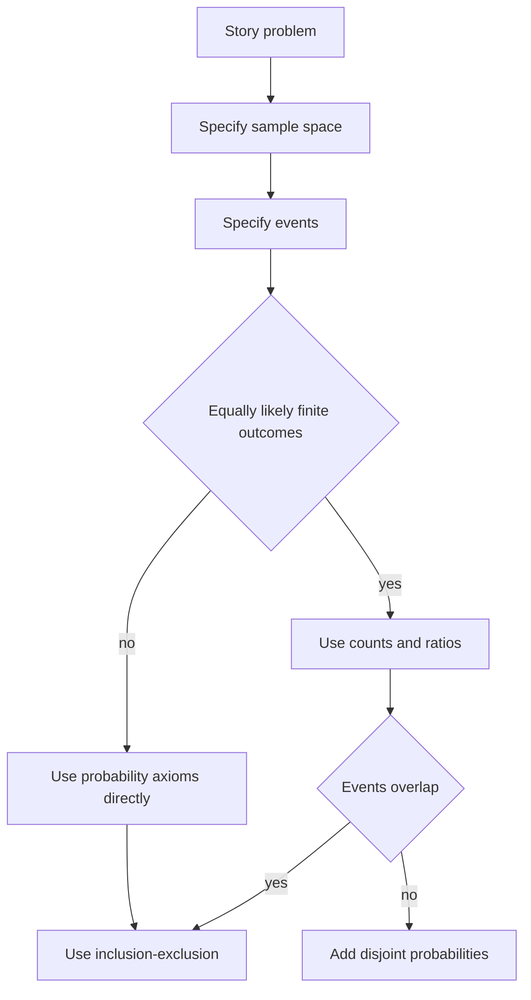

# Probability Axioms and Inclusion-Exclusion

After counting comes formal probability. A sample space records the possible outcomes of an experiment, events are subsets of that space, and a probability measure assigns numbers to events in a way that behaves like normalized size. The MIT lectures emphasize that the axioms are not merely formal rules: they encode consistency requirements for frequency interpretations, market prices, and personal degrees of belief.

Finite equally likely models are the easiest place to see the connection between counting and probability. If every outcome in a finite sample space has the same probability, then $P(A)=\vert A\vert /\vert S\vert $. The axioms then explain how probabilities of complements, unions, and intersections must behave. Inclusion-exclusion is the main tool for turning overlapping event counts into exact probabilities.

## The measure behind the rules

A **sample space** $S$ is the set of possible outcomes. An **event** is a subset $A\subseteq S$. The complement of $A$ is $A^c=S\setminus A$. The union $A\cup B$ means "$A$ or $B$"; the intersection $A\cap B$ means "$A$ and $B$".

A **probability measure** $P$ assigns a number $P(A)$ to each event $A$ and satisfies:

1. Nonnegativity: $P(A)\ge 0$.
2. Normalization: $P(S)=1$.
3. Countable additivity: if $A_1,A_2,\ldots$ are pairwise disjoint, then

$$
P\left(\bigcup_{j=1}^{\infty}A_j\right)=\sum_{j=1}^{\infty}P(A_j).
$$

In a finite equally likely model,

$$
P(A)=\frac{|A|}{|S|}.
$$

De Morgan's laws describe complements of unions and intersections:

$$
(A\cup B)^c=A^c\cap B^c,
\qquad
(A\cap B)^c=A^c\cup B^c.
$$

The laws extend to any finite or countable collection of events.

## Consequences of countable additivity

Several basic facts follow from the axioms:

$$
P(A^c)=1-P(A),
$$

because $A$ and $A^c$ are disjoint and $A\cup A^c=S$.

If $A\subseteq B$, then

$$
P(A)\le P(B),
$$

because $B=A\cup(B\setminus A)$ is a disjoint union.

For two events,

$$
P(A\cup B)=P(A)+P(B)-P(A\cap B).
$$

The subtraction corrects for the overlap, which was counted twice.

The general **inclusion-exclusion formula** is

$$
\begin{aligned}
P\left(\bigcup_{i=1}^n E_i\right)
&=
\sum_i P(E_i)
-
\sum_{i<j}P(E_i\cap E_j)
+\sum_{i<j<k}P(E_i\cap E_j\cap E_k)
-\cdots \\
&\quad
+(-1)^{n+1}P(E_1\cap\cdots\cap E_n).
\end{aligned}
$$

Proof sketch: fix an outcome $\omega$. Suppose $\omega$ lies in exactly $m$ of the events. Its total coefficient on the right side is

$$
\binom{m}{1}-\binom{m}{2}+\binom{m}{3}-\cdots+(-1)^{m+1}\binom{m}{m}=1
$$

when $m\gt 0$, by the binomial theorem applied to $1-(1-1)^m$. If $m=0$, its coefficient is $0$. Thus the right side counts exactly the union.

The axioms also provide consistency checks for proposed answers. If a proposed probability of $A\cap B$ is larger than $P(A)$, it cannot be correct. If a proposed value of $P(A\cup B)$ is smaller than either $P(A)$ or $P(B)$, it violates monotonicity. These checks are simple, but they catch many errors in word problems where several overlapping conditions are being counted at once.

In finite equally likely models, probability and counting are interchangeable only after the sample space is chosen. Rolling two dice should usually be modeled by the $36$ ordered pairs $(i,j)$, not by the $11$ possible sums, because the sums are not equally likely. A sum of $7$ has six ordered pairs, while a sum of $2$ has only one. The axioms allow nonuniform probabilities, but the shortcut $P(A)=\vert A\vert /\vert S\vert $ does not.

Inclusion-exclusion is most useful when intersections are easier than unions. The hat problem is the lecture's central example: "person $i$ gets their own hat" is easy to intersect because fixing several people leaves a smaller permutation problem. Directly counting "nobody gets their own hat" is less transparent until inclusion-exclusion converts it into those fixed-point intersections.

Complements are often the simplest special case of the same philosophy. Events such as "at least one match", "at least one repeated birthday", or "at least one six" may overlap in many ways. Their complements, such as "no matches", "all birthdays distinct", or "no sixes", often have a clean sequential count. The answer is then $1$ minus the complement probability.

De Morgan's laws help prevent logical errors when taking complements. The complement of "rain or snow" is "not rain and not snow", not "not rain or not snow". In symbols, complements turn unions into intersections and intersections into unions. Probability computations involving "none", "all", "at least one", and "not both" are safer after translation into set notation.

## Choosing a counting route

| Identity | Meaning | Common use |
|---|---|---|
| $P(A^c)=1-P(A)$ | complement rule | "at least one" via "none" |
| $P(A\cup B)=P(A)+P(B)-P(A\cap B)$ | two-event inclusion-exclusion | overlapping conditions |
| $P(A)\le P(B)$ if $A\subseteq B$ | monotonicity | checking impossible answers |
| $P(\emptyset)=0$ | null event | eliminating disjoint leftovers |
| $P(A)=\vert A\vert /\vert S\vert $ | finite uniform law | dice, cards, shuffled hats |

The flowchart emphasizes a useful habit: do not begin with inclusion-exclusion merely because several events are mentioned. First ask whether the events are disjoint, whether a complement is simpler, and whether a finite uniform model has actually been justified. Inclusion-exclusion is exact but can be algebraically heavy. For many "at least one" problems, the complement is a one-line count. For problems with many overlapping events, such as derangements, inclusion-exclusion is the natural systematic method.

## Worked example: derangements in the hat problem

Problem: $n$ people put their hats in a bin, hats are randomly shuffled, and each person receives one hat. What is the probability that nobody receives their own hat?

Method:

1. Let $E_i$ be the event that person $i$ gets their own hat.
2. We want

$$
P(E_1^c\cap\cdots\cap E_n^c)
=
1-P(E_1\cup\cdots\cup E_n).
$$

3. For any fixed set of $r$ people, the probability that all $r$ get their own hats is

$$
\frac{(n-r)!}{n!}.
$$

There are $(n-r)!$ permutations fixing those $r$ hats, out of $n!$ total permutations.

4. Inclusion-exclusion gives

$$
\begin{aligned}
P(E_1\cup\cdots\cup E_n)
&=
\sum_{r=1}^{n}(-1)^{r+1}\binom{n}{r}\frac{(n-r)!}{n!} \\
&=
\sum_{r=1}^{n}(-1)^{r+1}\frac{1}{r!}.
\end{aligned}
$$

5. Therefore the probability of no fixed points is

$$
1-\sum_{r=1}^{n}(-1)^{r+1}\frac{1}{r!}
=
\sum_{r=0}^{n}(-1)^r\frac{1}{r!}.
$$

Checked answer: as $n$ grows, this approaches $e^{-1}$. For $n=4$,

$$
1-1+\frac{1}{2}-\frac{1}{6}+\frac{1}{24}=\frac{9}{24}=\frac{3}{8}.
$$

Indeed, there are $9$ derangements of $4$ objects out of $24$ permutations.

## Worked example: birthday collision by the complement

Problem: In a room of $23$ people, assuming birthdays are independent and uniformly distributed among $365$ days, what is the probability that at least two people share a birthday?

Method:

1. Directly counting all possible collisions is awkward because many collision patterns overlap.
2. Use the complement: no two people share a birthday.
3. The total number of birthday assignments is $365^{23}$.
4. The number with all birthdays distinct is

$$
365\cdot 364\cdot 363\cdots(365-22).
$$

5. Thus

$$
P(\text{no shared birthday})
=
\frac{365\cdot 364\cdots 343}{365^{23}}.
$$

6. Therefore

$$
P(\text{at least one shared birthday})
=
1-\frac{365\cdot 364\cdots 343}{365^{23}}.
$$

Checked numerical value:

$$
1-\prod_{j=0}^{22}\left(1-\frac{j}{365}\right)\approx 0.5073.
$$

The answer is slightly above one half, which is the well-known birthday surprise.

## Continuity of probability

Countable additivity controls limiting sequences of events. If $A_1\subseteq A_2\subseteq\cdots$ and $A=\bigcup_{n=1}^{\infty}A_n$, then

$$
P(A_n)\longrightarrow P(A).
$$

Split the union into disjoint increments:

$$
B_1=A_1,\qquad B_n=A_n\setminus A_{n-1}\quad(n\ge2).
$$

Then $A_n=B_1\cup\cdots\cup B_n$ and $A=\bigcup_{j\ge1}B_j$. Countable additivity turns the claim into convergence of partial sums. By taking complements, decreasing events satisfy

$$
A_1\supseteq A_2\supseteq\cdots
\quad\Longrightarrow\quad
P(A_n)\longrightarrow P\left(\bigcap_{n=1}^{\infty}A_n\right).
$$

These continuity properties rule out a uniform distribution on all positive integers. If every integer had the same positive mass $c$, the total would diverge; if every integer had mass zero, countable additivity would give total mass zero.

## Bounds when the full expansion is too expensive

Dropping all correction terms gives the union bound:

$$
P\left(\bigcup_{i=1}^nE_i\right)\le\sum_{i=1}^nP(E_i).
$$

The right side may exceed one, but the inequality remains valid. Truncating inclusion-exclusion after pairwise intersections gives a lower Bonferroni bound:

$$
\sum_iP(E_i)-\sum_{i<j}P(E_i\cap E_j)
\le P\left(\bigcup_iE_i\right).
$$

More generally, an odd number of inclusion-exclusion levels gives an upper bound and an even number gives a lower bound. The alternating corrections track whether an outcome lying in several events has currently been counted too many or too few times.

## Worked example: three overlapping courses

Among $100$ students, $45$ take algebra, $38$ take probability, and $30$ take analysis. The pairwise overlaps are $18$, $12$, and $10$, while $5$ students take all three. Let $A,P,R$ denote the enrollment events. Then

$$
\begin{aligned}
|A\cup P\cup R|
&=|A|+|P|+|R|\\
&\quad-|A\cap P|-|A\cap R|-|P\cap R|\\
&\quad+|A\cap P\cap R|\\
&=45+38+30-18-12-10+5\\
&=78.
\end{aligned}
$$

A student in all three courses enters the first sum three times and is removed once for each pairwise intersection, leaving coefficient zero. The final term restores coefficient one. Hence $22$ students take none.

To count students in exactly one course, separate the regions:

$$
\begin{aligned}
|\text{algebra only}|&=45-18-12+5=20,\\
|\text{probability only}|&=38-18-10+5=15,\\
|\text{analysis only}|&=30-12-10+5=13.
\end{aligned}
$$

Thus $48$ take exactly one. Inclusion-exclusion directly answers a union question; “exactly one” requires isolating disjoint pieces.

## Probability zero is not impossibility

An impossible event has probability zero, but the converse fails in continuous models. A uniform point on $[0,1]$ equals $1/2$ with probability zero, although $1/2$ belongs to the sample space. Similarly, an event of probability one need not contain every possible outcome.

Statements that hold outside an event of probability zero are said to hold **almost surely**. Two random variables may be equal almost surely without agreeing at every outcome. Finite spaces with strictly positive elementary probabilities conceal this distinction because only the empty event has probability zero there.

## Frequent logical and counting errors

### Inclusion-exclusion through indicators

There is an algebraic proof that works pointwise. For an outcome $\omega$, let $I_i(\omega)$ indicate membership in $E_i$. The indicator of the union satisfies

$$
1_{\cup_iE_i}
=1-\prod_{i=1}^n(1-I_i).
$$

Expanding the product gives alternating sums of products such as $I_iI_j$, and

$$
I_iI_j=1_{E_i\cap E_j}.
$$

Taking expectations converts the identity into the probability inclusion-exclusion formula because $E[1_A]=P(A)$. This proof also explains why the same formula counts finite sets: replace expectation by summation over outcomes.

For two events, the same indicator identity is simply

$$
1_{A\cup B}=1_A+1_B-1_{A\cap B}.
$$

It holds separately for every outcome, so no independence assumption appears anywhere. Inclusion-exclusion corrects overlap; independence, when present, supplies a way to compute some intersection probabilities.

- Treating $P(A\cup B)$ as $P(A)+P(B)$ when $A$ and $B$ overlap. Additivity only applies to disjoint events.
- Forgetting to define the sample space before declaring outcomes equally likely. Some descriptions hide unequal likelihoods.
- Counting a complement correctly and then forgetting to subtract from $1$.
- Confusing "at least one" with "exactly one". Complements often help with "at least one", but exact counts usually require a separate condition.
- Assuming that a probability larger than a more detailed event is impossible. The axioms imply $P(A\cap B)\le P(A)$, so a conjunction cannot be more likely than one of its parts.

## Bounds and measurable events

Monotonicity also gives useful lower bounds. A union contains every member event, so its probability is at least the largest individual probability. For two events, the intersection lies between $\max(0,P(A)+P(B)-1)$ and $\min(P(A),P(B))$. These Fréchet bounds describe every intersection probability compatible with the two marginals. A proposed joint model outside them violates the axioms before independence or mechanism is considered.

### Why events form a sigma-algebra

On a finite sample space it is harmless to call every subset an event. For uncountable spaces, probability is normally assigned to a chosen collection $\mathcal F$ called a sigma-algebra. It contains the sample space, is closed under complements, and is closed under countable unions. De Morgan's laws then give closure under countable intersections as well.

These closure properties match the operations used in probability statements. If each $A_n$ is observable, then “at least one $A_n$ occurs,” “none occurs,” and “all occur” should also be observable events. Countable rather than arbitrary unions are used because countable additivity interacts cleanly with limits; assigning a coherent length-like probability to every subset of an interval is impossible under the usual invariance requirements.

For real-valued random variables, the standard event collection is generated by intervals and is called the Borel sigma-algebra. A random variable $X$ is measurable when inverse images such as

$$
\{\omega:X(\omega)\le x\}
$$

belong to $\mathcal F$. This condition ensures that its CDF is meaningful. Elementary calculations rarely mention measurability because familiar functions and events already satisfy it, but the definition prevents expressions from referring to sets to which no probability has been assigned.

### At least one occurrence: exact versus bounded

Suppose events $E_1,\ldots,E_n$ each have probability $p$. Without dependence information, the union bound gives

$$
P\left(\bigcup_iE_i\right)\le np.
$$

If the events are independent, the complement gives the exact value

$$
P\left(\bigcup_iE_i\right)=1-(1-p)^n.
$$

For small $p$, expanding the power gives

$$
1-(1-p)^n=np-\binom n2p^2+O(p^3).
$$

The union bound is the first term of inclusion-exclusion and overestimates by the pairwise-overlap correction. If the events are mutually exclusive, the exact probability is $np$ as long as such a model is possible. The same marginal probabilities can therefore lead to very different union probabilities; dependence information cannot be recovered from the marginals alone.

## Related pages

- [Counting and combinatorics](/math/probability-and-random-variables/counting-and-combinatorics)
- [Conditional probability, Bayes, and independence](/math/probability-and-random-variables/conditional-probability-bayes-independence)
- [Discrete random variables, expectation, and variance](/math/probability-and-random-variables/discrete-random-variables-expectation-variance)
- [Probability pitfalls and intuition](/math/probability/probability-pitfalls-intuition)
- [Counting principles](/math/probability/counting-principles)
