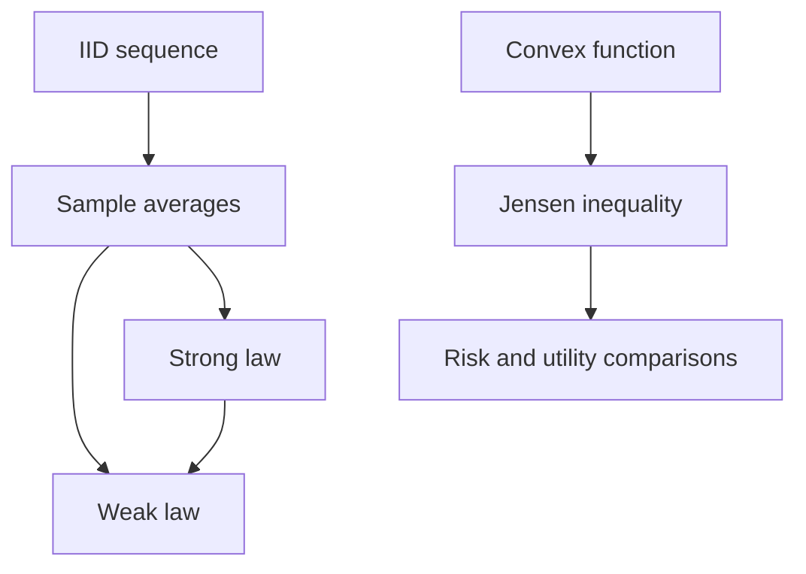

# Strong Law and Jensen's Inequality

The strong law of large numbers upgrades the weak law from high-probability convergence to almost-sure convergence. With probability one, sample averages settle to the mean along the realized infinite sequence of trials. The claim concerns entire sample paths, not only the distribution at one large index.

Jensen's inequality addresses a different question: how a nonlinear function interacts with averaging. MIT 18.440 places Jensen after the strong law and uses economic examples to show how convexity and concavity change the value of risk.

## Two roles for averaging

Let $X_1,X_2,\ldots$ be i.i.d. random variables with finite mean $\mu$, and define

$$
A_n=\frac{X_1+\cdots+X_n}{n}.
$$

The **strong law of large numbers** states

$$
P\left(\lim_{n\to\infty}A_n=\mu\right)=1.
$$

This is **almost-sure convergence** of $A_n$ to $\mu$. The weak law gives the weaker conclusion

$$
P(|A_n-\mu|>\epsilon)\to0
$$

for every $\epsilon\gt 0$.

A function $g$ is **convex** if, for $0\le\theta\le1$,

$$
g(\theta x+(1-\theta)y)
\le
\theta g(x)+(1-\theta)g(y).
$$

If $g$ is twice differentiable, $g''(x)\ge0$ throughout an interval implies convexity there. A function is **concave** when $-g$ is convex.

For convex $g$, **Jensen's inequality** says

$$
E[g(X)]\ge g(E[X]),
$$

whenever the relevant expectations exist. For concave $g$, the inequality reverses:

$$
E[g(X)]\le g(E[X]).
$$



| Idea | Statement | Type of conclusion |
|---|---|---|
| Weak law | $P(\vert A_n-\mu\vert \gt \epsilon)\to0$ | high-probability convergence |
| Strong law | $P(\lim A_n=\mu)=1$ | pathwise convergence |
| Convex Jensen | $E[g(X)]\ge g(E[X])$ | variability raises convex payoffs |
| Concave Jensen | $E[g(X)]\le g(E[X])$ | variability lowers concave utility |

The laws of large numbers ask what happens when many observations are averaged. Jensen asks what changes when a function is applied before rather than after averaging. Probability repeatedly alternates between those two operations.

Convergence in probability and almost-sure convergence are logically different. Almost-sure convergence controls the eventual behavior of a single infinite path. Convergence in probability permits the exceptional set to move with $n$. For example, let $U$ be uniform on $[0,1]$ and let $X_n$ indicate an interval of shrinking length that repeatedly sweeps across $[0,1]$. Then $P(X_n=1)\to0$, while a construction that visits each point infinitely often prevents pointwise convergence.

Neither law says the observations themselves approach the mean. For Bernoulli trials, $X_n$ continues to be zero or one; only the cumulative average settles. Nor does the strong law provide a sharp finite-$n$ error probability. Concentration inequalities and the central limit theorem answer that separate question.

## Reading an almost-sure statement path by path

Almost-sure convergence says that the set of infinite sample paths on which convergence fails has probability zero. Failure need not be logically impossible. In repeated coin tossing, the path consisting entirely of heads is possible as a sequence, but that singleton event has probability zero.

If $X_i$ is the indicator of heads on toss $i$, then $A_n$ is the fraction of heads in the first $n$ tosses. The strong law says that this fraction tends to $p$ on almost every infinite path. The weak law says only that, for each fixed large $n$, a noticeable deviation has small probability.

### Why the strong law implies the weak law

Fix $\epsilon\gt 0$ and suppose $A_n\to\mu$ almost surely. Define the last bad index by

$$
Y=\sup\bigl(\{n\ge1:|A_n-\mu|>\epsilon\}\cup\{0\}\bigr).
$$

On every convergent path, $Y$ is finite. Moreover,

$$
\{|A_n-\mu|>\epsilon\}\subseteq\{Y\ge n\}.
$$

Hence

$$
P(|A_n-\mu|>\epsilon)
\le P(Y\ge n)
\to0,
$$

because an almost-surely finite integer-valued random variable has a tail probability tending to zero. Taking $\epsilon=0.1$ gives the concrete statement $P(\vert A_n-\mu\vert \gt 0.1)\to0$.

### Worked example: estimating a Bernoulli parameter

Let $X_i=1$ when trial $i$ succeeds and $X_i=0$ otherwise, with independent success probability $p=0.3$. After ten trials, suppose the observations are

$$
1,0,0,1,0,0,0,1,0,0.
$$

The cumulative sum is $S_{10}=3$, so

$$
A_{10}=\frac{S_{10}}{10}=\frac3{10}=0.3.
$$

That exact agreement is accidental; another block will generally differ. For arbitrary $n$,

$$
E[A_n]=p,
\qquad
\operatorname{Var}(A_n)=\frac{p(1-p)}{n}=\frac{0.21}{n}.
$$

Chebyshev's inequality gives, for a tolerance of $0.05$,

$$
\begin{aligned}
P(|A_n-0.3|\geq0.05)
&\leq\frac{0.21/n}{0.05^2}\\
&=\frac{84}{n}.
\end{aligned}
$$

At $n=10{,}000$ the bound is $0.0084$. It is conservative, but it illustrates the weak-law calculation. The strong law says that, with probability one, the realized path eventually enters $[0.25,0.35]$ and never leaves it again.

## Why fourth moments make the proof easy

One elementary proof assumes $E[X_1^4]\lt \infty$. After centering so that $E[X_i]=0$, expand

$$
E[A_n^4].
$$

Write $S_n=X_1+\cdots+X_n$. Independence and centering eliminate terms containing an unpaired factor. If $E[X_1^2]=\sigma^2$ and $E[X_1^4]=m_4$, the surviving terms are the $n$ individual fourth powers and the $6\binom n2$ pairings:

$$
\begin{aligned}
E[S_n^4]
&=nm_4+6\binom n2\sigma^4\\
&=nm_4+3n(n-1)\sigma^4.
\end{aligned}
$$

Dividing by $n^4$ gives

$$
E[A_n^4]
=\frac{m_4}{n^3}+\frac{3(n-1)\sigma^4}{n^3}
=O\left(\frac1{n^2}\right).
$$

Markov's inequality then yields, for every $\epsilon\gt 0$,

$$
P(|A_n|>\epsilon)
\le
\frac{E[A_n^4]}{\epsilon^4}
=O\left(\frac1{n^2}\right).
$$

These probabilities are summable. The first Borel-Cantelli lemma says that only finitely many of the events $\{\vert A_n\vert \gt \epsilon\}$ occur almost surely. Apply this for $\epsilon=1,1/2,1/3,\ldots$. The intersection of these probability-one events still has probability one, and on every path in that intersection $A_n\to0$.

The full i.i.d. strong law needs only a finite first moment and requires a deeper argument. The fourth-moment proof shows how stronger moment assumptions supply enough control over rare deviations to rule out infinitely many large errors. A one-time Chebyshev bound does not by itself provide that summability.

The finite-mean assumption cannot simply be discarded. If $X_i$ are standard Cauchy variables, every average $A_n$ is again standard Cauchy; its distribution does not concentrate at a constant. Heavy-tailed models may need a different normalization or a different notion of typical behavior.

## Jensen from a supporting line

Let $\mu=E[X]$. A convex function has a supporting line at $\mu$,

$$
\ell(x)=g(\mu)+m(x-\mu),
$$

with $g(x)\ge\ell(x)$ throughout the interval under consideration. Taking expectations gives

$$
\begin{aligned}
E[g(X)]
&\ge E[\ell(X)] \\
&=g(\mu)+m(E[X]-\mu) \\
&=g(\mu).
\end{aligned}
$$

For $g(x)=x^2$,

$$
E[X^2]\ge(E[X])^2,
$$

which is equivalent to $\operatorname{Var}(X)\ge0$.

When $g$ is strictly convex, equality holds only when $X$ is constant almost surely, provided $X$ stays in an interval of strict convexity. With ordinary convexity, equality can also occur when the distribution lies along a linear portion of $g$.

For a finite weighted average, Jensen reads

$$
g\left(\sum_{i=1}^n w_ix_i\right)
\leq
\sum_{i=1}^n w_i g(x_i),
\qquad
w_i\geq0,\quad \sum_{i=1}^n w_i=1.
$$

The two-point definition proves this form by induction. The expectation form is its integral analogue. A differentiable proof uses the tangent-line inequality

$$
g(x)\geq g(\mu)+g'(\mu)(x-\mu),
$$

while a nondifferentiable convex function uses a subgradient at $\mu$.

There is also a conditional form:

$$
g(E[X\mid\mathcal G])\leq E[g(X)\mid\mathcal G].
$$

Taking expectations recovers ordinary Jensen. Conditional Jensen compares the convex cost of a current conditional forecast with the expected convex cost after more uncertainty is resolved.

For a convex payoff, the Jensen gap

$$
E[g(X)]-g(E[X])
$$

measures the benefit of variability relative to receiving the mean outcome. The sign reverses for a concave function, making variability costly under that utility.

## How curvature changes the value of risk

Suppose an investment returns $X=0$ with probability $1/2$ and $X=100$ with probability $1/2$. Its mean is

$$
E[X]=\frac12\cdot0+\frac12\cdot100=50.
$$

Square-root utility is concave on $[0,\infty)$, and

$$
E[\sqrt X]
=\frac12\sqrt0+\frac12\sqrt{100}
=5,
$$

whereas

$$
\sqrt{E[X]}=\sqrt{50}\approx7.071.
$$

Thus

$$
E[\sqrt X]<\sqrt{E[X]}.
$$

A decision maker with square-root utility prefers the certain payoff $50$ to this risky payoff with the same monetary mean. Comparing monetary expectations alone misses the curvature of utility.

The **certainty equivalent** $c$ solves $u(c)=E[u(X)]$. Here $u(x)=\sqrt x$, so

$$
\sqrt c=5
\quad\Longrightarrow\quad
c=25.
$$

The risk premium relative to the mean is therefore

$$
E[X]-c=50-25=25.
$$

That number belongs to the chosen utility function; a different concave utility gives a different certainty equivalent.

Convex compensation creates the opposite incentive. If a fund manager receives a large share of gains but bears limited downside, greater dispersion can raise the manager's expected compensation even when the investor's expected return is unchanged. The payoff's curvature creates a principal-agent conflict.

### Worked example: arithmetic and geometric growth

Suppose wealth is multiplied by $R$, where $R=1.5$ with probability $1/2$ and $R=0.5$ with probability $1/2$. The arithmetic mean factor is

$$
E[R]=\frac12(1.5)+\frac12(0.5)=1.
$$

Repeated independent investment is multiplicative. After $n$ periods,

$$
W_n=W_0\prod_{i=1}^nR_i,
$$

and taking logs gives

$$
\frac1n\log\frac{W_n}{W_0}
=\frac1n\sum_{i=1}^n\log R_i.
$$

The strong law sends the right-hand side almost surely to

$$
\begin{aligned}
E[\log R]
&=\frac12\log(1.5)+\frac12\log(0.5)\\
&=\frac12\log(0.75)\\
&\approx-0.14384.
\end{aligned}
$$

The typical long-run geometric factor per period is therefore

$$
\exp(E[\log R])=\sqrt{0.75}\approx0.8660.
$$

Jensen predicts the sign because $\log$ is strictly concave:

$$
E[\log R]<\log E[R]=0.
$$

Independence still gives $E[W_n]=W_0(E[R])^n=W_0$, while almost every long path decays at exponential rate $0.8660^n$. Rare paths with many $1.5$ multipliers keep the expectation high.

## Estimating the Jensen gap from curvature

If $X$ is concentrated near $\mu=E[X]$ and $g$ has a continuous second derivative, expand around $\mu$:

$$
g(X)\approx g(\mu)+g'(\mu)(X-\mu)+\frac12g''(\mu)(X-\mu)^2.
$$

Taking expectations removes the linear term:

$$
E[g(X)]-g(E[X])
\approx\frac12g''(\mu)\operatorname{Var}(X).
$$

This approximation explains locally how curvature and variance combine. Large dispersion or rapidly changing curvature requires the full expectation.

Several standard inequalities are Jensen in disguise. Convexity of $e^x$ gives $e^{E[X]}\leq E[e^X]$. Concavity of $\log x$ for positive $X$ gives $E[\log X]\leq\log E[X]$, the probabilistic form of the geometric-mean–arithmetic-mean inequality. Applying $g(x)=1/x$ on positive numbers yields $E[1/X]\geq1/E[X]$ whenever both sides are defined.

## Simulating convergence and the Jensen gap

```python
import numpy as np

rng = np.random.default_rng(1)
trials = rng.integers(0, 2, size=100_000)  # Bernoulli(1/2)
averages = np.cumsum(trials) / np.arange(1, len(trials) + 1)

print("last sample average:", averages[-1])
print("max error after 1000:", np.max(np.abs(averages[1000:] - 0.5)))

values = np.array([0.0, 100.0])
probs = np.array([0.5, 0.5])
expected_x = np.dot(probs, values)
expected_sqrt = np.dot(probs, np.sqrt(values))
sqrt_expected = np.sqrt(expected_x)

print("E[sqrt(X)]:", expected_sqrt)
print("sqrt(E[X]):", sqrt_expected)
```

One simulated path can illustrate stabilization but cannot prove the strong law. Likewise, the numerical Jensen comparison depends on using a function with the stated curvature and on the relevant expectations being finite.

The hypotheses are easy to lose sight of. Almost-sure convergence does not imply convergence of expectations without domination or uniform integrability. Jensen requires $X$ to lie in the interval of convexity and the relevant expectations to exist. A nonlinear transformation can turn an integrable random variable into a non-integrable one, in which case writing both sides as finite numbers is invalid.

## Statistical meaning and what consistency does not promise

The sample mean is a natural estimator of the population mean. The strong law says it is **strongly consistent** under the i.i.d. finite-mean assumptions: for almost every infinite data sequence, the estimates converge to the target. Consistency is an asymptotic property. It does not say the estimator is unbiased at each sample size, efficient among competitors, or robust to a few corrupted observations.

Independence is also a model assumption, not a consequence of collecting many measurements. Repeated sensor readings can share calibration drift; financial returns can have volatility dependence; measurements from members of one household can be correlated. Laws of large numbers extend to many dependent sequences, but their hypotheses control how dependence weakens over time. Blindly increasing $n$ does not repair systematic bias or persistent dependence.

Sampling from a changing distribution creates another failure mode. If the mean itself drifts, the average may converge to a time average unrelated to the present population. A long historical sample can then reduce random noise while increasing relevance error. The law certifies an estimator only relative to the probabilistic model that generated the sequence.

Almost-sure convergence is preserved by continuous transformations: if $A_n\to\mu$ almost surely and $h$ is continuous at $\mu$, then $h(A_n)\to h(\mu)$ almost surely. This permits consistent plug-in estimators. For Bernoulli observations, for example, $A_n(1-A_n)$ converges almost surely to $p(1-p)$. Discontinuity at the limit can break the argument, so the continuity condition should not be dropped silently.

## Jensen as a source of estimator bias

Nonlinear plug-in estimates are generally biased even when the input estimate is unbiased. Suppose $\bar X$ is a positive unbiased estimator of $\mu$. Since $g(x)=1/x$ is convex on the positive half-line,

$$
E\left[\frac1{\bar X}\right]\geq\frac1{E[\bar X]}=\frac1\mu.
$$

Thus taking a reciprocal introduces upward bias. The gap shrinks as the estimator concentrates, but it need not vanish at a useful rate without variance and tail control.

The exponential provides another example. If an error $Z$ has mean zero, Jensen gives

$$
E[e^Z]\geq e^{E[Z]}=1.
$$

Exponentiating an unbiased log-scale prediction therefore produces an upward-biased level-scale prediction. If $Z$ is normal with variance $s^2$, the exact factor is $e^{s^2/2}$. This effect appears in lognormal models and back-transformations of regression predictions.

Conditional Jensen sharpens the idea. If $Y=E[X\mid\mathcal G]$ is a forecast based on information $\mathcal G$, then for squared loss

$$
Y^2\leq E[X^2\mid\mathcal G]
$$

after conditional expectation in the appropriate form. More generally, resolving information raises the expected value of a convex function of a conditional forecast. In decision theory this is one mathematical expression of the value of information.

## Dependence on the averaging operation

Jensen applies to probability weights because they are nonnegative and sum to one. It does not permit arbitrary signed coefficients. Nor may one reverse the inequality merely because a function is decreasing; monotonicity controls order under the function, while curvature controls averaging.

The domain matters as much as the second derivative. The function $x^3$ changes curvature at zero, so no global Jensen direction holds for arbitrary real-valued $X$. One must restrict the support to a convexity interval or calculate directly. Likewise, $\log X$ requires positive $X$; a small probability of zero makes its expectation negative infinity rather than merely “very small.”

The strong law and Jensen often meet in long-run optimization. The strong law turns an average of log returns into an almost-sure growth rate, while Jensen compares that rate with the log of the arithmetic mean return. The distinction between ensemble expectation and time-average growth is then a consequence of both limit behavior and concavity, not a contradiction between two definitions of average.

<div className="see-also">

See also: [Weak law, concentration, and the central limit theorem](/math/probability-and-random-variables/weak-law-concentration-central-limit-theorem) · [Moment and characteristic functions](/math/probability-and-random-variables/moment-and-characteristic-functions) · [Covariance, correlation, and conditional expectation](/math/probability-and-random-variables/covariance-correlation-conditional-expectation) · [Martingales, risk-neutral probability, and Black-Scholes](/math/probability-and-random-variables/martingales-risk-neutral-probability-black-scholes)

</div>
