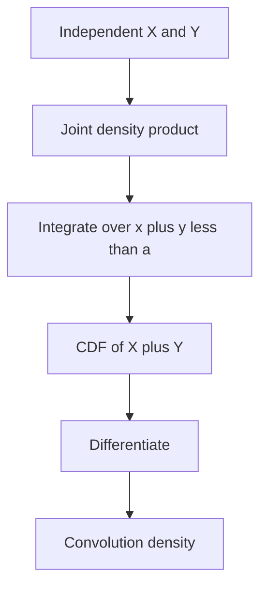

# Sums, Convolutions, and Order Statistics

Once random variables are defined jointly, the next natural question is what happens when we combine them. Sums of independent random variables produce convolutions. Maxima, minima, and sorted samples produce order statistics. These constructions explain why gamma distributions arise from exponential waiting times, why sums of uniforms have triangular and then smoother densities, and why sorted uniform samples lead to beta distributions.

The formulas often become simple after drawing the relevant region. A sum integrates joint density along compatible pairs, while an order statistic counts how many sample points fall below and above a proposed value. Support geometry should be settled before integration limits are written.

## Adding random variables

If $X$ and $Y$ are independent continuous random variables with densities $f_X$ and $f_Y$, then the density of $Z=X+Y$ is the **convolution**

$$
f_Z(a)=\int_{-\infty}^{\infty} f_X(a-y)f_Y(y)\,dy.
$$

The corresponding CDF computation is

$$
\begin{aligned}
F_Z(a)
&=P(X+Y\le a)\\
&=\int_{-\infty}^{\infty}P(X\le a-y)f_Y(y)\,dy\\
&=\int_{-\infty}^{\infty}F_X(a-y)f_Y(y)\,dy.
\end{aligned}
$$

For discrete independent variables,

$$
P(X+Y=k)=\sum_j P(X=k-j)P(Y=j).
$$

If $X_1,\ldots,X_n$ are sampled and then sorted, the ordered values are called **order statistics**:

$$
Y_1\le Y_2\le\cdots\le Y_n.
$$

For i.i.d. uniform variables on $[0,1]$, $Y_k$ has beta distribution with parameters $(k,n+1-k)$:

$$
f_{Y_k}(y)=
\frac{n!}{(k-1)!(n-k)!}
y^{k-1}(1-y)^{n-k},
\qquad 0<y<1.
$$

## Families closed under addition

Sums preserve several distribution families:

| Independent summands | Sum distribution | Reason |
|---|---|---|
| Binomial$(m,p)$ and Binomial$(n,p)$ | Binomial$(m+n,p)$ | combine trials |
| Poisson$(\lambda_1)$ and Poisson$(\lambda_2)$ | Poisson$(\lambda_1+\lambda_2)$ | superpose processes |
| Normal$(\mu_1,\sigma_1^2)$ and Normal$(\mu_2,\sigma_2^2)$ | Normal$(\mu_1+\mu_2,\sigma_1^2+\sigma_2^2)$ | transform or bell-curve geometry |
| Gamma$(\lambda,s)$ and Gamma$(\lambda,t)$ | Gamma$(\lambda,s+t)$ | convolution with common rate |

For independent variables with finite means,

$$
E[X+Y]=E[X]+E[Y].
$$

For independent variables with finite variances,

$$
\operatorname{Var}(X+Y)=\operatorname{Var}(X)+\operatorname{Var}(Y).
$$

The minimum and maximum of i.i.d. variables can be handled using CDFs. If $M=\max(X_1,\ldots,X_n)$ and the $X_i$ have CDF $F$, then

$$
P(M\le a)=P(X_1\le a,\ldots,X_n\le a)=F(a)^n.
$$

If $m=\min(X_1,\ldots,X_n)$, then

$$
P(m>a)=P(X_1>a,\ldots,X_n>a)=(1-F(a))^n.
$$

These formulas are often easier than starting with densities.

Convolution is best understood as adding up all ways a target sum can occur. In the discrete case, the sum $X+Y=k$ can happen through pairs $(k-j,j)$, so one sums over $j$. In the continuous case, a line $x+y=a$ has infinitely many points, and the integral accumulates density along the compatible values. The formula

$$
f_{X+Y}(a)=\int f_X(a-y)f_Y(y)\,dy
$$

is the continuous version of the same bookkeeping.

Support is often the hardest part of convolution. Before integrating, determine where the summands can live and what range the sum can have. For two uniforms on $[0,1]$, the sum ranges over $[0,2]$, but the integration length increases on $[0,1]$ and decreases on $[1,2]$. This piecewise behavior is typical when densities have bounded support.

Order statistics are another way of organizing a joint sample. If $n$ independent points are sampled from a continuous distribution, ties have probability zero, so sorting creates a unique ordered vector. For uniforms, the event $Y_k\in dy$ requires $k-1$ sample points below $y$, one point near $y$, and $n-k$ points above $y$. The combinatorial coefficient counts which original sample point lands near $y$ and which points lie on each side.

For uniform order statistics, the beta connection is not accidental. The density

$$
f_{Y_k}(y)\propto y^{k-1}(1-y)^{n-k}
$$

contains one factor for each point below and above the observed order statistic. This is the same algebraic shape as a beta posterior after observing successes and failures. In both settings, powers of $y$ and $1-y$ record counts.

Sums and order statistics also demonstrate that functions of independent variables need not be independent. The pair $(X+Y,X-Y)$ may be independent in special normal cases, but not generally. The sorted values of a sample are especially dependent: if the maximum is small, all other order statistics must also be small.

## Geometry of the convolution region



```text
Region for X+Y <= a in the unit square

y
1 |---------+
  |       / |
  |     /   |
  |   /     |
0 +--------- x
  0    a    1

For 0 <= a <= 1, the area is a triangle with area a^2/2.
```

The first diagram gives the algebraic route: compute a CDF over a region, then differentiate to get a density. The ASCII square gives the geometric route for the uniform example. Both routes are the same calculation in different language. Geometry is often the fastest way to avoid wrong integration limits, especially when the support is a polygon or simplex.

Order statistics have a similar geometric interpretation in higher-dimensional cubes. For $n$ independent uniforms, the unordered sample is uniform on the cube $[0,1]^n$. Sorting folds the cube into $n!$ congruent regions corresponding to the possible orderings. This symmetry is why factorial factors appear in order-statistic densities.

For repeated sums, direct convolution quickly becomes cumbersome. Transforms turn repeated convolution into powers of a single function. The convolution view remains useful because it records support constraints that can disappear inside transform algebra.

## Worked example: sum of two independent uniforms

Problem: Let $X,Y$ be independent uniform random variables on $[0,1]$. Find the density of $Z=X+Y$.

Method:

1. Since $0\le X,Y\le1$, the support of $Z$ is $[0,2]$.
2. The convolution is

$$
f_Z(a)=\int_{-\infty}^{\infty} f_X(a-y)f_Y(y)\,dy.
$$

3. The integrand equals $1$ exactly when

$$
0\le y\le1
\quad\text{and}\quad
0\le a-y\le1.
$$

4. The second condition is

$$
a-1\le y\le a.
$$

5. Therefore $y$ must lie in

$$
[\max(0,a-1),\min(1,a)].
$$

6. The length of this interval is the density.

For $0\le a\le1$:

$$
f_Z(a)=a.
$$

For $1\le a\le2$:

$$
f_Z(a)=2-a.
$$

Outside $[0,2]$, $f_Z(a)=0$.

Checked answer: the density integrates to

$$
\int_0^1 a\,da+\int_1^2(2-a)\,da
=\frac12+\frac12=1.
$$

## Worked example: maximum of independent uniforms

Problem: Let $X_1,\ldots,X_n$ be independent uniform variables on $[0,1]$, and let $M=\max(X_1,\ldots,X_n)$. Find the CDF, density, and expectation of $M$.

Method:

1. For $0\le a\le1$,

$$
P(M\le a)=P(X_1\le a,\ldots,X_n\le a).
$$

2. Independence gives

$$
F_M(a)=a^n.
$$

3. Differentiate:

$$
f_M(a)=na^{n-1},\qquad 0<a<1.
$$

4. Compute the expectation:

$$
E[M]=\int_0^1 a\cdot na^{n-1}\,da
=n\int_0^1 a^n\,da
=\frac{n}{n+1}.
$$

Checked answer: for $n=1$, $E[M]=1/2$, the mean of one uniform. As $n$ grows, $n/(n+1)$ approaches $1$, which matches the intuition that the maximum of many uniform samples is near the right endpoint.

## Deriving the general order-statistic density

Let $X_1,\ldots,X_n$ be i.i.d. with continuous CDF $F$ and density $f$, and let $X_{(k)}$ be the $k$th smallest observation. For $X_{(k)}$ to fall in a short interval near $x$, there must be $k-1$ observations below $x$, one observation near $x$, and $n-k$ above $x$.

There are $n$ choices for the observation near $x$ and $\binom{n-1}{k-1}$ ways to choose those below it. Dividing the short-interval probability by its width gives

$$
f_{X_{(k)}}(x)
=\frac{n!}{(k-1)!(n-k)!}
[F(x)]^{k-1}[1-F(x)]^{n-k}f(x).
$$

For a uniform distribution on $(0,1)$, $F(x)=x$ and $f(x)=1$, producing the beta$(k,n+1-k)$ density. For a general continuous law, the probability integral transform gives

$$
F(X_{(k)})\sim\operatorname{Beta}(k,n+1-k).
$$

This identity is used in exact quantile intervals and distribution-free rank procedures.

The CDF can also be read as a binomial tail. The event $X_{(k)}\le x$ means that at least $k$ sample points are at most $x$, so

$$
P(X_{(k)}\le x)
=\sum_{j=k}^n\binom njF(x)^j[1-F(x)]^{n-j}.
$$

Differentiating this expression yields the same density after cancellation.

## Worked example: the sample median

Five independent observations are uniform on $[0,1]$. The sample median is $X_{(3)}$. Substituting $n=5$ and $k=3$ gives

$$
f_{X_{(3)}}(x)
=\frac{5!}{2!2!}x^2(1-x)^2
=30x^2(1-x)^2,
\qquad 0<x<1.
$$

Find the probability that the median lies between $0.25$ and $0.75$. Symmetry gives equal tails, and the lower tail can be computed as the probability that at least three observations are at most $0.25$:

$$
\begin{aligned}
P(X_{(3)}\le0.25)
&=\sum_{j=3}^{5}\binom5j(0.25)^j(0.75)^{5-j}\\
&=10\frac{1}{64}\frac{9}{16}
+5\frac{1}{256}\frac34
+\frac{1}{1024}\\
&=\frac{106}{1024}.
\end{aligned}
$$

Therefore

$$
P(0.25<X_{(3)}<0.75)
=1-2\frac{106}{1024}
=\frac{203}{256}
\approx0.7930.
$$

The open or closed endpoints do not affect the answer because the distribution is continuous.

## Joint behavior of the minimum and maximum

For i.i.d. continuous variables supported on an interval, let $U=X_{(1)}$ and $V=X_{(n)}$. To have $U$ near $u$ and $V$ near $v$, choose which observation supplies each endpoint and require the other $n-2$ observations to lie between them. The joint density is

$$
f_{U,V}(u,v)
=n(n-1)[F(v)-F(u)]^{n-2}f(u)f(v),
\qquad u<v.
$$

For uniforms this becomes $n(n-1)(v-u)^{n-2}$ on $0\lt u\lt v\lt 1$. The density depends on the range $v-u$, and the constraint $u\lt v$ already shows that minimum and maximum are dependent.

The sample range $R=V-U$ can then be found by integrating over $u$:

$$
\begin{aligned}
f_R(r)
&=\int_0^{1-r}n(n-1)r^{n-2}\,du\\
&=n(n-1)r^{n-2}(1-r),
\qquad 0<r<1.
\end{aligned}
$$

Its mean is $(n-1)/(n+1)$. The formula agrees with the small cases: one observation has range zero, while a large uniform sample nearly spans the unit interval.

## Dependence changes convolution

If $X$ and $Y$ have joint density $f_{X,Y}$ but are not independent, the sum density is

$$
f_{X+Y}(z)=\int_{-\infty}^{\infty}f_{X,Y}(x,z-x)\,dx.
$$

Only under independence may $f_{X,Y}(x,z-x)$ be replaced by $f_X(x)f_Y(z-x)$. Marginals alone cannot determine a sum law. If $Y=X$, then $X+Y=2X$; if $Y=-X$, then $X+Y=0$. These pairs can be built with identical marginals when $X$ is symmetric, yet their sums are entirely different.

## Errors that usually come from the support

### Random sums

Sometimes the number of summands is random. Let

$$
S_N=X_1+\cdots+X_N,
$$

where $N$ is a nonnegative integer-valued variable independent of the i.i.d. $X_i$. Conditioning on $N$ gives the mean without finding the full distribution:

$$
E[S_N\mid N]=N E[X_1],
$$

so

$$
E[S_N]=E[N]E[X_1].
$$

The law of total variance gives

$$
\operatorname{Var}(S_N)
=E[N]\operatorname{Var}(X_1)
+\operatorname{Var}(N)E[X_1]^2.
$$

The first term is average within-count variability; the second is variability from the random count itself. If $N\sim\operatorname{Poisson}(\lambda)$, the result is a compound Poisson sum. Its MGF is

$$
M_{S_N}(t)=\exp\left(\lambda(M_X(t)-1)\right).
$$

For example, if claims arrive as a Poisson count and claim sizes are i.i.d., aggregate loss has mean $\lambda E[X]$ and variance $\lambda E[X^2]$. The latter equals $\lambda\operatorname{Var}(X)+\lambda E[X]^2$, showing that count uncertainty remains even when individual claim sizes have little spread.

### Ties in discrete samples

The clean order-statistic density assumes a continuous parent law, so ties occur with probability zero. Discrete samples can have repeated values, and the argument selecting one observation “near $x$” no longer applies. CDF identities remain reliable. For the maximum,

$$
P(X_{(n)}\le x)=F(x)^n
$$

holds for discrete, continuous, and mixed laws. Point probabilities can then be obtained by taking jumps. If $X_i$ are fair die rolls, for instance,

$$
P(X_{(n)}=m)=\left(\frac m6\right)^n-\left(\frac{m-1}{6}\right)^n,
\qquad m=1,\ldots,6.
$$

- Forgetting independence in convolution formulas. Without independence, the joint density is not the product of marginals.
- Using the same convolution limits for every value of $a$. Supports change the limits piece by piece.
- Confusing the density of $X+Y$ with the CDF of $X+Y$.
- Assuming order statistics are independent. Sorted sample values are strongly dependent.
- Forgetting the combinatorial factor in the density of the $k$th order statistic.

## Further consequences

Convolution is associative and commutative whenever the relevant integrals exist. The distribution of an independent sum does not depend on the order in which summands are combined. Computational order can still matter because convolving narrow-support arrays first may keep intermediate representations smaller. Fast Fourier transforms turn long discrete convolutions into pointwise products, but zero-padding is required to prevent circular wraparound from corrupting the desired linear convolution.

### Spacings between uniform order statistics

Uniform order statistics create random gaps. With $0=U_{(0)}\lt U_{(1)}\lt \cdots\lt U_{(n)}\lt U_{(n+1)}=1$, define

$$
D_i=U_{(i)}-U_{(i-1)},\qquad i=1,\ldots,n+1.
$$

The gaps are nonnegative and sum to one. Symmetry gives each gap the same mean, hence

$$
E[D_i]=\frac{1}{n+1}.
$$

They are not independent because their sum is fixed. Their joint distribution is uniform on the simplex of nonnegative vectors summing to one, a Dirichlet distribution with all parameters equal to one.

For a concrete calculation, the first gap $D_1=U_{(1)}$ is the minimum. Its survival function is

$$
P(D_1>x)=P(U_1>x,\ldots,U_n>x)=(1-x)^n,
$$

so it has beta$(1,n)$ density $n(1-x)^{n-1}$. The same marginal law holds for the last gap $1-U_{(n)}$ and, less obviously, for every interior gap. Large empty stretches are therefore rare as the sample grows, though the largest gap needs a separate extreme-value analysis.

### Repeated convolution smooths shapes

The sum of $n$ independent uniform$(0,1)$ variables has the Irwin–Hall distribution. Its density is piecewise polynomial of degree $n-1$. Each convolution raises smoothness because integration averages sharp features of the preceding density. After centering and scaling, these densities approach a normal curve by the central limit theorem.

Support still remembers the finite sum: the unscaled distribution lives on $[0,n]$, while a normal density has unbounded support. A normal approximation can assign small positive probability outside the possible interval. Near hard boundaries or in far tails, exact convolution or transform inversion may be preferable even when the center appears Gaussian.

Convolution is associative, so numerical algorithms can combine balanced pairs rather than convolving one distribution at a time. For lattice distributions, fast Fourier transforms turn convolution into pointwise multiplication. Padding is needed to prevent circular wraparound from contaminating the linear convolution.

## Related pages

- [Joint distributions, transformations, and independence](/math/probability-and-random-variables/joint-distributions-transformations-independence)
- [Normal, exponential, gamma, beta, and Cauchy laws](/math/probability-and-random-variables/normal-exponential-gamma-beta-cauchy)
- [Covariance, correlation, and conditional expectation](/math/probability-and-random-variables/covariance-correlation-conditional-expectation)
- [Moment and characteristic functions](/math/probability-and-random-variables/moment-and-characteristic-functions)
- [Transformations of random variables](/math/probability/transformations-random-variables)
