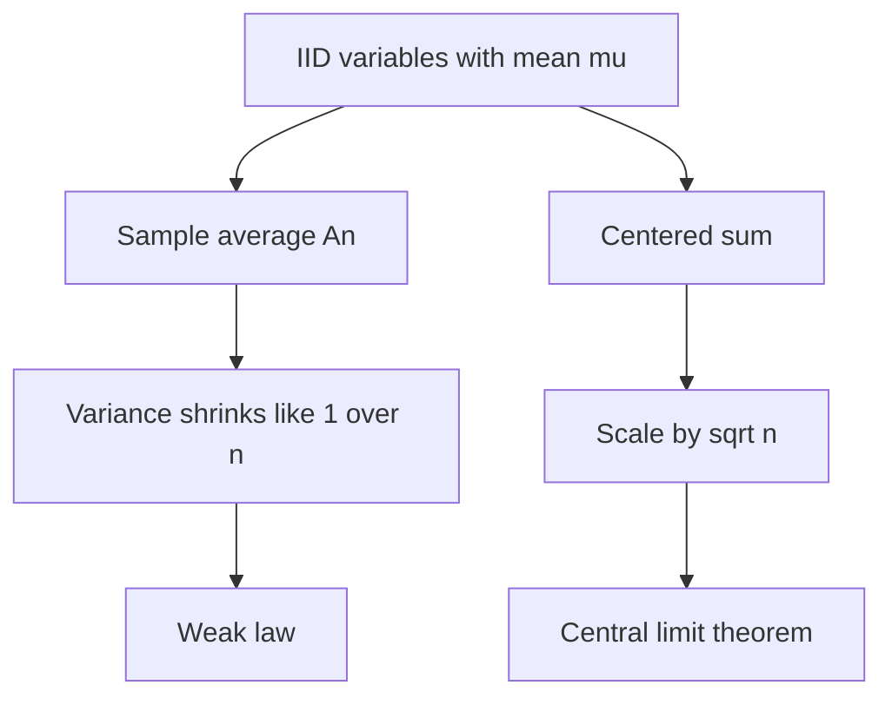

# Weak Law, Concentration, and the Central Limit Theorem

Limit theorems explain why probability becomes predictable at large scale. The weak law of large numbers says sample averages concentrate near the mean. The central limit theorem says the remaining fluctuations, after scaling by $\sqrt n$, often look normal. These two statements answer different questions: the weak law gives convergence to a constant, while the central limit theorem describes the shape of the error.

Finite variance gives a short Chebyshev proof of the weak law. Characteristic functions then describe the normalized fluctuations and lead to the central limit theorem without assuming an MGF exists near zero. The hypotheses matter: a Cauchy average, for example, has the same law as each summand and never concentrates around a finite mean.

## Three levels of control

For a nonnegative random variable $X$ and $a\gt 0$, **Markov's inequality** is

$$
P(X\ge a)\le \frac{E[X]}{a}.
$$

For a random variable $X$ with mean $\mu$ and variance $\sigma^2$, **Chebyshev's inequality** is

$$
P(|X-\mu|\ge k)\le \frac{\sigma^2}{k^2}.
$$

Let $X_1,X_2,\ldots$ be independent identically distributed random variables with mean $\mu$, and define the sample average

$$
A_n=\frac{X_1+\cdots+X_n}{n}.
$$

The **weak law of large numbers** states that for every $\epsilon\gt 0$,

$$
P(|A_n-\mu|>\epsilon)\to0
\qquad\text{as }n\to\infty.
$$

If the $X_i$ have variance $\sigma^2$, the normalized sum is

$$
B_n=\frac{X_1+\cdots+X_n-n\mu}{\sigma\sqrt n}.
$$

The **central limit theorem** states that

$$
B_n\Rightarrow Z,
$$

where $Z$ is standard normal and $\Rightarrow$ denotes convergence in distribution.

## Markov and Chebyshev from first principles

Markov's inequality proof: since $X\ge0$,

$$
E[X]\ge E[X1_{\{X\ge a\}}]\ge aP(X\ge a).
$$

Dividing by $a$ gives the result.

Chebyshev follows by applying Markov to the nonnegative random variable $(X-\mu)^2$:

$$
P(|X-\mu|\ge k)
=P((X-\mu)^2\ge k^2)
\le \frac{E[(X-\mu)^2]}{k^2}
=\frac{\sigma^2}{k^2}.
$$

Weak law with finite variance: if the $X_i$ are i.i.d. with variance $\sigma^2$, then

$$
E[A_n]=\mu,
\qquad
\operatorname{Var}(A_n)=\frac{\sigma^2}{n}.
$$

Chebyshev gives

$$
P(|A_n-\mu|\ge\epsilon)
\le
\frac{\sigma^2}{n\epsilon^2}
\to0.
$$

The transform proof of the central limit theorem begins by standardizing so $E[X_i]=0$ and $\operatorname{Var}(X_i)=1$. If $M(t)=E[e^{tX_1}]$ exists near zero, then

$$
M(t)=1+\frac{t^2}{2}+o(t^2).
$$

For

$$
B_n=\frac{X_1+\cdots+X_n}{\sqrt n},
$$

independence gives

$$
M_{B_n}(t)=\left(M\left(\frac{t}{\sqrt n}\right)\right)^n.
$$

Using the expansion,

$$
M_{B_n}(t)\to e^{t^2/2},
$$

the MGF of a standard normal variable. Characteristic functions give the same argument under the finite-variance assumption without requiring the MGF to exist.

The weak law and the central limit theorem should be compared through the sample average:

$$
A_n-\mu=\frac{\sigma}{\sqrt n}B_n.
$$

The CLT says $B_n$ has an approximately stable normal distribution for large $n$. Multiplying by $\sigma/\sqrt n$ then says the actual average error is typically of order $1/\sqrt n$. The weak law records only the consequence that this error goes to zero in probability, while the CLT describes the scale and shape of the error.

Markov and Chebyshev inequalities are deliberately crude. They do not assume a particular distribution, so they cannot give sharp normal-tail estimates in general. Their strength is robustness: with only a mean or variance, they still produce valid bounds. In applications, a loose guaranteed bound can be more valuable than a sharper approximation that depends on unverified distributional assumptions.

The finite-variance proof of the weak law also shows why independence matters. If $X_1,\ldots,X_n$ are not independent and remain highly correlated, the variance of the average may fail to shrink like $1/n$. For example, if all $X_i$ are actually the same random variable, then $A_n=X_1$ for every $n$ and averaging does not reduce uncertainty.

The CLT is robust but not universal. Heavy-tailed variables without finite variance can have different stable limits, and variables without finite mean may not satisfy the usual law of large numbers. The Cauchy distribution is the standard warning. Its sample average does not concentrate around a mean because no finite mean exists.

The De Moivre-Laplace theorem for coin tosses is the binomial special case of the CLT. If $X\sim\operatorname{Binomial}(n,p)$, then

$$
\frac{X-np}{\sqrt{np(1-p)}}
$$

is approximately standard normal for large $n$, provided $p$ is not too close to $0$ or $1$. This is the origin of the familiar bell curve in repeated-trial counting problems.

## What each theorem says

| Result | Scale | Conclusion | Main tool |
|---|---:|---|---|
| Markov inequality | one variable | large nonnegative values are limited by mean | expectation |
| Chebyshev inequality | one variable | deviations are limited by variance | Markov on square |
| Weak law | $A_n$ | average converges in probability to $\mu$ | Chebyshev or characteristic functions |
| CLT | $\sqrt n(A_n-\mu)/\sigma$ | normalized error tends to normal | MGFs or characteristic functions |

The table separates inequalities from asymptotic theorems. Markov and Chebyshev are finite-$n$ statements: they are true for a single random variable or a single sample average. The weak law and CLT are limiting statements about sequences. Finite inequalities often prove limits, while the limits describe large systems.

The CLT row also clarifies why the normal distribution appears even when the original variables are not normal. The theorem is about normalized sums, not the raw summands. Bernoulli, uniform, and many other finite-variance distributions produce approximately normal centered sums after enough independent addition.

The hypotheses should remain explicit. Independence, identical distribution, finite mean, and finite variance each play a role in the standard statements. Changing them can produce a different limit or no useful limit at all. Heavy-tailed examples mark the boundary rather than serving as curiosities.

## Worked example: Chebyshev bound for a sample mean

Problem: Suppose $X_1,\ldots,X_{100}$ are i.i.d. with mean $5$ and variance $9$. Bound the probability that their average differs from $5$ by at least $1$.

Method:

1. Let

$$
A_{100}=\frac{X_1+\cdots+X_{100}}{100}.
$$

2. The mean is

$$
E[A_{100}]=5.
$$

3. Since the variables are independent,

$$
\operatorname{Var}(A_{100})
=\frac{9}{100}
=0.09.
$$

4. Apply Chebyshev with $k=1$:

$$
P(|A_{100}-5|\ge1)
\le
\frac{0.09}{1^2}
=0.09.
$$

Checked answer: Chebyshev guarantees the probability is at most $9\%$. The true probability may be much smaller, but this bound uses only the mean, variance, and independence.

## Worked example: normal approximation for coin tosses

Problem: Toss a fair coin $400$ times. Approximate the probability of seeing between $190$ and $210$ heads, inclusive.

Method:

1. Let $X\sim\operatorname{Binomial}(400,1/2)$.
2. The mean and variance are

$$
\mu=np=200,
\qquad
\sigma^2=npq=100,
$$

so $\sigma=10$.

3. Use the normal approximation with continuity correction:

$$
P(190\le X\le210)
\approx
P(189.5\le N\le210.5),
$$

where $N$ is normal with mean $200$ and standard deviation $10$.

4. Standardize endpoints:

$$
z_1=\frac{189.5-200}{10}=-1.05,
\qquad
z_2=\frac{210.5-200}{10}=1.05.
$$

5. Therefore

$$
P(190\le X\le210)\approx \Phi(1.05)-\Phi(-1.05).
$$

6. Using $\Phi(1.05)\approx0.8531$ and $\Phi(-1.05)\approx0.1469$,

$$
P(190\le X\le210)\approx0.7062.
$$

Checked answer: the event is within about $1.05$ standard deviations of the mean, so a probability around $70\%$ is plausible.

## Convergence modes are different claims

The weak law gives convergence in probability:

$$
X_n\xrightarrow{P}X
\quad\Longleftrightarrow\quad
P(|X_n-X|>\epsilon)\to0
$$

for every $\epsilon\gt 0$. Almost-sure convergence asks that the realized sequence itself converge outside a single event of probability zero:

$$
P\left(\lim_{n\to\infty}X_n=X\right)=1.
$$

Almost-sure convergence implies convergence in probability, but the converse fails. The strong law supplies the stronger claim for sample averages under suitable assumptions.

Convergence in distribution is weaker still. It asks for CDF convergence at continuity points and does not force $X_n$ to become close to $X$ on a shared probability space. If $X_n$ has the standard normal distribution for every $n$, then $X_n\Rightarrow Z$ automatically, even if the variables are independent of $Z$ and of one another.

For convergence to a constant $c$, convergence in distribution and convergence in probability are equivalent. That special fact lets a law of large numbers be phrased either way, though convergence in probability better expresses concentration.

## Exponential concentration for bounded averages

Chebyshev uses only variance and therefore decays as $1/n$. If independent variables satisfy $a_i\le X_i\le b_i$, Hoeffding's inequality gives

$$
P\left(\sum_{i=1}^n(X_i-E[X_i])\ge t\right)
\le
\exp\left(-\frac{2t^2}{\sum_{i=1}^n(b_i-a_i)^2}\right).
$$

For i.i.d. Bernoulli variables and their average $\bar X_n$, this yields the two-sided bound

$$
P(|\bar X_n-p|\ge\epsilon)
\le2e^{-2n\epsilon^2}.
$$

Compare it with Chebyshev:

$$
P(|\bar X_n-p|\ge\epsilon)
\le\frac{p(1-p)}{n\epsilon^2}
\le\frac{1}{4n\epsilon^2}.
$$

Both are distribution-free within their assumptions, but boundedness buys an exponentially decreasing tail. Neither bound is the same as a CLT approximation: concentration inequalities guarantee an upper bound, while the CLT estimates probabilities near the natural $1/\sqrt n$ scale.

## Worked example: choosing a sample size

Suppose $X_i$ are independent Bernoulli responses with unknown success probability $p$. How many observations guarantee

$$
P(|\bar X_n-p|\ge0.05)\le0.01?
$$

Using Chebyshev and $p(1-p)\le1/4$,

$$
\frac{1}{4n(0.05)^2}\le0.01.
$$

Since $4(0.05)^2=0.01$, this becomes

$$
\frac{100}{n}\le0.01,
$$

so $n\ge10{,}000$ suffices. Hoeffding requires

$$
2e^{-2n(0.05)^2}\le0.01.
$$

Taking logarithms,

$$
-0.005n\le\log(0.005),
$$

and hence

$$
n\ge\frac{-\log(0.005)}{0.005}\approx1059.7.
$$

Thus $n=1060$ suffices under Hoeffding. These are guarantees, not exact minimum sample sizes. A normal approximation would suggest a smaller number, but it would be approximate and would require handling the unknown variance.

## Accuracy and continuity correction

The CLT is asymptotic and does not specify a universal sample size at which the approximation becomes good. Skewness, heavy tails, and lattice effects influence the error. Under a finite third absolute moment, the Berry–Esseen theorem bounds the uniform CDF error at order $1/\sqrt n$. The hidden constant and the standardized third moment determine how informative that order is for a particular distribution.

For a lattice variable such as a binomial count, a continuity correction aligns integer events with intervals on the continuous normal line. The event $190\le X\le210$ corresponds to the interval from $189.5$ to $210.5$ when each integer is represented by a unit-width cell. The correction improves many moderate-$n$ binomial approximations but does not repair a poor normal regime when $np$ or $n(1-p)$ is small.

## Misreadings to avoid

- Confusing convergence in probability with almost sure convergence. The weak law is weaker than the strong law.
- Forgetting the $\sqrt n$ scaling in the central limit theorem.
- Applying Chebyshev without a finite variance.
- Treating the CLT as saying the average itself has a nondegenerate normal limit. The average converges to a constant; the scaled error is asymptotically normal.
- Ignoring continuity correction when approximating a discrete binomial probability by a continuous normal distribution.

## Scope and extensions

Dependence does not automatically destroy limit behavior, but it changes the variance and hypotheses. Short-range dependence often leads to a CLT with a long-run variance containing covariance terms. Strong common shocks may prevent averaging altogether. Time-series and spatial models replace the i.i.d. assumption with explicit mixing, martingale, or dependence conditions. Treating correlated observations as independent usually understates uncertainty even when the sample mean remains approximately normal.

Effective sample size can therefore be much smaller than the number of recorded observations, especially in slowly varying series.

### Reading the characteristic-function proof

After standardization, let $E[X]=0$ and $E[X^2]=1$. The characteristic function has the local expansion

$$
\varphi_X(u)=1-\frac{u^2}{2}+o(u^2).
$$

For $S_n=(X_1+\cdots+X_n)/\sqrt n$, independence gives

$$
\varphi_{S_n}(t)=\left[\varphi_X\left(\frac{t}{\sqrt n}\right)\right]^n.
$$

Substitution yields

$$
\varphi_{S_n}(t)
=\left[1-\frac{t^2}{2n}+o\left(\frac1n\right)\right]^n
\longrightarrow e^{-t^2/2}.
$$

The limit is the standard normal characteristic function, and the continuity theorem converts transform convergence into convergence in distribution. Centering removes the linear term; division by $\sqrt n$ keeps the accumulated quadratic term finite. A different power of $n$ would make the limit collapse or blow up under finite variance.

Identical distribution is convenient but not essential. For triangular arrays of independent, nonidentically distributed terms, a Lindeberg condition prevents any single large summand from dominating the total variance. The resulting normalized sum is again asymptotically normal. The condition captures the “many small contributions” mechanism more precisely than the i.i.d. slogan.

### What the CLT does not estimate

The CLT concerns probabilities on the scale of a few standard deviations. It does not generally give accurate probabilities for deviations proportional to $n$, such as $S_n\ge n(\mu+c)$. Those are large deviations, often exponentially small, and Chernoff bounds or rate functions describe them better.

Nor does the theorem justify replacing the original data distribution by a normal law. Individual observations may remain skewed or discrete; only their centered normalized sum approaches normality. Statistics involving maxima, ratios with unstable denominators, or a sample size chosen from the data can require different limit arguments.

For confidence intervals based on the sample mean, the unknown variance is usually replaced by a sample estimate. At small sample sizes this changes the reference distribution under normal sampling from standard normal to Student's $t$. The ordinary CLT explains the large-sample return toward normal critical values, but finite-sample calibration is a separate question.

See also: [Moment and characteristic functions](/math/probability-and-random-variables/moment-and-characteristic-functions) · [Strong law and Jensen's inequality](/math/probability-and-random-variables/strong-law-and-jensens-inequality) · [Normal, exponential, gamma, beta, and Cauchy laws](/math/probability-and-random-variables/normal-exponential-gamma-beta-cauchy) · [Covariance, correlation, and conditional expectation](/math/probability-and-random-variables/covariance-correlation-conditional-expectation) · [Limit theorems](/math/probability/limit-theorems)

