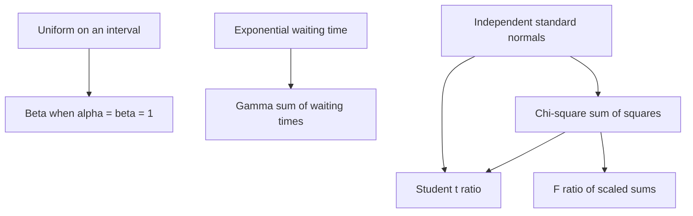

# Common Continuous Distributions

A continuous model assigns probability to intervals rather than isolated points. If $X$ has density $f$, then

$$
P(a\le X\le b)=\int_a^b f(x)\,dx,
$$

and $P(X=x)=0$ for every fixed $x$. The density itself may exceed $1$; only its integral over the support must equal $1$. A Uniform$(0,1/4)$ density, for example, has height $4$ and total area $4(1/4)=1$.

The families below recur because each encodes a particular mechanism: no preferred point in a bounded interval, waiting under a constant event rate, accumulation of many small effects, or a ratio built from normal samples. Choosing among them is easier when the mechanism is stated before the formula.

## A compact map of the families

The parameterization used here is Gamma shape--rate. Thus Gamma$(\alpha,\lambda)$ has rate $\lambda$ and scale $1/\lambda$. Software often asks for the scale instead, so the distinction belongs next to every calculation.

| Distribution | Support | Density or construction | Mean | Variance |
|---|---:|---|---:|---:|
| Uniform$(a,b)$ | $[a,b]$ | $1/(b-a)$ | $(a+b)/2$ | $(b-a)^2/12$ |
| Exponential$(\lambda)$ | $[0,\infty)$ | $\lambda e^{-\lambda x}$ | $1/\lambda$ | $1/\lambda^2$ |
| Normal$(\mu,\sigma^2)$ | $\mathbb R$ | $\frac{1}{\sigma\sqrt{2\pi}}e^{-(x-\mu)^2/(2\sigma^2)}$ | $\mu$ | $\sigma^2$ |
| Gamma$(\alpha,\lambda)$ | $(0,\infty)$ | $\frac{\lambda^\alpha}{\Gamma(\alpha)}x^{\alpha-1}e^{-\lambda x}$ | $\alpha/\lambda$ | $\alpha/\lambda^2$ |
| Beta$(\alpha,\beta)$ | $(0,1)$ | $\frac{x^{\alpha-1}(1-x)^{\beta-1}}{B(\alpha,\beta)}$ | $\alpha/(\alpha+\beta)$ | $\frac{\alpha\beta}{(\alpha+\beta)^2(\alpha+\beta+1)}$ |
| Chi-square$(\nu)$ | $[0,\infty)$ | Gamma$(\nu/2,1/2)$ | $\nu$ | $2\nu$ |
| Student $t_\nu$ | $\mathbb R$ | $Z/\sqrt{U/\nu}$ | $0$ for $\nu\gt 1$ | $\nu/(\nu-2)$ for $\nu\gt 2$ |
| $F_{d_1,d_2}$ | $[0,\infty)$ | $(U_1/d_1)/(U_2/d_2)$ | $d_2/(d_2-2)$ for $d_2\gt 2$ | finite only for $d_2\gt 4$ |

In the last two constructions, $Z\sim N(0,1)$, $U\sim\chi^2_\nu$, $U_1\sim\chi^2_{d_1}$, and $U_2\sim\chi^2_{d_2}$ are independent. The $t$ mean does not exist for $\nu\le1$; its variance is infinite for $1\lt \nu\le2$ and undefined when the mean is undefined. For the $F$ family,

$$
\operatorname{Var}(F)=
\frac{2d_2^2(d_1+d_2-2)}{d_1(d_2-2)^2(d_2-4)},
\qquad d_2>4.
$$

The following relations are more useful than memorizing eight unrelated formulas.



## Uniform and exponential: two different notions of “no preference”

Uniform$(a,b)$ says that equal-length subintervals have equal probability. Its CDF is linear on the support:

$$
F(x)=
\begin{cases}
0,&x<a,\\
\dfrac{x-a}{b-a},&a\le x\le b,\\
1,&x>b.
\end{cases}
$$

The mean follows from direct integration:

$$
E[X]=\frac{1}{b-a}\int_a^b x\,dx
=\frac{b^2-a^2}{2(b-a)}
=\frac{a+b}{2}.
$$

For the variance, shift to the midpoint $m=(a+b)/2$ and let the half-width be $h=(b-a)/2$. Symmetry gives $E[X]=m$, so

$$
\operatorname{Var}(X)
=\frac{1}{2h}\int_{-h}^{h}u^2\,du
=\frac{h^2}{3}
=\frac{(b-a)^2}{12}.
$$

Uniformity is appropriate for a randomized location or phase when the model genuinely supplies no preferred region. It is usually a poor model for measurement error: errors near zero tend to be more common than errors near a hard boundary.

Exponential$(\lambda)$ expresses a different symmetry. The remaining waiting time has the same distribution regardless of how long one has already waited. Its survival function is

$$
S(x)=P(X>x)=\int_x^\infty \lambda e^{-\lambda t}\,dt=e^{-\lambda x}.
$$

Consequently,

$$
P(X>s+t\mid X>s)
=\frac{e^{-\lambda(s+t)}}{e^{-\lambda s}}
=e^{-\lambda t}
=P(X>t).
$$

This memoryless property is equivalent, under mild regularity, to an exponential lifetime. Its hazard rate,

$$
h(x)=\frac{f(x)}{S(x)}=\lambda,
$$

is constant. A component whose failure risk rises with age should not be modeled this way merely because its lifetime is positive and right-skewed.

The exponential moments can be obtained from the gamma integral or integration by parts. With $u=\lambda x$,

$$
E[X^k]
=\int_0^\infty x^k\lambda e^{-\lambda x}\,dx
=\frac{1}{\lambda^k}\int_0^\infty u^k e^{-u}\,du
=\frac{k!}{\lambda^k}.
$$

Thus $E[X]=1/\lambda$, $E[X^2]=2/\lambda^2$, and $\operatorname{Var}(X)=1/\lambda^2$.

## Normal distributions and standardization

The normal density is

$$
f(x)=\frac{1}{\sigma\sqrt{2\pi}}
\exp\left[-\frac{(x-\mu)^2}{2\sigma^2}\right].
$$

Its normalizing constant comes from the Gaussian integral. If

$$
I=\int_{-\infty}^{\infty}e^{-x^2/2}\,dx,
$$

then, using polar coordinates on $I^2$,

$$
\begin{aligned}
I^2
&=\int_{\mathbb R^2}e^{-(x^2+y^2)/2}\,dx\,dy\\
&=\int_0^{2\pi}\int_0^\infty e^{-r^2/2}r\,dr\,d\theta\\
&=2\pi.
\end{aligned}
$$

Hence $I=\sqrt{2\pi}$. Symmetry gives $E[Z]=0$ for $Z\sim N(0,1)$, and integration by parts gives $E[Z^2]=1$. Any $X\sim N(\mu,\sigma^2)$ can be written as $X=\mu+\sigma Z$. Therefore

$$
P(a\le X\le b)
=\Phi\left(\frac{b-\mu}{\sigma}\right)
-\Phi\left(\frac{a-\mu}{\sigma}\right).
$$

Normal models fit additive noise and sums well, especially when no one contribution dominates. They have symmetric, fairly light tails. A bell-shaped center does not establish normality; tail probabilities and support can matter more than the center. If negative values are impossible and the mean is close to zero relative to the standard deviation, a normal approximation may allocate material probability outside the possible range.

## Gamma and beta: flexible positive and bounded shapes

The gamma function extends factorials:

$$
\Gamma(\alpha)=\int_0^\infty u^{\alpha-1}e^{-u}\,du,
\qquad \Gamma(\alpha+1)=\alpha\Gamma(\alpha).
$$

Substituting $u=\lambda x$ shows that the Gamma density integrates to $1$. Its raw moments are

$$
\begin{aligned}
E[X^k]
&=\frac{\lambda^\alpha}{\Gamma(\alpha)}
\int_0^\infty x^{\alpha+k-1}e^{-\lambda x}\,dx\\
&=\frac{\Gamma(\alpha+k)}{\Gamma(\alpha)\lambda^k}.
\end{aligned}
$$

Taking $k=1,2$ yields $E[X]=\alpha/\lambda$ and $\operatorname{Var}(X)=\alpha/\lambda^2$. When $\alpha=n$ is a positive integer, Gamma$(n,\lambda)$ is the waiting time to the $n$th event in a Poisson process. It is the sum of $n$ independent Exponential$(\lambda)$ waiting times. Non-integer shapes retain the useful positive, right-skewed family without requiring that literal event-count interpretation.

Beta$(\alpha,\beta)$ is bounded between $0$ and $1$. Its normalizing constant is the beta function

$$
B(\alpha,\beta)
=\int_0^1x^{\alpha-1}(1-x)^{\beta-1}\,dx
=\frac{\Gamma(\alpha)\Gamma(\beta)}{\Gamma(\alpha+\beta)}.
$$

The first moment is a ratio of beta functions:

$$
E[X]
=\frac{B(\alpha+1,\beta)}{B(\alpha,\beta)}
=\frac{\alpha}{\alpha+\beta}.
$$

Likewise $E[X^2]=\alpha(\alpha+1)/[(\alpha+\beta)(\alpha+\beta+1)]$, from which the variance in the table follows. Shape changes substantially with the parameters: both below $1$ gives a U-shape; both equal to $1$ gives the uniform density; both above $1$ gives an interior peak. If only $\alpha\lt 1$, density rises toward $0$; if only $\beta\lt 1$, it rises toward $1$. Endpoint singularities are allowed because an infinite density at one point can still have finite area.

## Why chi-square, Student t, and F travel together

If $Z_1,\ldots,Z_\nu$ are independent standard normals, then

$$
U=\sum_{i=1}^{\nu}Z_i^2\sim\chi^2_\nu.
$$

The sum rule can be proved with moment-generating functions: $M_{Z^2}(t)=(1-2t)^{-1/2}$, so independence gives $M_U(t)=(1-2t)^{-\nu/2}$, the MGF of Gamma$(\nu/2,1/2)$. Squaring removes signs, so the distribution is positive and right-skewed; increasing $\nu$ makes it more nearly symmetric.

For a normal sample, the standardized sample mean would be normal if the population standard deviation were known. Replacing it with the random sample standard deviation introduces the independent factor $\sqrt{U/\nu}$, producing

$$
T=\frac{Z}{\sqrt{U/\nu}}\sim t_\nu.
$$

The denominator can occasionally be small, so $t$ has heavier tails than a standard normal. As $\nu\to\infty$, $U/\nu$ concentrates near $1$ and $t_\nu$ approaches $N(0,1)$.

Comparing two independent variance estimates leads to a ratio of scaled chi-square variables:

$$
F=\frac{U_1/d_1}{U_2/d_2}\sim F_{d_1,d_2}.
$$

The order of the degrees of freedom matters. Taking reciprocals swaps them: if $F\sim F_{d_1,d_2}$, then $1/F\sim F_{d_2,d_1}$.

## Choosing a family from the generating mechanism

Support narrows the list, but it rarely settles the choice. Positive measurements can be exponential, gamma, lognormal, Weibull, or something with a much heavier tail. The mechanism and the behavior near zero provide additional information.

| Question about the data-generating process | Feature it tests | Families suggested here |
|---|---|---|
| Is every subinterval of equal length meant to be equally likely? | flat density on a bounded range | uniform |
| Does the remaining wait ignore elapsed time? | constant hazard and memorylessness | exponential |
| Is the total a sum of positive waiting stages? | additive positive components | gamma |
| Is the measurement an additive combination of many small signed effects? | symmetry and light tails | normal |
| Is the variable a proportion with genuine bounds at zero and one? | bounded support and flexible endpoint behavior | beta |
| Is the quantity built from squared normal deviations? | quadratic normal construction | chi-square |
| Is a normal numerator divided by an estimated scale? | random denominator and heavy symmetric tails | Student $t$ |
| Is the statistic a ratio of independent variance estimates? | positive ratio of chi-square terms | $F$ |

Parameters should be interpreted through consequences that can be checked. For an exponential model, doubling the observation interval squares the survival probability because $S(2t)=S(t)^2$. For a gamma model with fixed rate, increasing shape adds waiting stages and reduces relative variation: its coefficient of variation is $1/\sqrt\alpha$. For a beta model, the sum $\alpha+\beta$ controls concentration while the ratio $\alpha/(\alpha+\beta)$ controls the mean. Those statements are more diagnostic than the symbols alone.

Tail behavior matters when the target is a rare event. Normal tails decay like an exponential of a square, while Student $t$ tails decay polynomially. A fitted normal and a fitted low-degree $t$ distribution may look similar through the center yet assign very different probabilities to extremes. Mean and variance matching cannot resolve that difference.

### Location, scale, and shape are different roles

A location parameter shifts all quantiles by the same amount. A scale parameter multiplies all distances from the origin or location by a positive constant. Shape parameters alter skewness, tail weight, or endpoint behavior in ways that cannot be removed by changing units.

If $X$ has density $f$ and $Y=a+bX$ with $b\gt 0$, then

$$
f_Y(y)=\frac1b f\left(\frac{y-a}{b}\right).
$$

The factor $1/b$ keeps the area equal to one. The normal family uses explicit location $\mu$ and scale $\sigma$. The exponential rate is an inverse scale: multiplying a waiting time by $c$ divides its rate by $c$. In the gamma family, rate and shape play distinct roles, so changing measurement units alters $\lambda$ but leaves $\alpha$ unchanged.

### Quantiles under transformation

For an increasing location-scale transformation $Y=a+bX$, quantiles obey

$$
q_p(Y)=a+bq_p(X).
$$

For an exponential variable, solve $1-e^{-\lambda q_p}=p$ to obtain

$$
q_p=-\frac{\log(1-p)}{\lambda}.
$$

The median is therefore $\log 2/\lambda$, smaller than the mean $1/\lambda$ because the distribution is right-skewed. Reporting a mean as though half the observations lie on either side would be wrong here.

### Closure properties worth remembering

Independent normal variables remain normal under linear combinations. Independent gamma variables with the same rate have additive shapes: if $X\sim\operatorname{Gamma}(\alpha,\lambda)$ and $Y\sim\operatorname{Gamma}(\beta,\lambda)$, then

$$
X+Y\sim\operatorname{Gamma}(\alpha+\beta,\lambda).
$$

The shared rate is essential. Different rates do not generally produce another gamma variable. Chi-square addition is the special case with common rate $1/2$.

Beta and gamma variables are linked by normalization. If independent variables $G_1\sim\operatorname{Gamma}(\alpha,\lambda)$ and $G_2\sim\operatorname{Gamma}(\beta,\lambda)$ share a rate, then

$$
\frac{G_1}{G_1+G_2}\sim\operatorname{Beta}(\alpha,\beta).
$$

The total $G_1+G_2$ and the fraction are independent. This construction explains why beta distributions naturally describe how a positive total is split between two components.

### Truncation and censoring change the observed law

A variable is **truncated** when observations outside a permitted range are absent from the population being modeled. If $X$ has density $f$ and only values in $a\lt X\lt b$ are retained, the conditional density is

$$
f_{X\mid a<X<b}(x)=
\frac{f(x)}{F(b)-F(a)},
\qquad a<x<b.
$$

The denominator renormalizes the remaining area. Fitting the original untruncated family to retained values generally biases its location and spread.

Censoring is different: an observation beyond a threshold is present but reported only as “at least” or “at most” that threshold. A device that stops recording after $100$ hours produces right-censored lifetimes, not lifetimes truncated at $100$. The likelihood contribution of a right-censored value uses the survival probability $S(100)$ rather than a density value at $100$.

Mixtures also fall outside a single named-family description. If a population combines two normal subpopulations with different means, the aggregate density may be skewed or bimodal even though each component is normal. Mean and variance formulas still apply through conditioning, but a single fitted normal can conceal the group structure.

Named families are approximations, not labels discovered directly in data. A positive right-skewed histogram does not distinguish exponential from gamma, lognormal, or Weibull behavior. An exponential model imposes the strongest claim among these: constant hazard and a standard deviation equal to the mean. A gamma model relaxes the shape while retaining an additive waiting-stage interpretation.

The fitted range matters too. Truncating observations below a detection limit can make a density look less skewed; mixing several rates can make an exponential process appear overdispersed. Model comparison should therefore use the observation process and the target functional. A family adequate for estimating a central quantile may still be poor for extrapolating a very rare tail.

Parameter estimates do not repair support errors. If a proportion can equal exactly zero because no events were observed, a purely continuous beta density on $(0,1)$ cannot represent that atom without a mixture. If a measurement has a physical upper bound, a gamma or normal tail beyond it may be harmless for central calculations or unacceptable for safety probabilities, depending on how much mass reaches the impossible region.

## Worked calculations

### Reliability under a constant hazard

A component lifetime is exponential with mean $200$ hours. Since $E[X]=1/\lambda$,

$$
\lambda=\frac{1}{200}=0.005\text{ per hour}.
$$

The chance of lasting at least $300$ hours is

$$
P(X\ge300)=e^{-0.005(300)}=e^{-1.5}\approx0.2231.
$$

Given survival to $300$ hours, the chance of lasting another $100$ is

$$
\begin{aligned}
P(X>400\mid X>300)
&=\frac{P(X>400)}{P(X>300)}\\
&=\frac{e^{-0.005(400)}}{e^{-0.005(300)}}\\
&=e^{-0.5}\\
&\approx0.6065.
\end{aligned}
$$

The same $0.6065$ would apply to a new component surviving its first $100$ hours. That conclusion depends entirely on the constant-hazard assumption.

### A normal interval and its complement

Suppose exam scores follow $X\sim N(70,8^2)$. To find the proportion between $62$ and $84$, standardize both endpoints:

$$
z_1=\frac{62-70}{8}=-1,
\qquad
z_2=\frac{84-70}{8}=1.75.
$$

Then

$$
\begin{aligned}
P(62\le X\le84)
&=P(-1\le Z\le1.75)\\
&=\Phi(1.75)-\Phi(-1)\\
&\approx0.9599-0.1587\\
&=0.8012.
\end{aligned}
$$

The probability outside the interval is $1-0.8012=0.1988$. It is not split equally: the lower tail is $0.1587$, while the upper tail is $1-0.9599=0.0401$.

### Recovering beta parameters from a mean and concentration

Let a random proportion have a Beta distribution with mean $0.30$, and suppose $\alpha+\beta=20$. Since

$$
\frac{\alpha}{\alpha+\beta}=0.30,
$$

we obtain $\alpha=0.30(20)=6$ and $\beta=14$. Its variance is

$$
\operatorname{Var}(X)
=\frac{6\cdot14}{20^2\cdot21}
=\frac{84}{8400}
=0.01.
$$

The standard deviation is $0.1$. Holding the mean fixed while increasing $\alpha+\beta$ would reduce the variance and concentrate the density more tightly around $0.30$.

## Numerical checks and parameter conventions

```python
from scipy.stats import beta, expon, norm

# SciPy uses scale, the reciprocal of the exponential rate.
rate = 1 / 200
p_survive_300 = expon.sf(300, scale=1 / rate)
p_next_100 = expon.sf(100, scale=1 / rate)

p_scores = norm.cdf(84, loc=70, scale=8) - norm.cdf(62, loc=70, scale=8)

alpha, beta_param = 6, 14
beta_mean = beta.mean(alpha, beta_param)
beta_variance = beta.var(alpha, beta_param)

print(p_survive_300, p_next_100)
print(p_scores)
print(beta_mean, beta_variance)
```

Use survival functions such as `sf` for far-right-tail probabilities. Computing `1 - cdf(x)` can lose precision when the CDF is extremely close to $1$. For gamma and exponential calls, check whether an API uses rate or scale. For a normal call, the second spread parameter is usually the standard deviation, not the variance.

## Model checks that prevent common errors

- A density value is not a probability. Probability comes from integrating over an interval, and changing measurement units changes density heights.
- Support is part of the model. Normal distributions allow every real value; beta variables stay between $0$ and $1$; gamma and exponential variables are positive.
- Exponential memorylessness should follow from a plausible constant event rate, not merely from a histogram that slopes downward.
- The $t$, chi-square, and $F$ laws arise from specific independence and normal-sample constructions. Their familiar inferential formulas can fail when those assumptions fail.
- Means and variances do not always exist. Low-degree $t$ and $F$ distributions are standard examples, so a software-reported location should not be mistaken for a finite expectation.
- For a skewed distribution, a symmetric mean-plus-or-minus-standard-deviation interval can extend beyond the support or represent unequal tail areas. Quantiles usually communicate the uncertainty more faithfully.

## Related pages

- [random variables and distributions](/math/probability/random-variables-distributions)
- [expectation, variance, and moments](/math/probability/expectation-variance-moments)
- [transformations of random variables](/math/probability/transformations-random-variables)
- [limit theorems](/math/probability/limit-theorems)
- [normal, t, chi-square, and F distributions](/math/statistics/normal-t-chi-square-and-f-distributions)
- [sampling distributions and CLT](/math/statistics/sampling-distributions-and-clt)
