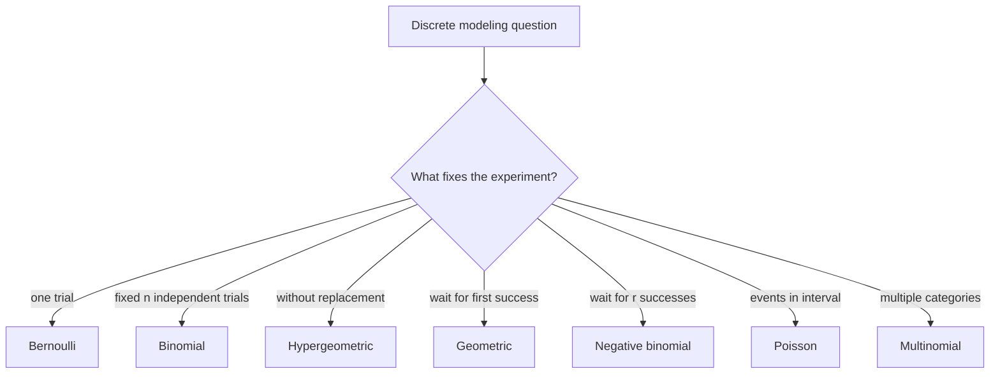

# Common Discrete Distributions

Discrete distributions model counts, categories, and waiting times measured in whole trials. They appear when the outcome is a finite choice, a number of successes, a number of failures before success, or a count in a fixed region.

The main work is matching the story to its assumptions: fixed trials or a random stopping time, independent sampling or depletion of a finite population, a per-trial probability or a rate per unit exposure. Two formulas can look similar while answering different questions.

## The basic counting models

A **Bernoulli** random variable records one success/failure trial:

$$
X\sim \operatorname{Bernoulli}(p),\quad P(X=1)=p,\quad P(X=0)=1-p.
$$

A **Binomial** random variable counts successes in $n$ independent Bernoulli trials with common success probability $p$:

$$
X\sim \operatorname{Binomial}(n,p),
$$

$$
P(X=k)=\binom{n}{k}p^k(1-p)^{n-k},\quad k=0,1,\ldots,n.
$$

A **Geometric** random variable counts the trial number of the first success:

$$
X\sim \operatorname{Geometric}(p),
$$

$$
P(X=k)=(1-p)^{k-1}p,\quad k=1,2,\ldots.
$$

Some books define geometric as the number of failures before the first success, with support $0,1,2,\ldots$. Always check the convention.

A **Negative binomial** random variable counts the trial number of the $r$-th success:

$$
P(X=k)=\binom{k-1}{r-1}p^r(1-p)^{k-r},\quad k=r,r+1,\ldots.
$$

A **Poisson** random variable counts events occurring in a fixed interval when events happen independently at average rate $\lambda$:

$$
X\sim \operatorname{Poisson}(\lambda),
$$

$$
P(X=k)=e^{-\lambda}\frac{\lambda^k}{k!},\quad k=0,1,2,\ldots.
$$

A **Hypergeometric** random variable counts successes in $n$ draws without replacement from a population of size $N$ containing $K$ successes:

$$
P(X=k)=\frac{\binom{K}{k}\binom{N-K}{n-k}}{\binom{N}{n}}.
$$

A **Multinomial** random vector counts outcomes in $m$ categories across $n$ independent trials:

$$
P(X_1=x_1,\ldots,X_m=x_m)
=\frac{n!}{x_1!\cdots x_m!}p_1^{x_1}\cdots p_m^{x_m},
$$

where $\sum_i x_i=n$ and $\sum_i p_i=1$.

The negative-binomial convention above counts the trial on which the $r$th success occurs. If $Y=X-r$, then $Y$ counts failures before that success and

$$
P(Y=y)=\binom{y+r-1}{r-1}p^r(1-p)^y,
\qquad y=0,1,\ldots.
$$

Both conventions describe the same experiment, shifted by $r$. A formula, software call, or reported mean should always be checked against its support.

## Means, variances, and what produces them

| Distribution | Support | Mean | Variance | Typical use |
|---|---:|---:|---:|---|
| Bernoulli$(p)$ | $0,1$ | $p$ | $p(1-p)$ | one yes/no trial |
| Binomial$(n,p)$ | $0,\ldots,n$ | $np$ | $np(1-p)$ | successes in fixed independent trials |
| Geometric$(p)$ | $1,2,\ldots$ | $1/p$ | $(1-p)/p^2$ | waiting time to first success |
| NegBin$(r,p)$ | $r,r+1,\ldots$ | $r/p$ | $r(1-p)/p^2$ | waiting time to $r$ successes |
| Poisson$(\lambda)$ | $0,1,\ldots$ | $\lambda$ | $\lambda$ | counts at a rate |
| Hypergeometric$(N,K,n)$ | valid counts | $nK/N$ | $n(K/N)(1-K/N)\frac{N-n}{N-1}$ | without-replacement sampling |

### Bernoulli indicators turn counting into algebra

If $I_i$ equals $1$ when trial $i$ succeeds and $0$ otherwise, then $E[I_i]=p$ and

$$
\operatorname{Var}(I_i)=E[I_i^2]-E[I_i]^2=p-p^2=p(1-p),
$$

because $I_i^2=I_i$. A binomial count is the sum

$$
X=X_1+\cdots+X_n\sim \operatorname{Binomial}(n,p).
$$

Linearity of expectation gives $E[X]=np$ without requiring independence. Independence is used for the variance:

$$
\operatorname{Var}(X)
=\sum_{i=1}^n\operatorname{Var}(I_i)
=np(1-p).
$$

The probability mass function has a separate counting argument. To obtain exactly $k$ successes, choose their $k$ positions in $\binom nk$ ways. Every such sequence has probability $p^k(1-p)^{n-k}$, so multiplying gives the binomial formula.

The same indicator device handles hypergeometric sampling. Write $p=K/N$. Each sampled position has success probability $p$, so the mean remains $np$. The indicators are negatively correlated because taking a success leaves fewer successes for later draws. Accounting for those covariance terms produces

$$
\operatorname{Var}(X)=np(1-p)\frac{N-n}{N-1}.
$$

The last factor is the **finite-population correction**. It approaches $1$ when $n/N$ is small and reaches $0$ when the whole population is sampled; a census has no sampling uncertainty.

### Poisson as a rare-event limit

Suppose $X_n\sim\operatorname{Binomial}(n,p_n)$ with $p_n=\lambda/n$. For fixed $k$,

$$
\begin{aligned}
P(X_n=k)
&=\binom nk\left(\frac{\lambda}{n}\right)^k
\left(1-\frac{\lambda}{n}\right)^{n-k}\\
&=\frac{n(n-1)\cdots(n-k+1)}{n^k}
\frac{\lambda^k}{k!}
\left(1-\frac{\lambda}{n}\right)^n
\left(1-\frac{\lambda}{n}\right)^{-k}.
\end{aligned}
$$

As $n\to\infty$, the first and last factors tend to $1$, while the central exponential factor tends to $e^{-\lambda}$. Therefore

$$
P(X_n=k)\longrightarrow e^{-\lambda}\frac{\lambda^k}{k!}.
$$

This limit explains the approximation

$$
\operatorname{Binomial}(n,p)\approx \operatorname{Poisson}(\lambda).
$$

for rare-event counts. “Large $n$ and small $p$” is shorthand; the approximation quality depends on how probabilities are used and on the resulting $np$. It can be good for central probabilities yet poor for a very remote tail.

### Waiting-time models and memorylessness

For the trial-count version of $X\sim\operatorname{Geometric}(p)$,

$$
P(X>s+t\mid X>s)=P(X>t).
$$

Indeed, $P(X\gt m)=(1-p)^m$, so the conditional probability is $(1-p)^t$. After $s$ failures, the remaining waiting-time distribution is unchanged because independent trials retain the same success probability. Among distributions supported on the positive integers, this property characterizes the geometric law.

A negative-binomial waiting time is the sum of $r$ independent geometric waiting times, one for each successive success. Hence

$$
E[X]=\frac{r}{p},
\qquad
\operatorname{Var}(X)=\frac{r(1-p)}{p^2}.
$$

Only the geometric case $r=1$ is memoryless. Once the target is the $r$th success, knowing how many successes have already occurred changes the remaining wait.

### Multinomial counts are tied together

For category $j$, the marginal count $X_j$ is Binomial$(n,p_j)$, so

$$
E[X_j]=np_j,
\qquad
\operatorname{Var}(X_j)=np_j(1-p_j).
$$

The counts cannot be independent because $X_1+\cdots+X_m=n$. For $i\ne j$,

$$
\operatorname{Cov}(X_i,X_j)=-np_ip_j.
$$

The negative sign records competition: one trial assigned to category $i$ cannot also be assigned to category $j$.

## Choosing the model from the experiment

The assumptions behind each distribution are part of the model. A binomial distribution needs a fixed number of trials, two outcome classes, constant success probability, and independence. A Poisson distribution needs a rate interpretation and is most natural when events in disjoint intervals are approximately independent. A hypergeometric distribution deliberately violates independence because the population changes after each draw. Checking these assumptions is usually more important than recognizing the formula.

There are also parameterization traps. Negative binomial distributions may count trials until the $r$-th success or failures before the $r$-th success. Geometric distributions have the same convention issue. Software libraries differ, so read the documentation and verify the support by calculating a simple probability such as the probability of success on the first trial.

Approximation is another modeling decision. A hypergeometric distribution can be approximated by a binomial distribution when the sample is small compared with the population, because removing a few items barely changes the success probability. A binomial distribution can be approximated by a Poisson distribution when successes are rare and $np$ is moderate. These approximations are useful, but the exact distribution should remain clear.



| Model cue | Distribution to try | Red flag |
|---|---|---|
| "exactly $k$ successes in $n$ trials" | Binomial | probabilities change across trials |
| "draw $n$ from a finite population" | Hypergeometric | replacement is actually used |
| "first success occurs on trial $k$" | Geometric | trials are not independent |
| "third success occurs on trial $k$" | Negative binomial | $r$ successes not specified |
| "calls per hour" or "defects per meter" | Poisson | events cluster or inhibit one another |

A Poisson count is tied to an exposure interval. If a rate is $3$ calls per hour and the assumptions remain stable, a half-hour count has parameter $1.5$, not $3$. Counts from disjoint intervals are independent under the Poisson-process model. Superposing independent Poisson streams adds their rates: parameters $\lambda_1$ and $\lambda_2$ produce a Poisson count with parameter $\lambda_1+\lambda_2$.

Observed variance offers a rough diagnostic. Poisson data have equal theoretical mean and variance. Strongly larger variance may indicate changing rates or event clustering; smaller variance may indicate regular spacing or capacity constraints. A mismatch does not identify the replacement model by itself, but it does invalidate the simplest Poisson story.

## Support and neighboring-probability checks

A PMF should be read together with its valid integer range. For a hypergeometric variable, not every value from zero through $n$ is necessarily possible. The support is

$$
\max(0,n-(N-K))\le k\le\min(n,K).
$$

The lower bound says the sample may be forced to contain successes when there are not enough failures in the population. The upper bound says one cannot observe more successes than either the sample size or the population's available successes.

Ratios of neighboring probabilities help locate modes and calculate PMFs stably. For a binomial variable,

$$
\frac{P(X=k+1)}{P(X=k)}
=\frac{n-k}{k+1}\frac{p}{1-p}.
$$

Probabilities rise while this ratio exceeds one and fall after it drops below one. The mode is therefore near $(n+1)p$, with two adjacent modes when that quantity is an integer. For a Poisson variable,

$$
\frac{P(X=k+1)}{P(X=k)}=\frac{\lambda}{k+1},
$$

so its mode lies near $\lambda$. These recurrences avoid repeated factorial evaluation and give a quick check on a computed probability table.

## Poisson counts across time and categories

The rate parameter scales with exposure. If $N(t)$ is a homogeneous Poisson-process count with rate $r$ per unit time, then

$$
N(t)\sim\operatorname{Poisson}(rt).
$$

Independent increments mean that counts on disjoint time intervals are independent. Consequently, adding adjacent intervals adds their Poisson parameters. This property matches the physical idea that an event count over two hours is the sum of the separate hourly counts.

Random classification preserves the family. Suppose $N\sim\operatorname{Poisson}(\lambda)$ events occur and each event is independently labeled type A with probability $q$. Then the type-A count is Poisson$(\lambda q)$, the remaining count is Poisson$(\lambda(1-q))$, and the two counts are independent. Conditional on the total $N=n$, however, the type-A count is Binomial$(n,q)$. Conditioning fixes the shared total and changes the dependence structure.

## Approximation is directional

The binomial-to-Poisson limit keeps $np=\lambda$ fixed while $n$ grows and $p$ shrinks. A Poisson distribution has no upper bound, whereas a binomial count cannot exceed $n$, so the approximation is unsuitable near that hard boundary. The normal approximation covers a different regime: both $np$ and $n(1-p)$ should be large enough that the binomial is not strongly skewed. A continuity correction then aligns integer probability bars with continuous area.

For hypergeometric sampling, a binomial approximation improves as the sampling fraction $n/N$ becomes small. The finite-population correction quantifies what is being discarded. Approximating without replacement by independent trials inflates variance by omitting the factor $(N-n)/(N-1)$.

## Extra zeros and extra variation

Real count data often contain more zeros than a Poisson model predicts. One explanation is a mixture: some units are structurally unable to produce events, while the remaining units follow a count distribution. A zero-inflated model then has a point-mass mechanism in addition to ordinary sampling zeros. Simply lowering $\lambda$ to match the zero fraction also lowers the mean for every unit and may distort positive counts.

Rate heterogeneity produces overdispersion. If different intervals have different unobserved Poisson rates, the marginal count variance includes both the average conditional variance and the variance of those rates. A negative-binomial count distribution can arise from a gamma mixture of Poisson rates, but its parameterization differs from the negative-binomial waiting-time convention introduced earlier. The support and stated story identify which use is intended.

Underdispersion also occurs. Appointment schedules, minimum-spacing rules, and fixed capacity can make events more regular than a Poisson process. Equality of mean and variance is a consequence of the Poisson law, not a generic fact about counts.

## Worked calculations

### Binomial and Poisson approximation

**Problem.** A manufacturing process produces a defective part with probability $0.01$, independently from part to part. In a batch of $200$ parts, find the probability of exactly $3$ defective parts using the binomial model, then approximate it with a Poisson distribution.

**Method.**

1. Let $X$ be the number of defective parts. A fixed number of independent parts is inspected, each with the same defect probability. Thus

$$
X\sim \operatorname{Binomial}(200,0.01).
$$

2. The exact probability is

$$
P(X=3)=\binom{200}{3}(0.01)^3(0.99)^{197}.
$$

3. Compute the combination:

$$
\binom{200}{3}=\frac{200\cdot199\cdot198}{3\cdot2\cdot1}=1313400.
$$

4. Substitute:

$$
P(X=3)=1313400(0.000001)(0.99)^{197}.
$$

   Since $(0.99)^{197}\approx 0.1380$,

$$
P(X=3)\approx 1313400(0.000001)(0.1380)=0.1812.
$$

5. For the Poisson approximation, use $\lambda=np=200(0.01)=2$:

$$
P(Y=3)=e^{-2}\frac{2^3}{3!}
=e^{-2}\frac{8}{6}
\approx 0.1804.
$$

The exact binomial probability is about $0.1812$, and the Poisson approximation is about $0.1804$. Their absolute difference is about $0.0008$.

### Hypergeometric sampling

**Problem.** A lot contains $30$ components, of which $6$ are faulty. An inspector samples $5$ components without replacement. What is the probability that exactly $2$ sampled components are faulty?

**Method.**

1. The sample is without replacement from a finite population, so use a hypergeometric model:

$$
N=30,\quad K=6,\quad n=5,\quad k=2.
$$

2. Count favorable samples:

   - choose $2$ faulty components from $6$;
   - choose $3$ good components from $24$.

   The favorable count is

$$
\binom{6}{2}\binom{24}{3}.
$$

3. Count all possible samples:

$$
\binom{30}{5}.
$$

4. Form the probability:

$$
P(X=2)=\frac{\binom{6}{2}\binom{24}{3}}{\binom{30}{5}}.
$$

5. Compute:

$$
\binom{6}{2}=15,\quad \binom{24}{3}=2024,\quad \binom{30}{5}=142506.
$$

   Therefore

$$
P(X=2)=\frac{15\cdot 2024}{142506}
=\frac{30360}{142506}
\approx 0.2130.
$$

6. Check reasonableness. The expected number is

$$
n\frac{K}{N}=5\cdot\frac{6}{30}=1.
$$

   Exactly $2$ faulty components is above the mean but not extreme.

The probability is approximately $0.2130$.

### Waiting for the fourth success

Suppose independent attempts succeed with probability $p=0.30$. Find the probability that the fourth success occurs on attempt $9$.

If the fourth success occurs on attempt $9$, then the first eight attempts contain exactly three successes and the ninth succeeds. There are $\binom83$ possible placements for those first three successes. Thus

$$
\begin{aligned}
P(X=9)
&=\binom{8}{3}(0.30)^3(0.70)^5(0.30)\\
&=56(0.30)^4(0.70)^5\\
&\approx56(0.0081)(0.16807)\\
&\approx0.07624.
\end{aligned}
$$

Under the failures-before-success convention, the same event is $Y=5$: five failures occur before the fourth success. Substituting $y=5$ into that PMF gives the same $0.07624$. The expected trial number is

$$
E[X]=\frac{4}{0.30}\approx13.33,
$$

so trial $9$ is earlier than the mean but quite plausible.

## Checking calculations in software

```python
from math import comb, exp, factorial
from scipy.stats import binom, poisson, hypergeom, nbinom, geom

# Example 1: binomial and Poisson approximation.
n, p, k = 200, 0.01, 3
exact = binom.pmf(k, n, p)
approx = poisson.pmf(k, n * p)
print("binomial exact:", exact)
print("poisson approximation:", approx)

# Example 2: hypergeometric.
N, K, draws, observed = 30, 6, 5, 2
manual = comb(K, observed) * comb(N - K, draws - observed) / comb(N, draws)
library = hypergeom.pmf(observed, N, K, draws)
print("hypergeometric manual:", manual)
print("hypergeometric scipy:", library)

# Geometric and negative binomial conventions in scipy:
# geom counts trial number of first success; nbinom counts failures before r successes.
print("P(first success on trial 4):", geom.pmf(4, 0.25))
print("P(2 failures before 3 successes):", nbinom.pmf(2, 3, 0.25))
```

## Failure modes to check

- Binomial sampling requires a stable success probability and independent trials. Without-replacement sampling from a small population calls for the hypergeometric law.
- Geometric and negative-binomial formulas come in trial-count and failure-count forms. Check the smallest possible value before using a library routine.
- Poisson mean and variance both equal $\lambda$. Data with persistent overdispersion do not fit that one-parameter variance structure.
- Multinomial category counts sum to $n$, so treating them as independent loses their negative covariance.
- A per-trial probability such as $0.01$ is unitless and bounded by $1$; a rate such as two events per meter changes with the length of the interval.
- Direct factorials overflow quickly. Combination routines, log probabilities, or a distribution library are safer for large inputs, and early decimal rounding can distort a small tail.

## Related pages

- [counting principles](/math/probability/counting-principles)
- [random variables and distributions](/math/probability/random-variables-distributions)
- [expectation, variance, and moments](/math/probability/expectation-variance-moments)
- [limit theorems](/math/probability/limit-theorems)
- [normal, t, chi-square, and F distributions](/math/statistics/normal-t-chi-square-and-f-distributions)
