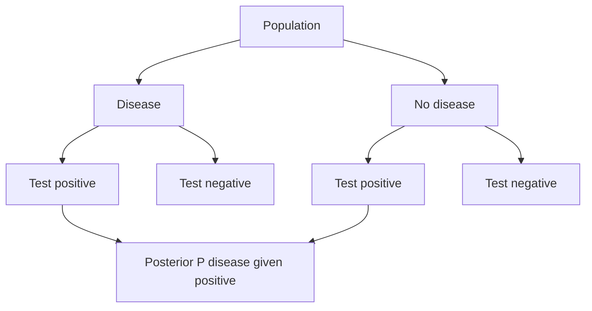

# Conditional Probability and Bayes' Theorem

Conditional probability asks how probabilities change after information restricts the possible outcomes. The restriction matters as much as the event of interest: $P(A\mid B)$ and $P(B\mid A)$ generally answer different questions, even though both use the same intersection $A\cap B$.

## Restricting the sample space

For events $A$ and $B$ with $P(B)\gt 0$, the **conditional probability** of $A$ given $B$ is

$$
P(A\mid B)=\frac{P(A\cap B)}{P(B)}.
$$

The vertical bar is read as "given." The condition $B$ becomes the new reference universe. The numerator keeps only outcomes where both $A$ and $B$ occur; the denominator normalizes by the probability of being inside $B$.

For a finite equally likely sample space, conditioning has a direct counting interpretation:

$$
P(A\mid B)=\frac{|A\cap B|}{|B|}.
$$

Outcomes outside $B$ are discarded, then the surviving outcomes are renormalized. If $P(B)=0$, this event-level definition is undefined. Conditional densities can sometimes be defined at zero-probability values, but doing so requires a more careful construction than substituting into the ratio above.

The **multiplication rule** follows by rearranging:

$$
P(A\cap B)=P(A\mid B)P(B)=P(B\mid A)P(A).
$$

Events $A$ and $B$ are **independent** if learning that one occurred does not change the probability of the other:

$$
P(A\mid B)=P(A)
$$

whenever $P(B)\gt 0$. Equivalently,

$$
P(A\cap B)=P(A)P(B).
$$

A collection $A_1,\ldots,A_n$ is **mutually independent** if every finite intersection factors into the product of its probabilities. Pairwise independence alone is weaker and does not guarantee mutual independence.

A set of events $H_1,\ldots,H_k$ is a **partition** of $\Omega$ if the events are disjoint and their union is $\Omega$. Partitions often represent competing hypotheses.

## Multiplication, case splits, and Bayes' rule

Repeated use of the multiplication rule gives the chain rule:

$$
P(A_1\cap\cdots\cap A_n)
=P(A_1)P(A_2\mid A_1)\cdots
P(A_n\mid A_1\cap\cdots\cap A_{n-1}).
$$

This form handles sequential sampling even when the draws are dependent. If the events are mutually independent, all conditional factors reduce to marginal probabilities.

**Law of total probability.** If $H_1,\ldots,H_k$ partition $\Omega$ and $P(H_i)\gt 0$, then

$$
P(A)=\sum_{i=1}^k P(A\mid H_i)P(H_i).
$$

This says that the probability of evidence $A$ can be computed by splitting the world into cases $H_i$.

To derive it, decompose $A$ into disjoint pieces:

$$
A=(A\cap H_1)\cup\cdots\cup(A\cap H_k).
$$

Additivity and the multiplication rule then give

$$
P(A)=\sum_iP(A\cap H_i)
=\sum_iP(A\mid H_i)P(H_i).
$$

**Bayes' theorem.** For a partition $H_1,\ldots,H_k$,

$$
P(H_j\mid A)=\frac{P(A\mid H_j)P(H_j)}{\sum_{i=1}^k P(A\mid H_i)P(H_i)}.
$$

Bayes' theorem is the conditional-probability definition with the denominator expanded by a partition. The numerator is the joint probability of hypothesis and evidence. The denominator is the probability of obtaining that evidence under every competing hypothesis.

For two events $A$ and $B$,

$$
P(A\mid B)=\frac{P(B\mid A)P(A)}{P(B\mid A)P(A)+P(B\mid A^c)P(A^c)}.
$$

The terms have standard interpretations:

| Term | Bayesian name | Diagnostic-test name |
|---|---|---|
| $P(H)$ | prior probability | base rate |
| $P(E\mid H)$ | likelihood | sensitivity if $E$ is a positive test |
| $P(E)$ | evidence probability | positive-test rate |
| $P(H\mid E)$ | posterior probability | positive predictive value |

## Independence has several levels

If $A$ and $B$ are independent, then $A$ and $B^c$ are independent, $A^c$ and $B$ are independent, and $A^c$ and $B^c$ are independent. For example,

$$
\begin{aligned}
P(A\cap B^c)
&=P(A)-P(A\cap B)\\
&=P(A)-P(A)P(B)\\
&=P(A)(1-P(B))\\
&=P(A)P(B^c).
\end{aligned}
$$

Pairwise independence does not imply mutual independence. Toss two fair coins and define $A$ as “the first coin is heads,” $B$ as “the second coin is heads,” and $C$ as “the coins match.” Each event has probability $1/2$, and every pair has intersection probability $1/4$, so the three are pairwise independent. Yet

$$
P(A\cap B\cap C)=P(HH)=\frac14
\ne\frac18=P(A)P(B)P(C).
$$

Conditional independence is another concept. Events $A$ and $B$ are conditionally independent given $C$ when

$$
P(A\cap B\mid C)=P(A\mid C)P(B\mid C).
$$

Unconditional independence need not survive conditioning. In the coin example, $A$ and $B$ are independent, but given $C$ they are perfectly linked: learning that the first coin is heads tells us the second is heads. The reverse can occur when a shared cause creates marginal association but conditioning on that cause separates the events.

## Odds and repeated evidence

Bayes' theorem can also be written in odds form. If $H$ is a hypothesis and $E$ is evidence, then

$$
\frac{P(H\mid E)}{P(H^c\mid E)}
=\frac{P(H)}{P(H^c)}
\cdot
\frac{P(E\mid H)}{P(E\mid H^c)}.
$$

The first factor is the prior odds and the second factor is the likelihood ratio. This form is useful because it shows exactly how evidence changes belief: evidence multiplies prior odds by a factor. A likelihood ratio greater than $1$ supports $H$ over $H^c$; a likelihood ratio less than $1$ supports $H^c$ over $H$.

Odds are $p/(1-p)$ rather than $p$. To return from odds $o$ to probability, use $p=o/(1+o)$. If observations $E_1,\ldots,E_n$ are conditionally independent given both $H$ and $H^c$, their likelihood ratios multiply:

$$
\frac{P(H\mid E_1,\ldots,E_n)}{P(H^c\mid E_1,\ldots,E_n)}
=\frac{P(H)}{P(H^c)}
\prod_{i=1}^n
\frac{P(E_i\mid H)}{P(E_i\mid H^c)}.
$$

The conditional-independence requirement cannot be skipped. Repeating the same laboratory measurement on the same contaminated sample, for example, may produce correlated errors; multiplying likelihood ratios as if the tests were independent would overstate the evidence.

## The information protocol belongs in the event

Conditional probability also depends on the information protocol. In a medical test, a positive result is generated by a known test procedure. In a card game, seeing another player's card depends on the rules of dealing and revealing. In a search problem, the fact that a match was found may depend on how many candidates were searched. These details change the conditioning event. Before applying a formula, state the event after the vertical bar in a way that includes how the information was obtained.

Another reliable habit is to draw a probability tree before writing Bayes' theorem. The first split usually represents the hidden condition or hypothesis, and the second split represents the observed evidence. Multiplying along branches gives joint probabilities such as $P(D\cap +)$ and $P(D^c\cap +)$. Adding the branches that end in the same observation gives the denominator. This tree method is algebraically the same as Bayes' theorem, but it keeps the base rate in the calculation and reduces the chance of reversing the conditional probabilities.



| Quantity | Symbol | In a medical test |
|---|---|---|
| Sensitivity | $P(+\mid D)$ | positive if diseased |
| Specificity | $P(-\mid D^c)$ | negative if not diseased |
| False positive rate | $P(+\mid D^c)$ | positive if not diseased |
| False negative rate | $P(-\mid D)$ | negative if diseased |
| Positive predictive value | $P(D\mid +)$ | diseased if positive |

The two paths ending at a positive result form its denominator. A probability tree also prevents a unit mismatch: branch probabilities are conditional on the node they leave, while full path probabilities are products along a branch.

## Natural frequencies and calibration

Percentages become easier to audit when translated to counts in a hypothetical population. Choose a population size that clears the denominators, apply the base rate first, then apply the test rates within each branch. The posterior is a ratio among the people matching the evidence, not among the whole population.

For a binary test, positive predictive value is

$$
P(D\mid +)=
\frac{\text{true positives}}
{\text{true positives}+\text{false positives}}.
$$

Negative predictive value similarly compares true negatives with all negative results. Neither predictive value is fixed by sensitivity and specificity alone; both depend on prevalence. If prevalence changes across settings or over time, a previously reported predictive value cannot be transferred unchanged.

Calibration asks a different question from discrimination. If a forecast assigns probability $0.20$ to many events, roughly one fifth of those events should occur for a calibrated system. Bayes' theorem describes how a coherent probability changes when evidence arrives, but it does not guarantee that the prior probabilities or likelihood model were well estimated.

## Conditioning is not intervention

The expression $P(Y\mid X=x)$ describes observations among cases where $X=x$. It does not automatically describe what would happen if someone forced $X$ to equal $x$. Confounding variables can make the observational conditional distribution differ from the result of an intervention.

Selection can also reverse associations. Suppose admission depends on either a strong portfolio or a strong test score. Among admitted applicants, knowing that one credential is weak makes a strong value of the other more likely, even if the credentials were independent in the full applicant pool. Conditioning on a common effect creates dependence. The probability calculation is valid; the causal reading is the mistake.

## A likelihood is a function of the hypothesis

For observed evidence $E$, the likelihood $P(E\mid H)$ is considered as a function of $H$. It need not sum to one over hypotheses. Bayes' rule multiplies this likelihood by a prior and then normalizes:

$$
P(H_j\mid E)
=\frac{P(E\mid H_j)P(H_j)}
{\sum_iP(E\mid H_i)P(H_i)}.
$$

Comparing likelihoods while ignoring priors answers which hypothesis predicts the evidence better, not which hypothesis is more probable after observing it. The distinction becomes pronounced when one hypothesis was initially rare.

Posterior probabilities also depend on the set of alternatives placed in the denominator. A model comparing two fault types conditions on their union; adding a third plausible fault redistributes posterior mass after renormalization. Statements such as “the probability of hypothesis A” are incomplete unless the hypothesis space and evidence protocol are fixed.

Zero likelihood has a permanent effect in exact Bayes updating: a hypothesis assigning probability zero to observed evidence receives posterior zero. Assigning exact zeros therefore carries more force than assigning very small probabilities. In models with measurement error or incomplete mechanisms, an unjustified zero can rule out a hypothesis that should merely be disfavored.

## Sequential updating should reproduce one joint update

For two observations, updating first on $E_1$ and then on $E_2$ gives

$$
P(H\mid E_1,E_2)
\propto P(E_2\mid H,E_1)P(E_1\mid H)P(H).
$$

The product of the two conditional likelihoods is $P(E_1,E_2\mid H)$ by the chain rule. Sequential and batch updating therefore agree when they use the same joint model.

Replacing $P(E_2\mid H,E_1)$ by $P(E_2\mid H)$ asserts conditional independence. That may be reasonable for separate instruments with independent errors, but not for repeated readings sharing calibration drift or for symptoms generated by one underlying episode. Dependence affects the amount of new information in the second observation.

The order of coherent updating does not affect the final posterior, though it changes intermediate posteriors. If two updating orders give different final answers, the calculations have used incompatible likelihoods or priors.

The same issue appears in legal reasoning. A small probability of observing evidence under innocence, $P(E\mid I)$, is not the probability of innocence after observing evidence, $P(I\mid E)$. The latter also depends on how well guilt predicts the evidence and on prior odds over the hypotheses being compared.

## Worked calculations

### Two cards without replacement

**Problem.** Two cards are drawn from a standard $52$-card deck without replacement. Find the probability that both cards are aces. Then find the probability that the second card is an ace given that the first card is an ace.

**Method.**

1. Let $A_1$ be "first card is an ace" and $A_2$ be "second card is an ace."

2. The first draw has $4$ aces among $52$ cards:

$$
P(A_1)=\frac{4}{52}=\frac{1}{13}.
$$

3. If the first card is an ace, then $3$ aces remain among $51$ cards:

$$
P(A_2\mid A_1)=\frac{3}{51}=\frac{1}{17}.
$$

4. Apply the multiplication rule:

$$
\begin{aligned}
P(A_1\cap A_2)
&=P(A_2\mid A_1)P(A_1)\\
&=\frac{1}{17}\cdot \frac{1}{13}\\
&=\frac{1}{221}.
\end{aligned}
$$

5. Check against counting. The number of unordered two-card hands is $\binom{52}{2}=1326$. The number with two aces is $\binom{4}{2}=6$. Thus

$$
\frac{\binom{4}{2}}{\binom{52}{2}}=\frac{6}{1326}=\frac{1}{221}.
$$

$P(\text{two aces})=1/221$, and $P(A_2\mid A_1)=1/17$. The events are not independent because $P(A_2\mid A_1)\ne P(A_2)$.

### Base rates and a positive test

**Problem.** A disease affects $2\%$ of a population. A test has sensitivity $99\%$ and false positive rate $9\%$. If a person tests positive, what is the probability that the person has the disease?

**Method.**

1. Let $D$ be the event "has disease" and $+$ be the event "test positive."

2. Translate the problem:

$$
P(D)=0.02,\quad P(D^c)=0.98,
$$

$$
P(+\mid D)=0.99,\quad P(+\mid D^c)=0.09.
$$

3. Compute the total probability of a positive test:

$$
\begin{aligned}
P(+)
&=P(+\mid D)P(D)+P(+\mid D^c)P(D^c)\\
&=(0.99)(0.02)+(0.09)(0.98)\\
&=0.0198+0.0882\\
&=0.108.
\end{aligned}
$$

4. Apply Bayes' theorem:

$$
\begin{aligned}
P(D\mid +)
&=\frac{P(+\mid D)P(D)}{P(+)}\\
&=\frac{0.0198}{0.108}\\
&=0.1833\ldots.
\end{aligned}
$$

5. Check with natural frequencies. In $100000$ people, about $2000$ have the disease and $98000$ do not. True positives are $(0.99)(2000)=1980$. False positives are $(0.09)(98000)=8820$. Among positives, the diseased count is $1980$ out of $1980+8820=10800$, so

$$
\frac{1980}{10800}=0.1833\ldots.
$$

The posterior probability is about $18.3\%$, not $99\%$. Sensitivity answers a different conditional question, and the low base rate leaves many more healthy than diseased people available to generate false positives.

### Updating with two likelihood ratios

A fault occurs in $1$ out of $20$ machines, so $P(F)=0.05$. A sensor alarm is four times as likely under a fault as under normal operation:

$$
\frac{P(A\mid F)}{P(A\mid F^c)}=4.
$$

The prior odds are

$$
\frac{P(F)}{P(F^c)}=\frac{0.05}{0.95}=\frac1{19}.
$$

After one alarm, the posterior odds are

$$
\frac1{19}\cdot4=\frac4{19}.
$$

Convert back to probability:

$$
P(F\mid A)=\frac{4/19}{1+4/19}=\frac4{23}\approx0.1739.
$$

Suppose a second, conditionally independent sensor gives an alarm with likelihood ratio $3$. The updated odds become

$$
\frac1{19}\cdot4\cdot3=\frac{12}{19},
$$

and the posterior is

$$
P(F\mid A_1,A_2)=\frac{12/19}{1+12/19}
=\frac{12}{31}\approx0.3871.
$$

Both alarms favor a fault, yet the probability remains below one half because the prior odds were small.

## A small calculator for sensitivity analysis

```python
def bayes_binary(prior, sensitivity, false_positive_rate):
    p_pos = sensitivity * prior + false_positive_rate * (1 - prior)
    posterior = sensitivity * prior / p_pos
    return posterior, p_pos

posterior, positive_rate = bayes_binary(
    prior=0.02,
    sensitivity=0.99,
    false_positive_rate=0.09,
)

print(f"P(positive) = {positive_rate:.4f}")
print(f"P(disease | positive) = {posterior:.4f}")

# Compare with a less rare condition.
for prior in [0.02, 0.10, 0.50]:
    post, _ = bayes_binary(prior, 0.99, 0.09)
    print(f"prior={prior:.2f}, posterior={post:.3f}")
```

Changing the looped prior shows that predictive value belongs to the test and the tested population together. The same sensitivity and false-positive rate yield different posteriors in screening and high-risk settings.

## Errors in conditioning arguments

- $P(A\mid B)$ and $P(B\mid A)$ share a numerator but have different denominators. High sensitivity alone says little about the posterior when the base rate is low.
- Bayes' denominator includes every route by which the evidence can occur. Omitting alternatives systematically inflates the favored hypothesis.
- Independence and disjointness are nearly opposites for positive-probability events. If disjoint $A$ occurs, $B$ becomes impossible.
- Pairwise checks do not establish mutual independence; the coin construction above supplies a counterexample.
- Conditioning on a selected subgroup can create association. The data-selection rule belongs in the conditioning event before making a causal interpretation.
- “Accuracy” merges several quantities and depends on prevalence. Sensitivity, specificity, and predictive values should be reported separately.

<div className="see-also">

See also: [sample spaces, events, and axioms](/math/probability/sample-spaces-events-axioms) · [joint, marginal, and conditional distributions](/math/probability/joint-marginal-conditional-distributions) · [probability pitfalls and intuition](/math/probability/probability-pitfalls-intuition) · [discrete probability](/math/discrete/discrete-probability) · [estimation and confidence intervals](/math/statistics/estimation-and-confidence-intervals)

</div>
