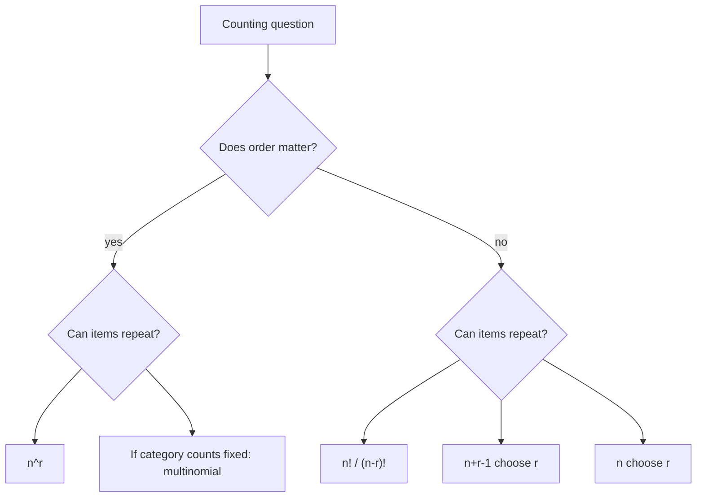

# Counting Principles

Counting is the arithmetic behind finite probability. When outcomes are equally likely, probability reduces to a ratio: favorable outcomes divided by possible outcomes. The difficulty is rarely the division; it is deciding what should be counted, whether order matters, and whether repetition is allowed.

Reliable counting starts by fixing what one outcome looks like. A five-card hand is a set; five cards dealt to labeled positions form a sequence. Either representation works if numerator and denominator use it consistently.

## Build outcomes in stages

The **multiplication principle** says that if a process has $a$ choices at one stage and $b$ choices at the next stage for each first choice, then the two-stage process has $ab$ outcomes. More generally, stages with $n_1,n_2,\ldots,n_k$ choices have

$$
n_1n_2\cdots n_k
$$

total outcomes.

A **permutation** is an ordered arrangement. If $r$ objects are selected without replacement from $n$ distinct objects, the number of ordered selections is

$$
P(n,r)=n(n-1)\cdots(n-r+1)=\frac{n!}{(n-r)!}.
$$

A **combination** is an unordered selection. If $r$ objects are selected without replacement from $n$ distinct objects, the number of unordered selections is

$$
\binom{n}{r}=\frac{n!}{r!(n-r)!}.
$$

The division by $r!$ removes order. There are $P(n,r)$ ordered lists of $r$ distinct objects, and each unordered $r$-element set appears once for each of its $r!$ orderings:

$$
\binom nr=\frac{P(n,r)}{r!}
=\frac{n!}{r!(n-r)!}.
$$

The symbol $n!$ means

$$
n!=n(n-1)(n-2)\cdots 2\cdot 1,\quad 0!=1.
$$

A **multinomial coefficient** counts the number of ways to divide $n$ labeled positions into groups of sizes $n_1,\ldots,n_k$, where $n_1+\cdots+n_k=n$:

$$
\binom{n}{n_1,n_2,\ldots,n_k}=\frac{n!}{n_1!n_2!\cdots n_k!}.
$$

A **combination with repetition** chooses $r$ items from $n$ types when repeated choices are allowed and order does not matter:

$$
\binom{n+r-1}{r}.
$$

This formula is often called **stars and bars**. Represent the chosen items by $r$ stars and separate the $n$ types with $n-1$ bars. For example, the string

```text
**| |***|*
```

represents counts $(2,0,3,1)$ across four types. Every count vector satisfying

$$
x_1+\cdots+x_n=r,
\qquad x_i\ge0,
$$

corresponds to one arrangement of $r$ stars and $n-1$ bars. Choosing the star positions gives $\binom{n+r-1}{r}$. If every type must occur at least once, set $y_i=x_i-1$ and count nonnegative solutions to $y_1+\cdots+y_n=r-n$, giving $\binom{r-1}{n-1}$ when $r\ge n$.

## Formula map and the identities behind it

| Situation | Order matters? | Repetition? | Count |
|---|---:|---:|---:|
| length $r$ strings from $n$ symbols | yes | yes | $n^r$ |
| ordered sample of $r$ from $n$ | yes | no | $\frac{n!}{(n-r)!}$ |
| unordered sample of $r$ from $n$ | no | no | $\binom{n}{r}$ |
| split $n$ positions into $k$ labeled groups | partially | no | $\frac{n!}{n_1!\cdots n_k!}$ |
| choose $r$ items from $n$ types | no | yes | $\binom{n+r-1}{r}$ |

Two identities appear constantly in probability.

**Symmetry of combinations.**

$$
\binom{n}{r}=\binom{n}{n-r}.
$$

Choosing the $r$ included objects is equivalent to choosing the $n-r$ excluded objects.

**Pascal identity.**

$$
\binom{n}{r}=\binom{n-1}{r-1}+\binom{n-1}{r}.
$$

Proof sketch: focus on a particular object, say object $n$. A size-$r$ subset either includes it, in which case choose $r-1$ more from the remaining $n-1$, or excludes it, in which case choose all $r$ from the remaining $n-1$.

**Binomial theorem.**

$$
(a+b)^n=\sum_{r=0}^n \binom{n}{r}a^r b^{n-r}.
$$

In probability, this identity explains why binomial probabilities sum to one:

$$
\sum_{r=0}^n \binom{n}{r}p^r(1-p)^{n-r}=(p+(1-p))^n=1.
$$

The coefficient $\binom nr$ also has a combinatorial derivation from the expansion. To produce $a^rb^{n-r}$ from $(a+b)^n$, choose the $r$ factors that contribute $a$; all remaining factors contribute $b$.

Summing the binomial coefficients gives another useful identity:

$$
\sum_{r=0}^n\binom nr=2^n.
$$

The right side counts all subsets of an $n$-element set by making an include-or-exclude choice for every element. The left side counts those same subsets after grouping them by size.

## Keep the sample space consistent

A useful counting workflow is to decide on a representation before calculating. If the experiment produces a sequence, count ordered sequences. If the final outcome is a set, count unordered selections. If the experiment is easier to count in ordered form but the probability question is unordered, count ordered outcomes consistently in both numerator and denominator or divide by the appropriate number of orderings. Mixing ordered and unordered counts in the same fraction is one of the most common sources of wrong answers.

Sometimes the complement is easier to count than the event itself. For example, “at least one shared birthday” is awkward to count directly because many overlap patterns are possible. Its complement, “all birthdays are different,” has a clean product:

$$
\frac{365\cdot 364\cdot 363\cdots(365-n+1)}{365^n}.
$$

Then the desired probability is one minus that value. Similar complement strategies work for "at least one success," "not all distinct," and "at least one collision" problems.

For multinomial counts, remember that the coefficient counts arrangements of category labels, not probabilities. The probability of each arrangement is supplied separately by $p_1^{x_1}\cdots p_k^{x_k}$. If all categories are equally likely, the probability part may look simple, but the arrangement count is still essential.

Counting with restrictions often benefits from building the object in stages. If a password must contain at least one digit, count all passwords and subtract those with no digits. If a committee must contain members from several groups, choose the group counts first and then choose people within each group. If two selected objects cannot be adjacent, place the unrestricted objects first and then count the available gaps. The goal is not to force every problem into one formula; it is to choose stages that avoid double counting.

## Overlapping restrictions and inclusion--exclusion

When forbidden conditions overlap, subtracting each bad set once removes their intersections too many times. For two finite sets,

$$
|A\cup B|=|A|+|B|-|A\cap B|.
$$

For three,

$$
\begin{aligned}
|A\cup B\cup C|
={}&|A|+|B|+|C|\\
&-|A\cap B|-|A\cap C|-|B\cap C|\\
&+|A\cap B\cap C|.
\end{aligned}
$$

The signs alternate. An outcome lying in exactly $m$ bad sets is first counted $m$ times, then subtracted $\binom m2$ times, and so on. Its final coefficient is

$$
\binom m1-\binom m2+\cdots+(-1)^{m+1}\binom mm=1.
$$

For arrangements where no object occupies its original position, let $A_i$ be the set where object $i$ is fixed. The number of **derangements** is

$$
!n=n!-\binom n1(n-1)!+\binom n2(n-2)!-\cdots+(-1)^n.
$$

Since $\binom nk(n-k)!=n!/k!$, the fraction of permutations that are derangements is

$$
\frac{!n}{n!}=\sum_{k=0}^n\frac{(-1)^k}{k!},
$$

which approaches $e^{-1}$ as $n$ grows.

As a final check, estimate the scale of the answer. A probability should lie between $0$ and $1$, and a count should be an integer. If a count of favorable outcomes exceeds the total sample space, the numerator and denominator are probably based on inconsistent outcome definitions.



| Probability model | Counting tool | Example |
|---|---|---|
| Binomial | combinations | exactly $k$ successes in $n$ independent trials |
| Hypergeometric | combinations | successes in draws without replacement |
| Multinomial | multinomial coefficients | category counts across repeated trials |
| Poker hands | combinations | unordered five-card hand |
| Passwords | multiplication principle | ordered strings with allowed symbols |

## Distinguishable positions, repeated labels, and symmetry

Factorials count arrangements of distinct objects in distinct linear positions. If some labels repeat, permutations that exchange identical copies do not create new arrangements. A multiset containing $n_1$ copies of one label, $n_2$ of another, and total size $n$ has

$$
\frac{n!}{n_1!n_2!\cdots n_k!}
$$

distinct strings. This is the same multinomial coefficient that counts category sequences.

Circular arrangements require another symmetry correction. Placing $n$ distinct people around an unlabeled round table gives $(n-1)!$ arrangements when rotations are considered equivalent: fix one person as an anchor, then order the remaining $n-1$. If reflections are also considered identical, a further division by two may apply for $n\gt 2$. The equivalence convention must be stated; labeled seats around a round table give $n!$, not $(n-1)!$.

Symmetry divisions are safe only when every equivalence class has the same size. Dividing by $r!$ turns ordered samples of distinct items into subsets because every subset has exactly $r!$ orderings. With constraints or repeated objects, orbit sizes can differ, and an automatic factorial division may fail.

## Counting onto assignments

Suppose $n$ labeled tasks are assigned to $m$ labeled servers and every server must receive at least one task. There are $m^n$ unrestricted assignments. Let $A_j$ be the assignments leaving server $j$ empty. Inclusion--exclusion gives

$$
\sum_{k=0}^{m}(-1)^k\binom mk(m-k)^n.
$$

For each choice of $k$ empty servers, the tasks may use any of the remaining $m-k$ servers. The alternating sum corrects assignments that leave several servers empty.

Take $n=5$ and $m=3$. The number of onto assignments is

$$
\begin{aligned}
3^5-\binom31 2^5+\binom32 1^5
&=243-3(32)+3(1)\\
&=150.
\end{aligned}
$$

The $3^5$ total assignments are equally likely if each task independently chooses one of three servers uniformly, so the probability that no server is empty is

$$
\frac{150}{243}=\frac{50}{81}.
$$

Stars and bars would be wrong for this question. It counts occupancy vectors such as $(2,2,1)$ but treats each vector once, whereas labeled-task assignments produce occupancy vectors with unequal multiplicities.

## Recurrences can be easier than closed forms

Pascal's identity supplies a dynamic program for combinations and avoids huge intermediate factorials. Many constrained counts have similar “include the last object or exclude it” recurrences. A recurrence is also a proof when its cases are disjoint and exhaustive, provided the boundary values are stated.

For probabilities, exact integer counts should usually be kept until the final division. Cancelling common factors or using rational arithmetic prevents a small tail from being distorted by several rounded intermediate values.

## Double counting as a proof method

An identity can often be proved by counting the same set of objects in two ways. Count pairs $(S,x)$ where $S$ is an $r$-element subset of an $n$-element set and $x\in S$. Choosing $S$ first gives $r\binom nr$ pairs. Choosing $x$ first and then the other $r-1$ members gives $n\binom{n-1}{r-1}$. Hence

$$
r\binom nr=n\binom{n-1}{r-1}.
$$

This method avoids factorial algebra and often exposes the probabilistic meaning of an identity. Before manipulating a complicated sum of binomial coefficients, it is useful to ask what objects its terms might classify.

## Gap arguments for nonadjacent choices

Suppose $r$ positions are chosen from a line of $n$ positions with no two adjacent. Write the selected positions as

$$
1\le x_1<x_2<\cdots<x_r\le n,
\qquad x_{i+1}\ge x_i+2.
$$

Remove the forced gaps by setting $y_i=x_i-(i-1)$. Then

$$
1\le y_1<y_2<\cdots<y_r\le n-r+1,
$$

with no extra spacing restriction. The number of choices is therefore

$$
\binom{n-r+1}{r}.
$$

For example, choosing three nonadjacent days from a ten-day period gives $\binom83=56$ schedules. The transformation is a bijection: subtracting offsets compresses each mandatory gap, and adding them restores the original schedule. Gap methods work best when restrictions can be converted into fixed separators rather than handled by overlapping casework.

## Worked counts

### Exactly two aces in a poker hand

**Problem.** A five-card hand is dealt from a standard deck. What is the probability that the hand contains exactly two aces?

**Method.**

1. A poker hand is unordered, so the total number of hands is

$$
\binom{52}{5}.
$$

2. To get exactly two aces:

   - choose $2$ of the $4$ aces;
   - choose the remaining $3$ cards from the $48$ non-aces.

   Thus the favorable count is

$$
\binom{4}{2}\binom{48}{3}.
$$

3. The probability is

$$
P=\frac{\binom{4}{2}\binom{48}{3}}{\binom{52}{5}}.
$$

4. Compute the pieces:

$$
\binom{4}{2}=6,
$$

$$
\binom{48}{3}=\frac{48\cdot 47\cdot 46}{3\cdot 2\cdot 1}=17296,
$$

$$
\binom{52}{5}=2598960.
$$

5. Substitute:

$$
P=\frac{6\cdot 17296}{2598960}=\frac{103776}{2598960}\approx 0.03993.
$$

The probability is about $3.99\%$. The structure matches the hypergeometric distribution: successes are aces, and sampling is without replacement.

### Multinomial category counts

**Problem.** A customer chooses one of three drink sizes on each visit: small with probability $0.25$, medium with probability $0.50$, and large with probability $0.25$. Assuming independent visits, what is the probability that in $8$ visits the customer chooses $2$ small, $5$ medium, and $1$ large?

**Method.**

1. The sequence is ordered in time, but the requested event specifies only counts. We must count how many sequences have those counts.

2. The number of sequences with $2$ S, $5$ M, and $1$ L is

$$
\binom{8}{2,5,1}=\frac{8!}{2!5!1!}.
$$

3. Compute it:

$$
\frac{8!}{2!5!1!}
=\frac{40320}{(2)(120)(1)}
=168.
$$

4. Any particular sequence with these counts has probability

$$
(0.25)^2(0.50)^5(0.25)^1.
$$

5. Multiply count by probability per sequence:

$$
\begin{aligned}
P
&=168(0.25)^2(0.50)^5(0.25)\\
&=168(0.25)^3(0.50)^5\\
&=168\left(\frac{1}{4}\right)^3\left(\frac{1}{2}\right)^5\\
&=168\cdot \frac{1}{64}\cdot \frac{1}{32}\\
&=\frac{168}{2048}\\
&=0.08203125.
\end{aligned}
$$

The probability is about $0.0820$. Omitting the multinomial coefficient would calculate only one particular order.

### A birthday collision

Assume $23$ people have independent birthdays uniformly distributed across $365$ days, ignoring leap day. Find the probability that at least two share a birthday.

There are $365^{23}$ ordered birthday sequences. For all birthdays to be distinct, the first person has $365$ choices, the second has $364$, and person $23$ has $365-22=343$ choices. Therefore

$$
P(\text{all distinct})
=\frac{365\cdot364\cdots343}{365^{23}}
=\prod_{j=0}^{22}\left(1-\frac{j}{365}\right).
$$

The requested event is the complement:

$$
\begin{aligned}
P(\text{at least one match})
&=1-P(\text{all distinct})\\
&=1-\prod_{j=0}^{22}\left(1-\frac{j}{365}\right)\\
&\approx1-0.492703\\
&\approx0.507297.
\end{aligned}
$$

Counting matching pairs directly would double-count outcomes with triples or two separate matching pairs. The complement bundles all those overlap patterns into one product.

## Exact arithmetic checks

```python
from math import comb, factorial

def poker_exactly_two_aces():
    favorable = comb(4, 2) * comb(48, 3)
    total = comb(52, 5)
    return favorable / total

def multinomial_probability(counts, probs):
    n = sum(counts)
    coefficient = factorial(n)
    for count in counts:
        coefficient //= factorial(count)

    probability = coefficient
    for count, prob in zip(counts, probs):
        probability *= prob ** count
    return probability

print(poker_exactly_two_aces())
print(multinomial_probability([2, 5, 1], [0.25, 0.50, 0.25]))
```

For very large values, direct factorials may be needlessly expensive or overflow in fixed-width languages. Compute combinations with a library routine, cancel factors before multiplying, or use log-factorials when only a floating-point probability is needed.

## Counting errors to look for

- Counting ordered objects when the outcome is unordered, especially with card hands.
- Counting unordered objects when order actually matters, such as passwords, rankings, or sequences over time.
- Forgetting to multiply by the number of arrangements after computing the probability of one particular sequence.
- Using $\binom{n}{r}$ when sampling is with replacement. Without replacement and with replacement are different models.
- Treating categories as distinguishable when they are not, or indistinguishable when labels matter.
- Forgetting that probabilities require both a count and an equally likely sample space. Counting alone does not justify a probability model.

<div className="see-also">

See also: [discrete probability](/math/discrete/discrete-probability) · [common discrete distributions](/math/probability/common-discrete-distributions) · [sample spaces, events, and axioms](/math/probability/sample-spaces-events-axioms) · [conditional probability and Bayes' theorem](/math/probability/conditional-probability-bayes) · [permutations and combinations](/math/discrete/permutations-and-combinations)

</div>
