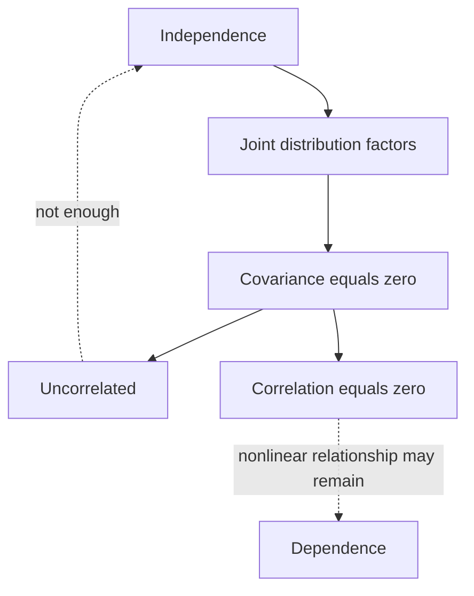

# Covariance, Correlation, and Independence

When two random variables are studied together, we often want to know whether they move together, move oppositely, or have no systematic linear relationship. Covariance measures joint variation in original units; correlation standardizes it to a number between $-1$ and $1$. Independence is stronger: it means the full distribution of one variable is unchanged by knowing the other.

This distinction matters throughout statistics. A zero correlation can be useful, but it does not by itself mean that variables are unrelated. Many nonlinear relationships have zero covariance. Conversely, independence implies zero covariance when variances exist, but the reverse implication usually fails.

## Three different questions about association

For random variables $X$ and $Y$ with finite means, the **covariance** is

$$
\operatorname{Cov}(X,Y)=E[(X-E[X])(Y-E[Y])].
$$

An equivalent computational formula is

$$
\operatorname{Cov}(X,Y)=E[XY]-E[X]E[Y].
$$

The **correlation coefficient** is

$$
\rho_{X,Y}=\frac{\operatorname{Cov}(X,Y)}{\sigma_X\sigma_Y},
$$

where $\sigma_X=\sqrt{\operatorname{Var}(X)}$ and $\sigma_Y=\sqrt{\operatorname{Var}(Y)}$. Correlation is defined only when both standard deviations are positive and finite.

Random variables $X$ and $Y$ are **independent** if events determined by $X$ are independent of events determined by $Y$. Equivalently,

$$
P(X\in A,Y\in B)=P(X\in A)P(Y\in B)
$$

for all suitable sets $A$ and $B$.

For discrete variables, independence is equivalent to

$$
p_{X,Y}(x,y)=p_X(x)p_Y(y)
$$

for all values $x,y$. For continuous variables with densities, it is equivalent to

$$
f_{X,Y}(x,y)=f_X(x)f_Y(y)
$$

on the support.

Variables are **uncorrelated** if $\operatorname{Cov}(X,Y)=0$. This is weaker than independence.

The distinctions can be stated in terms of prediction. Independence says the entire conditional distribution of $Y$ given $X$ equals the marginal distribution of $Y$. Zero covariance says only that the slope in the best linear predictor of $Y$ from $X$ is zero, assuming $\operatorname{Var}(X)\gt 0$:

$$
b=\frac{\operatorname{Cov}(X,Y)}{\operatorname{Var}(X)}.
$$

A curved or otherwise nonlinear dependence can remain after that slope vanishes.

## Covariance algebra

Expanding the centered-product definition gives the computational identity:

$$
\begin{aligned}
E[(X-E[X])(Y-E[Y])]
&=E[XY]-E[X]E[Y]\\
&\quad-E[X]E[Y]+E[X]E[Y]\\
&=E[XY]-E[X]E[Y].
\end{aligned}
$$

Covariance is bilinear. For constants $a,b,c,d$,

$$
\operatorname{Cov}(aX+b,cY+d)=ac\operatorname{Cov}(X,Y).
$$

Adding constants changes neither covariance nor correlation. Multiplying by positive constants leaves correlation unchanged; multiplying one variable by a negative constant reverses its sign. These facts explain why converting centimeters to meters does not alter correlation.

More generally,

$$
\operatorname{Cov}\left(\sum_i a_iX_i,\sum_j b_jY_j\right)
=\sum_i\sum_j a_ib_j\operatorname{Cov}(X_i,Y_j).
$$

The familiar variance-of-a-sum formula is the special case where the two sums are the same.

### Independence removes mixed moments

**Independence implies zero covariance.** If $X$ and $Y$ are independent and $E[X^2]$ and $E[Y^2]$ are finite, then

$$
E[XY]=E[X]E[Y],
$$

so

$$
\operatorname{Cov}(X,Y)=0.
$$

### Variance of a sum

$$
\operatorname{Var}(X+Y)=\operatorname{Var}(X)+\operatorname{Var}(Y)+2\operatorname{Cov}(X,Y).
$$

For a sum of many variables,

$$
\operatorname{Var}\left(\sum_{i=1}^n X_i\right)
=\sum_{i=1}^n \operatorname{Var}(X_i)
+2\sum_{i<j}\operatorname{Cov}(X_i,X_j).
$$

If the variables are pairwise uncorrelated, the covariance terms vanish.

### Why correlation stays between minus one and one

$$
-1\le \rho_{X,Y}\le 1.
$$

This follows from the Cauchy-Schwarz inequality:

$$
|\operatorname{Cov}(X,Y)|\le \sigma_X\sigma_Y.
$$

Apply Cauchy--Schwarz to the centered variables $U=X-E[X]$ and $V=Y-E[Y]$:

$$
|E[UV]|^2\le E[U^2]E[V^2]
=\sigma_X^2\sigma_Y^2.
$$

Dividing by the positive product of variances yields $\vert \rho\vert \le1$. Equality in Cauchy--Schwarz occurs exactly when $V=cU$ almost surely. Therefore $\vert \rho\vert =1$ means

$$
Y-E[Y]=c(X-E[X])
$$

apart from probability-zero exceptions. The sign of $c$ determines whether the correlation is $1$ or $-1$.

Covariance has units equal to the product of the units of $X$ and $Y$. Correlation is unitless, which makes it easier to compare across settings.

Covariance can be read geometrically after centering. The product $(X-\mu_X)(Y-\mu_Y)$ is positive when both variables are above their means or both are below their means. It is negative when one is above its mean and the other is below. Averaging these products gives covariance. A positive covariance therefore means same-direction deviations dominate; a negative covariance means opposite-direction deviations dominate.

Correlation standardizes this average product by the two standard deviations. This standardization makes $\rho$ insensitive to changes of units such as inches to centimeters or dollars to cents. However, correlation still measures only linear association. A strong curved pattern can have correlation close to zero, and a high correlation does not imply that changing one variable causes the other to change.

For independent variables, all information about $X$ is irrelevant for predicting any event involving $Y$. For uncorrelated variables, only the best linear prediction gains no slope from $X$. That is a much narrower statement, so scatterplots still matter alongside correlation coefficients.

## Covariance matrices and linear combinations

For a random vector $X=(X_1,\ldots,X_n)^T$, the covariance matrix $\Sigma$ has entries $\Sigma_{ij}=\operatorname{Cov}(X_i,X_j)$. It is symmetric because covariance is symmetric. For any fixed coefficient vector $a$,

$$
\operatorname{Var}(a^TX)=a^T\Sigma a\ge0.
$$

Thus every covariance matrix is positive semidefinite. The condition has content: an arbitrary symmetric table of proposed variances and covariances may be impossible if some linear combination would receive a negative variance.

If $Y=AX+b$, then

$$
\operatorname{Cov}(Y)=A\Sigma A^T.
$$

The shift $b$ disappears because covariance concerns centered values. This transformation rule drives error propagation, portfolio variance, and multivariate linear models.

### Decomposing covariance by groups

For a grouping variable $G$, the law of total covariance is

$$
\operatorname{Cov}(X,Y)
=E[\operatorname{Cov}(X,Y\mid G)]
+\operatorname{Cov}(E[X\mid G],E[Y\mid G]).
$$

The first term averages within-group association. The second measures association between group means. A large overall correlation can be generated mostly by the second term even when the within-group correlations are small or reversed.

Correlation is also sensitive to mixtures. If data combine several subpopulations with different centers, the overall correlation can mainly reflect differences between groups rather than a relationship within each group. In probability terms, conditioning on a group variable changes the joint distribution. Covariance calculations should therefore be interpreted together with the sampling process and any important conditioning variables.

When variables are binary, covariance has a direct event interpretation:

$$
\operatorname{Cov}(X,Y)=P(X=1,Y=1)-P(X=1)P(Y=1).
$$

It measures how much the joint occurrence exceeds what independence would predict. This binary form is a useful sanity check because it connects covariance directly back to event probability.

## Linear prediction and residual orthogonality

Among predictors of the form $a+bX$, the coefficients minimizing

$$
E[(Y-a-bX)^2]
$$

are

$$
b=\frac{\operatorname{Cov}(X,Y)}{\operatorname{Var}(X)},
\qquad
a=E[Y]-bE[X],
$$

provided $\operatorname{Var}(X)\gt 0$. Centering first reduces the minimization to

$$
E[((Y-E[Y])-b(X-E[X]))^2].
$$

Expanding gives a quadratic in $b$:

$$
\operatorname{Var}(Y)-2b\operatorname{Cov}(X,Y)+b^2\operatorname{Var}(X).
$$

Differentiating yields the stated slope. At the optimum, the residual $R=Y-a-bX$ satisfies

$$
E[R]=0,
\qquad
\operatorname{Cov}(R,X)=0.
$$

The residual is uncorrelated with the predictor, but it need not be independent of it. Independence follows in special models, most notably joint normal models.

The fraction of variance removed by the best one-variable linear predictor is $\rho^2$. Indeed, the residual variance is

$$
\operatorname{Var}(R)=\operatorname{Var}(Y)(1-\rho^2).
$$

This identity concerns population linear prediction. It does not imply that a causal intervention on $X$ changes $Y$ by the regression slope.

## The multivariate normal exception

For jointly normal random variables, zero covariance does imply independence. The qualifier “jointly” matters: two marginally normal variables can be coupled in a non-normal joint distribution and remain dependent despite zero covariance.

In a multivariate normal vector, every linear combination is normal and the joint density is governed by a mean vector and covariance matrix. When the covariance matrix is diagonal, the joint density factors into the product of its marginal normal densities. More generally, blocks of zero cross-covariances give independent subvectors.

This exception explains why uncorrelated Gaussian noise components are often treated as independent. Applying the same inference to arbitrary data is invalid; the counterexample $Y=X^2$ already shows what can go wrong.

## Population quantities and sample estimates

The symbols $\operatorname{Cov}(X,Y)$ and $\rho$ describe a population distribution. Given observed pairs $(x_i,y_i)$, the usual sample covariance is

$$
s_{xy}=\frac{1}{n-1}\sum_{i=1}^{n}(x_i-\bar x)(y_i-\bar y),
$$

and the sample correlation is

$$
r=\frac{s_{xy}}{s_xs_y}.
$$

The divisor $n-1$ makes sample covariance unbiased under independent sampling, although it cancels from the correlation ratio if all sample spreads use the same convention. A computed $r$ varies from sample to sample. A value near zero may reflect a truly weak population correlation or simply limited data; a large magnitude can be driven by a single high-leverage observation.

Correlation is invariant to separate affine changes with positive scale, but it is not robust to outliers. Rank correlations answer a related question about monotone association and can be less sensitive, though they still do not establish independence or causation.

## Checking a proposed covariance matrix

Consider

$$
\Sigma=
\begin{pmatrix}
1&1.2\\
1.2&1
\end{pmatrix}.
$$

Its implied correlation is $1.2$, already outside the allowed interval. The coefficient vector $a=(1,-1)^T$ gives

$$
a^T\Sigma a=1+1-2(1.2)=-0.4,
$$

which would be the variance of $X_1-X_2$. A negative result proves that $\Sigma$ cannot be a covariance matrix. For two variables, positive semidefiniteness is equivalent to nonnegative variances and $\vert \operatorname{Cov}(X,Y)\vert \le\sigma_X\sigma_Y$.

## Dependence created by a fixed total

Negative covariance often appears when components must sum to a constant. If $X_1,\ldots,X_m$ are multinomial category counts from $n$ trials, then

$$
X_1+\cdots+X_m=n.
$$

For two different categories,

$$
\operatorname{Cov}(X_i,X_j)=-np_ip_j.
$$

One derivation uses trial-level indicators. Within a trial, the indicators for categories $i$ and $j$ cannot both equal one, so their product has expectation zero and their covariance is $-p_ip_j$. Different trials are independent; summing the $n$ within-trial covariances yields the formula.

Sampling without replacement creates the same kind of competition. Indicators that two particular draws are successes have negative covariance because drawing a success first slightly reduces the next success probability. That negative dependence produces the finite-population correction in the hypergeometric variance.

## Deriving total covariance

Let $m_X(G)=E[X\mid G]$ and $m_Y(G)=E[Y\mid G]$. Write each centered variable as a within-group residual plus a centered group mean:

$$
X-E[X]=(X-m_X(G))+(m_X(G)-E[X]),
$$

with the analogous expression for $Y$. Multiply the decompositions and take expectations. The two cross terms vanish after conditioning on $G$, leaving

$$
\operatorname{Cov}(X,Y)
=E[\operatorname{Cov}(X,Y\mid G)]
+\operatorname{Cov}(m_X(G),m_Y(G)).
$$

The formula distinguishes association within groups from association of group centers. A pooled covariance can be positive even if every within-group covariance is negative, or vice versa. Reporting only the pooled correlation can therefore answer a different question from the one intended.

## Nonexistence is different from zero

Covariance requires the product to be integrable; finite second moments are a convenient sufficient condition. For heavy-tailed variables, the expression $E[XY]-E[X]E[Y]$ may be undefined. Software applied to a finite sample will still return a number, but that sample statistic need not estimate a finite population covariance.

A constant random variable has variance zero, so its correlation with another variable is undefined because the denominator contains zero. Calling that correlation zero would confuse “no linear association detected” with “the standardized quantity cannot be formed.” Covariance with a constant is well defined and equals zero.

## Nonlinear transformations can change correlation sharply

Correlation is invariant to separate positive affine transformations, not to arbitrary monotone transformations. Taking logarithms can strengthen or weaken a Pearson correlation because it changes the geometry of deviations from the means. A deterministic increasing relationship such as $Y=e^X$ has perfect rank association but generally has Pearson correlation below one.

Covariance with functions can reveal dependence missed by $\operatorname{Cov}(X,Y)$. In the example $Y=X^2$ with symmetric $X$, the covariance of $X$ and $Y$ is zero, but

$$
\operatorname{Cov}(X^2,Y)=\operatorname{Var}(X^2)>0
$$

unless $X^2$ is constant. Independence would force factorization for all suitable functions $g(X)$ and $h(Y)$, not only the identity functions.

This suggests a hierarchy of checks. Pearson correlation tests one standardized cross-moment. Scatterplots and conditional summaries test broader patterns. A proof of independence requires the joint law to factor, or an equivalent argument covering every event, rather than a finite collection of correlations.



| Relationship | Meaning | Implies zero covariance? | Implies independence? |
|---|---|---:|---:|
| independent | full joint factors | yes, if moments exist | yes |
| uncorrelated | no linear association | yes | no |
| positive covariance | above-mean values tend to pair | no | no |
| negative covariance | above-mean pairs with below-mean | no | no |
| zero correlation | standardized covariance is zero | yes | no |

## Worked calculations

### Covariance from a joint table

**Problem.** Let the joint PMF be:

| $p_{X,Y}(x,y)$ | $y=0$ | $y=1$ |
|---|---:|---:|
| $x=0$ | $0.20$ | $0.10$ |
| $x=1$ | $0.30$ | $0.40$ |

Compute $\operatorname{Cov}(X,Y)$ and $\rho_{X,Y}$.

**Method.**

1. Marginals:

$$
P(X=0)=0.30,\quad P(X=1)=0.70,
$$

$$
P(Y=0)=0.50,\quad P(Y=1)=0.50.
$$

2. Means:

$$
E[X]=0(0.30)+1(0.70)=0.70,
$$

$$
E[Y]=0(0.50)+1(0.50)=0.50.
$$

3. Since $XY=1$ only when $X=1$ and $Y=1$,

$$
E[XY]=1\cdot P(X=1,Y=1)=0.40.
$$

4. Covariance:

$$
\begin{aligned}
\operatorname{Cov}(X,Y)
&=E[XY]-E[X]E[Y]\\
&=0.40-(0.70)(0.50)\\
&=0.05.
\end{aligned}
$$

5. Variances:

   $X$ and $Y$ are Bernoulli with parameters $0.70$ and $0.50$:

$$
\operatorname{Var}(X)=0.70(0.30)=0.21,
$$

$$
\operatorname{Var}(Y)=0.50(0.50)=0.25.
$$

6. Correlation:

$$
\rho_{X,Y}=\frac{0.05}{\sqrt{0.21}\sqrt{0.25}}
\approx \frac{0.05}{0.2291}=0.2182.
$$

The covariance is $0.05$ and the correlation is about $0.218$. The variables are positively associated but not strongly.

### Zero covariance without independence

**Problem.** Let $X$ take values $-1,0,1$ with probabilities $1/3$ each, and let $Y=X^2$. Show that $X$ and $Y$ are uncorrelated but not independent.

**Method.**

1. Compute $E[X]$:

$$
E[X]=(-1)\frac{1}{3}+0\cdot\frac{1}{3}+1\cdot\frac{1}{3}=0.
$$

2. Values of $Y$ are $1,0,1$, so

$$
E[Y]=1\cdot\frac{1}{3}+0\cdot\frac{1}{3}+1\cdot\frac{1}{3}=\frac{2}{3}.
$$

3. Compute $XY=X^3$. Values are $-1,0,1$, so

$$
E[XY]=E[X^3]=(-1)\frac{1}{3}+0+1\frac{1}{3}=0.
$$

4. Covariance:

$$
\operatorname{Cov}(X,Y)=E[XY]-E[X]E[Y]=0-0\cdot\frac{2}{3}=0.
$$

5. Check independence. If $X$ and $Y$ were independent, then

$$
P(Y=0\mid X=0)=P(Y=0).
$$

   But $Y=0$ happens exactly when $X=0$, so

$$
P(Y=0\mid X=0)=1,
$$

   while

$$
P(Y=0)=\frac{1}{3}.
$$

$\operatorname{Cov}(X,Y)=0$, but $X$ and $Y$ are not independent. The relationship is deterministic and nonlinear: $Y=X^2$.

### Variance of a correlated two-asset position

Let returns $R_1$ and $R_2$ have standard deviations $0.10$ and $0.20$, with correlation $0.30$. A position puts weight $0.60$ on the first and $0.40$ on the second. First convert correlation to covariance:

$$
\operatorname{Cov}(R_1,R_2)
=(0.30)(0.10)(0.20)=0.006.
$$

For $R=0.60R_1+0.40R_2$,

$$
\begin{aligned}
\operatorname{Var}(R)
&=(0.60)^2(0.10)^2+(0.40)^2(0.20)^2\\
&\quad+2(0.60)(0.40)(0.006)\\
&=0.0036+0.0064+0.00288\\
&=0.01288.
\end{aligned}
$$

Therefore

$$
\operatorname{SD}(R)=\sqrt{0.01288}\approx0.1135.
$$

If the returns were uncorrelated, the covariance contribution would vanish and the standard deviation would be $\sqrt{0.0100}=0.10$. Positive association raises the combined variance here; negative association would lower it.

## Verifying a joint table numerically

```python
import numpy as np

# Joint table example.
joint = np.array([[0.20, 0.10], [0.30, 0.40]])
x_values = np.array([0, 1])
y_values = np.array([0, 1])

px = joint.sum(axis=1)
py = joint.sum(axis=0)
EX = np.sum(x_values * px)
EY = np.sum(y_values * py)
EXY = sum(x * y * joint[i, j]
          for i, x in enumerate(x_values)
          for j, y in enumerate(y_values))
cov = EXY - EX * EY
var_x = np.sum((x_values - EX)**2 * px)
var_y = np.sum((y_values - EY)**2 * py)
corr = cov / np.sqrt(var_x * var_y)
print(cov, corr)

# Zero covariance but dependence.
x = np.array([-1, 0, 1])
p = np.ones(3) / 3
y = x**2
cov_xy = np.sum(x * y * p) - np.sum(x * p) * np.sum(y * p)
print(cov_xy)
```

## Interpretation traps

- Saying "independent" when only correlation has been checked.
- Assuming zero covariance means no relationship. It only rules out linear association.
- Forgetting that covariance changes under unit scaling, while correlation does not.
- Computing sample correlation from data and treating it as the population correlation without uncertainty.
- Using covariance formulas without checking that second moments exist.
- Ignoring nonlinear plots. A curved relationship can have near-zero correlation.

## Related pages

- [joint, marginal, and conditional distributions](/math/probability/joint-marginal-conditional-distributions)
- [expectation, variance, and moments](/math/probability/expectation-variance-moments)
- [functions of random variables](/math/probability/transformations-random-variables)
- [bivariate data and correlation](/math/statistics/bivariate-data-and-correlation)
- [linear regression inference](/math/statistics/linear-regression-inference)
