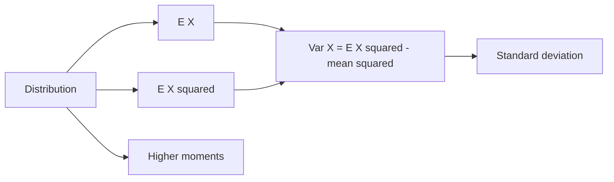

# Expectation, Variance, and Moments

Expectation summarizes the long-run center of a random variable; variance summarizes its spread; moments summarize increasingly detailed features of its distribution. These quantities are not substitutes for the full distribution, but they are often the most useful first summaries. They also power limit theorems, regression, risk calculations, and error estimates.

The key idea is weighted averaging. In a discrete distribution, values are weighted by probability masses. In a continuous distribution, values are weighted by density and integrated. The same logic also applies to functions of random variables through the law of the unconscious statistician.

## Weighted averages over a distribution

For a discrete random variable $X$ with PMF $p_X(x)$, the **expected value** is

$$
E[X]=\sum_x x p_X(x),
$$

provided the sum converges absolutely.

For a continuous random variable with PDF $f_X(x)$,

$$
E[X]=\int_{-\infty}^{\infty} x f_X(x)\,dx,
$$

provided the integral converges absolutely.

For a function $g$, the **law of the unconscious statistician** says

$$
E[g(X)]=\sum_x g(x)p_X(x)
$$

in the discrete case, and

$$
E[g(X)]=\int_{-\infty}^{\infty} g(x)f_X(x)\,dx
$$

in the continuous case.

The **variance** is

$$
\operatorname{Var}(X)=E[(X-E[X])^2].
$$

The **standard deviation** is

$$
\operatorname{SD}(X)=\sqrt{\operatorname{Var}(X)}.
$$

The $k$-th **raw moment** is $E[X^k]$. The $k$-th **central moment** is $E[(X-\mu)^k]$, where $\mu=E[X]$. The third central moment is related to skewness, and the fourth central moment is related to kurtosis.

Absolute convergence in the definition of expectation prevents an ambiguous $\infty-\infty$ subtraction. If $E[\vert X\vert ]\lt \infty$, the positive and negative parts can be combined safely. A symmetric principal-value integral may equal zero even when the probabilistic expectation does not exist.

## Algebra that does most of the work

**Linearity of expectation.** For constants $a,b$,

$$
E[aX+bY+c]=aE[X]+bE[Y]+c.
$$

Linearity does not require independence.

**Computational variance formula.**

$$
\operatorname{Var}(X)=E[X^2]-(E[X])^2.
$$

Proof:

$$
\begin{aligned}
\operatorname{Var}(X)
&=E[(X-\mu)^2]\\
&=E[X^2-2\mu X+\mu^2]\\
&=E[X^2]-2\mu E[X]+\mu^2\\
&=E[X^2]-2\mu^2+\mu^2\\
&=E[X^2]-\mu^2.
\end{aligned}
$$

**Scaling and shifting.**

$$
E[aX+b]=aE[X]+b,
$$

$$
\operatorname{Var}(aX+b)=a^2\operatorname{Var}(X).
$$

Adding a constant shifts the center but does not change spread. Multiplying by $a$ scales standard deviation by $\vert a\vert $ and variance by $a^2$.

**Variance of sums.**

$$
\operatorname{Var}(X+Y)=\operatorname{Var}(X)+\operatorname{Var}(Y)+2\operatorname{Cov}(X,Y).
$$

If $X$ and $Y$ are independent, then the covariance term is zero, so variances add.

**Indicator trick.** If $I_A$ is $1$ when event $A$ occurs and $0$ otherwise, then

$$
E[I_A]=P(A).
$$

This converts counting problems into expectation problems.

For any nonnegative integer-valued $X$, a related tail-sum identity is

$$
E[X]=\sum_{k=1}^{\infty}P(X\ge k).
$$

Write $X=I_{\{X\ge1\}}+I_{\{X\ge2\}}+\cdots$ and use linearity. For a nonnegative continuous variable,

$$
E[X]=\int_0^\infty P(X>t)\,dt.
$$

The continuous formula follows from $x=\int_0^\infty I_{\{t\lt x\}}dt$ after exchanging expectation and integration. Survival probabilities can therefore determine the mean without first differentiating a CDF.

Expectation is linear even when variables are dependent, which makes it unusually powerful. If $X$ counts the number of students in a room who share a birthday with someone else, it may be hard to write down the full distribution of $X$. But if $X$ is written as a sum of indicator variables, then $E[X]$ can often be found by adding the probabilities that each indicator equals $1$. This technique appears in occupancy problems, randomized algorithms, and combinatorics.

Variance is less forgiving. To find the variance of a sum, dependence must be handled through covariance terms. If $X_1,\ldots,X_n$ are independent, then

$$
\operatorname{Var}\left(\sum_{i=1}^n X_i\right)=\sum_{i=1}^n \operatorname{Var}(X_i).
$$

Without independence, this formula can be badly wrong. Positive covariance increases the variance of a sum; negative covariance decreases it.

Moments may fail to exist. A distribution can have a median and many quantiles but no finite mean. It can have a finite mean but infinite variance. When a theorem assumes finite variance, that condition rules out some heavy-tailed models. Before manipulating $E[X]$ or $E[X^2]$, check that the relevant expectation is finite, especially for distributions with polynomial tails.

Expectation is not automatically a typical value. In skewed distributions, the mean can be pulled far into the tail. For waiting times, income, file sizes, and insurance losses, the median, quantiles, or tail probabilities may be more representative for user-facing summaries. Variance has a similar limitation: it summarizes spread around the mean, so it can be dominated by rare extreme values. Moments are powerful algebraic summaries, but they should be paired with distribution shape when interpretation matters.

## Conditioning separates sources of randomness

The quantity $E[X\mid Y]$ is itself a random variable: after $Y$ is observed, it gives the average value of $X$ under that condition. The identity

$$
E[X]=E[E[X\mid Y]]
$$

means that averaging conditional averages recovers the overall average. This is often the cleanest way to compute expectations in multi-stage experiments.

For example, if a random number of customers arrive and each customer independently spends a random amount, conditioning on the number of customers separates the count randomness from the spending randomness. The outer expectation then averages over possible customer counts. This pattern appears in compound distributions, insurance risk, and queueing models.

Variance has a corresponding decomposition:

$$
\operatorname{Var}(X)
=E[\operatorname{Var}(X\mid Y)]
+\operatorname{Var}(E[X\mid Y]).
$$

The first term is average variation remaining within a condition. The second is variation of the conditional means across conditions. Start with

$$
X-E[X]
=\bigl(X-E[X\mid Y]\bigr)
+\bigl(E[X\mid Y]-E[X]\bigr).
$$

After squaring and taking expectations, the cross term vanishes because

$$
E[X-E[X\mid Y]\mid Y]=0.
$$

### A random sum

Let $N$ be a nonnegative integer-valued count, and let $Z_1,Z_2,\ldots$ be independent identically distributed amounts, independent of $N$, with mean $\mu$ and variance $\sigma^2$. For

$$
S=Z_1+\cdots+Z_N,
$$

conditioning on $N$ gives

$$
E[S\mid N]=N\mu,
\qquad
\operatorname{Var}(S\mid N)=N\sigma^2.
$$

The two total laws yield

$$
E[S]=E[N]\mu
$$

and

$$
\operatorname{Var}(S)=E[N]\sigma^2+\operatorname{Var}(N)\mu^2.
$$

The first variance term comes from individual amounts; the second comes from fluctuation in how many amounts are present.

## Moments, shape, and nonlinear functions

Standardized skewness and excess kurtosis are

$$
\gamma_1=\frac{E[(X-\mu)^3]}{\sigma^3},
\qquad
\gamma_2=\frac{E[(X-\mu)^4]}{\sigma^4}-3.
$$

The subtraction of $3$ gives a normal distribution excess kurtosis zero. These summaries are sensitive to outliers because deviations are raised to high powers. Existence of the mean does not imply existence of either quantity. Even all finite moments need not always identify a distribution uniquely without additional conditions; matching several moments is matching summaries, not proving equality of distributions.

Usually $E[g(X)]\ne g(E[X])$. If $g$ is convex and the expectations exist, Jensen's inequality gives the direction:

$$
g(E[X])\le E[g(X)].
$$

For $g(x)=x^2$, Jensen gives $(E[X])^2\le E[X^2]$, which is nonnegativity of variance. For a strictly convex function, equality requires $X$ to be constant almost surely, apart from intervals where $g$ happens to be linear.

## The mean as a least-squares center

The mean is the constant that minimizes expected squared error. For any real number $a$,

$$
\begin{aligned}
E[(X-a)^2]
&=E[(X-\mu+\mu-a)^2]\\
&=E[(X-\mu)^2]+2(\mu-a)E[X-\mu]+(\mu-a)^2\\
&=\operatorname{Var}(X)+(\mu-a)^2.
\end{aligned}
$$

The second term is minimized at $a=\mu$. This identity also separates random spread from squared bias. If a prediction rule has mean error away from zero, its mean squared error equals error variance plus squared bias.

Absolute loss gives a different center: a median minimizes $E[\vert X-a\vert ]$. The choice of summary is therefore tied to the loss being used. A mean is natural for squared-error calculations, while a median can better represent a skewed distribution under absolute error.

## Moment inequalities turn summaries into bounds

For a nonnegative random variable and $a\gt 0$, Markov's inequality states

$$
P(X\ge a)\le\frac{E[X]}{a}.
$$

It follows from the pointwise inequality $X\ge aI_{\{X\ge a\}}$. Taking expectations gives

$$
E[X]\ge aP(X\ge a).
$$

Apply Markov's inequality to the nonnegative variable $(X-\mu)^2$ to obtain Chebyshev's inequality:

$$
P(|X-\mu|\ge k\sigma)\le\frac1{k^2}.
$$

These bounds use very little distributional information and can be loose. Their strength is universality: no symmetry or named-family assumption is required. Higher finite moments can yield other tail bounds by applying Markov to $\vert X\vert ^r$.

## When algebra with expectations is legitimate

Linearity for a finite sum holds whenever the individual expectations are finite. Infinite sums require conditions that permit interchange of summation and expectation. For nonnegative terms, monotone convergence allows

$$
E\left[\sum_{i=1}^{\infty}X_i\right]
=\sum_{i=1}^{\infty}E[X_i].
$$

For signed terms, absolute integrability is a common sufficient condition. Ignoring convergence can turn a rearranged conditionally convergent series into a different answer.

The computational variance formula can also suffer numerical cancellation when $E[X^2]$ and $E[X]^2$ are both large and close. The centered definition is mathematically equivalent but often more stable. Streaming algorithms update the mean and centered sum of squares without subtracting two nearly equal large numbers.

## A numerical random-sum calculation

Suppose a shop receives $N\sim\operatorname{Poisson}(20)$ customers in a period. Customer spending amounts are independent of $N$, with mean $30$ and standard deviation $12$. For total spending $S$,

$$
E[S]=E[N]\mu=20(30)=600.
$$

Because a Poisson variable has variance $20$,

$$
\begin{aligned}
\operatorname{Var}(S)
&=E[N]\sigma^2+\operatorname{Var}(N)\mu^2\\
&=20(12^2)+20(30^2)\\
&=2880+18000\\
&=20880.
\end{aligned}
$$

Thus $\operatorname{SD}(S)=\sqrt{20880}\approx144.50$. Most of the variance comes from uncertainty in the number of customers, not variation in individual spending. Replacing $N$ by its mean would miss the $18000$ term.

## Raw, central, and factorial moments serve different algebra

Raw moments are convenient when expanding polynomials. Central moments describe shape after location is removed. Factorial moments,

$$
E[(X)_k]=E[X(X-1)\cdots(X-k+1)],
$$

fit count variables because $(X)_k$ counts ordered selections of $k$ distinct items from the $X$ items present.

For $X\sim\operatorname{Binomial}(n,p)$, write $X$ as the number of successful trials. The quantity $X(X-1)$ counts ordered pairs of distinct successful trials. There are $n(n-1)$ ordered trial pairs, and each pair succeeds with probability $p^2$, so

$$
E[X(X-1)]=n(n-1)p^2.
$$

Since $X^2=X(X-1)+X$,

$$
\begin{aligned}
E[X^2]
&=n(n-1)p^2+np,\\
\operatorname{Var}(X)
&=E[X^2]-(np)^2\\
&=np(1-p).
\end{aligned}
$$

This counting derivation avoids differentiating a generating function and generalizes to higher factorial moments.

Moment existence becomes stricter with order. If $E[\vert X\vert ^r]\lt \infty$, then every lower absolute moment is finite, but the reverse need not hold. A distribution can have a finite variance and infinite fourth moment, making ordinary standard deviation meaningful while kurtosis is not. Empirical high-order moments can also be unstable long before the corresponding population moment becomes infinite.

Quantiles require no finite moments. When tail behavior is uncertain, medians and interquantile ranges can remain interpretable even when sample means and variances fluctuate severely. The algebraic convenience of moments should be kept separate from their statistical stability.

## Conditional Jensen and information

Jensen's inequality also has a conditional form:

$$
g(E[X\mid Y])\le E[g(X)\mid Y]
$$

for convex $g$. Taking expectations recovers the ordinary inequality. With $g(x)=x^2$, it shows that the squared conditional mean cannot exceed the conditional second moment.

More information can improve a squared-error predictor. Predicting $X$ by its unconditional mean has mean squared error $\operatorname{Var}(X)$. Predicting it by $E[X\mid Y]$ has error

$$
E[\operatorname{Var}(X\mid Y)].
$$

The total-variance formula shows the reduction:

$$
\operatorname{Var}(X)-E[\operatorname{Var}(X\mid Y)]
=\operatorname{Var}(E[X\mid Y])\ge0.
$$

If the conditional mean does not vary with $Y$, that particular predictor gains nothing, even though other features of the conditional distribution might still depend on $Y$. Zero predictive gain for the mean is weaker than independence.

Conditional moments can also be easier to calculate than unconditional ones. In a mixture model, compute means and variances within each component, then average them with the component probabilities. The between-component variance term records spread caused by differing component centers and is easily missed if only within-component variances are averaged.

## Symmetry can determine moments without integration

If $X$ and $-X$ have the same distribution and $E[\vert X\vert ]\lt \infty$, then

$$
E[X]=E[-X]=-E[X],
$$

so $E[X]=0$. More generally, every existing odd moment about zero vanishes. The existence condition matters: symmetry alone does not give the standard Cauchy distribution a mean.

If a distribution is symmetric about $a$, then $X-a$ is symmetric about zero, and $E[X]=a$ when the mean exists. Symmetry also makes $a$ a median, though the median need not be unique if the CDF has a flat portion.

Even functions such as $x^2$ do not cancel under symmetry. Their expectations can often be computed by doubling an integral over the positive half-line. Recognizing parity before integration reduces work and provides a sign check on odd-moment calculations.

## A map of the summaries

| Quantity | Formula | Interpretation |
|---|---|---|
| Mean | $E[X]$ | balance point or long-run average |
| Raw second moment | $E[X^2]$ | average squared size |
| Variance | $E[(X-\mu)^2]$ | average squared deviation from mean |
| Standard deviation | $\sqrt{\operatorname{Var}(X)}$ | spread in original units |
| Skewness numerator | $E[(X-\mu)^3]$ | direction of asymmetry |
| Fourth central moment | $E[(X-\mu)^4]$ | tail weight and peakedness |



## Worked calculations

### Expectation and variance of one die

**Problem.** Let $X$ be the result of one fair six-sided die. Compute $E[X]$, $E[X^2]$, and $\operatorname{Var}(X)$.

**Method.**

1. The possible values are $1,2,3,4,5,6$, each with probability $1/6$.

2. Compute the expectation:

$$
\begin{aligned}
E[X]
&=\sum_{x=1}^6 x\cdot \frac{1}{6}\\
&=\frac{1+2+3+4+5+6}{6}\\
&=\frac{21}{6}\\
&=3.5.
\end{aligned}
$$

3. Compute the second raw moment:

$$
\begin{aligned}
E[X^2]
&=\sum_{x=1}^6 x^2\cdot \frac{1}{6}\\
&=\frac{1^2+2^2+3^2+4^2+5^2+6^2}{6}\\
&=\frac{1+4+9+16+25+36}{6}\\
&=\frac{91}{6}.
\end{aligned}
$$

4. Use the computational formula:

$$
\begin{aligned}
\operatorname{Var}(X)
&=E[X^2]-(E[X])^2\\
&=\frac{91}{6}-\left(\frac{7}{2}\right)^2\\
&=\frac{91}{6}-\frac{49}{4}\\
&=\frac{182-147}{12}\\
&=\frac{35}{12}.
\end{aligned}
$$

5. Standard deviation is

$$
\sqrt{\frac{35}{12}}\approx 1.7078.
$$

$E[X]=3.5$, $E[X^2]=91/6$, and $\operatorname{Var}(X)=35/12$.

### Expectation of an exponential random variable

**Problem.** Let $X\sim\operatorname{Exponential}(\lambda)$ with density $f(x)=\lambda e^{-\lambda x}$ for $x\ge 0$. Show that $E[X]=1/\lambda$ and $\operatorname{Var}(X)=1/\lambda^2$.

**Method.**

1. Compute the mean:

$$
E[X]=\int_0^\infty x\lambda e^{-\lambda x}\,dx.
$$

2. Use integration by parts with $u=x$ and $dv=\lambda e^{-\lambda x}dx$. Then $du=dx$ and $v=-e^{-\lambda x}$.

$$
\begin{aligned}
E[X]
&=\left[-xe^{-\lambda x}\right]_0^\infty+\int_0^\infty e^{-\lambda x}\,dx\\
&=0+\left[-\frac{1}{\lambda}e^{-\lambda x}\right]_0^\infty\\
&=\frac{1}{\lambda}.
\end{aligned}
$$

3. Compute the second moment:

$$
E[X^2]=\int_0^\infty x^2\lambda e^{-\lambda x}\,dx.
$$

4. Integration by parts gives

$$
E[X^2]=\frac{2}{\lambda}E[X]=\frac{2}{\lambda^2}.
$$

5. Now compute variance:

$$
\begin{aligned}
\operatorname{Var}(X)
&=E[X^2]-(E[X])^2\\
&=\frac{2}{\lambda^2}-\left(\frac{1}{\lambda}\right)^2\\
&=\frac{1}{\lambda^2}.
\end{aligned}
$$

$E[X]=1/\lambda$ and $\operatorname{Var}(X)=1/\lambda^2$.

### Expected fixed points in a random permutation

Randomly permute $n$ labeled objects. Let $X$ be the number left in their original positions. Define

$$
I_i=I_{\{\text{object }i\text{ remains fixed}\}},
\qquad
X=I_1+\cdots+I_n.
$$

Exactly $(n-1)!$ of the $n!$ permutations leave object $i$ fixed, so

$$
P(I_i=1)=\frac{(n-1)!}{n!}=\frac1n.
$$

Linearity now gives

$$
\begin{aligned}
E[X]
&=\sum_{i=1}^nE[I_i]\\
&=\sum_{i=1}^n\frac1n\\
&=1.
\end{aligned}
$$

The expected number of fixed points is $1$ for every positive $n$, even though the indicators are dependent and the full distribution changes with $n$.

## Numerical checks

```python
import numpy as np
from scipy.integrate import quad

# Die moments.
values = np.arange(1, 7)
probs = np.ones(6) / 6
mean = np.sum(values * probs)
second = np.sum(values**2 * probs)
variance = second - mean**2
print(mean, second, variance)

# Exponential moments by numerical integration.
lam = 2.5
density = lambda x: lam * np.exp(-lam * x)
mean_integral, _ = quad(lambda x: x * density(x), 0, np.inf)
second_integral, _ = quad(lambda x: x**2 * density(x), 0, np.inf)
var_integral = second_integral - mean_integral**2
print(mean_integral, var_integral)
print("theory:", 1 / lam, 1 / lam**2)
```

## Checks before using a moment

- Treating expectation as the most likely value. A fair die has expected value $3.5$, which is not a possible roll.
- Assuming expectation always exists. Heavy-tailed distributions can have undefined means or variances.
- Forgetting to square the scaling constant in variance: $\operatorname{Var}(aX)=a^2\operatorname{Var}(X)$.
- Assuming $E[g(X)]=g(E[X])$. This is generally false except for linear $g$.
- Adding standard deviations instead of variances for independent sums.
- Using variance formulas that require independence without checking independence.

<div className="see-also">

See also: [random variables and distributions](/math/probability/random-variables-distributions) · [covariance, correlation, and independence](/math/probability/covariance-correlation-independence) · [moment generating and characteristic functions](/math/probability/generating-functions) · [limit theorems](/math/probability/limit-theorems) · [summarizing distributions](/math/statistics/summarizing-distributions)

</div>
