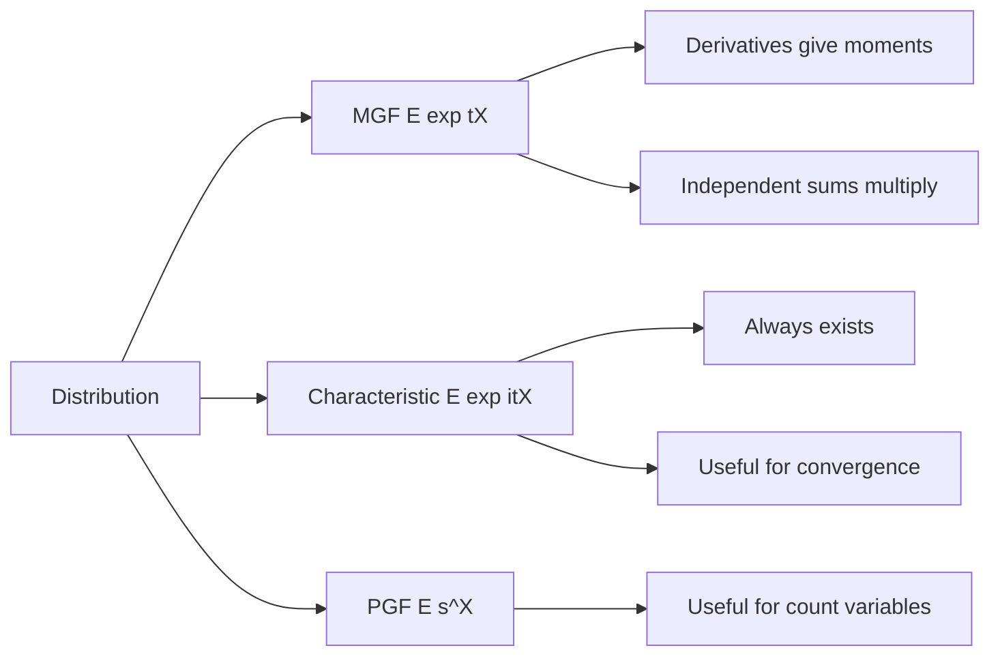

# Moment Generating and Characteristic Functions

Generating functions encode a distribution inside an expectation involving powers or exponentials. They are compact tools for finding moments, proving sums of independent random variables, and proving limit theorems. Moment generating functions are often easiest when they exist near zero. Characteristic functions always exist and are the more general theoretical tool.

The useful habit is to treat the transform and its domain as one object. An algebraic expression without its convergence interval may not identify an MGF at all.

## Three transforms, three domains

For a random variable $X$, the **moment generating function** (MGF) is

$$
M_X(t)=E[e^{tX}],
$$

for values of $t$ where the expectation exists. If $M_X(t)$ exists on an open interval around $0$, it uniquely determines the distribution.

The **characteristic function** is

$$
\varphi_X(t)=E[e^{itX}],
$$

where $i^2=-1$. Characteristic functions exist for every random variable because $\vert e^{itX}\vert =1$.

For a nonnegative integer-valued random variable $X$, the **probability generating function** (PGF) is

$$
G_X(s)=E[s^X]=\sum_{k=0}^{\infty}P(X=k)s^k.
$$

The MGF generates raw moments by differentiation:

$$
M_X^{(k)}(0)=E[X^k],
$$

when the derivatives exist.

The characteristic function similarly generates moments through derivatives at zero when the corresponding moments exist:

$$
\varphi_X^{(k)}(0)=i^k E[X^k].
$$

The converse requires care: existence of a few derivatives at zero does not automatically provide all corresponding absolute moments. For ordinary computations with common distributions, the displayed differentiation rules apply under the usual interchange-of-derivative-and-expectation conditions.

## Why independent sums become products

**Sums of independent variables.** If $X$ and $Y$ are independent, then

$$
M_{X+Y}(t)=M_X(t)M_Y(t),
$$

where the MGFs exist. Proof:

$$
\begin{aligned}
M_{X+Y}(t)
&=E[e^{t(X+Y)}]\\
&=E[e^{tX}e^{tY}]\\
&=E[e^{tX}]E[e^{tY}]\\
&=M_X(t)M_Y(t).
\end{aligned}
$$

The same multiplication rule holds for characteristic functions.

For a shifted and scaled variable $Y=aX+b$,

$$
M_Y(t)=e^{bt}M_X(at),
\qquad
\varphi_Y(t)=e^{ibt}\varphi_X(at).
$$

The formula is often quicker than recomputing an integral. It also shows immediately how centering removes the linear term in a cumulant generating function.

### Recovering mean and variance

$$
E[X]=M_X'(0),
$$

$$
E[X^2]=M_X''(0),
$$

$$
\operatorname{Var}(X)=M_X''(0)-[M_X'(0)]^2.
$$

**MGF of common distributions.**

| Distribution | MGF $M_X(t)$ | Valid $t$ |
|---|---|---|
| Bernoulli$(p)$ | $1-p+pe^t$ | all real $t$ |
| Binomial$(n,p)$ | $(1-p+pe^t)^n$ | all real $t$ |
| Poisson$(\lambda)$ | $\exp(\lambda(e^t-1))$ | all real $t$ |
| Exponential$(\lambda)$ | $\lambda/(\lambda-t)$ | $t\lt \lambda$ |
| Normal$(\mu,\sigma^2)$ | $\exp(\mu t+\sigma^2t^2/2)$ | all real $t$ |

The normal formula follows by completing the square. For $X\sim N(\mu,\sigma^2)$,

$$
\begin{aligned}
tx-\frac{(x-\mu)^2}{2\sigma^2}
&=-\frac{(x-\mu-\sigma^2t)^2}{2\sigma^2}
+\mu t+\frac{\sigma^2t^2}{2}.
\end{aligned}
$$

The remaining integral is a normal density centered at $\mu+\sigma^2t$, so it integrates to $1$. The factor left outside is

$$
M_X(t)=\exp\left(\mu t+\frac{\sigma^2t^2}{2}\right).
$$

Multiplying two such MGFs adds both the means and variances, proving closure of independent normal sums without a convolution.

**Characteristic functions and convergence.** A sequence of random variables converges in distribution if their characteristic functions converge pointwise to a characteristic function, under standard continuity conditions. This is one route to proving the central limit theorem.

MGFs are especially convenient for sums because multiplication is simpler than convolution. Instead of deriving the full distribution of $X_1+\cdots+X_n$ by repeatedly summing or integrating over all possible decompositions, one can multiply the MGFs and then recognize the result. This is how the binomial MGF follows immediately from independent Bernoulli variables, and how sums of independent normal variables can be shown to remain normal.

Characteristic functions play the same role but with fewer existence problems. A Cauchy random variable, for example, has no finite mean and no MGF around zero, but it still has a characteristic function. This makes characteristic functions the standard tool in more advanced probability.

## Cumulants turn products into sums

The **cumulant generating function** is

$$
K_X(t)=\log M_X(t).
$$

When it exists, derivatives of $K_X$ at zero give cumulants. The first cumulant is the mean, the second is the variance, and the next two are the third and fourth central cumulants. Independent sums add cumulant generating functions:

$$
K_{X+Y}(t)=K_X(t)+K_Y(t).
$$

For identically distributed independent variables, every cumulant of the sum is $n$ times the corresponding cumulant of one term. After standardizing by a standard deviation of order $\sqrt n$, standardized cumulants of order above two shrink. This algebra foreshadows why normalized sums often approach a normal distribution.

## PGFs keep the coefficients in view

PGFs are useful for count variables because probabilities can be recovered from coefficients. If

$$
G_X(s)=\sum_{k=0}^{\infty}p_k s^k,
$$

then $p_k$ is the coefficient of $s^k$. Derivatives at $s=1$ give factorial moments:

$$
G_X'(1)=E[X],
$$

and

$$
G_X''(1)=E[X(X-1)].
$$

Ordinary variance follows from the factorial moments:

$$
\operatorname{Var}(X)
=G_X''(1)+G_X'(1)-[G_X'(1)]^2.
$$

These are convenient for branching processes, occupancy counts, and sums of independent nonnegative integer-valued random variables. As with MGFs, independence turns sums into products:

$$
G_{X+Y}(s)=G_X(s)G_Y(s).
$$

Generating functions also provide distribution checks. If a derived MGF matches the known MGF of a named family on an interval around zero, then the derived variable has that distribution. The interval condition prevents identification from a merely formal series.

Still, a generating function is not a substitute for assumptions. The multiplication rule encodes independence, and recognition of a named MGF depends on using the same parameterization as the reference formula.

Many calculations run backward: compute a transform, simplify it, then identify a known distribution. The final statement should include the valid transform range, since an exponential MGF cannot be valid for all real $t$.

## Which transform fits the job



| Function | Best for | Main limitation |
|---|---|---|
| MGF | moments and named distributions | may not exist away from $0$ |
| Characteristic function | theory and convergence | complex-valued |
| PGF | nonnegative integer counts | limited to count variables |

## Worked transforms

### Bernoulli and binomial MGFs

**Problem.** Find the MGF of a Bernoulli$(p)$ random variable, then use it to get the MGF, mean, and variance of a Binomial$(n,p)$ random variable.

**Method.**

1. Let $X\sim\operatorname{Bernoulli}(p)$. Then $X=1$ with probability $p$ and $X=0$ with probability $1-p$.

2. Compute the MGF:

$$
\begin{aligned}
M_X(t)
&=E[e^{tX}]\\
&=e^{t\cdot 0}(1-p)+e^{t\cdot 1}p\\
&=1-p+pe^t.
\end{aligned}
$$

3. Let $Y=X_1+\cdots+X_n$, where the $X_i$ are independent Bernoulli$(p)$. Then $Y\sim\operatorname{Binomial}(n,p)$.

4. Use the multiplication rule:

$$
M_Y(t)=\prod_{i=1}^n M_{X_i}(t)=(1-p+pe^t)^n.
$$

5. Find the mean:

$$
M_Y'(t)=n(1-p+pe^t)^{n-1}pe^t.
$$

   At $t=0$,

$$
M_Y'(0)=n(1)^{n-1}p=np.
$$

6. The variance is easier from the independent sum:

$$
\operatorname{Var}(Y)=\sum_{i=1}^n \operatorname{Var}(X_i)=np(1-p).
$$

The binomial MGF is $(1-p+pe^t)^n$, with mean $np$ and variance $np(1-p)$.

### MGF of an exponential distribution

**Problem.** Let $X\sim\operatorname{Exponential}(\lambda)$ with density $\lambda e^{-\lambda x}$ for $x\ge0$. Find the MGF and use it to compute $E[X]$ and $\operatorname{Var}(X)$.

**Method.**

1. Start from the definition:

$$
M_X(t)=E[e^{tX}]=\int_0^\infty e^{tx}\lambda e^{-\lambda x}\,dx.
$$

2. Combine exponents:

$$
M_X(t)=\lambda\int_0^\infty e^{-(\lambda-t)x}\,dx.
$$

3. The integral converges only if $\lambda-t\gt 0$, so $t\lt \lambda$.

4. Evaluate:

$$
\begin{aligned}
M_X(t)
&=\lambda\left[-\frac{1}{\lambda-t}e^{-(\lambda-t)x}\right]_0^\infty\\
&=\frac{\lambda}{\lambda-t}.
\end{aligned}
$$

5. Differentiate:

$$
M_X'(t)=\frac{\lambda}{(\lambda-t)^2}.
$$

   Thus

$$
E[X]=M_X'(0)=\frac{\lambda}{\lambda^2}=\frac{1}{\lambda}.
$$

6. Differentiate again:

$$
M_X''(t)=\frac{2\lambda}{(\lambda-t)^3}.
$$

   Then

$$
E[X^2]=M_X''(0)=\frac{2}{\lambda^2}.
$$

7. Variance:

$$
\operatorname{Var}(X)=\frac{2}{\lambda^2}-\left(\frac{1}{\lambda}\right)^2
=\frac{1}{\lambda^2}.
$$

$M_X(t)=\lambda/(\lambda-t)$ for $t\lt \lambda$, $E[X]=1/\lambda$, and $\operatorname{Var}(X)=1/\lambda^2$.

### Poisson thinning with a PGF

Let $N\sim\operatorname{Poisson}(\lambda)$. Independently retain each of its $N$ items with probability $p$, and call the retained count $Y$. Conditional on $N=n$, $Y$ is Binomial$(n,p)$, with conditional PGF

$$
E[s^Y\mid N=n]=(1-p+ps)^n.
$$

Average over $N$:

$$
\begin{aligned}
G_Y(s)
&=E[(1-p+ps)^N]\\
&=G_N(1-p+ps).
\end{aligned}
$$

The Poisson PGF is

$$
G_N(u)=\exp(\lambda(u-1)).
$$

Substitution gives

$$
\begin{aligned}
G_Y(s)
&=\exp\left(\lambda[(1-p+ps)-1]\right)\\
&=\exp\left(\lambda p(s-1)\right).
\end{aligned}
$$

This is the PGF of Poisson$(\lambda p)$. Randomly retaining independent items thins the original rate by the factor $p$.

## Deriving common PGFs from their series

For $X\sim\operatorname{Binomial}(n,p)$,

$$
\begin{aligned}
G_X(s)
&=\sum_{k=0}^{n}s^k\binom nkp^k(1-p)^{n-k}\\
&=\sum_{k=0}^{n}\binom nk(ps)^k(1-p)^{n-k}\\
&=(1-p+ps)^n
\end{aligned}
$$

by the binomial theorem. For a Poisson variable,

$$
\begin{aligned}
G_X(s)
&=\sum_{k=0}^{\infty}s^ke^{-\lambda}\frac{\lambda^k}{k!}\\
&=e^{-\lambda}\sum_{k=0}^{\infty}\frac{(\lambda s)^k}{k!}\\
&=e^{-\lambda}e^{\lambda s}\\
&=e^{\lambda(s-1)}.
\end{aligned}
$$

Setting $s=1$ checks normalization: every PGF satisfies $G_X(1)=1$. Setting $s=0$ returns $P(X=0)$. Values between zero and one summarize a downweighted version of the right tail and are numerically well behaved for nonnegative counts.

The geometric PGF also displays the parameter convention. If $X$ counts failures before the first success,

$$
G_X(s)=\sum_{k=0}^{\infty}p(1-p)^ks^k
=\frac{p}{1-(1-p)s}.
$$

If $T=X+1$ counts the successful trial, then $G_T(s)=sG_X(s)$. The extra factor records the shift of the support.

## Random sums and composition

Let $N$ be a nonnegative integer-valued variable and let $X_1,X_2,\ldots$ be independent identically distributed nonnegative counts, independent of $N$. For

$$
S=X_1+\cdots+X_N,
$$

condition on $N$:

$$
E[s^S\mid N=n]=G_X(s)^n.
$$

Averaging over $N$ gives the composition rule

$$
G_S(s)=G_N(G_X(s)).
$$

Composition, rather than multiplication alone, reflects the random number of summands. If $N$ is Poisson and $X_i$ is a claim count or batch size, the result is a compound Poisson distribution. Differentiating the composition at one recovers the random-sum mean and variance formulas.

As an example, suppose buses arrive according to Poisson$(\lambda)$ over a time window and each bus carries an independent Binomial$(m,p)$ number of riders from a specified group. The total group count has PGF

$$
\exp\left(\lambda[(1-p+ps)^m-1]\right).
$$

Except when $m=1$, this is not an ordinary Poisson PGF: riders arrive in correlated batches within a bus.

## What characteristic functions add

The characteristic function is bounded in magnitude by one:

$$
|\varphi_X(t)|=|E[e^{itX}]|\le E[|e^{itX}|]=1.
$$

It also obeys $\varphi_X(0)=1$ and $\varphi_X(-t)=\overline{\varphi_X(t)}$. These checks catch sign and normalization errors.

Characteristic functions uniquely determine probability distributions. Under suitable regularity, Fourier inversion reconstructs a density from its characteristic function. More generally, an inversion theorem reconstructs interval probabilities even when no density exists. The complex exponential simultaneously encodes cosine and sine expectations:

$$
\varphi_X(t)=E[\cos(tX)]+iE[\sin(tX)].
$$

For a distribution symmetric about zero, the sine term vanishes and the characteristic function is real and even.

The Cauchy distribution illustrates the gap between MGFs and characteristic functions. Its characteristic function exists for every real $t$, while $E[e^{tX}]$ diverges for every nonzero real $t$. Expanding $e^{tX}$ as a formal power series does not create moments that the distribution lacks.

## A normal-sum identification

Let independent variables $X\sim N(2,3^2)$ and $Y\sim N(-1,4^2)$. Their MGFs are

$$
M_X(t)=e^{2t+9t^2/2},
\qquad
M_Y(t)=e^{-t+16t^2/2}.
$$

For $S=X+Y$,

$$
\begin{aligned}
M_S(t)
&=M_X(t)M_Y(t)\\
&=e^{(2-1)t+(9+16)t^2/2}\\
&=e^{t+25t^2/2}.
\end{aligned}
$$

Recognizing the normal MGF gives

$$
S\sim N(1,25).
$$

The standard deviation is $5$, not $3+4=7$; independent variances add. If $X$ and $Y$ were dependent, multiplying their marginal MGFs would be unjustified and the covariance would affect the variance of the sum.

## Domains are mathematical data

Two algebraically similar expressions can represent different transforms because their domains differ. The exponential MGF

$$
M_X(t)=\frac{\lambda}{\lambda-t}
$$

exists only for $t\lt \lambda$. Its Taylor series about zero has radius of convergence $\lambda$, set by the pole at $t=\lambda$. Differentiating inside that interval recovers every exponential moment.

An MGF may exist only at $t=0$, which is insufficient for the usual uniqueness theorem. One-sided existence can still support some tail calculations, but it should not be reported as an MGF “for all $t$.” For nonnegative $X$, the Laplace transform

$$
L_X(s)=E[e^{-sX}],
\qquad s\ge0,
$$

always exists and equals $M_X(-s)$ where the latter notation is valid. Survival analysis and queueing theory often prefer this nonnegative argument convention.

PGFs are analytic at least for $\vert s\vert \lt 1$, since

$$
\sum_{k=0}^{\infty}p_k|s|^k\le\sum_{k=0}^{\infty}p_k=1.
$$

At $s=1$, derivatives may be infinite if the corresponding factorial moments do not exist. The PGF itself can be perfectly valid even when its slope at one is infinite.

## Cumulants under centering and scaling

If $Y=aX+b$, then

$$
K_Y(t)=bt+K_X(at).
$$

The first cumulant becomes $a\kappa_1+b$, while cumulants of order $r\ge2$ become $a^r\kappa_r$. Translation affects only the first cumulant. For independent sums, cumulants add, so the variance addition rule is the second-order instance of a broader pattern.

The third cumulant equals the third central moment. The fourth cumulant is

$$
\kappa_4=E[(X-\mu)^4]-3\sigma^4.
$$

Dividing these by powers of standard deviation yields standardized skewness and excess kurtosis. For a normal distribution, every cumulant above order two is zero. The converse holds when the cumulant generating function exists near zero and has exactly the quadratic normal form.

## Transform recognition needs uniqueness

After simplifying a transform, identification is justified by a uniqueness result, not by visual resemblance alone. MGFs equal on an open interval around zero determine the same distribution. Characteristic functions equal for every real argument also determine the same distribution. PGFs equal on an interval inside their convergence disk have identical coefficients and therefore identical count probabilities.

Moments alone are more delicate. Even if two distributions share every finite moment, they need not always be identical unless a moment-determinacy condition holds. An MGF existing near zero supplies such control and is stronger than merely listing all formal moments.

## Derivatives should be checked at the right point

MGF and characteristic-function moments come from derivatives at zero. PGF factorial moments come from derivatives at one, while derivatives at zero recover coefficients:

$$
P(X=k)=\frac{G_X^{(k)}(0)}{k!}.
$$

Confusing these evaluation points changes the quantity entirely. For a Bernoulli PGF $G(s)=1-p+ps$, evaluating the first derivative at either point happens to give $p$, but that coincidence disappears for higher-support variables.

Numerical differentiation near a transform boundary can be unstable. Symbolic differentiation or direct moment formulas are preferable when available. For empirical characteristic functions, sampling variability grows important when interpreting fine oscillations; exact transform identities should not be inferred from a noisy finite-sample curve alone.

## MGFs also give tail bounds

For $t\gt 0$, Markov's inequality applied to $e^{tX}$ gives

$$
P(X\ge x)\le e^{-tx}M_X(t).
$$

Any valid positive $t$ supplies a bound; minimizing over $t$ gives the Chernoff bound associated with the MGF. For sums of independent variables, the product rule turns the bound into a product of one-variable MGFs, often yielding exponential decay in sample size.

For a left tail, use $t\lt 0$ and note that the inequality reverses when translating $X\le x$ into an event involving $e^{tX}$. Transform domains limit the allowable optimization. A formal minimizer outside the MGF's convergence interval is invalid.

Tail bounds use more of a distribution than its first two moments but less than a full CDF calculation. They are especially useful when an exact convolution is unwieldy and a guaranteed bound matters more than a close approximation.

## Symbolic and empirical checks

```python
import sympy as sp

t, p, n, lam = sp.symbols("t p n lam", positive=True)

# Bernoulli MGF and binomial MGF.
M_bern = 1 - p + p * sp.exp(t)
M_binom = M_bern ** n
print("Bernoulli MGF:", M_bern)
print("Binomial MGF:", M_binom)

# Exponential MGF and moments.
M_exp = lam / (lam - t)
mean_exp = sp.diff(M_exp, t).subs(t, 0)
second_exp = sp.diff(M_exp, t, 2).subs(t, 0)
var_exp = sp.simplify(second_exp - mean_exp**2)
print("Exponential mean:", mean_exp)
print("Exponential variance:", var_exp)

# Numeric characteristic function estimate for a normal sample.
import numpy as np
rng = np.random.default_rng(2)
x = rng.normal(loc=1.0, scale=2.0, size=100_000)
u = 0.3
phi_hat = np.mean(np.exp(1j * u * x))
phi_theory = np.exp(1j * 1.0 * u - (2.0**2) * u**2 / 2)
print(phi_hat, phi_theory)
```

## Transform mistakes to catch

- Assuming an MGF exists for every distribution. Characteristic functions always exist; MGFs may fail.
- Forgetting that the MGF must exist on an interval around $0$ to guarantee uniqueness by the usual theorem.
- Multiplying MGFs for sums without independence.
- Confusing raw moments $E[X^k]$ with central moments $E[(X-\mu)^k]$.
- Dropping the domain restriction, such as $t\lt \lambda$ for an exponential MGF.
- Treating complex characteristic functions as optional decoration. They are often the right tool for rigorous convergence results.

<div className="see-also">

See also: [expectation, variance, and moments](/math/probability/expectation-variance-moments) · [common discrete distributions](/math/probability/common-discrete-distributions) · [common continuous distributions](/math/probability/common-continuous-distributions) · [limit theorems](/math/probability/limit-theorems) · [random variables and distributions](/math/probability/random-variables-distributions)

</div>
