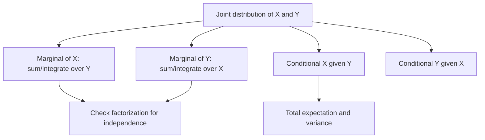

# Joint, Marginal, and Conditional Distributions

Most probability models involve more than one random variable. A student's study time and exam score, two components in a system, or the two coordinates of a random point are not separate stories; their relationship is often the point of the model. Joint distributions describe variables together. Marginal distributions describe one variable after ignoring the others. Conditional distributions describe one variable after another has been observed.

The joint law is the complete object. Marginals and conditionals are different views obtained by summing, integrating, or renormalizing it; marginals alone generally cannot reconstruct the dependence.

## The joint law and its two projections

For discrete random variables $X$ and $Y$, the **joint PMF** is

$$
p_{X,Y}(x,y)=P(X=x,Y=y).
$$

The **marginal PMFs** are obtained by summing over the other variable:

$$
p_X(x)=\sum_y p_{X,Y}(x,y),
$$

$$
p_Y(y)=\sum_x p_{X,Y}(x,y).
$$

If $p_Y(y)\gt 0$, the **conditional PMF** of $X$ given $Y=y$ is

$$
p_{X\mid Y}(x\mid y)=\frac{p_{X,Y}(x,y)}{p_Y(y)}.
$$

For continuous random variables, the **joint PDF** $f_{X,Y}(x,y)$ satisfies

$$
P((X,Y)\in A)=\iint_A f_{X,Y}(x,y)\,dx\,dy.
$$

The marginal PDFs are

$$
f_X(x)=\int_{-\infty}^{\infty} f_{X,Y}(x,y)\,dy,
$$

$$
f_Y(y)=\int_{-\infty}^{\infty} f_{X,Y}(x,y)\,dx.
$$

If $f_Y(y)\gt 0$, the conditional density is

$$
f_{X\mid Y}(x\mid y)=\frac{f_{X,Y}(x,y)}{f_Y(y)}.
$$

The **joint CDF** is

$$
F_{X,Y}(x,y)=P(X\le x,Y\le y).
$$

Unlike a density, the joint CDF always exists. If it is twice differentiable, then

$$
f_{X,Y}(x,y)=\frac{\partial^2}{\partial x\,\partial y}F_{X,Y}(x,y).
$$

It also recovers rectangle probabilities by inclusion--exclusion:

$$
\begin{aligned}
P(a<X\le b,\ c<Y\le d)
={}&F(b,d)-F(a,d)\\
&-F(b,c)+F(a,c).
\end{aligned}
$$

A multivariate model may have discrete mass, a continuous density, or a mixture of both. The CDF handles all three; a single ordinary joint density does not.

## Marginalizing and conditioning

**Factorization by conditioning.**

For discrete variables,

$$
p_{X,Y}(x,y)=p_{X\mid Y}(x\mid y)p_Y(y).
$$

For continuous variables,

$$
f_{X,Y}(x,y)=f_{X\mid Y}(x\mid y)f_Y(y).
$$

This is the random-variable version of $P(A\cap B)=P(A\mid B)P(B)$.

For more variables, repeated conditioning gives the chain factorization

$$
p(x_1,\ldots,x_n)
=p(x_1)\prod_{j=2}^n p(x_j\mid x_1,\ldots,x_{j-1}),
$$

with the analogous density formula. No independence assumption is needed. Graphical models become economical by asserting conditional independences that allow some conditioning variables to be dropped.

### Independence is factorization of the whole law

Random variables $X$ and $Y$ are independent if, for all suitable $x,y$,

$$
F_{X,Y}(x,y)=F_X(x)F_Y(y).
$$

In the discrete case, this is equivalent to

$$
p_{X,Y}(x,y)=p_X(x)p_Y(y)
$$

for all $x,y$. In the continuous case, it is equivalent to

$$
f_{X,Y}(x,y)=f_X(x)f_Y(y)
$$

where densities exist.

### Expectations use the same joint weights

For discrete variables,

$$
E[g(X,Y)]=\sum_x\sum_y g(x,y)p_{X,Y}(x,y).
$$

For continuous variables,

$$
E[g(X,Y)]=\int_{-\infty}^{\infty}\int_{-\infty}^{\infty}
g(x,y)f_{X,Y}(x,y)\,dx\,dy.
$$

### Total expectation and total variance

$$
E[X]=E[E[X\mid Y]].
$$

**Law of total variance.**

$$
\operatorname{Var}(X)=E[\operatorname{Var}(X\mid Y)]+\operatorname{Var}(E[X\mid Y]).
$$

These laws say that overall variation can be split into within-condition variation and between-condition variation.

The total-expectation law follows by substituting the conditional factorization. In the discrete case,

$$
\begin{aligned}
E[E[X\mid Y]]
&=\sum_y\left(\sum_x x\,p_{X\mid Y}(x\mid y)\right)p_Y(y)\\
&=\sum_y\sum_x x\,p_{X,Y}(x,y)\\
&=E[X].
\end{aligned}
$$

The order of summation may be interchanged under the usual integrability conditions. The continuous proof replaces the sums by integrals.

## Draw the support before integrating

The support of a joint distribution is often the most important part of the problem. If the support is rectangular, such as $0\lt x\lt 1$ and $0\lt y\lt 1$, integration limits are usually independent. If the support is triangular, circular, or constrained by inequalities such as $0\lt y\lt x\lt 1$, the limits change with the variable being integrated. Many wrong marginal densities come from integrating over the right formula but the wrong region.

Conditional distributions are distributions in their own right. After observing $Y=y$, the function $p_{X\mid Y}(x\mid y)$ or $f_{X\mid Y}(x\mid y)$ must sum or integrate to $1$ over $x$. If it does not normalize, the denominator or support is wrong.

For a triangular support $0\lt y\lt x\lt 1$, the two useful descriptions are

$$
0<x<1,\quad 0<y<x
$$

and

$$
0<y<1,\quad y<x<1.
$$

The first is suited to integrating out $y$; the second to integrating out $x$. A quick sketch or these paired inequalities prevents most limit errors.

Conditioning on $Y=y$ in a continuous model refers to a regular conditional distribution, because the event $Y=y$ itself usually has probability zero. The density ratio is the standard computational form where the marginal density is positive. It should not be interpreted as dividing two positive event probabilities at a point.

Conditional expectation compresses a conditional distribution into a single function:

$$
E[X\mid Y=y].
$$

As $y$ changes, this value can trace a regression curve. In linear regression, the corresponding statistical model focuses on how the conditional mean of a response changes with predictors.

Marginalization can also hide structure. Two groups may have different conditional relationships between $X$ and $Y$, while the combined marginal relationship looks weaker, stronger, or even reversed. This is the probability mechanism behind Simpson's paradox. Whenever a joint distribution includes a meaningful grouping variable, compare conditional distributions as well as the aggregate marginal distribution.

## From the joint law to other views



| Operation | Discrete | Continuous |
|---|---|---|
| joint probability/density | $p_{X,Y}(x,y)$ | $f_{X,Y}(x,y)$ |
| marginalize $Y$ | $\sum_y p_{X,Y}(x,y)$ | $\int f_{X,Y}(x,y)\,dy$ |
| condition on $Y=y$ | $p_{X,Y}(x,y)/p_Y(y)$ | $f_{X,Y}(x,y)/f_Y(y)$ |
| compute probability in region | sum over cells | double integral |

## Marginals do not determine dependence

Suppose both $X$ and $Y$ are Bernoulli$(1/2)$. One possible joint table is the independent table, with all four cells equal to $1/4$. Another is

| $p_{X,Y}(x,y)$ | $y=0$ | $y=1$ |
|---|---:|---:|
| $x=0$ | $1/2$ | $0$ |
| $x=1$ | $0$ | $1/2$ |

The second table has the same marginals but satisfies $Y=X$ with probability one. A third table can put mass $1/2$ on each off-diagonal cell, giving $Y=1-X$. Marginal distributions say how each variable behaves alone; they leave the coupling unspecified.

For a two-by-two table with Bernoulli$(1/2)$ marginals, every valid joint law has the form

$$
\begin{array}{c|cc}
&Y=0&Y=1\\\hline
X=0&a&1/2-a\\
X=1&1/2-a&a
\end{array}
$$

for $0\le a\le1/2$. The endpoints give perfect negative or positive dependence, while $a=1/4$ gives independence. This one parameter changes the joint behavior without changing either marginal.

## Support can rule out independence immediately

If positive densities factor as $f_X(x)f_Y(y)$, their joint positive support is essentially a Cartesian product of the two marginal supports. A triangular support such as $0\lt y\lt x\lt 1$ cannot have independent coordinates with both marginals positive across $(0,1)$: some pairs permitted by the marginals, such as a small $x$ and large $y$, are forbidden jointly.

A rectangular support does not prove independence. The density must still factor. Conversely, apparent non-factorization caused only by an algebraic constant can disappear after the marginals are computed. Checking support first is fast, then checking $f_{X,Y}=f_Xf_Y$ completes the argument.

## Conditional expectation as a function of information

The notation $E[X\mid Y]$ denotes a random variable measurable with respect to $Y$. If $m(y)=E[X\mid Y=y]$, then

$$
E[X\mid Y]=m(Y).
$$

It satisfies the defining averaging property

$$
E[XI_{\{Y\in B\}}]
=E[E[X\mid Y]I_{\{Y\in B\}}]
$$

for every suitable set $B$. In a discrete model, this says that replacing $X$ by its conditional mean preserves totals within every group defined by $Y$.

Under squared loss, $E[X\mid Y]$ is the best predictor of $X$ based on $Y$. For any function $g(Y)$ with finite second moment,

$$
\begin{aligned}
E[(X-g(Y))^2]
={}&E[(X-E[X\mid Y])^2]\\
&+E[(E[X\mid Y]-g(Y))^2].
\end{aligned}
$$

The cross term vanishes after conditioning on $Y$. The full conditional distribution contains more information than this predictor, including asymmetry and tail risk around the conditional mean.

## Simpson reversal from aggregation

Consider two groups with success counts:

| Group | Method A | Method B |
|---|---:|---:|
| easier cases | $81/87$ | $234/270$ |
| harder cases | $192/263$ | $55/80$ |

Within the easier group, method A has rate about $93.1\%$ versus $86.7\%$ for B. Within the harder group, A has about $73.0\%$ versus $68.8\%$ for B. Yet after aggregation,

$$
P(\text{success}\mid A)=\frac{273}{350}=78.0\%,
$$

while

$$
P(\text{success}\mid B)=\frac{289}{350}\approx82.6\%.
$$

Method A handled a much larger fraction of harder cases. The group variable changes the mixture weights, and marginalization reverses the within-group comparison. The arithmetic alone does not decide which conditional or marginal quantity answers a scientific question; that depends on how group assignment relates to the target.

## Iterated conditioning

With three variables, the tower property can be applied in stages. If the information in $Z$ includes the information in $Y$, then

$$
E[E[X\mid Z]\mid Y]=E[X\mid Y].
$$

For example, $Z$ might contain both region and store, while $Y$ contains only region. First average within stores, then average those conditional means within regions using the correct store weights. Averaging unweighted subgroup means can give the wrong marginal mean when subgroup sizes differ.

## Conditional densities reverse by Bayes' rule

The factorization of a joint density can be written in either direction:

$$
f_{X,Y}(x,y)=f_{Y\mid X}(y\mid x)f_X(x)
=f_{X\mid Y}(x\mid y)f_Y(y).
$$

Equating them gives the density form of Bayes' rule:

$$
f_{X\mid Y}(x\mid y)
=\frac{f_{Y\mid X}(y\mid x)f_X(x)}
{\int f_{Y\mid X}(y\mid u)f_X(u)\,du}.
$$

The denominator is the marginal density of the observed value $y$. In a Bayesian model, $f_X$ is a prior density and $f_{Y\mid X}$ is a likelihood model. Density values are not point probabilities, but their normalized product yields the conditional density.

For example, if $X$ is a latent signal with a normal density and $Y=X+\varepsilon$ with independent normal noise, the joint density factors as noise density times signal density. Completing the square in their product produces a normal conditional density for $X\mid Y=y$. The observation shifts the conditional mean toward $y$ and reduces conditional variance relative to the prior.

## Markov structure is a statement about conditionals

A sequence $X_0,X_1,\ldots$ is Markov when

$$
P(X_{n+1}\in A\mid X_0,\ldots,X_n)
=P(X_{n+1}\in A\mid X_n).
$$

The future need not be independent of the past unconditionally. It becomes conditionally independent of the earlier past after the current state is known. The joint law of a finite path factors as

$$
p(x_0,\ldots,x_n)
=p(x_0)\prod_{j=1}^{n}p(x_j\mid x_{j-1}).
$$

Marginalizing intermediate states gives multi-step transition probabilities. A large joint law can therefore be represented economically through local conditional laws.

## Changing integration order

For a nonnegative joint density, either order of integration gives the same probability. The bounds must describe the same region in both orders. For $0\lt y\lt x\lt 1$,

$$
\int_0^1\int_0^x f(x,y)\,dy\,dx
=\int_0^1\int_y^1 f(x,y)\,dx\,dy.
$$

Changing order helps when one marginal integral is difficult or when the target event has simpler vertical than horizontal slices. It does not replace drawing the support; it relies on describing that support correctly twice.

## Degenerate joint distributions

Not every pair of continuous marginals has a two-dimensional joint density. If $Y=X$ and $X$ is continuous, all probability lies on the diagonal line $y=x$, which has zero area in the plane. The marginals have densities, but the joint law is singular with respect to area. CDF and conditional formulations still apply, while a regular two-dimensional density does not.

This case warns against inferring joint continuity from marginal continuity. Dependence can concentrate probability on a curve or another lower-dimensional set.

## Normalization checks at every level

A joint PMF must sum to one over all pairs, and a joint density must integrate to one over its support. Marginalization preserves normalization automatically when the bounds are correct. For each conditioning value with positive marginal mass or density, the conditional law must normalize separately.

These checks locate different errors. A joint density integrating to one but producing a conditional density with total other than one usually has a wrong marginal denominator or conditional support. Marginals that do not normalize usually signal incorrect projection limits. Independence checks should come only after these basic validity checks; factorizing an invalid density proves nothing.

Units provide another check for continuous models. A joint density for variables measured in seconds and meters has reciprocal second-meter units. Integrating out meters leaves a marginal density with reciprocal-second units. A conditional density of distance given time has reciprocal-meter units because the conditioning density cancels the time unit.

## Dependence with fixed marginals

A copula is a way to describe the dependence separately from continuous marginal distributions. Transforming each variable by its own CDF produces uniform marginal variables; their joint distribution retains the dependence. Different copulas can then join the same marginals while producing different probabilities of simultaneous extremes.

No copula machinery is needed for basic calculations, but the idea clarifies why choosing two marginals does not finish a multivariate model. Independence selects the product coupling. Perfect comovement, negative association, and tail dependence require other joint constructions.

Bounds are possible even when the dependence is unknown. For any events $A$ and $B$,

$$
\max(0,P(A)+P(B)-1)
\le P(A\cap B)
\le\min(P(A),P(B)).
$$

These Fréchet bounds follow from inclusion--exclusion and monotonicity. They quantify how widely a joint probability can vary while the two marginal probabilities stay fixed.

## Worked calculations

### Joint table, marginals, and conditionals

**Problem.** The joint PMF of $X$ and $Y$ is:

| $p_{X,Y}(x,y)$ | $y=0$ | $y=1$ |
|---|---:|---:|
| $x=0$ | $0.20$ | $0.10$ |
| $x=1$ | $0.30$ | $0.40$ |

Find the marginal distributions, $P(X=1\mid Y=1)$, and determine whether $X$ and $Y$ are independent.

**Method.**

1. Check total probability:

$$
0.20+0.10+0.30+0.40=1.
$$

2. Marginal distribution of $X$:

$$
P(X=0)=0.20+0.10=0.30,
$$

$$
P(X=1)=0.30+0.40=0.70.
$$

3. Marginal distribution of $Y$:

$$
P(Y=0)=0.20+0.30=0.50,
$$

$$
P(Y=1)=0.10+0.40=0.50.
$$

4. Conditional probability:

$$
P(X=1\mid Y=1)=\frac{P(X=1,Y=1)}{P(Y=1)}
=\frac{0.40}{0.50}=0.80.
$$

5. Check independence. If independent, then

$$
P(X=1,Y=1)=P(X=1)P(Y=1)=0.70(0.50)=0.35.
$$

   But the table gives $0.40$.

The marginals are $P(X=0)=0.30$, $P(X=1)=0.70$, $P(Y=0)=0.50$, $P(Y=1)=0.50$. Also $P(X=1\mid Y=1)=0.80$, and $X,Y$ are not independent.

### A continuous joint density

**Problem.** Let

$$
f_{X,Y}(x,y)=2
$$

on the triangular region $0\lt y\lt x\lt 1$, and $0$ otherwise. Find $f_X(x)$, $f_Y(y)$, and $f_{Y\mid X}(y\mid x)$.

**Method.**

1. Verify normalization. The triangular region has area $1/2$, so the integral of constant density $2$ over it is $1$.

2. For fixed $x$, the possible $y$ values satisfy $0\lt y\lt x$. Therefore

$$
f_X(x)=\int_0^x 2\,dy=2x,\quad 0<x<1.
$$

3. For fixed $y$, the possible $x$ values satisfy $y\lt x\lt 1$. Therefore

$$
f_Y(y)=\int_y^1 2\,dx=2(1-y),\quad 0<y<1.
$$

4. Conditional density of $Y$ given $X=x$:

$$
f_{Y\mid X}(y\mid x)=\frac{f_{X,Y}(x,y)}{f_X(x)}
=\frac{2}{2x}
=\frac{1}{x},
$$

   for $0\lt y\lt x$.

5. Interpret. Given $X=x$, the conditional density of $Y$ is uniform on $(0,x)$.

6. Check normalization:

$$
\int_0^x \frac{1}{x}\,dy=1.
$$

$f_X(x)=2x$, $f_Y(y)=2(1-y)$, and $Y\mid X=x\sim \operatorname{Uniform}(0,x)$.

### Total expectation and variance on the triangle

Continue with the density $f_{X,Y}(x,y)=2$ on $0\lt y\lt x\lt 1$. Since $Y\mid X=x$ is Uniform$(0,x)$,

$$
E[Y\mid X=x]=\frac{x}{2},
\qquad
\operatorname{Var}(Y\mid X=x)=\frac{x^2}{12}.
$$

The marginal density of $X$ is $2x$, so

$$
E[X]=\int_0^1x(2x)\,dx
=2\int_0^1x^2\,dx
=\frac23.
$$

Total expectation gives

$$
E[Y]=E\left[\frac X2\right]=\frac13.
$$

This agrees with direct integration using $f_Y(y)=2(1-y)$:

$$
E[Y]=\int_0^1 2y(1-y)\,dy
=\left[y^2-\frac23y^3\right]_0^1
=\frac13.
$$

For variance, first calculate

$$
E[X^2]=\int_0^1x^2(2x)\,dx=\frac12,
$$

so

$$
\operatorname{Var}(X)=\frac12-\left(\frac23\right)^2=\frac1{18}.
$$

Now apply total variance:

$$
\begin{aligned}
\operatorname{Var}(Y)
&=E\left[\frac{X^2}{12}\right]
+\operatorname{Var}\left(\frac X2\right)\\
&=\frac1{12}\cdot\frac12
+\frac14\cdot\frac1{18}\\
&=\frac1{24}+\frac1{72}\\
&=\frac1{18}.
\end{aligned}
$$

The decomposition separates uncertainty left after $X$ is known from uncertainty caused by the varying value of $X$ itself.

## Numerical checks

```python
import numpy as np

# Discrete joint table example.
joint = np.array([
    [0.20, 0.10],
    [0.30, 0.40],
])

px = joint.sum(axis=1)
py = joint.sum(axis=0)
conditional_x1_given_y1 = joint[1, 1] / py[1]
independent = np.allclose(joint, np.outer(px, py))

print("P_X:", px)
print("P_Y:", py)
print("P(X=1 | Y=1):", conditional_x1_given_y1)
print("independent:", independent)

# Monte Carlo check for triangular density f=2 on 0<y<x<1.
rng = np.random.default_rng(0)
n = 100_000
# Sample X from density 2x using inverse CDF X=sqrt(U).
x = np.sqrt(rng.random(n))
y = rng.random(n) * x
print("sample mean X:", x.mean())
print("sample mean Y:", y.mean())
```

## Errors in multivariable calculations

- Confusing joint and marginal probabilities. A joint table cell is not the same as a row total.
- Dividing by the wrong marginal when computing conditionals.
- Assuming a joint density value is a probability. Probabilities require integrating over a region.
- Checking independence at only one cell and declaring success. Factorization must hold over the whole support.
- Forgetting support constraints when integrating. In triangular or curved regions, limits depend on the other variable.
- Treating zero covariance as independence. That implication holds only under special conditions, not generally.

<div className="see-also">

See also: [conditional probability and Bayes' theorem](/math/probability/conditional-probability-bayes) · [covariance, correlation, and independence](/math/probability/covariance-correlation-independence) · [functions of random variables](/math/probability/transformations-random-variables) · [Markov chains intro](/math/probability/markov-chains) · [bivariate data and correlation](/math/statistics/bivariate-data-and-correlation)

</div>
