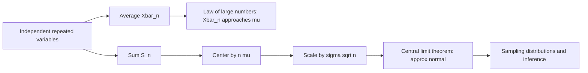

# Limit Theorems

Limit theorems explain why averages stabilize and why normal distributions appear so often. The law of large numbers says that sample averages converge toward the expected value. The central limit theorem says that, after centering and scaling, sums of many weakly behaved independent variables become approximately normal. These results are the mathematical reason repeated measurement can produce reliable estimates.

The limiting statement and the finite-sample approximation are separate matters. A theorem can guarantee eventual convergence without saying that $n=30$ is enough for a particular skewed distribution or tail probability.

## Three meanings of convergence

Let $X_1,X_2,\ldots$ be random variables with common mean $\mu$. The **sample mean** is

$$
\overline{X}_n=\frac{1}{n}\sum_{i=1}^n X_i.
$$

A sequence $Y_n$ **converges in probability** to $Y$ if, for every $\epsilon\gt 0$,

$$
P(|Y_n-Y|>\epsilon)\to 0
$$

as $n\to\infty$.

A sequence $Y_n$ **converges almost surely** to $Y$ if

$$
P\left(\lim_{n\to\infty}Y_n=Y\right)=1.
$$

Almost sure convergence is stronger than convergence in probability.

A sequence $Y_n$ **converges in distribution** to $Y$ if

$$
F_{Y_n}(y)\to F_Y(y)
$$

at every continuity point $y$ of $F_Y$.

The **standard normal** random variable is denoted by $Z\sim N(0,1)$, with CDF $\Phi$.

The main implication chain is

$$
\text{almost sure convergence}
\Longrightarrow
\text{convergence in probability}
\Longrightarrow
\text{convergence in distribution}.
$$

Neither reverse implication holds in general. If the limit is a constant, convergence in distribution to that constant does imply convergence in probability. Convergence in distribution only compares CDFs; it does not say that $Y_n$ and $Y$ are close on the same realized outcome.

## Averages settle: the laws of large numbers

**Weak law of large numbers.** If $X_1,X_2,\ldots$ are independent and identically distributed with $E[X_i]=\mu$ and finite variance $\sigma^2$, then

$$
\overline{X}_n \xrightarrow{P} \mu.
$$

A proof sketch uses Chebyshev's inequality. Since

$$
E[\overline{X}_n]=\mu
$$

and, by independence,

$$
\operatorname{Var}(\overline{X}_n)=\frac{\sigma^2}{n},
$$

Chebyshev gives

$$
P(|\overline{X}_n-\mu|\ge \epsilon)
\le \frac{\sigma^2}{n\epsilon^2}\to 0.
$$

### The strong law

Under standard conditions such as independent identically distributed variables with $E[\vert X_1\vert ]\lt \infty$,

$$
\overline{X}_n \to \mu
$$

almost surely.

The strong law concerns whole infinite sample paths: except on a probability-zero set of paths, the running average eventually stays near $\mu$. The weak law only says the probability of a large deviation at time $n$ tends to zero.

## Fluctuations remain: the central limit theorem

If $X_1,\ldots,X_n$ are independent identically distributed with mean $\mu$ and variance $\sigma^2\gt 0$, then

$$
\frac{\sum_{i=1}^n X_i-n\mu}{\sigma\sqrt{n}}
\xrightarrow{d} N(0,1).
$$

Equivalently,

$$
\frac{\overline{X}_n-\mu}{\sigma/\sqrt{n}}
\xrightarrow{d} N(0,1).
$$

### MGF proof sketch

Assume the MGF exists near zero, a stronger condition than the basic theorem needs. Standardize one observation as $Y=(X-\mu)/\sigma$. Near $0$, its MGF has expansion

$$
M_Y(t)=1+\frac{t^2}{2}+o(t^2),
$$

because $E[Y]=0$ and $E[Y^2]=1$. For the standardized sum $S_n=(Y_1+\cdots+Y_n)/\sqrt n$, independence gives

$$
M_{S_n}(t)=\left[M_Y\left(\frac{t}{\sqrt n}\right)\right]^n.
$$

Substitute the expansion:

$$
M_{S_n}(t)
=\left[1+\frac{t^2}{2n}+o\left(\frac1n\right)\right]^n
\longrightarrow e^{t^2/2}.
$$

The limit is the MGF of $N(0,1)$. Characteristic functions supply a proof under the weaker finite-variance assumptions because they always exist.

### Normal approximation to a binomial count

If $X\sim\operatorname{Binomial}(n,p)$, then for large $n$,

$$
\frac{X-np}{\sqrt{np(1-p)}}\approx N(0,1).
$$

A continuity correction often improves the approximation:

$$
P(a\le X\le b)\approx
P(a-0.5\le Y\le b+0.5)
$$

where $Y\sim N(np,np(1-p))$.

## What the two theorems do and do not say

The LLN says the sample mean becomes close to $\mu$; it does not describe the detailed shape of the error. The CLT describes that error after multiplying by $\sqrt{n}$. The typical size of $\overline{X}_n-\mu$ is on the order of $1/\sqrt{n}$, not $1/n$. Quadrupling the sample size roughly halves the standard error.

The assumptions matter. Independence can be weakened in some advanced versions, and identical distribution can also be relaxed, but some control over dependence and tail size is still needed. Heavy-tailed variables with infinite variance may converge to non-normal stable laws rather than to a normal distribution. Strong dependence can prevent averaging from reducing uncertainty at the usual rate.

The CLT is about distributions, not about individual observations becoming normal. If the original data are skewed, individual future observations remain skewed. What becomes approximately normal is the standardized sum or average. This distinction is central in statistics: a sample mean can be approximately normal even when the raw data are not.

Continuity corrections illustrate another practical issue: a theorem may give the limiting shape, but finite-sample accuracy depends on details. A binomial count is discrete, while the normal approximation is continuous. Replacing $P(70\le X\le 90)$ with an area from $69.5$ to $90.5$ aligns integer bars with continuous intervals. For highly skewed distributions or tail probabilities, simulation or exact computation may be better than a rough CLT approximation.

Limit theorems justify many methods, but they do not remove the need for diagnostics. If data are dependent over time, clustered by group, or generated by a changing process, the effective sample size may be much smaller than the raw count.

The standard error $\sigma/\sqrt{n}$ is the practical bridge from the CLT to statistics. It quantifies the spread of sample means across repeated samples. If $\sigma$ is unknown, statistics replaces it with an estimate, which leads to $t$ procedures under normal-sample assumptions. That inferential step is covered in the statistics section, but the probability source is the variance of the sample mean.

For proportions, the same logic gives standard error

$$
\sqrt{\frac{p(1-p)}{n}}.
$$

This comes from treating each trial as Bernoulli.

As sample size grows, the standard error shrinks, but model bias does not automatically disappear. Averaging many biased measurements converges to the wrong center. Limit theorems control random error under assumptions; they do not fix bad measurement, sampling bias, or a misspecified target.

### Slutsky's theorem and estimated scale

If $Y_n\xrightarrow{d}Y$ and $Z_n\xrightarrow{P}c$, then

$$
Y_n+Z_n\xrightarrow{d}Y+c,
\qquad
Y_nZ_n\xrightarrow{d}cY.
$$

When $c\ne0$, division also behaves as expected. This permits replacement of an unknown $\sigma$ by a consistent estimator in many asymptotic statistics. It does not say that the finite-sample distribution is exactly normal; it transfers the limiting distribution.

## How the statements fit together



| Theorem | What converges? | Type of convergence | Main message |
|---|---|---|---|
| Weak LLN | $\overline{X}_n$ | probability | averages get close to $\mu$ |
| Strong LLN | $\overline{X}_n$ | almost surely | long-run average settles at $\mu$ |
| CLT | standardized sum or mean | distribution | shape becomes normal |
| Normal approximation | binomial counts | approximation | large count probabilities use $Z$ |

## Convergence mode examples

Let $U\sim\operatorname{Uniform}(0,1)$ and define $Y_n=I_{\{U\le1/n\}}$. Then

$$
P(|Y_n-0|>1/2)=P(U\le1/n)=\frac1n\to0,
$$

so $Y_n\to0$ in probability. For almost every fixed outcome $U=u\gt 0$, eventually $1/n\lt u$, after which $Y_n=0$ forever. Thus convergence is also almost sure in this construction.

To see why distributional convergence is weaker, let every $Y_n$ have the same $N(0,1)$ distribution as a variable $Y$ but arrange them independently on a common probability space. Their CDFs are identical, so $Y_n\xrightarrow{d}Y$. The difference $Y_n-Y$ does not shrink in probability; it retains nonzero variation. Distributional convergence compares laws, not samplewise closeness.

Convergence of random variables also does not automatically imply convergence of expectations. Rare, increasingly large values can disappear in probability while keeping or increasing the mean. If

$$
X_n=
\begin{cases}
n,&\text{with probability }1/n,\\
0,&\text{otherwise},
\end{cases}
$$

then $X_n\to0$ in probability, but $E[X_n]=1$ for every $n$. Additional conditions such as domination or uniform integrability are needed to interchange limits and expectations.

## How fast does the normal approximation improve?

The basic CLT gives no universal sample-size cutoff. Finite-sample error depends on skewness, tail weight, lattice effects, and which part of the distribution is queried. A bounded symmetric population may approach normality quickly near its center. A highly skewed population can need far more observations, especially for extreme tail probabilities.

With a finite third absolute central moment, Berry--Esseen bounds the maximum CDF error by a constant times

$$
\frac{E[|X-\mu|^3]}{\sigma^3\sqrt n}.
$$

The expression explains two qualitative facts: approximation error commonly decreases at a $1/\sqrt n$ rate, and large standardized third moments slow convergence. The bound is conservative and does not replace an exact calculation when one is available.

For Bernoulli sums, the rules of thumb based on $np$ and $n(1-p)$ are checks on skew and boundary distance. When $p$ is close to zero, the lower boundary remains influential even if $n$ looks large. A Poisson approximation may then be better than a normal one.

## Dependence changes the effective sample size

For identically distributed variables with variance $\sigma^2$ and common pairwise correlation $\rho$,

$$
\operatorname{Var}(\overline X_n)
=\frac{\sigma^2}{n}[1+(n-1)\rho].
$$

When $\rho=0$, the usual $\sigma^2/n$ appears. If $\rho\gt 0$ remains fixed, the variance approaches $\rho\sigma^2$ instead of zero, so averaging does not consistently reveal the mean. The constant-correlation model is simplified, but it shows why a thousand measurements from tightly related units can contain far less information than a thousand independent measurements.

For time series, correlations often decay with lag rather than staying constant. Variance of the mean then involves a sum of autocovariances. Clustered surveys and repeated measurements have analogous corrections. Substituting the raw number of rows for an independent sample size understates uncertainty.

## Delta-method extension

Suppose

$$
\sqrt n(T_n-\theta)\xrightarrow{d}N(0,\tau^2)
$$

and $g$ is differentiable at $\theta$. A first-order Taylor expansion gives

$$
g(T_n)-g(\theta)
\approx g'(\theta)(T_n-\theta),
$$

so

$$
\sqrt n[g(T_n)-g(\theta)]
\xrightarrow{d}N(0,[g'(\theta)]^2\tau^2).
$$

This delta method carries a CLT through smooth transformations. It fails at points where the derivative is zero or absent without a higher-order analysis.

## Rare deviations live beyond the CLT scale

The CLT describes deviations of a sum on the order of $\sqrt n$, or deviations of a mean on the order of $1/\sqrt n$. It does not directly estimate the probability that a sample mean differs from $\mu$ by a fixed amount as $n$ grows. Such events move farther into the standardized tail with increasing $n$.

When an MGF exists near zero, exponential concentration bounds can address that regime. For any $t\gt 0$, Markov's inequality gives

$$
P(S_n\ge a)
=P(e^{tS_n}\ge e^{ta})
\le e^{-ta}M_{S_n}(t).
$$

Optimizing over $t$ yields a Chernoff bound. Independence makes $M_{S_n}(t)$ a product, often producing a probability that decreases exponentially with $n$. The CLT supplies an approximate central shape; concentration and large-deviation methods control much rarer fixed-size departures.

No contradiction exists between the $1/\sqrt n$ standard-error rate and exponential tail decay. The first describes the width of typical fluctuations. The second describes the probability of a deviation whose absolute size does not shrink with the sample mean's typical scale.

## Exact distributions still outrank asymptotics

If the summands are normal, the sample mean is exactly normal for every $n$. If exponential waiting times are summed, the result is exactly gamma. A binomial probability can be computed exactly by a stable library routine. Limit theorems remain valuable for broad understanding and models without convenient exact forms, but approximation should not displace an accessible exact calculation.

Simulation can check a proposed approximation at selected parameter values. It introduces Monte Carlo error and cannot prove a theorem, yet it can reveal severe skew, boundary effects, or tail mismatch before an asymptotic formula is used operationally.

## Continuous mapping preserves many limits

If $Y_n\xrightarrow{P}Y$ and $g$ is continuous at values taken by $Y$, then

$$
g(Y_n)\xrightarrow{P}g(Y).
$$

An analogous statement holds for convergence in distribution. Thus a consistent estimator remains consistent after a continuous transformation: if $T_n\to\theta$ in probability and $\theta\gt 0$, then $\log T_n\to\log\theta$ and $1/T_n\to1/\theta$.

Continuity at the limit is essential. If $g$ jumps at the limiting value, small changes in $Y_n$ can produce nonvanishing changes in $g(Y_n)$. Division also fails when the denominator limit is zero. Slutsky's theorem and the delta method are refinements of this general principle for combining limits and tracking their fluctuation scale.

## Worked approximations

### LLN bound for coin flips

**Problem.** A fair coin is flipped $n=1000$ times. Let $\overline{X}_n$ be the sample proportion of heads, where $X_i=1$ for heads and $0$ for tails. Use Chebyshev's inequality to bound

$$
P(|\overline{X}_n-0.5|\ge 0.05).
$$

**Method.**

1. For one flip,

$$
X_i\sim\operatorname{Bernoulli}(0.5).
$$

2. Mean and variance:

$$
E[X_i]=0.5,
$$

$$
\operatorname{Var}(X_i)=0.5(1-0.5)=0.25.
$$

3. The sample mean has variance

$$
\operatorname{Var}(\overline{X}_n)=\frac{0.25}{1000}=0.00025.
$$

4. Chebyshev's inequality says

$$
P(|\overline{X}_n-\mu|\ge \epsilon)
\le \frac{\operatorname{Var}(\overline{X}_n)}{\epsilon^2}.
$$

5. Substitute $\epsilon=0.05$:

$$
\begin{aligned}
P(|\overline{X}_n-0.5|\ge 0.05)
&\le \frac{0.00025}{(0.05)^2}\\
&=\frac{0.00025}{0.0025}\\
&=0.10.
\end{aligned}
$$

6. Interpretation. Chebyshev guarantees the probability is at most $10\%$. The exact probability is smaller, but Chebyshev works broadly without requiring a binomial table.

The Chebyshev upper bound is $0.10$. It is a guarantee based only on the variance, not an estimate of the actual tail probability.

### CLT approximation for a binomial count

**Problem.** Suppose $X\sim\operatorname{Binomial}(200,0.40)$. Approximate $P(70\le X\le 90)$ using the normal approximation with continuity correction.

**Method.**

1. Compute mean:

$$
\mu=np=200(0.40)=80.
$$

2. Compute variance and standard deviation:

$$
\sigma^2=np(1-p)=200(0.40)(0.60)=48,
$$

$$
\sigma=\sqrt{48}\approx 6.9282.
$$

3. Apply continuity correction:

$$
P(70\le X\le 90)\approx P(69.5\le Y\le 90.5),
$$

   where $Y\sim N(80,48)$.

4. Standardize lower endpoint:

$$
z_1=\frac{69.5-80}{6.9282}\approx -1.5155.
$$

5. Standardize upper endpoint:

$$
z_2=\frac{90.5-80}{6.9282}\approx 1.5155.
$$

6. Use the standard normal CDF:

$$
P(69.5\le Y\le 90.5)=\Phi(1.5155)-\Phi(-1.5155).
$$

7. With $\Phi(1.5155)\approx 0.9352$ and $\Phi(-1.5155)\approx 0.0648$,

$$
P(70\le X\le 90)\approx 0.8704.
$$

The CLT approximation is about $0.870$.

### Mean waiting time from a skewed population

Let $X_1,\ldots,X_{100}$ be independent Exponential$(1/5)$ waiting times, so each has mean $5$ minutes and standard deviation $5$ minutes. Approximate

$$
P(4.5\le\overline X_{100}\le5.8).
$$

The sample mean has mean $5$ and standard error

$$
\frac{\sigma}{\sqrt n}=\frac5{10}=0.5.
$$

Standardize the two endpoints:

$$
z_1=\frac{4.5-5}{0.5}=-1,
\qquad
z_2=\frac{5.8-5}{0.5}=1.6.
$$

The CLT approximation is

$$
\begin{aligned}
P(4.5\le\overline X_{100}\le5.8)
&\approx\Phi(1.6)-\Phi(-1)\\
&\approx0.9452-0.1587\\
&=0.7865.
\end{aligned}
$$

Individual waiting times remain strongly right-skewed. The approximation applies to their average. Because the sum of exponentials has an exact gamma distribution, this example can also be checked without the CLT.

## Simulation and exact checks

```python
import numpy as np
from scipy.stats import binom, norm

# LLN simulation.
rng = np.random.default_rng(3)
n = 1000
reps = 20_000
samples = rng.binomial(1, 0.5, size=(reps, n))
means = samples.mean(axis=1)
sim_prob = np.mean(np.abs(means - 0.5) >= 0.05)
chebyshev_bound = 0.25 / (n * 0.05**2)
print("simulation:", sim_prob)
print("Chebyshev bound:", chebyshev_bound)

# CLT approximation for Binomial(200, 0.40).
n, p = 200, 0.40
mu = n * p
sigma = np.sqrt(n * p * (1 - p))
approx = norm.cdf((90.5 - mu) / sigma) - norm.cdf((69.5 - mu) / sigma)
exact = binom.cdf(90, n, p) - binom.cdf(69, n, p)
print("normal approximation:", approx)
print("exact binomial:", exact)
```

## Approximation errors to watch

- Thinking the LLN says short-run outcomes must balance out. It says averages stabilize as $n$ grows, not that tails "owe" heads.
- Using the CLT for very small samples without checking the parent distribution or skew.
- Forgetting to scale by $\sqrt{n}$ in the CLT.
- Confusing convergence in probability with convergence in distribution.
- Applying the normal approximation to a binomial when $np$ or $n(1-p)$ is too small.
- Forgetting the continuity correction for discrete-to-continuous approximations when accuracy matters.

<div className="see-also">

See also: [expectation, variance, and moments](/math/probability/expectation-variance-moments) · [common discrete distributions](/math/probability/common-discrete-distributions) · [common continuous distributions](/math/probability/common-continuous-distributions) · [sampling distributions and CLT](/math/statistics/sampling-distributions-and-clt) · [normal, t, chi-square, and F distributions](/math/statistics/normal-t-chi-square-and-f-distributions)

</div>
