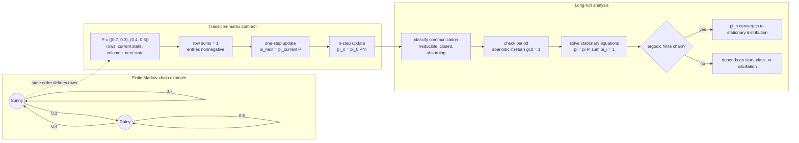

# Markov Chains

A Markov chain models random movement among states when the next state depends on the current state rather than the full past. The assumption supports models of queues, genetics, board games, web ranking, weather, text generation, inventory systems, and random walks.

For finite, discrete-time chains, the central computations concern transition probabilities, multi-step behavior, and stationary distributions.

## Reading the state graph and transition matrix

A **discrete-time stochastic process** is a sequence of random variables

$$
X_0,X_1,X_2,\ldots
$$

indexed by time. It has the **Markov property** when

$$
P(X_{n+1}=j\mid X_n=i,X_{n-1}=i_{n-1},\ldots,X_0=i_0)
=P(X_{n+1}=j\mid X_n=i).
$$

The possible values are **states**. For a finite chain with states $1,\ldots,m$, the transition probability from state $i$ to state $j$ is

$$
p_{ij}=P(X_{n+1}=j\mid X_n=i).
$$

Collecting these probabilities gives the transition matrix

$$
P=
\begin{pmatrix}
p_{11} & p_{12} & \cdots & p_{1m}\\
p_{21} & p_{22} & \cdots & p_{2m}\\
\vdots & \vdots & \ddots & \vdots\\
p_{m1} & p_{m2} & \cdots & p_{mm}
\end{pmatrix}.
$$

Each row represents a current state, each column a next state, and every row sums to $1$:

$$
\sum_{j=1}^m p_{ij}=1.
$$

An initial distribution is the row vector

$$
\pi^{(0)}=(P(X_0=1),\ldots,P(X_0=m)).
$$

The following state graph and calculation path use the weather chain that will appear in the examples.



The state order fixes the correspondence between graph nodes and matrix rows. Before doing matrix algebra, the directed graph often reveals closed classes, absorbing states, and states that cannot be reached.

## Multi-step movement is matrix multiplication

The distribution after $n$ steps is

$$
\pi^{(n)}=\pi^{(0)}P^n.
$$

This is the Chapman--Kolmogorov equation in matrix form. The $(i,j)$ entry of $P^n$ is

$$
P(X_n=j\mid X_0=i).
$$

For two steps, every path from $i$ to $j$ passes through an intermediate state $k$, so

$$
(P^2)_{ij}=\sum_k p_{ik}p_{kj}.
$$

The same argument works for any split time $r+s=n$:

$$
p_{ij}^{(r+s)}=\sum_kp_{ik}^{(r)}p_{kj}^{(s)}.
$$

Condition on the state at time $r$, then sum over its possible values. This composition law is the probabilistic reason matrix powers appear; it is not merely convenient notation.

Expectations can also be propagated by $P$. For a function $g$ on the state space, regard its values as a column vector. Then

$$
(Pg)_i=\sum_jp_{ij}g(j)=E[g(X_{n+1})\mid X_n=i].
$$

Repeated application gives $(P^ng)_i=E[g(X_n)\mid X_0=i]$. Distributions evolve on the left, while observables evolve on the right. Mixing these two viewpoints is the source of many transpose errors.

| Concept | Formula | Meaning |
|---|---|---|
| one-step transition | $p_{ij}$ | chance the next state is $j$ from $i$ |
| transition matrix | $P$ | all one-step probabilities |
| $n$-step transition | $P^n$ | transition probabilities after $n$ steps |
| next distribution | $\pi^{(1)}=\pi^{(0)}P$ | updated state probabilities |
| stationary distribution | $\pi=\pi P$ | a distribution unchanged by transitions |

## When a stationary distribution predicts the limit

A distribution $\pi$ is **stationary** if

$$
\pi=\pi P
$$

and

$$
\sum_i \pi_i=1.
$$

For a finite irreducible chain, the stationary distribution is unique. If the chain is also aperiodic, then the distribution converges to it from every initial distribution, and $\pi_j$ is the long-run fraction of time spent in state $j$.

The eigenvalue $1$ is always present because $P\mathbf 1=\mathbf1$. A stationary row vector is a left eigenvector for that eigenvalue. In a finite irreducible aperiodic chain, every other eigenvalue has magnitude less than one, so their contributions to $P^n$ decay. For a diagonalizable chain the slowest asymptotic rate is governed by the second-largest eigenvalue magnitude. A value close to one means slow mixing even though eventual convergence is guaranteed.

For a reversible chain, detailed balance makes $P$ self-adjoint under the weighted inner product $\langle f,g\rangle_\pi=\sum_i\pi_if_ig_i$. Its eigenvalues are real and spectral convergence arguments become cleaner. Nonreversible chains may have complex eigenvalues and circulation around the state graph while maintaining the same stationary distribution.

The structural terms in that statement matter:

- State $j$ is **reachable** from state $i$ if $(P^n)_{ij}\gt 0$ for some $n$.
- Two states **communicate** when each is reachable from the other.
- The chain is **irreducible** when all states communicate.
- A state's **period** is the greatest common divisor of its possible return times. Period $1$ means the state is **aperiodic**.
- A state is **recurrent** if, starting from that state, the probability of an eventual return is $1$; otherwise it is **transient**. Every state in a finite irreducible chain is recurrent.

Periodicity can produce oscillation even when a stationary distribution exists. Reducibility can make the limiting behavior depend on the starting state or on which closed class is entered.

For example,

$$
P=\begin{pmatrix}0&1\\1&0\end{pmatrix}
$$

is irreducible and has stationary distribution $(1/2,1/2)$, but a chain starting in state $1$ alternates deterministically. Its distribution never converges. Time averages do converge to $(1/2,1/2)$, illustrating that stationary proportions and convergence of the one-time distribution are different claims.

A distribution satisfies **detailed balance** when

$$
\pi_i p_{ij}=\pi_j p_{ji}
$$

for every pair $i,j$. Summing these equations over $i$ shows that detailed balance implies stationarity. The converse need not hold.

## Absorption and changing transition laws

State $i$ is **absorbing** when

$$
p_{ii}=1.
$$

Once the chain enters it, the chain cannot leave. Games that end, machines that fail, and random walks with barriers lead naturally to absorbing chains. Partitioning the transition matrix into transient and absorbing states lets one calculate eventual absorption probabilities and expected times to absorption; powers of the matrix show probability mass moving into the absorbing states.

After ordering transient states first, an absorbing transition matrix has block form

$$
P=\begin{pmatrix}Q&R\\0&I\end{pmatrix}.
$$

The entry $(Q^n)_{ij}$ is the probability of being in transient state $j$ after $n$ steps, starting from transient state $i$. Because transient mass eventually leaves, $Q^n\to0$, and the geometric matrix series gives the fundamental matrix

$$
N=I+Q+Q^2+\cdots=(I-Q)^{-1}.
$$

$N_{ij}$ is the expected number of visits to transient state $j$ before absorption, counting the initial time when appropriate. Therefore

$$
t=N\mathbf1
$$

contains expected absorption times, while

$$
B=NR
$$

contains probabilities of absorption in each absorbing state.

## Expected duration of a small absorbing chain

Consider transient states $1,2$ and an absorbing state $A$ with

$$
P=\begin{pmatrix}
1/2&1/2&0\\
0&1/2&1/2\\
0&0&1
\end{pmatrix}.
$$

Then

$$
Q=\begin{pmatrix}1/2&1/2\\0&1/2\end{pmatrix},
\qquad
I-Q=\begin{pmatrix}1/2&-1/2\\0&1/2\end{pmatrix}.
$$

Inverting the triangular matrix gives

$$
N=(I-Q)^{-1}=\begin{pmatrix}2&2\\0&2\end{pmatrix}.
$$

Thus

$$
t=N\mathbf1=\begin{pmatrix}4\\2\end{pmatrix}.
$$

Starting in state $2$, the chain waits a geometric number of steps with success probability $1/2$, so mean time $2$ agrees with the matrix calculation. Starting in state $1$ requires mean $2$ steps to move to state $2$ and another mean $2$ to reach $A$, totaling $4$.

Here $R=(0,1/2)^T$, and $NR=(1,1)^T$: absorption in $A$ occurs with probability one from either transient state.

All formulas above assume a time-homogeneous chain: the same matrix $P$ is used at every step. If the probabilities vary with time, write $P_0,P_1,P_2,\ldots$, and replace $P^n$ by an ordered product of the step-specific matrices. Such chains can represent seasons, learning, or changing policies, but stationary-distribution arguments require additional care.

Continuous-time Markov chains use transition rates and generator matrices rather than one-step probabilities. They are central to queueing and reliability models but require a separate treatment.

## Choosing a state with enough memory

The Markov property depends on how the state is defined. Suppose tomorrow's demand depends on today's inventory and yesterday's unfilled orders. A state recording only today's inventory omits information needed for the next transition. Adding the outstanding orders to the state restores the Markov description.

Simulation provides a quick check of a proposed model. A long sample path gives empirical state and transition frequencies that can be compared with the matrix and stationary calculations. It cannot establish a convergence theorem, but it readily exposes row-order errors and impossible transitions.

## Two-day weather forecast

Consider states Sunny and Rainy with transition matrix

$$
P=
\begin{pmatrix}
0.7 & 0.3\\
0.4 & 0.6
\end{pmatrix},
$$

where rows describe today's weather and columns tomorrow's weather. Starting from Sunny gives

$$
\pi^{(0)}=(1,0).
$$

Two days later,

$$
\pi^{(2)}=\pi^{(0)}P^2.
$$

The Sunny-to-Rainy entry is

$$
(P^2)_{SR}=0.7(0.3)+0.3(0.6)=0.39.
$$

Thus

$$
\pi^{(2)}=(1,0)P^2=(0.61,0.39),
$$

so the probability of rain two days from now is $0.39$.

## Solving the weather equilibrium

Write the stationary distribution as

$$
\pi=(s,r),
$$

where $s$ and $r$ are the long-run Sunny and Rainy probabilities. The equation $\pi P=\pi$ gives

$$
0.7s+0.4r=s,
$$

$$
0.3s+0.6r=r.
$$

These equations are redundant once $s+r=1$ is imposed. From the first,

$$
0.4r=0.3s,
$$

so $r=0.75s$. Normalization then gives

$$
s+0.75s=1,
$$

and therefore

$$
\pi=\left(\frac{4}{7},\frac{3}{7}\right)\approx(0.5714,0.4286).
$$

## Computing powers, equilibria, and sample paths

```python
import numpy as np

P = np.array([
    [0.7, 0.3],
    [0.4, 0.6],
])

pi0 = np.array([1.0, 0.0])
pi2 = pi0 @ np.linalg.matrix_power(P, 2)
print("distribution after two days:", pi2)

# Solve (P.T - I) pi = 0 subject to sum(pi) = 1.
A = P.T - np.eye(2)
A[-1, :] = 1.0
b = np.array([0.0, 1.0])
stationary = np.linalg.solve(A, b)
print("stationary:", stationary)

rng = np.random.default_rng(4)
state = 0
counts = np.zeros(2)
for _ in range(100_000):
    counts[state] += 1
    state = rng.choice([0, 1], p=P[state])
print("simulated proportions:", counts / counts.sum())
```

## How quickly equilibrium becomes useful

Convergence to stationarity is qualitative until a distance and tolerance are chosen. Total variation distance between distributions $\mu$ and $\nu$ on a finite state space is

$$
\|\mu-\nu\|_{TV}=\frac12\sum_i|\mu_i-\nu_i|.
$$

It equals the largest probability difference the two distributions assign to the same event. A mixing time asks how many steps are needed before this distance from stationarity is below a specified threshold for every starting state.

For the weather chain, the nontrivial eigenvalue is $0.3$. Writing the Sunny probability as $q_n$ gives

$$
q_{n+1}=0.4+0.3q_n,
$$

whose fixed point is $4/7$. Hence

$$
q_n-\frac47=0.3^n\left(q_0-\frac47\right).
$$

In a two-state distribution, total variation is the absolute difference in either coordinate, so the distance shrinks exactly by $0.3$ each step. This turns the stationary calculation into a quantitative forecast of how much the initial weather still matters.

Coupling gives another interpretation. Run two copies of the chain from different states using shared randomness, arranged so that once they meet they move together. The probability they have not met by time $n$ bounds total variation between their distributions. A good coupling can prove rapid mixing without diagonalizing a large matrix.

## Return times and visits

Let $T_i^+=\min\{n\geq1:X_n=i\}$ be the first positive return time to state $i$. In a finite irreducible chain,

$$
E_i[T_i^+]=\frac1{\pi_i}.
$$

For the weather equilibrium, the mean return time to Sunny is $7/4$ days and to Rainy is $7/3$ days. These include a one-step return when weather persists. They differ from the waiting time to enter a state when starting outside it.

Expected visit counts can be computed by rewards. If $g(i)$ is a reward earned in state $i$, the stationary mean reward per step is $\sum_i\pi_i g(i)$. On a long irreducible trajectory, the time average converges to this value. Dependence affects fluctuations and effective sample size even though the mean limit is simple.

## Estimating a transition matrix

From an observed path, the maximum-likelihood estimate of $p_{ij}$ is the count of transitions $i\to j$ divided by the number of observed departures from $i$. Rows with few departures have high uncertainty, and an unobserved transition is not thereby impossible. Smoothing or prior information may be appropriate when the estimated chain will assign probabilities to future rare events.

The observation process can also hide the state. If emissions are noisy functions of an unobserved Markov chain, the model is a hidden Markov model; the observed sequence need not itself be Markov. Treating observed symbols as states can then produce transition probabilities that change with longer history.

## Bookkeeping checks that prevent wrong answers

- With row distributions, an update is $\pi P$, not $P\pi$. A column-vector convention is equally valid if used consistently.
- The rows of $P$ must sum to $1$, and $p_{ij}$ points from $i$ to $j$ rather than from $j$ to $i$.
- Solving $\pi=\pi P$ does not by itself prove convergence. Check irreducibility and periodicity.
- The past can affect the future through the current state. If additional history changes the next-step law, the proposed state is incomplete.
- A stationary distribution can exist without convergence from a point mass. Periodicity and multiple closed classes must be examined before taking a limit of $P^n$.
- Simulation estimates long-run behavior but rare transitions can require far more samples than a casual run suggests. Compare several starts and report uncertainty rather than treating one path as proof.

## Stationary equations as flow conservation

The equation $\pi_j=\sum_i\pi_ip_{ij}$ says that stationary mass entering state $j$ equals its mass after one step. Subtracting the self-loop term displays balance between flow from other states and flow leaving $j$. Detailed balance enforces equality on every pair; ordinary stationarity requires only equality of total incoming and outgoing flow.

This distinction appears on a directed cycle with occasional self-loops. The uniform distribution can be stationary because the same total mass enters and leaves each state, while net probability current circulates in one direction. Such a chain is nonreversible even though its marginals are constant under a stationary start.

Numerically, replacing one row of $P^T-I$ by the normalization equation usually gives a square system for an irreducible chain. Least-squares or eigenvector routines also work, but small negative components caused by rounding should be assessed relative to conditioning rather than silently clipped. Reducibility makes the nullspace larger and requires class analysis before normalization.

<div className="see-also">

See also: [conditional probability and Bayes' theorem](/math/probability/conditional-probability-bayes) · [joint, marginal, and conditional distributions](/math/probability/joint-marginal-conditional-distributions) · [limit theorems](/math/probability/limit-theorems) · [matrices and matrix algebra](/math/linear-algebra/matrices-and-matrix-algebra) · [random variables and distributions](/math/probability/random-variables-distributions)

</div>
