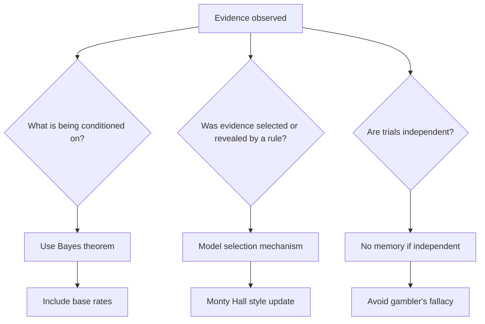

# Probability Pitfalls and Intuition

Probability is precise, but intuition about uncertainty is easily biased. Vivid evidence can crowd out base rates; one conditional probability is mistaken for its reverse; small samples are expected to look more regular than random samples usually do. Reliable reasoning begins with the sample space, the conditioning event, and the process that selected or revealed the observation.


*Figure: The Monty Hall problem turns on the host's rule for opening a door. Image: [Wikimedia Commons](https://commons.wikimedia.org/wiki/File:Monty_open_door.svg), Cepheus, public domain.*

## Diagnose the conditioning before calculating

The most common errors can be separated by asking three questions: what is conditioned on, how was the evidence selected, and are the trials independent?



| Pitfall | Mistaken thought | Correction |
|---|---|---|
| Base-rate fallacy | "The test is accurate, so I probably have it" | include prevalence |
| Prosecutor's fallacy | "Evidence is rare, so innocence is rare" | reverse conditioning with Bayes |
| Gambler's fallacy | "Tails is due" | independent trials do not compensate |
| Monty Hall | "Two doors remain, so $1/2$ each" | the host's reveal is informative |
| Multiple comparisons | "This rare pattern is amazing" | count how many patterns were possible |

The **base-rate fallacy** underweights the prior probability of a condition or hypothesis and overweights a test result or other evidence. Bayes' theorem restores the missing terms:

$$
P(H\mid E)=\frac{P(E\mid H)P(H)}{P(E)}.
$$

A small $P(E\mid H^c)$ can coexist with a modest $P(H\mid E)$ when $P(H)$ is very small or when many alternative hypotheses also explain the evidence.

The **prosecutor's fallacy** confuses

$$
P(\text{evidence}\mid \text{innocent})
$$

with

$$
P(\text{innocent}\mid \text{evidence}).
$$

The first is a likelihood under innocence; the second is a posterior probability that also depends on prior odds and the evidence-generating process.

## Base rates are easier to see as counts

Natural frequencies replace nested percentages with counts. For a condition with prevalence $0.1\%$ and a test with a $1\%$ false-positive rate, imagine testing $100{,}000$ people. Count the true positives and false positives, then form the desired ratio from those counts.

The reference class must match the available information. Risk measured in a broad population may not apply to a subgroup with different age, exposure, or symptoms. A preseason probability of a sports upset differs from the probability after injuries, weather, and opponent strength are known.

## Independent trials do not settle their accounts

The **gambler's fallacy** treats a streak in independent trials as if it increased the chance of the opposite result. For independent fair coin flips,

$$
P(\text{heads next}\mid \text{previous ten were tails})=\frac{1}{2}.
$$

Independence fixes the next-trial probability; it does not require short runs to balance. Long-run frequency stabilization is compatible with substantial local irregularity.

## Why switching wins in Monty Hall

The Monty Hall problem is governed by an information policy. The host knows where the car is, does not open the player's chosen door, and always opens a goat door. Changing that rule can change the answer.

Suppose one car and two goats are behind three doors. You choose Door 1, and the host opens a goat door among the other two.

Your first choice is correct with probability

$$
P(\text{initially correct})=\frac{1}{3},
$$

and wrong with probability

$$
P(\text{initially wrong})=\frac{2}{3}.
$$

When the first choice is correct, switching loses. When it is wrong, the host is forced to expose the only goat among the unchosen doors, so switching reaches the car. The cases are:

| Car location | Initial Door 1? | Host opens | Switch result |
|---|---:|---|---|
| Door 1 | correct | Door 2 or 3 | lose |
| Door 2 | wrong | Door 3 | win |
| Door 3 | wrong | Door 2 | win |

Therefore,

$$
P(\text{win by staying})=\frac{1}{3},
$$

$$
P(\text{win by switching})=\frac{2}{3}.
$$

These values assume the standard host rule. A host who sometimes opens a random door or chooses strategically defines a different conditional-probability problem.

## A database match is not a posterior verdict

Suppose a profile has random match probability $1$ in $1{,}000{,}000$ among unrelated innocent people, and a search covers $5{,}000{,}000$ possible people. The reported number means

$$
P(\text{match}\mid \text{a specified innocent person})=10^{-6}.
$$

Across the database, the expected number of innocent matches is

$$
5{,}000{,}000\cdot 10^{-6}=5.
$$

The expectation does not assert that exactly five false matches occur. It shows that finding a match somewhere in a large search is less surprising than obtaining a match for one person specified in advance.

Computing the posterior probability of innocence requires a prior probability that the suspect is the source and a model of the search:

$$
P(\text{innocent}\mid \text{match})
=\frac{P(\text{match}\mid \text{innocent})P(\text{innocent})}{P(\text{match})},
$$

where

$$
P(\text{match})=
P(\text{match}\mid \text{source})P(\text{source})
+P(\text{match}\mid \text{innocent})P(\text{innocent}).
$$

If the suspect emerged from a database sweep, the evidence is closer to “someone in this database matched” than to “this prespecified person matched.” The number of search opportunities belongs in the analysis.

## Selection changes the distribution you observe

**Selection bias** arises when the mechanism determining which data are observed changes their distribution. Conditioning on inclusion can create associations or distort probabilities that were absent in the source population. The host's constrained choice in Monty Hall is one small example; publication filters, database searches, and symptom-driven testing have the same structural feature.

Rare events also need an opportunity count. A tiny probability may matter when there are millions of chances for the event to occur. Conversely, one striking result after many unreported attempts may offer weak evidence.

An individually specified lottery sequence has extremely low probability, yet some sequence must be drawn. A result counts against a model when it belongs to a class of outcomes that the model assigned low total probability before observing the result. Choosing the class afterward invites multiple-comparisons and pattern-selection errors.

## Calibration is judged across forecasts

A forecaster who repeatedly assigns $70\%$ probability should be correct about $70\%$ of the time within that group of forecasts. A single occurrence of the less likely outcome does not refute the stated probability. Calibration is a repeated-performance property, not a verdict on one event.

Model probabilities also inherit their assumptions. Before interpreting a number as a claim about the world, check whether the sampling process, independence assumptions, reference class, and selection rule match the situation.

## Simulating the host rule and database scale

```python
import numpy as np

rng = np.random.default_rng(5)

def simulate_monty_hall(n=100_000):
    wins_switch = 0
    wins_stay = 0
    for _ in range(n):
        car = rng.integers(0, 3)
        choice = rng.integers(0, 3)
        possible_opens = [d for d in range(3) if d != choice and d != car]
        opened = rng.choice(possible_opens)
        remaining = [d for d in range(3) if d != choice and d != opened][0]
        wins_stay += choice == car
        wins_switch += remaining == car
    return wins_stay / n, wins_switch / n

stay, switch = simulate_monty_hall()
print("stay:", stay)
print("switch:", switch)

database_size = 5_000_000
random_match_probability = 1 / 1_000_000
expected_false_matches = database_size * random_match_probability
print("expected false matches:", expected_false_matches)
```

## Questions to ask when intuition feels certain

- Which conditional probability is being stated, and which one is being requested?
- What prior or base rate applies to the relevant population?
- Did a rule select, reveal, or filter the observation?
- Are repeated trials genuinely independent?
- How many other patterns, comparisons, or search targets could have produced an apparently rare result?
- Do the model assumptions describe the mechanism that produced the data?

<div className="see-also">

See also: [conditional probability and Bayes' theorem](/math/probability/conditional-probability-bayes) · [sample spaces, events, and axioms](/math/probability/sample-spaces-events-axioms) · [common discrete distributions](/math/probability/common-discrete-distributions) · [limit theorems](/math/probability/limit-theorems) · [statistical literacy and data](/math/statistics/statistical-literacy-and-data)

</div>
