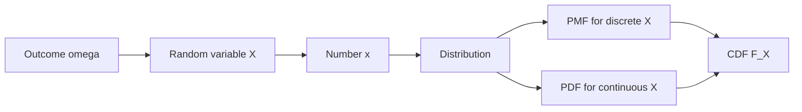

# Random Variables and Distributions

A random variable converts outcomes into numbers. Instead of listing every detailed outcome in the sample space, we often care about a numerical summary: the number of heads, the waiting time until a machine fails, the maximum of several measurements, or whether a test result is positive. Distributions describe how probability is assigned to those numerical values.

Once $X$ is specified, events about its values pull back to events in $\Omega$. For example, $\{X\le3\}$ means the set of outcomes $\omega$ for which $X(\omega)\le3$. The distribution records the probabilities of all such value-based events and forgets irrelevant details of the original outcome.

## From outcomes to a distribution

A **random variable** is a function

$$
X:\Omega\to \mathbb{R}
$$

that assigns a real number to each outcome. The word "variable" is traditional, but formally $X$ is a function.

A random variable is **discrete** if its possible values are finite or countably infinite. Its **probability mass function** (PMF) is

$$
p_X(x)=P(X=x).
$$

The PMF satisfies

$$
p_X(x)\ge 0,\quad \sum_x p_X(x)=1.
$$

A random variable is **continuous** if probabilities are described by a **probability density function** (PDF) $f_X(x)$ such that

$$
P(a\le X\le b)=\int_a^b f_X(x)\,dx.
$$

The PDF satisfies

$$
f_X(x)\ge 0,\quad \int_{-\infty}^{\infty} f_X(x)\,dx=1.
$$

The **cumulative distribution function** (CDF) is defined for every real random variable by

$$
F_X(x)=P(X\le x).
$$

The CDF is nondecreasing, right-continuous, and satisfies

$$
\lim_{x\to -\infty}F_X(x)=0,\quad \lim_{x\to \infty}F_X(x)=1.
$$

For a continuous random variable with density $f_X$,

$$
F_X(x)=\int_{-\infty}^{x} f_X(t)\,dt,
$$

and, where differentiable,

$$
f_X(x)=F_X'(x).
$$

The **support** of a distribution is the set of values where the PMF or PDF is positive. A **parameter** is a fixed constant that indexes a family of distributions, such as the success probability $p$ in a Bernoulli distribution or the rate $\lambda$ in an exponential distribution.

More formally, the distribution of $X$ is the rule

$$
P_X(B)=P(X\in B)
$$

for suitable subsets $B$ of the real line. It is sometimes called the pushforward of the probability on $\Omega$ through $X$. Different experiments can therefore produce identically distributed random variables.

## Why the CDF is the universal representation

The CDF is the most universal way to describe a distribution because it works for discrete, continuous, and mixed random variables. Probability over intervals can be recovered from it:

$$
P(a<X\le b)=F_X(b)-F_X(a).
$$

For continuous random variables, endpoint choices usually do not matter because

$$
P(X=a)=\int_a^a f_X(x)\,dx=0.
$$

For discrete random variables, endpoint choices matter because points can have positive probability.

The jump of a CDF at $x$ equals the point mass there:

$$
P(X=x)=F_X(x)-F_X(x^-),
$$

where $F_X(x^-)=\lim_{t\uparrow x}F_X(t)$. A continuous CDF has no atoms, but a continuous CDF need not possess a density everywhere. “Continuous distribution” and “distribution with a PDF” are often treated as synonyms in elementary work, though a distinction exists.

If $X$ is discrete with PMF $p_X$, then its CDF is a step function:

$$
F_X(x)=\sum_{t\le x}p_X(t).
$$

If $X$ is continuous with PDF $f_X$, then probabilities are areas under the curve:

$$
P(a\le X\le b)=\int_a^b f_X(x)\,dx.
$$

Do not interpret density height as probability. A density can exceed $1$ on a short interval; the area, not the height, is the probability.

A **quantile** is an inverse-CDF value. A number $q_\alpha$ is an $\alpha$-quantile if

$$
P(X\le q_\alpha)\ge \alpha
$$

and

$$
P(X\ge q_\alpha)\ge 1-\alpha.
$$

For continuous strictly increasing CDFs, this is simply

$$
q_\alpha=F_X^{-1}(\alpha).
$$

For a general CDF, use the generalized inverse

$$
F_X^{-1}(u)=\inf\{x:F_X(x)\ge u\},
\qquad 0<u<1.
$$

It works across flat portions and jumps. It also supplies a simulation method: if $U\sim\operatorname{Uniform}(0,1)$, then $F_X^{-1}(U)$ has CDF $F_X$ under the standard convention.

Two random variables can have the same distribution even if they are defined on different sample spaces. For instance, the indicator of heads in a coin toss and the indicator of drawing a red card from a balanced red/black deck are different functions on different experiments, but both can be Bernoulli$(1/2)$. Distributional statements describe probabilities of values, not the underlying physical mechanism.

Random variables can also be mixed. A delivery time might have a positive probability of being exactly $0$ if an item is already available, plus a continuous density over positive waiting times if it must be shipped. Such variables are neither purely discrete nor purely continuous, but their CDF still works. This is one reason the CDF is more fundamental than either a PMF or a PDF.

When modeling, the support is as important as the formula. A normal distribution may approximate adult heights well near the center but still gives tiny probability to negative heights. A beta distribution is often better for proportions because its support is exactly $(0,1)$. A Poisson distribution can count events but cannot model negative values or fixed upper limits. Matching support prevents many silent modeling errors.

CDFs also make inequalities precise. The event $X\le x$ is always meaningful, but phrases such as “around $x$” or “near $x$” require an interval. In continuous models, changing from $\lt $ to $\le$ usually makes no difference; in discrete models, it can change the answer by a point mass. When using software, check whether a function returns $P(X\le x)$, $P(X\lt x)$, $P(X\ge x)$, or $P(X\gt x)$.

## Survival functions and tails

For waiting times and lifetimes, the survival function

$$
S(x)=P(X>x)=1-F_X(x)
$$

is often the direct object. If a nonnegative continuous variable has density $f$, its hazard rate is

$$
h(x)=\frac{f(x)}{S(x)},
$$

where $S(x)\gt 0$. Density measures probability per unit $x$; hazard measures instantaneous event rate conditional on survival to $x$. Two lifetime distributions with similar densities near the center can have different tail and hazard behavior.

## Distribution, realization, and sample

A distribution is a mathematical law. A **realization** is one observed value produced by a random variable, and a sample is a collection of realizations. A histogram estimates features of a distribution but is not itself the distribution. Parameters such as $p$, $\lambda$, or $\mu$ are fixed within the model even when unknown; statistics computed from a sample are random before data are observed.

The support must also be separated from the values seen in a finite sample. A sample from a normal law contains finitely many values, but the model support remains all of $\mathbb R$. Failing to observe an allowed rare value does not remove it from the distribution.

## Discrete and continuous bookkeeping

| Feature | Discrete random variable | Continuous random variable |
|---|---|---|
| Probability object | PMF $p_X(x)=P(X=x)$ | PDF $f_X(x)$ |
| Total probability | $\sum_x p_X(x)=1$ | $\int f_X(x)\,dx=1$ |
| Point probability | can be positive | usually $P(X=x)=0$ |
| Interval probability | sum masses | integrate density |
| CDF shape | step function | often smooth curve |
| Example | number of heads | waiting time |



## Checking whether a proposed function is valid

A proposed PMF must be nonnegative and sum to one over its support. A proposed density must be nonnegative and integrate to one. These conditions are sufficient: interval probabilities obtained by summing or integrating will then obey the probability axioms.

A proposed CDF must satisfy four properties:

- it is nondecreasing;
- it is right-continuous;
- its limit at negative infinity is zero;
- its limit at positive infinity is one.

Differentiability is not required. Jumps represent atoms, flat portions represent intervals receiving no probability, and corners cause no difficulty.

Consider

$$
F(x)=
\begin{cases}
0,&x<0,\\
x/2,&0\le x<1,\\
3/4,&1\le x<2,\\
1,&x\ge2.
\end{cases}
$$

This is a valid CDF. It rises linearly to a left limit of $1/2$ at $x=1$, jumps upward to $3/4$, remains flat until $x=2$, then jumps to one. It contains atoms of size $1/4$ at both $1$ and $2$, plus density $1/2$ on $(0,1)$. Reading the pieces carefully matters more than expecting a single density.

For that mixed distribution,

$$
P(X=1)=F(1)-F(1^-)=\frac34-\frac12=\frac14.
$$

The example also shows that a flat CDF from $1$ to $2$ assigns zero probability to the open interval, despite positive masses at its endpoints.

## Comparing distributions by their CDFs

If

$$
F_X(t)\ge F_Y(t)
$$

for every $t$, then $X$ is **stochastically smaller** than $Y$. More of $X$'s probability has accumulated by every threshold. Equivalently,

$$
P(X>t)\le P(Y>t)
$$

for all $t$.

For every increasing function $g$ whose expectations exist, stochastic ordering implies

$$
E[g(X)]\le E[g(Y)].
$$

The converse can be phrased using all bounded increasing functions. Comparing means alone is much weaker: one distribution can have the smaller mean yet a heavier far-right tail.

## Inverse-CDF simulation step by step

Let $U\sim\operatorname{Uniform}(0,1)$ and set $X=F^{-1}(U)$. Then

$$
\begin{aligned}
P(X\le x)
&=P(F^{-1}(U)\le x)\\
&=P(U\le F(x))\\
&=F(x).
\end{aligned}
$$

The middle equivalence is immediate for a continuous strictly increasing CDF and extends using the generalized inverse. For an exponential target with rate $\lambda$,

$$
F(x)=1-e^{-\lambda x}.
$$

Solving $u=F(x)$ gives

$$
x=-\frac{\log(1-u)}{\lambda}.
$$

Since $1-U$ is also uniform, $-\log U/\lambda$ is equivalent and common in simulation libraries.

## Equality of variables versus equality in distribution

The notation $X=Y$ usually means the two random variables have the same value for every outcome, or almost surely when probability-zero exceptions are allowed. The notation

$$
X\overset{d}=Y
$$

means only that they have the same distribution. They may be defined on different sample spaces and need not move together when placed on the same space.

For example, if $X$ is a fair coin indicator and $Y=1-X$, then $X\overset d=Y$ but $X\ne Y$ on every outcome. Their marginals match while their joint relationship is perfectly negative. Distributional equality permits substitution in calculations involving one variable at a time, but not in expressions such as $X+Y$ that depend on their coupling.

## Parameters and identifiability

A parameterized family should assign a distinct distribution to each meaningful parameter value. In a normal family, the mean and positive standard deviation identify the law. Writing variance as an unrestricted real parameter would be invalid because negative variance values do not define distributions.

Different parameterizations can name the same law. An exponential distribution may use rate $\lambda$ or scale $\theta=1/\lambda$. A geometric variable may count failures or the successful trial. Recording the support and one consequence such as the mean prevents silent translation errors.

Identifiability can fail in richer models. A two-component mixture is unchanged if the component labels are swapped, and different latent descriptions can sometimes induce the same observed distribution. Data can identify only features that alter the distribution of observables.

## Discretization and rounding

A continuous measurement stored to the nearest unit becomes a discrete random variable. If $Y$ is the rounded value of continuous $X$, then

$$
P(Y=k)=P(k-1/2\le X<k+1/2).
$$

The recorded PMF is obtained by integrating the original density over bins. Treating rounded data as exact continuous values ignores ties and measurement resolution; treating the bin label's density height as its probability ignores bin width. The appropriate approximation depends on how fine the resolution is relative to the distribution's scale.

## Atoms, densities, and mixed decompositions

An atom is a point with positive probability. The collection of atoms of a real-valued distribution is at most countable: for each positive integer $n$, only finitely many atoms can have mass at least $1/n$, and every positive mass exceeds $1/n$ for some $n$.

A mixed CDF can therefore be read as jumps plus continuous accumulation. Its total jump mass may be less than one, with the remainder carried by a density or a more singular continuous component. Differentiating the CDF recovers the density only where the continuous part is differentiable; derivatives do not recover jump masses.

When computing an expectation under a simple mixed law, add the discrete and continuous contributions. For an atom of mass $q$ at zero plus density $(1-q)f(x)$ on positive values,

$$
E[g(X)]=qg(0)+(1-q)\int_0^\infty g(x)f(x)\,dx.
$$

Ignoring either part loses probability mass and usually fails the normalization check.

## Worked distributions

### Sum of two dice

**Problem.** Let $X$ be the sum of two fair six-sided dice. Find the PMF and compute $P(5\le X\le 9)$.

**Method.**

1. The sample space has $36$ equally likely ordered outcomes $(i,j)$.

2. Count outcomes by sum:

   | $x$ | 2 | 3 | 4 | 5 | 6 | 7 | 8 | 9 | 10 | 11 | 12 |
   |---:|---:|---:|---:|---:|---:|---:|---:|---:|---:|---:|---:|
   | count | 1 | 2 | 3 | 4 | 5 | 6 | 5 | 4 | 3 | 2 | 1 |

3. Convert counts to probabilities:

$$
p_X(x)=\frac{\text{count at sum }x}{36}.
$$

4. The event $5\le X\le 9$ includes sums $5,6,7,8,9$, so

$$
\begin{aligned}
P(5\le X\le 9)
&=\frac{4+5+6+5+4}{36}\\
&=\frac{24}{36}\\
&=\frac{2}{3}.
\end{aligned}
$$

5. Check by complement. The excluded sums are $2,3,4,10,11,12$, with counts $1+2+3+3+2+1=12$. Thus the desired probability is $1-12/36=2/3$.

$P(5\le X\le 9)=2/3$. The random variable compresses $36$ outcomes into $11$ possible numerical values.

### Building a CDF from a density

**Problem.** Suppose $X$ has density

$$
f_X(x)=
\begin{cases}
2x,&0\le x\le1,\\
0,&\text{otherwise}.
\end{cases}
$$

Find $F_X(x)$ and compute $P(0.25\le X\le 0.75)$.

**Method.**

1. First verify it is a density:

$$
\int_0^1 2x\,dx = \left[x^2\right]_0^1=1.
$$

2. For $x\lt 0$, no mass has accumulated:

$$
F_X(x)=0.
$$

3. For $0\le x\le 1$,

$$
F_X(x)=\int_0^x 2t\,dt=x^2.
$$

4. For $x\gt 1$, all mass has accumulated:

$$
F_X(x)=1.
$$

5. Now compute the interval probability:

$$
\begin{aligned}
P(0.25\le X\le 0.75)
&=F_X(0.75)-F_X(0.25)\\
&=(0.75)^2-(0.25)^2\\
&=0.5625-0.0625\\
&=0.5.
\end{aligned}
$$

6. Check by integration:

$$
\int_{0.25}^{0.75}2x\,dx
=\left[x^2\right]_{0.25}^{0.75}
=0.5.
$$

$F_X(x)=0$ for $x\lt 0$, $F_X(x)=x^2$ for $0\le x\le1$, and $F_X(x)=1$ for $x\gt 1$. The interval probability is $0.5$.

### A mixed waiting-time distribution

An item is immediately available with probability $0.30$. Otherwise its waiting time is exponential with rate $\lambda=1/2$ per day. Let $X$ be the total wait. Then $P(X=0)=0.30$, and for $x\gt 0$ the continuous component has unconditional density

$$
f_X(x)=0.70\left(\frac12e^{-x/2}\right).
$$

For $x\lt 0$, $F_X(x)=0$. At $x=0$, the CDF jumps to $0.30$. For $x\gt 0$,

$$
\begin{aligned}
F_X(x)
&=0.30+0.70P(\operatorname{Exp}(1/2)\le x)\\
&=0.30+0.70(1-e^{-x/2})\\
&=1-0.70e^{-x/2}.
\end{aligned}
$$

The probability of waiting between one and three days is

$$
\begin{aligned}
P(1<X\le3)
&=F_X(3)-F_X(1)\\
&=0.70(e^{-1/2}-e^{-3/2})\\
&\approx0.70(0.60653-0.22313)\\
&\approx0.26838.
\end{aligned}
$$

The point mass at zero is not represented by the density on $x\gt 0$. The CDF carries both pieces at once.

## Computational checks

```python
import numpy as np

# PMF for the sum of two dice.
outcomes = [(i, j) for i in range(1, 7) for j in range(1, 7)]
sums = np.array([i + j for i, j in outcomes])

values, counts = np.unique(sums, return_counts=True)
pmf = counts / counts.sum()

for value, probability in zip(values, pmf):
    print(f"P(X={value}) = {probability:.4f}")

mask = (values >= 5) & (values <= 9)
print("P(5 <= X <= 9) =", pmf[mask].sum())

# Continuous example: F(x)=x^2 on [0,1].
def cdf(x):
    x = np.asarray(x)
    return np.where(x < 0, 0, np.where(x <= 1, x**2, 1))

print("P(0.25 <= X <= 0.75) =", cdf(0.75) - cdf(0.25))
```

## Representation errors to catch

- Forgetting that a random variable is a function on outcomes, not the outcome itself.
- Treating a density value $f_X(x)$ as if it were $P(X=x)$.
- Ignoring support. Formulas such as $2x$ are densities only on the interval where they are defined.
- Assuming endpoint choices never matter. They do not matter for continuous distributions, but they do matter for discrete distributions.
- Using a PDF when the problem gives a CDF, or differentiating a discrete CDF as if it were smooth.
- Failing to check that probabilities or densities normalize to one.

<div className="see-also">

See also: [common discrete distributions](/math/probability/common-discrete-distributions) · [common continuous distributions](/math/probability/common-continuous-distributions) · [expectation, variance, and moments](/math/probability/expectation-variance-moments) · [functions of random variables](/math/probability/transformations-random-variables) · [sampling distributions and CLT](/math/statistics/sampling-distributions-and-clt)

</div>
