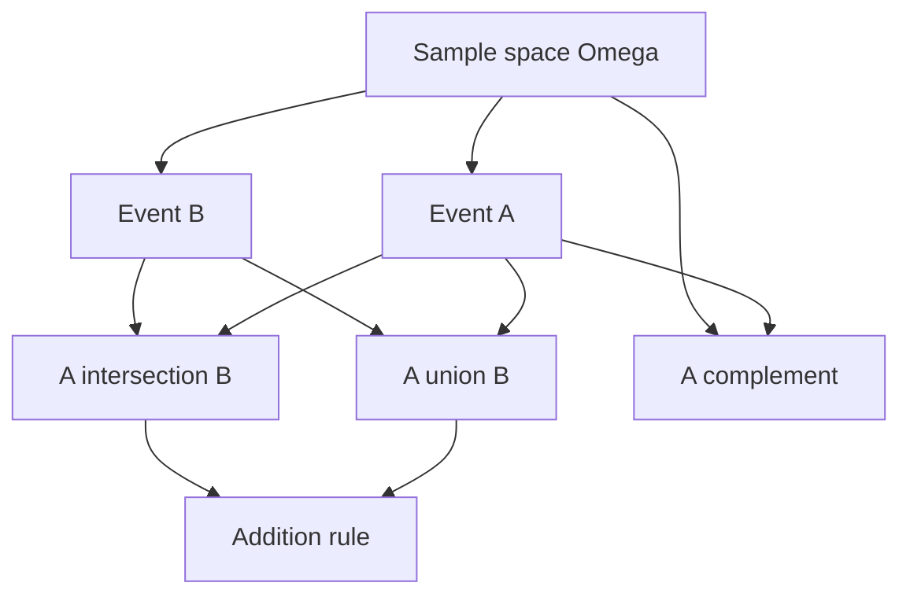

# Sample Spaces, Events, and Axioms

Probability begins by separating two ideas that everyday language often mixes together: the outcomes that could happen and the numerical rules used to describe how likely those outcomes are. A sample space lists the possible outcomes of an experiment, while events are the subsets of outcomes we ask questions about. Once those objects are clear, probability is not a collection of gambling tricks; it is a measure on events.

Kolmogorov's axioms use the same framework for finite dice rolls, countably infinite waiting times, and continuous measurements. Equal-count ratios are one special construction inside that framework, not the general definition.

## Start by choosing outcomes at the right resolution

A **random experiment** is a process whose outcome is not known in advance but whose possible outcomes can be specified. The **sample space** is the set of all possible outcomes and is usually denoted by $\Omega$ or $S$.

An **event** is a subset of the sample space. If the observed outcome $\omega$ lies in event $A$, we say that event $A$ occurred. Common event operations are:

- **Complement:** $A^c = \{\omega \in \Omega : \omega \notin A\}$.
- **Union:** $A \cup B = \{\omega : \omega \in A \text{ or } \omega \in B\}$.
- **Intersection:** $A \cap B = \{\omega : \omega \in A \text{ and } \omega \in B\}$.
- **Difference:** $A \setminus B = A \cap B^c$.
- **Disjoint events:** $A$ and $B$ are disjoint if $A \cap B = \varnothing$.

A **probability space** is a triple $(\Omega, \mathcal{F}, P)$ where:

1. $\Omega$ is the sample space.
2. $\mathcal{F}$ is a collection of events, called a sigma-algebra, closed under complements and countable unions.
3. $P$ assigns a number $P(A)$ to each event $A \in \mathcal{F}$.

In a finite or countable sample space, it is common to assign probabilities to individual outcomes and then add. If $\Omega = \{\omega_1,\omega_2,\ldots\}$ and $p_i = P(\{\omega_i\})$, then $p_i \ge 0$, $\sum_i p_i = 1$, and

$$
P(A) = \sum_{\omega_i \in A} p_i.
$$

When all finite outcomes are equally likely, the classical rule is

$$
P(A)=\frac{\# A}{\# \Omega}.
$$

This rule is useful but not a definition of probability in general. It applies only when the outcomes are equally likely and the sample space is finite.

The choice of sample space is part of the model. For two dice, ordered pairs $(i,j)$ preserve which die showed which value. If only the sum is retained, the space $\{2,3,\ldots,12\}$ is valid, but its elements are not equally likely. A coarser description can still be used once the induced probabilities are assigned correctly.

Sample spaces should distinguish outcomes needed by later questions without recording irrelevant detail. A model of a component's lifetime may use $\Omega=[0,\infty)$ rather than a complete microscopic history of the component. If a later question concerns failure cause as well as time, that space is too coarse and must be enlarged.

## Why a sigma-algebra appears

For finite spaces one can usually take $\mathcal F$ to be every subset of $\Omega$. On uncountable spaces, assigning probabilities consistently to every conceivable subset leads to pathologies. A sigma-algebra selects a rich collection of measurable events and guarantees that complements, countable unions, and therefore countable intersections remain measurable.

Closure under countable intersections follows from De Morgan's law:

$$
\bigcap_{i=1}^{\infty}A_i
=\left(\bigcup_{i=1}^{\infty}A_i^c\right)^c.
$$

The smallest sigma-algebra containing all open intervals of $\mathbb R$ is the Borel sigma-algebra used for ordinary real-valued probability models.

## What follows from the axioms

The Kolmogorov axioms are the foundation:

| Axiom | Statement | Meaning |
|---|---|---|
| Nonnegativity | $P(A) \ge 0$ | An event cannot have negative probability. |
| Normalization | $P(\Omega)=1$ | Something in the sample space occurs. |
| Countable additivity | If $A_1,A_2,\ldots$ are pairwise disjoint, then $P(\cup_i A_i)=\sum_i P(A_i)$ | Probabilities of non-overlapping alternatives add. |

Several rules follow immediately.

**Complement rule.** Since $A$ and $A^c$ are disjoint and $A \cup A^c = \Omega$,

$$
P(A^c)=1-P(A).
$$

**Empty event.** Since $\Omega$ and $\varnothing$ are disjoint and $\Omega \cup \varnothing=\Omega$,

$$
P(\varnothing)=0.
$$

**Monotonicity.** If $A \subseteq B$, then

$$
B = A \cup (B \setminus A)
$$

with disjoint pieces, so

$$
P(B)=P(A)+P(B\setminus A) \ge P(A).
$$

**Addition rule.** For any two events,

$$
P(A \cup B)=P(A)+P(B)-P(A \cap B).
$$

The subtraction is necessary because outcomes in $A \cap B$ were counted once in $P(A)$ and once in $P(B)$.

**Finite inclusion-exclusion.** For three events,

$$
\begin{aligned}
P(A \cup B \cup C)
&=P(A)+P(B)+P(C)\\
&\quad -P(A\cap B)-P(A\cap C)-P(B\cap C)\\
&\quad +P(A\cap B\cap C).
\end{aligned}
$$

The pattern alternates between adding single events, subtracting pairwise intersections, and adding the triple intersection.

### The union bound

Dropping all overlap corrections gives a useful inequality:

$$
P\left(\bigcup_{i=1}^{n}A_i\right)
\le\sum_{i=1}^{n}P(A_i).
$$

It remains true for countably many events. The bound may be loose, but it needs no independence assumptions and often turns many small failure probabilities into a bound on the chance of any failure.

### Continuity of probability

If $A_1\subseteq A_2\subseteq\cdots$ is an increasing sequence of events, then

$$
P\left(\bigcup_{n=1}^{\infty}A_n\right)
=\lim_{n\to\infty}P(A_n).
$$

Decompose the union into the disjoint increments $A_1$, $A_2\setminus A_1$, and so on, then apply countable additivity. For decreasing events $A_1\supseteq A_2\supseteq\cdots$,

$$
P\left(\bigcap_{n=1}^{\infty}A_n\right)
=\lim_{n\to\infty}P(A_n).
$$

The decreasing result follows by taking complements. These continuity properties connect finite calculations to limiting events.

The axioms also separate probability from the physical story that motivated it. A coin, a weather forecast, and a randomized algorithm can all be modeled by the same probability rules once the sample space and event class are chosen. The hard modeling work is deciding which outcomes belong in $\Omega$ and which probability assignment is appropriate. In finite examples, the phrase “equally likely” must be justified by symmetry or design. In continuous examples, the probability of a single point is usually zero, so events must be intervals, regions, or other measurable sets. The sigma-algebra $\mathcal{F}$ records the events that the model is prepared to measure.

## Event algebra at a glance

| Event expression | Plain-language reading | Probability rule |
|---|---|---|
| $A^c$ | $A$ does not occur | $1-P(A)$ |
| $A \cap B$ | both $A$ and $B$ occur | depends on dependence |
| $A \cup B$ | at least one of $A,B$ occurs | $P(A)+P(B)-P(A\cap B)$ |
| $A \setminus B$ | $A$ occurs but $B$ does not | $P(A)-P(A\cap B)$ |
| disjoint $A,B$ | no shared outcomes | $P(A\cup B)=P(A)+P(B)$ |

## Three standard ways to build a probability model

### Finite uniform models

When a randomized mechanism makes $N$ elementary outcomes symmetric, assign mass $1/N$ to each. Card shuffles, fair dice, and uniformly chosen permutations fit this pattern after outcomes are specified at the correct resolution. The ratio rule then follows from additivity:

$$
P(A)=\sum_{\omega\in A}\frac1N=\frac{|A|}{N}.
$$

Symmetry must belong to the elementary outcomes. The eleven possible sums of two dice are not symmetric, even though the thirty-six ordered die pairs are.

### Countable weighted models

For $\Omega=\{\omega_1,\omega_2,\ldots\}$, choose nonnegative weights $p_i$ with sum one. Every event receives the sum of its outcome weights. A geometric waiting-time model uses

$$
p_k=(1-p)^{k-1}p,
\qquad k=1,2,\ldots,
$$

and the geometric-series identity verifies normalization. There is no uniform probability distribution on all positive integers: if every singleton had the same positive mass, the total would diverge; if each had mass zero, countable additivity would give total zero.

### Continuous models

A nonnegative density $f$ satisfying

$$
\int_{-\infty}^{\infty}f(x)\,dx=1
$$

defines probabilities by integration. The probability of an interval is its weighted area, not a count of its infinitely many points. Every singleton has zero area, but uncountably many singleton points can combine into an interval of positive probability. Countable additivity does not extend to arbitrary uncountable sums of point probabilities.

## Bounds without independence

Suppose a system has $100$ components and component $i$ fails during a mission with probability at most $0.0001$. No dependence information is available. Let $A_i$ be its failure event. The union bound gives

$$
P(\text{at least one failure})
=P\left(\bigcup_{i=1}^{100}A_i\right)
\le\sum_{i=1}^{100}P(A_i)
\le0.01.
$$

The bound remains valid if failures share a common cause. Assuming independence would permit an exact calculation from the individual probabilities, but that assumption is absent. If the events overlap heavily, the actual union probability may be much smaller than one percent.

The complement form is often useful. If each of $n$ desirable conditions fails with probability at most $\epsilon_i$, then all conditions hold simultaneously with probability at least

$$
1-\sum_{i=1}^{n}\epsilon_i.
$$

This elementary estimate appears in randomized algorithms and reliability arguments because it composes guarantees without requiring a full joint distribution.

## Limits of events

The event that infinitely many events $A_n$ occur is

$$
\limsup_{n\to\infty}A_n
=\bigcap_{m=1}^{\infty}\bigcup_{n=m}^{\infty}A_n.
$$

An outcome belongs to every tail union exactly when it keeps appearing in the sequence. The event that all but finitely many $A_n$ occur is the corresponding limit inferior. These constructions translate long-run verbal statements into countable unions and intersections, which a sigma-algebra is designed to contain.

## Axioms do not choose the probabilities

The axioms constrain a probability assignment once the model is proposed; they do not determine whether a die is fair or whether tomorrow's rain probability is $0.30$. Such numbers come from physical symmetry, randomization design, empirical calibration, or a stated model of uncertainty.

Two analysts can use the same sample space and assign different probabilities while both obeying the axioms. Evidence and model criticism decide which assignment is useful. Internal consistency is necessary, not sufficient for an empirically good model.

Long-run frequency gives one interpretation. Under repeated comparable trials, a model with event probability $p$ often predicts relative frequency near $p$ through a law of large numbers. The axioms themselves do not require literal repetition; they also support one-time events and conditional beliefs, provided the assignments remain coherent.

Null events need care in conditional statements. The elementary ratio $P(A\cap B)/P(B)$ is unavailable when $P(B)=0$, even if $B$ contains possible outcomes. Continuous models handle conditioning on observed point values through conditional densities or regular conditional distributions, not by declaring every zero-probability condition impossible.

## Disjointness, exhaustiveness, and independence

These terms describe different structures. Events are disjoint when they cannot occur together. A collection is exhaustive when its union is the whole sample space. A partition is both pairwise disjoint and exhaustive. Partitions are useful because probabilities can be computed case by case without overlap corrections.

Independence does not mean disjointness. If positive-probability events $A$ and $B$ are disjoint, then

$$
P(A\cap B)=0<P(A)P(B),
$$

so they are dependent. Observing $A$ rules out $B$. Independent events may overlap; their overlap has exactly the product probability.

Exhaustive events need not be disjoint. “The first die is even” and “the second die is odd” do not cover every two-die outcome, while adding their complements creates overlapping coverage. Before adding case probabilities, check that the cases form a partition rather than merely a list of plausible alternatives.

De Morgan's laws translate complements of compound events:

$$
(A\cup B)^c=A^c\cap B^c,
\qquad
(A\cap B)^c=A^c\cup B^c.
$$

They are the algebra behind replacing “at least one” by the complement of “none” and replacing “not both” by “at least one fails.”

## Worked event calculations

### Two dice and event algebra

**Problem.** Roll two fair six-sided dice. Let $A$ be the event that the sum is $7$, and let $B$ be the event that at least one die shows $6$. Find $P(A)$, $P(B)$, $P(A\cap B)$, and $P(A\cup B)$.

**Method.**

1. The sample space is ordered pairs:

$$
\Omega=\{(i,j): i,j\in\{1,2,3,4,5,6\}\}.
$$

   There are $6\cdot 6=36$ equally likely outcomes.

2. Event $A$ contains the pairs whose sum is $7$:

$$
A=\{(1,6),(2,5),(3,4),(4,3),(5,2),(6,1)\}.
$$

   Therefore $\#A=6$ and

$$
P(A)=\frac{6}{36}=\frac{1}{6}.
$$

3. Event $B$ contains outcomes with a $6$ in the first coordinate or second coordinate. There are $6$ outcomes with first die $6$ and $6$ outcomes with second die $6$, but $(6,6)$ is counted twice:

$$
\#B=6+6-1=11.
$$

   Hence

$$
P(B)=\frac{11}{36}.
$$

4. For $A\cap B$, the sum must be $7$ and at least one die must be $6$. From the list for $A$, only $(1,6)$ and $(6,1)$ qualify:

$$
P(A\cap B)=\frac{2}{36}=\frac{1}{18}.
$$

5. Use the addition rule:

$$
\begin{aligned}
P(A\cup B)
&=P(A)+P(B)-P(A\cap B)\\
&=\frac{6}{36}+\frac{11}{36}-\frac{2}{36}\\
&=\frac{15}{36}\\
&=\frac{5}{12}.
\end{aligned}
$$

Direct counting confirms this: $A\cup B$ has the $11$ outcomes in $B$ plus the $4$ sum-seven outcomes without a $6$, for $15$ outcomes out of $36$.

### A countably infinite sample space

**Problem.** A coin is tossed until the first head appears. Let $T$ be the toss number on which the first head appears. For a fair coin, find $P(T\le 3)$ and $P(T\gt 3)$.

**Method.**

1. The sample space can be written as

$$
\Omega=\{H,TH,TTH,TTTH,\ldots\}.
$$

   Equivalently, the outcome is $T\in\{1,2,3,\ldots\}$.

2. The event $T=k$ means the first $k-1$ tosses are tails and the $k$-th toss is heads:

$$
P(T=k)=\left(\frac{1}{2}\right)^{k-1}\left(\frac{1}{2}\right)=\left(\frac{1}{2}\right)^k.
$$

3. Add the disjoint cases $T=1,2,3$:

$$
\begin{aligned}
P(T\le 3)
&=P(T=1)+P(T=2)+P(T=3)\\
&=\frac{1}{2}+\frac{1}{4}+\frac{1}{8}\\
&=\frac{7}{8}.
\end{aligned}
$$

4. Use the complement rule:

$$
P(T>3)=1-P(T\le 3)=1-\frac{7}{8}=\frac{1}{8}.
$$

5. Check directly. The event $T\gt 3$ means the first three tosses are all tails:

$$
P(T>3)=P(TTT)=\left(\frac{1}{2}\right)^3=\frac{1}{8}.
$$

$P(T\le 3)=7/8$ and $P(T\gt 3)=1/8$. The probabilities over the infinite sample space still sum to one because

$$
\sum_{k=1}^{\infty}\left(\frac{1}{2}\right)^k=1.
$$

### Probability zero is not the empty event

Choose a point uniformly from $[0,1]$, and let $A$ be the event that the selected point equals $1/2$. The event contains a legitimate outcome, so $A\ne\varnothing$. Yet its probability is the length of a degenerate interval:

$$
P(A)=P(X=1/2)=0.
$$

Now let $B$ be the event that $X$ is irrational. The rational numbers in $[0,1]$ form a countable set, and each singleton has probability zero. Countable additivity gives probability zero to their union, so $P(B)=1$. Irrationality is almost sure, but rational outcomes remain elements of the sample space.

## Modeling and algebra errors

- Treating a sample space as equally likely without checking the modeling assumption. The unordered sums of two dice, for example, are not equally likely.
- Forgetting that $A\cup B$ is inclusive: it includes outcomes where both $A$ and $B$ occur.
- Adding $P(A)+P(B)$ for overlapping events without subtracting $P(A\cap B)$.
- Confusing the impossible event $\varnothing$ with events that have probability zero in continuous models. A point such as $\{0.5\}$ can have probability zero under a continuous distribution without being logically impossible.
- Defining events vaguely. "A high value" is not an event until the cutoff is specified.
- Assuming probability one means guaranteed in every philosophical sense. In continuous probability, probability-one events may still exclude exceptional outcomes.

## Related pages

- [conditional probability and Bayes' theorem](/math/probability/conditional-probability-bayes)
- [random variables and distributions](/math/probability/random-variables-distributions)
- [counting principles](/math/probability/counting-principles)
- [discrete probability](/math/discrete/discrete-probability)
- [sampling distributions and CLT](/math/statistics/sampling-distributions-and-clt)
