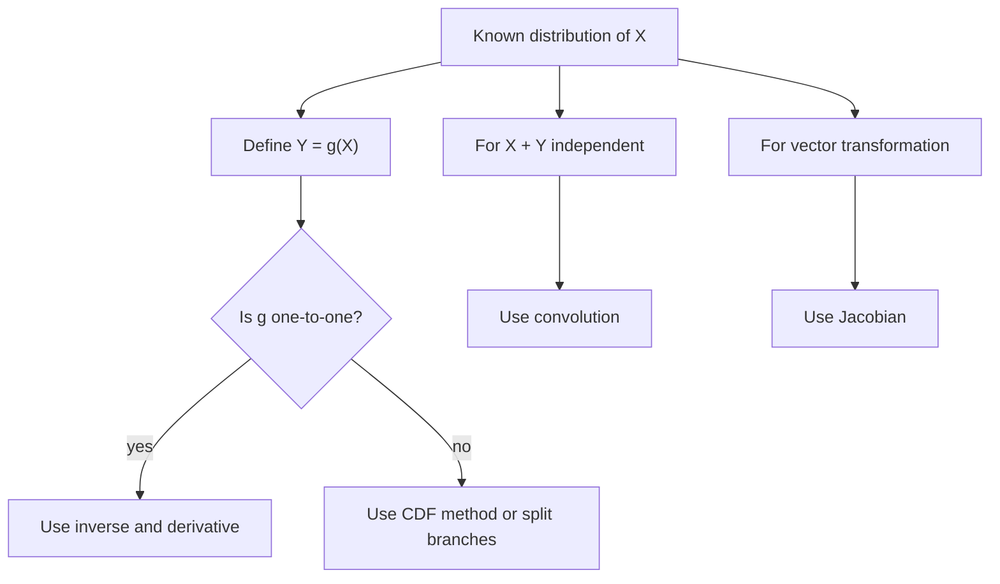

# Functions of Random Variables

Many useful random variables are built from other random variables. If $X$ is a measurement, then $X^2$, $\log X$, $aX+b$, $\max(X_1,\ldots,X_n)$, and $X+Y$ are all transformations. Probability theory gives systematic ways to derive the distribution of the transformed variable rather than guessing from simulation.

Transformations are also the engine behind standardization, change of variables in continuous distributions, sums of independent variables, and many sampling distributions. The main tools are the CDF method, one-to-one density transformations, Jacobians, and convolution.

## Start from the event, not the formula

If $Y=g(X)$, then $Y$ is a **function of a random variable**. Its distribution is determined by

$$
F_Y(y)=P(Y\le y)=P(g(X)\le y).
$$

This is called the **CDF method**. It is often the safest method because it works even when $g$ is not one-to-one.

If $X$ is continuous with density $f_X$ and $Y=g(X)$ where $g$ is differentiable and one-to-one with inverse $x=g^{-1}(y)$, then

$$
f_Y(y)=f_X(g^{-1}(y))\left|\frac{d}{dy}g^{-1}(y)\right|.
$$

For a vector transformation $(U,V)=g(X,Y)$ with inverse $(x,y)=h(u,v)$, the joint density is

$$
f_{U,V}(u,v)=f_{X,Y}(h(u,v))\left|J_h(u,v)\right|,
$$

where $J_h$ is the determinant of the Jacobian matrix of the inverse transformation.

If $X$ and $Y$ are independent continuous random variables, the density of their sum $S=X+Y$ is the **convolution**

$$
f_S(s)=\int_{-\infty}^{\infty} f_X(x)f_Y(s-x)\,dx.
$$

For discrete variables,

$$
P(S=s)=\sum_x P(X=x)P(Y=s-x).
$$

When a differentiable transformation has several inverse branches $x_j=g_j^{-1}(y)$, their density contributions add:

$$
f_Y(y)=\sum_j f_X(x_j)\left|\frac{dx_j}{dy}\right|.
$$

This is the continuous counterpart of adding probabilities of all original outcomes that map to the same transformed value.

## Location, scale, and monotone maps

**Linear transformations.** If $Y=aX+b$ and $a\ne 0$, then

$$
F_Y(y)=
\begin{cases}
F_X\left(\dfrac{y-b}{a}\right),&a>0,\\
1-F_X\left(\dfrac{y-b}{a}^-\right),&a<0.
\end{cases}
$$

For densities,

$$
f_Y(y)=\frac{1}{|a|}f_X\left(\frac{y-b}{a}\right).
$$

Means and variances transform as

$$
E[aX+b]=aE[X]+b,
$$

$$
\operatorname{Var}(aX+b)=a^2\operatorname{Var}(X).
$$

**Monotone transformations.** If $g$ is strictly increasing, then

$$
F_Y(y)=F_X(g^{-1}(y)).
$$

If $g$ is strictly decreasing, inequalities reverse.

**Order statistics.** If $X_1,\ldots,X_n$ are independent with CDF $F$, then the maximum $M=\max_i X_i$ has CDF

$$
F_M(m)=P(X_1\le m,\ldots,X_n\le m)=F(m)^n.
$$

The minimum $L=\min_i X_i$ satisfies

$$
P(L>l)=P(X_1>l,\ldots,X_n>l)=(1-F(l))^n.
$$

If $F$ has density $f$, differentiation gives

$$
f_M(m)=nF(m)^{n-1}f(m),
$$

and

$$
f_L(l)=n[1-F(l)]^{n-1}f(l).
$$

The factor $n$ reflects which observation supplies the extreme, while the remaining $n-1$ observations must lie on the appropriate side.

## A reliable change-of-variable workflow

Use the following order:

1. Find the support of the new variable before doing algebra.
2. Decide whether the transformation is one-to-one on that support.
3. If it is one-to-one, use the inverse and derivative formula.
4. If it is not one-to-one, split the support into one-to-one branches or use the CDF method.
5. Check that the resulting density integrates to $1$.

For example, $Y=X^2$ is not one-to-one on $(-1,1)$, but it is one-to-one on $(-1,0)$ and $(0,1)$. The transformed density receives contributions from both branches. The CDF method automatically accounts for both branches, which is why it is often safer.

The absolute derivative has a probability-conservation interpretation. A short interval of width $dy$ near $y$ corresponds to an interval of width approximately $\vert dx/dy\vert dy$ near its preimage. Hence

$$
f_Y(y)dy\approx f_X(x)|dx|.
$$

Omitting the derivative would preserve density height rather than probability mass.

## Area changes and Jacobians

In multivariable transformations, the Jacobian factor measures local area distortion. A transformation may stretch a small rectangle in $(u,v)$-space into a larger or smaller region in $(x,y)$-space. The absolute determinant corrects the density so that probability mass is preserved. The sign of the determinant is irrelevant for probability, which is why the absolute value is used.

For sums, convolution is a distribution-level version of adding all possible ways to reach the same total. In the continuous case, the integral sweeps over every possible value $x$ of the first variable and pairs it with $s-x$ for the second variable.

The integration range is determined by support, even when the formula displays $(-\infty,\infty)$. If $X$ and $Y$ are nonnegative, only $0\le x\le s$ can contribute to the density of $X+Y=s$. Writing this overlap before integrating often turns a difficult-looking convolution into a short calculation.

## Simulation by inverse CDF

Transformations are also how simulation turns simple random numbers into useful samples. Many pseudorandom generators first produce values that are approximately Uniform$(0,1)$. If $F$ is a continuous CDF and $U\sim\operatorname{Uniform}(0,1)$, then

$$
X=F^{-1}(U)
$$

has CDF $F$. This is the inverse-transform method. It works especially well when the inverse CDF is available in closed form or can be computed numerically. For example, if $U\sim\operatorname{Uniform}(0,1)$, then $X=-\log(1-U)/\lambda$ is Exponential$(\lambda)$.

Another common transformation is standardization. If $X$ has mean $\mu$ and standard deviation $\sigma\gt 0$, then

$$
Z=\frac{X-\mu}{\sigma}
$$

has mean $0$ and variance $1$. Standardization does not usually make a variable normal; it only changes location and scale. It becomes a standard normal variable only when the original $X$ was normal.

Absolute values, squares, maxima, and ratios deserve special care because they can merge many original outcomes into the same transformed value. Whenever a transformation collapses information, expect multiple inverse branches or support boundaries. A quick sketch of the function often prevents algebraic mistakes.

For ratios, also check where the denominator can be zero or close to zero, since this often creates heavy tails and may destroy moments.

## Discrete transformations collect preimages

For a discrete variable, no derivative appears. If $Y=g(X)$, then

$$
P(Y=y)=\sum_{x:g(x)=y}P(X=x).
$$

Let $X$ be uniform on $\{-2,-1,0,1,2\}$ and set $Y=X^2$. Then

$$
P(Y=0)=\frac15,
\qquad
P(Y=1)=\frac25,
\qquad
P(Y=4)=\frac25.
$$

The values $1$ and $4$ each have two preimages. Treating the map as one-to-one would lose half their mass. This is the same bookkeeping performed by the branch-sum density formula in the continuous case.

For integer-valued sums, discrete convolution similarly collects all pairs with the same total. If $X$ and $Y$ are independent fair dice,

$$
P(X+Y=7)=\sum_{x=1}^{6}P(X=x)P(Y=7-x)=6\left(\frac1{36}\right)=\frac16.
$$

The limits of the sum encode which partner values remain in support.

## Products and ratios through a two-variable map

To derive a product $U=XY$, introduce a second coordinate that makes the transformation invertible, such as $V=X$. Then

$$
x=v,
\qquad
y=\frac uv,
$$

and the absolute inverse Jacobian is $1/\vert v\vert $. Integrating out $v$ gives

$$
f_U(u)=\int_{-\infty}^{\infty}
f_{X,Y}\left(v,\frac uv\right)\frac{1}{|v|}\,dv,
$$

over values where the arguments lie in the joint support. Independence may simplify the joint density, but the support analysis remains.

For a ratio $R=X/Y$, take $R=X/Y$ and $V=Y$. The inverse is $x=rv$, $y=v$, with absolute Jacobian $\vert v\vert $. Therefore

$$
f_R(r)=\int_{-\infty}^{\infty}f_{X,Y}(rv,v)|v|\,dv.
$$

Normal ratios illustrate the danger near a zero denominator: the ratio of independent standard normals has a Cauchy distribution, whose mean and variance do not exist.

## Order statistics beyond the extremes

Let $X_{(k)}$ denote the $k$th smallest of $n$ independent observations with continuous CDF $F$ and density $f$. For $X_{(k)}$ to fall near $x$, choose which observation lands near $x$, place exactly $k-1$ observations below it, and place the remaining $n-k$ above it. The resulting density is

$$
f_{X_{(k)}}(x)
=\frac{n!}{(k-1)!(n-k)!}
[F(x)]^{k-1}[1-F(x)]^{n-k}f(x).
$$

For Uniform$(0,1)$ observations, this is a Beta$(k,n-k+1)$ density. In particular,

$$
E[X_{(k)}]=\frac{k}{n+1}.
$$

The expected minimum is $1/(n+1)$ and the expected maximum is $n/(n+1)$. Neither reaches an endpoint in finite samples, although both approach their respective endpoints as $n$ grows.

## A worked maximum calculation

Suppose three independent component lifetimes are Exponential$(\lambda)$, and let $M$ be the last failure time. One lifetime has CDF

$$
F(x)=1-e^{-\lambda x},
\qquad x\ge0.
$$

All three must fail by time $m$ for $M\le m$, so

$$
F_M(m)=(1-e^{-\lambda m})^3,
\qquad m\ge0.
$$

Differentiation gives

$$
f_M(m)=3\lambda e^{-\lambda m}(1-e^{-\lambda m})^2.
$$

To find the median, solve $F_M(m_{0.5})=1/2$:

$$
1-e^{-\lambda m_{0.5}}=2^{-1/3},
$$

so

$$
m_{0.5}=-\frac1\lambda\log(1-2^{-1/3}).
$$

The median of the maximum is larger than the median $\log2/\lambda$ of one lifetime, as it must be.

## Checking a transformed density

Three checks catch most errors. First, the support should match the range of the transformation. Second, the density must integrate to one; a missing branch or Jacobian usually appears as lost mass. Third, moments or quantiles that can be obtained another way should agree. For $Y=aX+b$, for example, a derived density should reproduce $E[Y]=aE[X]+b$ whenever the mean exists.

## Sometimes the transformed distribution is unnecessary

To compute an expectation of $Y=g(X)$, the law of the unconscious statistician works directly from the distribution of $X$:

$$
E[g(X)]=\int g(x)f_X(x)\,dx
$$

in the continuous case. Deriving $f_Y$ first adds work unless the whole distribution of $Y$ is needed.

For example, if $X\sim\operatorname{Uniform}(-1,1)$ and $Y=X^2$, then

$$
E[Y]=E[X^2]
=\frac12\int_{-1}^{1}x^2\,dx
=\frac13.
$$

Using the transformed density gives the same result:

$$
\int_0^1 y\frac1{2\sqrt y}\,dy=\frac13.
$$

The direct route is shorter; the density route is needed for interval probabilities and quantiles of $Y$.

## Quantiles under monotone maps

If $g$ is strictly increasing, then quantiles transform in the same direction:

$$
q_p(g(X))=g(q_p(X)).
$$

For a strictly decreasing map, the tail reverses and, under a continuous distribution,

$$
q_p(g(X))=g(q_{1-p}(X)).
$$

At atoms, generalized-inverse conventions require endpoint care. Medians behave especially well under monotone transformations, while expectations generally do not: $E[g(X)]$ is rarely $g(E[X])$.

## Numerical transformations and simulation

When no closed-form inverse CDF exists, a root finder can solve $F(x)=u$ for each uniform draw. Rejection sampling or composition methods may be more efficient when inverse evaluation is costly. A simulation histogram is a check on a derived law, not a replacement for its Jacobian or support argument.

Numerical convolution can be performed by quadrature or by multiplying Fourier transforms and transforming back. Discrete convolution is efficiently computed with polynomial or fast Fourier transform methods when supports are large. These methods still inherit modeling assumptions: multiplying transforms corresponds to adding independent variables.

Floating-point endpoints deserve attention. A generator may return zero, and $-\log U$ is then infinite. Libraries often choose a uniform convention that excludes zero or use `log1p`-style calculations to preserve precision near one. The mathematical formulas assume exact real arithmetic; robust code must respect the numerical domain too.

## Log and exponential transformations

Positive variables are often transformed with logarithms. If $Y=\log X$, then $X=e^Y$ and

$$
f_Y(y)=f_X(e^y)e^y,
\qquad -\infty<y<\infty.
$$

The factor $e^y$ is the inverse derivative. If $Y\sim N(\mu,\sigma^2)$ and $X=e^Y$, then $X$ is lognormal with density

$$
f_X(x)=\frac{1}{x\sigma\sqrt{2\pi}}
\exp\left[-\frac{(\log x-\mu)^2}{2\sigma^2}\right],
\qquad x>0.
$$

Its median is $e^\mu$, obtained by monotone transformation of the normal median. Its mean is $e^{\mu+\sigma^2/2}$, not $e^\mu$, because expectation does not commute with the nonlinear exponential map.

Logs turn products into sums. If positive independent factors multiply, their logarithms add, so convolution or a central-limit argument may be applied on the log scale. Transforming back produces a right-skewed distribution even when the log variable is symmetric.

Data transformation does not erase units automatically. Taking a logarithm of a dimensional quantity is interpreted relative to a reference unit, and changing units shifts the logged value by a constant. Differences of logs, which are logs of ratios, avoid that ambiguity.

## Closure under addition is family-specific

Convolution does not usually return the same distributional family. Independent normal variables are closed under addition because their means and variances add in the normal MGF. Independent gamma variables are closed under addition only when they share a rate, in which case their shape parameters add. Independent Poisson counts are closed under addition with rates added.

Uniform variables are not closed under addition: two Uniform$(0,1)$ variables produce the triangular density derived below. Exponential variables with a common rate sum to a gamma variable rather than another exponential variable. These failures are useful clues; assuming that a familiar family survives a transformation can bypass the support and shape changes that convolution reveals.

Closure may also depend on independence. The sum of marginally normal variables is normal when the pair is jointly normal, but arbitrary dependence between normal marginals can produce a non-normal sum. Knowing only the two one-variable distributions is insufficient to determine the distribution of their sum.

## Choosing the route



| Task | Tool | Warning |
|---|---|---|
| $Y=aX+b$ | linear density formula | divide by $\vert a\vert $ |
| $Y=g(X)$ monotone | inverse transformation | support changes |
| $Y=X^2$ | CDF method or split branches | two preimages for $y\gt 0$ |
| $S=X+Y$ independent | convolution | independence required |
| $(U,V)=g(X,Y)$ | Jacobian | use inverse Jacobian |

## Worked transformations

### Squaring a uniform variable

**Problem.** Let $X\sim\operatorname{Uniform}(-1,1)$ and let $Y=X^2$. Find the CDF and PDF of $Y$.

**Method.**

1. The support of $Y$ is $0\le Y\le 1$.

2. For $0\le y\le 1$,

$$
F_Y(y)=P(Y\le y)=P(X^2\le y).
$$

3. Rewrite the event:

$$
X^2\le y \quad \Longleftrightarrow \quad -\sqrt{y}\le X\le \sqrt{y}.
$$

4. Since $X$ is uniform on an interval of length $2$,

$$
P(-\sqrt{y}\le X\le \sqrt{y})
=\frac{2\sqrt{y}}{2}
=\sqrt{y}.
$$

5. Therefore

$$
F_Y(y)=
\begin{cases}
0,&y<0,\\
\sqrt{y},&0\le y\le1,\\
1,&y>1.
\end{cases}
$$

6. Differentiate on $(0,1)$:

$$
f_Y(y)=\frac{d}{dy}\sqrt{y}=\frac{1}{2\sqrt{y}}.
$$

$Y$ has density $f_Y(y)=1/(2\sqrt{y})$ on $0\lt y\lt 1$. The density is high near zero because intervals are compressed by squaring near the origin.

### Sum of two independent uniforms

**Problem.** Let $X,Y$ be independent Uniform$(0,1)$ random variables. Find the density of $S=X+Y$.

**Method.**

1. Use convolution:

$$
f_S(s)=\int_{-\infty}^{\infty} f_X(x)f_Y(s-x)\,dx.
$$

2. Since both densities equal $1$ on $(0,1)$, the integrand is $1$ when

$$
0<x<1
$$

   and

$$
0<s-x<1.
$$

3. The second inequality means

$$
s-1<x<s.
$$

4. Therefore $x$ must lie in the overlap

$$
(0,1)\cap(s-1,s).
$$

5. For $0\lt s\lt 1$, the overlap is $(0,s)$, length $s$, so

$$
f_S(s)=s.
$$

6. For $1\le s\lt 2$, the overlap is $(s-1,1)$, length $2-s$, so

$$
f_S(s)=2-s.
$$

7. Outside $0\lt s\lt 2$, there is no overlap.

$$
f_S(s)=
\begin{cases}
s,&0<s<1,\\
2-s,&1\le s<2,\\
0,&\text{otherwise}.
\end{cases}
$$

The density is triangular and integrates to $1$.

### Sum and proportion of two exponential variables

Let $X$ and $Y$ be independent Exponential$(\lambda)$ variables. Define

$$
U=X+Y,
\qquad
V=\frac{X}{X+Y}.
$$

The inverse transformation is

$$
x=uv,
\qquad
y=u(1-v),
$$

with support $u\gt 0$ and $0\lt v\lt 1$. Its inverse Jacobian is

$$
\begin{aligned}
\left|\frac{\partial(x,y)}{\partial(u,v)}\right|
&=\left|
\begin{matrix}
v&u\\
1-v&-u
\end{matrix}
\right|\\
&=|-uv-u(1-v)|\\
&=u.
\end{aligned}
$$

The original joint density is $\lambda^2e^{-\lambda(x+y)}$. Substitute the inverse and multiply by the Jacobian:

$$
\begin{aligned}
f_{U,V}(u,v)
&=\lambda^2e^{-\lambda u}u\\
&=\left(\lambda^2u e^{-\lambda u}\right)(1),
\end{aligned}
$$

for $u\gt 0$ and $0\lt v\lt 1$. The factorization and rectangular support show that $U$ and $V$ are independent. Moreover,

$$
U\sim\operatorname{Gamma}(2,\lambda),
\qquad
V\sim\operatorname{Uniform}(0,1).
$$

Thus the total waiting time is independent of the fraction contributed by the first wait, a fact that is far from obvious in the original coordinates.

## Simulation checks

```python
import numpy as np
import matplotlib.pyplot as plt

rng = np.random.default_rng(1)
n = 200_000

# Example 1: Y = X^2 for X uniform(-1, 1).
x = rng.uniform(-1, 1, size=n)
y = x**2
print("P(Y <= 0.25) simulation:", np.mean(y <= 0.25))
print("P(Y <= 0.25) theory:", np.sqrt(0.25))

# Example 2: sum of two uniforms.
u = rng.uniform(0, 1, size=n)
v = rng.uniform(0, 1, size=n)
s = u + v
print("mean of sum:", s.mean())
print("P(0.5 <= S <= 1.5):", np.mean((s >= 0.5) & (s <= 1.5)))

# Optional plot when running locally.
plt.hist(s, bins=80, density=True, alpha=0.5)
grid = np.linspace(0, 2, 200)
density = np.where(grid < 1, grid, 2 - grid)
plt.plot(grid, density, color="black")
plt.show()
```

## Change-of-variable errors

- Forgetting the derivative factor in one-to-one transformations.
- Using the inverse transformation formula when the function is not one-to-one without splitting branches.
- Losing support restrictions after a transformation.
- Treating convolution as valid without independence.
- Confusing the Jacobian of the forward transformation with the Jacobian of the inverse transformation.
- Forgetting endpoint behavior for decreasing transformations and CDF calculations.

<div className="see-also">

See also: [random variables and distributions](/math/probability/random-variables-distributions) · [joint, marginal, and conditional distributions](/math/probability/joint-marginal-conditional-distributions) · [expectation, variance, and moments](/math/probability/expectation-variance-moments) · [common continuous distributions](/math/probability/common-continuous-distributions) · [sampling distributions and CLT](/math/statistics/sampling-distributions-and-clt)

</div>
