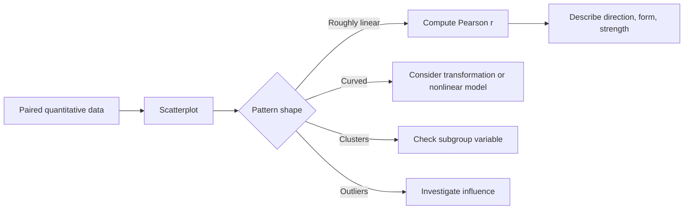

# Bivariate Data and Correlation

Bivariate data record two variables on the same cases. The first statistical task is to ask how the variables move together: Do larger values of one tend to appear with larger values of the other? Is the pattern linear, curved, clustered, or dominated by an outlier? The Lane text introduces bivariate data before regression because correlation and scatterplots provide the language of association.

Association is useful even when causation is not justified. A scatterplot of study time and exam score can support prediction and reveal unusual cases. It does not, by itself, prove that more study caused the higher score. Students who study more may differ in preparation, attendance, motivation, or course load. The central statistical habit is to describe the relationship accurately while respecting what the study design can and cannot establish.

## Start with the pairs, not the coefficient

A **bivariate data set** contains paired observations $(x_i,y_i)$ for $i=1,\dots,n$. Each pair belongs to the same case. The pairing is essential: a list of heights from one group and weights from another group is not bivariate data about body size.

A **scatterplot** places the explanatory or predictor variable on the horizontal axis and the response variable on the vertical axis. If the roles are not clear, either variable may be placed on either axis, but the interpretation should say whether the goal is association, prediction, or explanation.

The **Pearson correlation coefficient** $r$ measures the direction and strength of a linear association between two quantitative variables:

$$
r=\frac{1}{n-1}\sum_{i=1}^{n}
\left(\frac{x_i-\bar{x}}{s_x}\right)
\left(\frac{y_i-\bar{y}}{s_y}\right).
$$

It is always between $-1$ and $1$. A value near $1$ indicates a strong positive linear association; a value near $-1$ indicates a strong negative linear association; a value near $0$ indicates little linear association. A value near $0$ does not rule out a curved relationship.

The **covariance** is

$$
s_{xy}=\frac{\sum_{i=1}^{n}(x_i-\bar{x})(y_i-\bar{y})}{n-1}.
$$

Correlation is standardized covariance:

$$
r=\frac{s_{xy}}{s_xs_y}.
$$

An **outlier** in bivariate data is a point that differs from the overall pattern. An **influential point** is a point that substantially changes a statistical summary, such as a correlation or regression line, when included or removed. An observation can be an outlier without being highly influential, and a high-leverage observation can be influential even if it follows the trend.

## What standardization buys

Correlation is unitless and unchanged by positive linear transformations of either variable. If height is converted from inches to centimeters, or income from dollars to thousands of dollars, $r$ does not change. If one variable is multiplied by a negative number, the sign of $r$ changes but its magnitude does not.

Correlation measures linear association, not slope. A correlation of $0.80$ does not mean that $y$ increases by $0.80$ units for every one-unit increase in $x$. Slope belongs to regression and has units; correlation has no units.

Correlation is symmetric:

$$
r_{xy}=r_{yx}.
$$

The correlation between height and weight is the same as the correlation between weight and height. Regression is not symmetric because predicting weight from height is not the same fitted equation as predicting height from weight.

The squared correlation $r^2$ has a special interpretation in simple linear regression with an intercept: it is the proportion of sample variation in $y$ explained by the fitted linear relationship with $x$. This link is developed further in [linear regression inference](/math/statistics/linear-regression-inference).

The bound $-1\le r\le1$ follows from the Cauchy--Schwarz inequality. If $u_i=x_i-\bar{x}$ and $v_i=y_i-\bar{y}$, then

$$
\left(\sum u_iv_i\right)^2
\le\left(\sum u_i^2\right)\left(\sum v_i^2\right).
$$

Dividing by the two sums of squares gives $r^2\le1$. Equality occurs only when the centered vectors are proportional, meaning all points lie exactly on a nonvertical straight line. The sign tells whether that line rises or falls.

The regression slope and correlation are connected by

$$
b_1=r\frac{s_y}{s_x}.
$$

Correlation is the slope after both variables have been converted to standard scores. The factor $s_y/s_x$ restores the response units for regression. It also explains why a strong correlation can coexist with a numerically small slope when $y$ varies on a much smaller scale than $x$.

Adding a constant to either variable leaves $r$ unchanged. Multiplying by positive constants also leaves it unchanged; multiplying one variable by a negative constant reverses its sign. Nonlinear transformations have no such guarantee. Taking a logarithm can strengthen a linear association when the original pattern is exponential, provided the transformed relationship and units answer a sensible question.

## Range restriction, mixtures, and influence

Several cautions are essential. Restricting the range of one variable can reduce correlation. Combining different subgroups can create or hide associations. Outliers can inflate or deflate $r$. Categorical variables require different tools unless encoded with a meaningful design. Most importantly, correlation does not imply causation; an association may be caused by $x$, by $y$, by a third variable, by selection effects, or by coincidence.

Range restriction removes some of the variation that correlation uses. The relationship between entrance-exam score and college performance may be weaker within an admitted class than in the full applicant pool because low entrance scores were screened out. The smaller correlation does not necessarily mean the predictor ceased to matter.

Mixtures can reverse direction. Suppose two departments each show a mild positive association between preparation time and score, but one department has both longer preparation times and a harder exam with lower scores. Combining departments may produce a negative overall association. This is a form of Simpson's paradox. Coloring the scatterplot by department often reveals the hidden structure.

Influence depends on location in both coordinates. A point far from $\bar{x}$ has leverage because it contributes heavily to $\sum(x_i-\bar{x})^2$. If it also lies away from the prevailing trend, it can rotate the fitted line and change $r$ substantially. Reporting correlations with and without a questionable record is a sensitivity analysis, not permission to delete the record. Any exclusion needs a reason established from data quality or study design.

Pearson correlation can also look strong for time series that both trend upward, even when their short-term movements are unrelated. Serial dependence violates the usual inference formulas, and a shared time trend can generate a misleading association. Plotting values against time and examining changes or detrended series may be necessary before interpreting the pairwise scatterplot.

## Pearson, Spearman, and repeated measurements

Spearman's rank correlation applies Pearson's formula to ranks. It measures monotone association: values need to move mostly in one direction, but the pattern need not be linear. It is less sensitive to extreme magnitudes, though tied ranks and influential cases still require attention. Kendall's tau is based on concordant and discordant pairs and has a direct probability interpretation.

Neither rank correlation nor Pearson correlation repairs dependence caused by repeated measurements. If ten observations come from each of twenty people, treating all two hundred pairs as independent overstates the effective sample size and mixes within-person with between-person association. Separate within- and between-person questions, or use a multilevel model designed for that structure.

## Inference for a population correlation

Under independent sampling from a bivariate normal population, testing $H_0:\rho=0$ uses

$$
t=r\sqrt{\frac{n-2}{1-r^2}},
$$

with $n-2$ degrees of freedom. The formula is equivalent to the slope test in simple linear regression with an intercept. It is sensitive to the same outliers and nonlinearity as $r$ itself.

Confidence intervals are commonly built after Fisher's transformation

$$
z_r=\frac12\log\left(\frac{1+r}{1-r}\right),
$$

whose approximate standard error is $1/\sqrt{n-3}$ under the model. Transform the endpoints back rather than placing a symmetric margin directly around $r$; the parameter is bounded by $-1$ and $1$. With small samples or doubtful distributional assumptions, bootstrap methods can help, provided the resampling preserves the observational unit.

A useful reporting sentence for correlation has four parts: direction, form, strength, and context. For example, "Among the 86 sampled apartments, rent and floor area had a strong positive roughly linear association." This is better than saying only "$r=0.82$." The number gives a compact measure, but the sentence reminds the reader what cases were studied, what variables were paired, and that the association is being described as linear. If the scatterplot shows curvature, clusters, or unequal spread, report those features before relying on a single correlation coefficient.

## A scatterplot reading order



| Feature in scatterplot | What to report | Why it matters |
|---|---|---|
| Direction | positive, negative, none | Indicates how variables move together |
| Form | linear, curved, clustered | Determines whether Pearson $r$ is appropriate |
| Strength | weak, moderate, strong | Describes tightness around a pattern |
| Outliers | unusual points | May change summaries or reveal data problems |
| Context | units and population | Prevents overgeneralized conclusions |

## Worked example 1: Computing Pearson correlation

Problem: Six students report weekly study hours and exam scores:

| Student | Hours $x$ | Score $y$ |
|---|---:|---:|
| A | 2 | 68 |
| B | 3 | 70 |
| C | 5 | 78 |
| D | 6 | 82 |
| E | 8 | 88 |
| F | 9 | 91 |

Compute the Pearson correlation.

Method:

1. Compute means:

$$
\bar{x}=\frac{2+3+5+6+8+9}{6}=5.5,
$$

$$
\bar{y}=\frac{68+70+78+82+88+91}{6}=79.5.
$$

2. Compute deviations and products:

| $x$ | $y$ | $x-\bar{x}$ | $y-\bar{y}$ | product |
|---:|---:|---:|---:|---:|
| 2 | 68 | -3.5 | -11.5 | 40.25 |
| 3 | 70 | -2.5 | -9.5 | 23.75 |
| 5 | 78 | -0.5 | -1.5 | 0.75 |
| 6 | 82 | 0.5 | 2.5 | 1.25 |
| 8 | 88 | 2.5 | 8.5 | 21.25 |
| 9 | 91 | 3.5 | 11.5 | 40.25 |

3. Sum products:

$$
\sum (x-\bar{x})(y-\bar{y})=127.5.
$$

4. Compute sums of squared deviations:

$$
\sum(x-\bar{x})^2=37.5,
$$

$$
\sum(y-\bar{y})^2=435.5.
$$

5. Use the equivalent formula:

$$
r=\frac{\sum(x-\bar{x})(y-\bar{y})}
{\sqrt{\sum(x-\bar{x})^2\sum(y-\bar{y})^2}}
=\frac{127.5}{\sqrt{37.5(435.5)}}.
$$

6. Calculate:

$$
r\approx\frac{127.5}{127.794}\approx 0.998.
$$

Answer: The correlation is about $0.998$, indicating a very strong positive linear association in this sample.

Checked answer: The sign is positive because high hours pair with high scores and low hours pair with low scores. The magnitude is close to 1 because the points lie nearly on a straight upward line.

The associated regression slope can be recovered without redoing the cross-products. Here

$$
s_x=\sqrt{37.5/5}=2.7386,
\qquad
s_y=\sqrt{435.5/5}=9.3327.
$$

Therefore

$$
b_1=r\frac{s_y}{s_x}
\approx0.9977\frac{9.3327}{2.7386}
\approx3.40
$$

score points per study hour, agreeing with the direct least-squares calculation.

## Worked example 2: Detecting a misleading zero correlation

Problem: A researcher records $x=-2,-1,0,1,2$ and $y=4,1,0,1,4$ from a physical experiment. Compute enough to explain why Pearson correlation is misleading.

Method:

1. Find the means:

$$
\bar{x}=\frac{-2-1+0+1+2}{5}=0,
$$

$$
\bar{y}=\frac{4+1+0+1+4}{5}=2.
$$

2. Compute products $(x-\bar{x})(y-\bar{y})$:

| $x$ | $y$ | $x-\bar{x}$ | $y-\bar{y}$ | product |
|---:|---:|---:|---:|---:|
| -2 | 4 | -2 | 2 | -4 |
| -1 | 1 | -1 | -1 | 1 |
| 0 | 0 | 0 | -2 | 0 |
| 1 | 1 | 1 | -1 | -1 |
| 2 | 4 | 2 | 2 | 4 |

3. Sum the products:

$$
-4+1+0-1+4=0.
$$

4. Since the covariance numerator is zero, Pearson $r=0$.

Answer: The Pearson correlation is 0, but the relationship is perfectly curved: $y=x^2$. The correlation is not wrong; it is answering the narrower question of linear association. A scatterplot would reveal a U-shaped pattern.

Checked answer: The data are symmetric around $x=0$, so positive and negative products cancel. This cancellation is exactly why relying only on $r$ can miss nonlinear structure.

## Computation after inspection

```python
import numpy as np
import matplotlib.pyplot as plt
from scipy import stats

hours = np.array([2, 3, 5, 6, 8, 9])
scores = np.array([68, 70, 78, 82, 88, 91])

r, p_value = stats.pearsonr(hours, scores)
print(f"r = {r:.3f}, two-sided p-value = {p_value:.4f}")

plt.scatter(hours, scores)
plt.xlabel("study hours per week")
plt.ylabel("exam score")
plt.title("Study time and exam score")
plt.show()
```

The p-value tests a no-linear-correlation null under model assumptions. It should not replace the scatterplot, and it should not be read as evidence of causation without a design that supports causal interpretation.

## Interpretive mistakes

- Computing $r$ before making a scatterplot.
- Saying "no relationship" when $r$ is near zero, even though a curved relationship may exist.
- Interpreting correlation as slope or as percent increase.
- Letting one extreme point determine the story without checking influence.
- Combining subgroups whose separate relationships differ from the overall relationship.
- Using correlation to claim causation from observational data.

<div className="see-also">

See also: [Graphing distributions](/math/statistics/graphing-distributions) · [Summarizing distributions](/math/statistics/summarizing-distributions) · [Linear regression inference](/math/statistics/linear-regression-inference) · [Hypothesis testing logic](/math/statistics/hypothesis-testing-logic) · [Effect size, nonparametric methods, and resampling](/math/statistics/effect-size-nonparametric-and-resampling)

</div>
