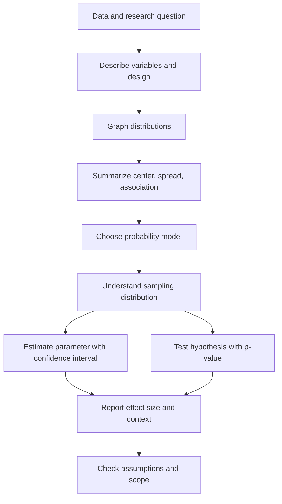

# Statistics

The source is *Introduction to Statistics, Online Edition*. Its cover lists David M. Lane of Rice University as primary author and editor, with contributions from David Scott, Mikki Hebl, Rudy Guerra, Dan Osherson, and Heidi Zimmer of the University of Houston–Downtown. The work is marked public domain.

The course moves from statistical literacy, graphs, and numerical summaries into probability, research design, sampling distributions, estimation, hypothesis tests, regression, ANOVA, categorical methods, effect size, and resampling.

## Description and inference answer different questions

**Statistics** covers the collection, organization, display, analysis, and interpretation of data, together with decisions made under uncertainty. A statistic may also mean one sample summary, such as a mean salary or polling percentage.

**Descriptive statistics** summarize observed data through graphs, tables, center, variability, percentiles, z-scores, and shape. They answer questions about what happened in the recorded data.

**Inferential statistics** uses sample data to learn about a population or process. Estimation, confidence intervals, hypothesis tests, regression inference, ANOVA, chi-square tests, and resampling all depend on a probability account of how the sample statistic varies.

A **population** is the full set of cases under study; a **sample** is the observed subset. A **parameter**, such as $mu$ or $p$, describes the population. A **statistic**, such as $\bar{x}$ or $\hat{p}$, describes the sample. Inference starts from the known statistic and quantifies what it says about the unknown parameter.

A **variable** records a characteristic of a case. Categorical variables may be nominal or ordinal. Quantitative variables may be discrete or continuous and may be treated as interval or ratio measurements depending on whether zero has substantive meaning.

A **probability model** assigns probabilities to possible outcomes. Binomial models describe success counts in repeated trials; normal models describe many measurements and approximations; chi-square models describe certain sums of squared standardized discrepancies.

A **sampling distribution** is the distribution of a statistic over repeated samples from a specified design. It supplies standard errors, confidence intervals, and p-values. The central limit theorem often makes sample means approximately normal even when individual observations are not normal, subject to independence and finite-variance conditions.

## Graph before trusting a summary

*Figure: Anscombe's quartet has nearly identical elementary summaries across four data sets but sharply different relationships and influential points. Image: [Wikimedia Commons](https://commons.wikimedia.org/wiki/File:AnscombeQuartet.svg), Gabry, CC BY-SA 3.0.*

Anscombe's quartet is the compact warning behind the graphing chapters: means, variances, correlations, and fitted lines can agree while the underlying patterns do not. A scatterplot distinguishes linear association, curvature, outliers, and leverage before a correlation or regression coefficient is interpreted.

The same order applies to one-variable data. A mean and standard deviation can conceal skew, multimodality, truncation, or miscoded values. Graphs and numerical summaries should be read together.

## Signal, noise, and standard error

An introductory analysis often has the form

$$
\text{statistic}=\text{signal}+\text{noise}.
$$

Descriptive summaries estimate structure in the observed data. Probability models describe the random variation generated by sampling or assignment. Inference then compares an estimate with a reference value on the scale of its standard error:

$$
\text{standardized statistic}
=
\frac{\text{estimate}-\text{null value}}{\text{standard error}}.
$$

One-proportion $z$ tests, one-sample $t$ tests, and slope tests instantiate the same logic with different estimators and sampling distributions. The recurring steps are to define the parameter, choose an estimator, derive or approximate its sampling distribution, quantify uncertainty, and interpret the result in the study context.

Study design controls what that interpretation may claim. Random assignment supports causal comparisons more directly than observation alone. Probability sampling supports population generalization better than convenience sampling. Paired observations require a paired analysis. A correct numerical procedure cannot repair a design that does not address the research question.

The analysis flow therefore runs from design and variables to description, probability, sampling, estimation or testing, and finally interpretation:

| Stage | Statistical role | First page to read |
|---|---|---|
| Data literacy | Define cases, variables, samples, populations | [Statistical literacy and data](/math/statistics/statistical-literacy-and-data) |
| Description | Display and summarize observed data | [Graphing distributions](/math/statistics/graphing-distributions) |
| Probability | Model uncertainty before inference | [Probability basics](/math/statistics/probability-basics) |
| Sampling | Explain standard errors and repeated-sampling behavior | [Sampling distributions and the central limit theorem](/math/statistics/sampling-distributions-and-clt) |
| Estimation | Estimate unknown parameters with uncertainty | [Estimation and confidence intervals](/math/statistics/estimation-and-confidence-intervals) |
| Testing | Compare data with a null model | [Hypothesis testing logic](/math/statistics/hypothesis-testing-logic) |
| Modeling | Analyze relationships among variables | [Linear regression inference](/math/statistics/linear-regression-inference) |
| Robustness | Use effect sizes, ranks, bootstrap, and permutation | [Effect size, nonparametric methods, and resampling](/math/statistics/effect-size-nonparametric-and-resampling) |

## Chapter map

| Source chapter | Main idea | Notes pages |
|---:|---|---|
| 1. Introduction | statistics, variables, percentiles, measurement, distributions | [Statistical literacy and data](/math/statistics/statistical-literacy-and-data), [Summarizing distributions](/math/statistics/summarizing-distributions) |
| 2. Graphing Distributions | qualitative and quantitative displays | [Graphing distributions](/math/statistics/graphing-distributions) |
| 3. Summarizing Distributions | center, variability, shape, transformations | [Summarizing distributions](/math/statistics/summarizing-distributions) |
| 4. Describing Bivariate Data | scatterplots and Pearson correlation | [Bivariate data and correlation](/math/statistics/bivariate-data-and-correlation) |
| 5. Probability | events, counting, binomial, Poisson, base rates | [Probability basics](/math/statistics/probability-basics), [Random variables and probability distributions](/math/statistics/random-variables-and-distributions) |
| 6. Research Design | measurement, sampling, experiments, causation | [Statistical literacy and data](/math/statistics/statistical-literacy-and-data), [Hypothesis testing logic](/math/statistics/hypothesis-testing-logic) |
| 7. Normal Distributions | normal curve and standard normal | [Normal, t, chi-square, and F distributions](/math/statistics/normal-t-chi-square-and-f-distributions) |
| 8. Advanced Graphs | Q-Q plots, contour plots, 3D plots | [Graphing distributions](/math/statistics/graphing-distributions), [Linear regression inference](/math/statistics/linear-regression-inference) |
| 9. Sampling Distributions | means, differences, correlations, proportions | [Sampling distributions and the central limit theorem](/math/statistics/sampling-distributions-and-clt) |
| 10. Estimation | estimators and confidence intervals | [Estimation and confidence intervals](/math/statistics/estimation-and-confidence-intervals) |
| 11. Logic of Hypothesis Testing | p-values, errors, tails, misconceptions | [Hypothesis testing logic](/math/statistics/hypothesis-testing-logic) |
| 12. Testing Means | one-sample, independent, paired comparisons | [Tests for means](/math/statistics/tests-for-means) |
| 13. Power | power and factors affecting power | [Hypothesis testing logic](/math/statistics/hypothesis-testing-logic), [Effect size, nonparametric methods, and resampling](/math/statistics/effect-size-nonparametric-and-resampling) |
| 14. Regression | least squares, inference, influence, multiple regression | [Linear regression inference](/math/statistics/linear-regression-inference) |
| 15. Analysis of Variance | one-way, multifactor, within-subjects ANOVA | [ANOVA](/math/statistics/anova) |
| 16. Transformations | logs, Tukey ladder, Box–Cox | [Summarizing distributions](/math/statistics/summarizing-distributions), [Linear regression inference](/math/statistics/linear-regression-inference) |
| 17. Chi Square | goodness-of-fit and contingency tables | [Proportions and chi-square tests](/math/statistics/proportions-and-chi-square-tests) |
| 18. Distribution-Free Tests | randomization and rank tests | [Effect size, nonparametric methods, and resampling](/math/statistics/effect-size-nonparametric-and-resampling) |
| 19. Effect Size | proportions, mean differences, variance explained | [Effect size, nonparametric methods, and resampling](/math/statistics/effect-size-nonparametric-and-resampling) |
| 20–21. Case Studies and Glossary | applied examples and terms | all pages in this section |

## One employee survey, four analysis paths

A sample of 120 employees records commute mode, weekly remote-work days, job satisfaction on a 1–7 scale, and annual salary. Each question implies a different response type and design.

1. **Which commute modes are most common?** Commute mode is categorical. A frequency table and bar chart from [graphing distributions](/math/statistics/graphing-distributions) answer the descriptive question.
2. **What is a typical salary?** Salary is quantitative and often right-skewed. [Summarizing distributions](/math/statistics/summarizing-distributions) motivates a histogram, median, IQR, mean, and standard deviation. A few high salaries can make the median more representative than the mean.
3. **Is salary associated with remote-work days?** If remote-work days is treated numerically and the scatterplot is roughly linear, use [bivariate data and correlation](/math/statistics/bivariate-data-and-correlation) and possibly [linear regression inference](/math/statistics/linear-regression-inference). With only a few meaningful day categories, group comparisons may communicate the pattern better.
4. **Does mean satisfaction differ among employees with 0, 1–2, and 3+ remote-work days?** For independent groups and an approximately quantitative response, [ANOVA](/math/statistics/anova) is one option. If the ordinal scale or distribution makes the mean model implausible, [effect size, nonparametric methods, and resampling](/math/statistics/effect-size-nonparametric-and-resampling) supplies rank-based and permutation alternatives.

These data support estimates and associations for the sampled setting. They do not identify the causal effect of a work schedule because employees were sampled rather than randomly assigned to schedules.

## What a 12-point difference does—and does not—show

Suppose 500 students who chose a study app averaged 84 points and 500 nonusers from the same district averaged 72. The observed difference is

$$
84-72=12.
$$

That is a descriptive fact about the sample. The study is observational because students selected whether to use the app. Prior achievement, family resources, teacher quality, motivation, attendance, device access, and course level may differ between the groups and confound the comparison.

With an adequate sampling design, a confidence interval could quantify uncertainty in the district-level association. Regression could adjust for measured confounders, though it cannot remove bias from unmeasured ones by calculation alone. The evidence does not establish that the app caused a 12-point gain.

A defensible report is: “In this district sample, app users had higher average scores than nonusers; because use was not randomly assigned, other student or school factors may explain some or all of the difference.” The magnitude, sampling uncertainty, and causal scope are separate parts of the conclusion.

## Interpretation failures to catch early

- Identify cases, variables, population, and design before naming a test.
- Graphing, numerical summaries, probability, and inference are connected stages, not separate silos.
- Statistical significance does not imply practical importance or causation.
- A sample statistic and population parameter play different roles even when they use similar notation.
- Familiarity with a method does not establish that its assumptions fit the data.
- Reports need uncertainty, effect size, design limits, and subject-matter context alongside a p-value.

See also: [Statistical literacy and data](/math/statistics/statistical-literacy-and-data) · [Graphing distributions](/math/statistics/graphing-distributions) · [Summarizing distributions](/math/statistics/summarizing-distributions) · [Probability basics](/math/statistics/probability-basics) · [Sampling distributions and the central limit theorem](/math/statistics/sampling-distributions-and-clt) · [Estimation and confidence intervals](/math/statistics/estimation-and-confidence-intervals) · [Hypothesis testing logic](/math/statistics/hypothesis-testing-logic) · [Linear regression inference](/math/statistics/linear-regression-inference)

