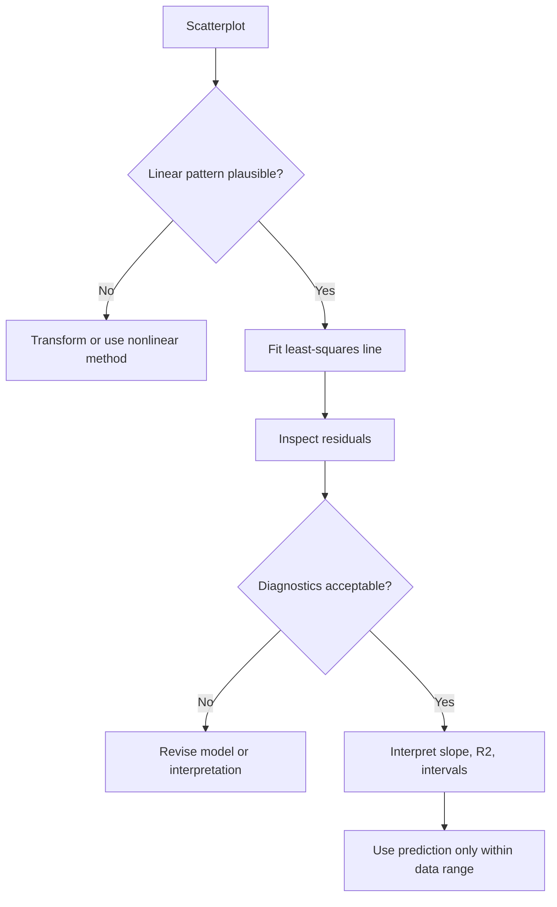

# Linear Regression Inference

Linear regression models the mean of a quantitative response as a linear function of one or more predictors. In simple linear regression, one predictor $x$ is used to predict a response $y$ through a fitted line. The Lane text introduces regression after correlation because regression adds direction: it distinguishes the predictor from the response, estimates a slope, and supports prediction, diagnostics, and inference about the linear relationship.

A regression line is not merely a line drawn through a scatterplot by eye. It is the line that minimizes the sum of squared residuals. That least-squares criterion gives precise formulas, but the model must still be checked. Outliers, curvature, nonconstant variance, dependence, and extrapolation can make a technically correct line misleading.

## The line chosen by squared error

The **simple linear regression model** is

$$
Y_i=\beta_0+\beta_1x_i+\varepsilon_i,
$$

where $\beta_0$ is the intercept, $\beta_1$ is the population slope, and $\varepsilon_i$ is the random error for observation $i$. The fitted line is

$$
\hat{y}=b_0+b_1x.
$$

The **slope** $b_1$ estimates the expected change in $Y$ for a one-unit increase in $X$. The **intercept** $b_0$ estimates the mean response when $x=0$, if $x=0$ is meaningful and within the range of data.

The **residual** for observation $i$ is

$$
e_i=y_i-\hat{y}_i.
$$

Least squares chooses $b_0$ and $b_1$ to minimize

$$
SSE=\sum_{i=1}^{n}(y_i-\hat{y}_i)^2.
$$

For simple linear regression,

$$
b_1=\frac{\sum(x_i-\bar{x})(y_i-\bar{y})}{\sum(x_i-\bar{x})^2},
$$

and

$$
b_0=\bar{y}-b_1\bar{x}.
$$

The **coefficient of determination** is

$$
R^2=1-\frac{SSE}{SST},
$$

where

$$
SST=\sum(y_i-\bar{y})^2.
$$

In simple regression with an intercept, $R^2=r^2$.

## Deriving the least-squares coefficients

Write

$$
Q(b_0,b_1)=\sum_{i=1}^n(y_i-b_0-b_1x_i)^2.
$$

Setting both partial derivatives to zero gives the normal equations

$$
\sum(y_i-b_0-b_1x_i)=0,
$$

$$
\sum x_i(y_i-b_0-b_1x_i)=0.
$$

The first says the residuals sum to zero and gives $b_0=\bar y-b_1\bar x$. Substitution into the second yields

$$
b_1=\frac{S_{xy}}{S_{xx}},
\qquad
S_{xy}=\sum(x_i-\bar x)(y_i-\bar y),
\qquad
S_{xx}=\sum(x_i-\bar x)^2.
$$

Because the fitted line contains $(\bar x,\bar y)$, centering the predictor changes the intercept but not the slope or fitted values. Replacing $x$ by $x-\bar x$ makes the intercept equal to the fitted response at the observed mean, often a far more interpretable quantity than the response at $x=0$.

The least-squares residuals are orthogonal to both the constant vector and the predictor vector:

$$
\sum e_i=0,
\qquad
\sum x_ie_i=0.
$$

These identities explain the variation decomposition $SST=SSR+SSE$ for a model with an intercept. They are algebraic properties of the fit, not evidence that the model assumptions hold.

## Uncertainty around the slope and predictions

Inference for the slope commonly tests

$$
H_0:\beta_1=0
$$

against a one- or two-sided alternative. The test statistic is

$$
t=\frac{b_1-0}{SE(b_1)},
$$

with $df=n-2$ in simple regression. A confidence interval for the slope is

$$
b_1\pm t^*_{n-2}SE(b_1).
$$

The standard error of the estimate, also called residual standard error, is

$$
s_e=\sqrt{\frac{SSE}{n-2}}.
$$

It measures typical vertical scatter around the fitted line in response units.

In simple regression,

$$
SE(b_1)=\frac{s_e}{\sqrt{S_{xx}}}.
$$

Slope precision improves when residual scatter is smaller, when there are more observations, and when predictor values cover a wider range. Replicating many observations near $\bar x$ estimates the local mean well but adds little information about slope compared with observations spread across the relevant predictor range.

At $x_0$, the fitted mean has standard error

$$
SE_{\text{mean}}(x_0)=s_e
\sqrt{\frac1n+\frac{(x_0-\bar x)^2}{S_{xx}}}.
$$

For a new individual response, the standard error is

$$
SE_{\text{pred}}(x_0)=s_e
\sqrt{1+\frac1n+\frac{(x_0-\bar x)^2}{S_{xx}}}.
$$

The extra 1 represents irreducible individual error. Both intervals widen away from $\bar x$, even within the data range, because the line is less precisely located at its ends.

Regression assumptions for classical inference include linear mean structure, independent errors, constant error variance, and approximately normal errors for small-sample p-values and intervals. The predictor values need not be normally distributed. Residual plots are central: plot residuals against fitted values and predictors to check curvature and changing spread; use Q-Q plots to assess normality; inspect leverage and influence.

## Diagnostics answer different questions

A curved residual pattern challenges the linear mean model. A funnel shape challenges constant variance. Long runs of residuals with the same sign in collection order suggest dependence. A Q--Q plot mainly addresses tail behavior and the small-sample calibration of tests; it does not diagnose linearity or independence.

Leverage in simple regression is

$$
h_{ii}=\frac1n+\frac{(x_i-\bar x)^2}{S_{xx}}.
$$

It depends only on predictor location. Studentized residuals scale vertical discrepancy, while Cook's distance combines discrepancy and leverage to estimate influence on the fitted coefficients. No universal cutoff replaces looking at the observation, checking data provenance, and fitting a sensitivity analysis.

Nonconstant variance does not necessarily bias the least-squares line when the conditional mean is correctly specified, but it makes the usual standard errors wrong. Heteroscedasticity-consistent standard errors can repair inference for coefficients under suitable independence conditions. They do not repair curvature, omitted variables, or extrapolation.

A **confidence interval for the mean response** at a given $x_0$ estimates the average $Y$ among cases with that predictor value. A **prediction interval** estimates a new individual response at $x_0$. Prediction intervals are wider because they include both uncertainty in the mean and individual-level noise.

Extrapolation occurs when using the line outside the observed range of $x$. It can be very misleading because linear patterns often hold only locally.

Regression interpretation should separate prediction, explanation, and causation. A model can predict well without revealing a causal mechanism, especially when predictors are proxies for other variables. A model can estimate an association after adjustment for measured covariates, but unmeasured confounding may remain. A randomized experiment with a regression analysis can support stronger causal language because treatment assignment is controlled by design. In observational regression, use language such as "is associated with" or "predicts" unless the design and assumptions justify a causal claim.

Multiple regression extends the same idea to several predictors. A coefficient then estimates the expected change in the response for a one-unit increase in that predictor, holding the other predictors in the model constant. That phrase is powerful but easy to overstate: it means statistically adjusted within the fitted model, not physically held constant by an experiment.

Influence diagnostics ask whether one or a few observations are driving the fitted relationship. A point with an unusual $x$ value has high leverage; a point with a large residual has poor fit; a point with both can strongly change the slope. Removing such a point without justification is not acceptable, but fitting the model with and without it can reveal whether the conclusion is stable. If the story changes completely, the final analysis should say so and investigate the observation's source.

Good regression reporting includes the fitted equation, units, uncertainty for key coefficients, residual diagnostics, and the observed predictor range.

With several predictors, coefficients are conditional on the other columns in the model. Strong collinearity can make individual coefficient estimates unstable even when overall predictions are adequate. Interactions change the meaning further: in a model containing $x$, group, and $x\times$group, the coefficient of $x$ is the slope in the reference group, not an average slope shared by all groups.

## Omitted variables and transformations

If an omitted variable affects $Y$ and is associated with an included predictor, the fitted slope can absorb part of its effect. The direction of bias depends on both associations; adding any available covariate does not automatically help. A mediator can remove part of the effect one intended to estimate, while a collider can create an association that was absent. Model specification therefore starts from the design and causal question, not from stepwise p-values.

Transformations change coefficient interpretation. In

$$
\log Y=\beta_0+\beta_1x+\varepsilon,
$$

a one-unit increase in $x$ multiplies the conditional geometric mean by $e^{\beta_1}$ under the log-scale model. For small $\beta_1$, $100\beta_1$ is an approximate percent change, while $100(e^{\beta_1}-1)$ is the exact model-based percentage. Transforming fitted log means back with an exponential does not generally recover the arithmetic mean of $Y$ because $E(e^Z)\ne e^{E(Z)}$.

A polynomial term such as $x^2$ can represent smooth curvature while remaining linear in coefficients. The coefficient of $x$ alone is then not a constant slope; the derivative of the fitted mean is $\beta_1+2\beta_2x$. Centering $x$ before squaring often improves interpretation and reduces avoidable collinearity between $x$ and $x^2$.

## Validation is distinct from fitting

$R^2$ never decreases when another predictor is added to the training data, even if that predictor is noise. Adjusted $R^2$ adds a complexity penalty, but prediction claims are better checked on held-out data or by cross-validation. All preprocessing and variable selection must occur inside each training fold; performing them once on the full data leaks information into validation.

Prediction error on new cases includes model misspecification, coefficient uncertainty, and irreducible noise. A narrow textbook prediction interval assumes the future case follows the same model and population as the training cases. Distribution shift, new measurement procedures, or a different predictor range can invalidate it without altering the original residual diagnostics.

## Fit, diagnose, then interpret



| Quantity | Formula | Interpretation |
|---|---:|---|
| Slope | $b_1=S_{xy}/S_{xx}$ | predicted change in $y$ per one-unit $x$ increase |
| Intercept | $b_0=\bar{y}-b_1\bar{x}$ | predicted $y$ at $x=0$ |
| Residual | $e_i=y_i-\hat{y}_i$ | vertical prediction error |
| SSE | $\sum e_i^2$ | unexplained variation |
| $R^2$ | $1-SSE/SST$ | proportion of sample variation explained |
| Slope test | $t=b_1/SE(b_1)$ | evidence of nonzero linear slope |

## Worked example 1: Fitting a least-squares line

Problem: A small data set records study hours $x$ and exam scores $y$:

| Student | $x$ | $y$ |
|---|---:|---:|
| A | 2 | 68 |
| B | 3 | 70 |
| C | 5 | 78 |
| D | 6 | 82 |
| E | 8 | 88 |
| F | 9 | 91 |

Find the least-squares line and predict the score for 7 hours.

Method:

1. From the correlation page, the means are

$$
\bar{x}=5.5,\quad \bar{y}=79.5.
$$

2. Compute

$$
S_{xy}=\sum(x_i-\bar{x})(y_i-\bar{y})=127.5.
$$

3. Compute

$$
S_{xx}=\sum(x_i-\bar{x})^2=37.5.
$$

4. Slope:

$$
b_1=\frac{127.5}{37.5}=3.4.
$$

5. Intercept:

$$
b_0=\bar{y}-b_1\bar{x}=79.5-3.4(5.5).
$$

6. Calculate:

$$
b_0=79.5-18.7=60.8.
$$

7. Fitted line:

$$
\hat{y}=60.8+3.4x.
$$

8. Predict at $x=7$:

$$
\hat{y}=60.8+3.4(7)=60.8+23.8=84.6.
$$

Answer: The fitted line is $\hat{y}=60.8+3.4x$. For 7 study hours, the predicted exam score is 84.6.

Checked answer: The slope is positive, matching the scatterplot. The prediction at 7 hours lies between the observed scores for 6 and 8 hours, which is reasonable.

## Worked example 2: Interpreting slope inference and prediction

Problem: A regression of monthly electricity cost on average daily temperature uses $n=40$ months. The fitted slope is $b_1=2.80$ dollars per degree, with $SE(b_1)=0.90$. Test whether the population slope differs from 0 at $\alpha=0.05$, and construct a 95% confidence interval.

Method:

1. State hypotheses:

$$
H_0:\beta_1=0,
$$

$$
H_A:\beta_1\ne0.
$$

2. Degrees of freedom:

$$
df=n-2=40-2=38.
$$

3. Test statistic:

$$
t=\frac{2.80}{0.90}=3.111.
$$

4. A two-sided p-value with 38 degrees of freedom is about 0.0035.
5. Since $0.0035\lt 0.05$, reject $H_0$.
6. For a 95% interval with $df=38$, $t^*\approx2.024$.
7. Margin of error:

$$
ME=2.024(0.90)=1.8216.
$$

8. Interval:

$$
2.80\pm1.8216=(0.9784,\ 4.6216).
$$

Answer: There is statistically significant evidence of a nonzero linear slope. The estimated cost increase is \$2.80 per degree, with a 95% confidence interval from about \$0.98 to \$4.62 per degree.

Checked answer: The interval does not include 0, agreeing with the two-sided test at $\alpha=0.05$. The conclusion is about association and prediction unless the data came from a design supporting causation.

The same fitted slope may be useful for prediction while remaining poor evidence about intervention. If temperature is correlated with season, occupancy, or tariff changes, the slope absorbs those associations unless the model and design separate them.

## Fit and prediction intervals in code

```python
import pandas as pd
import statsmodels.api as sm

df = pd.DataFrame({
    "hours": [2, 3, 5, 6, 8, 9],
    "score": [68, 70, 78, 82, 88, 91],
})

X = sm.add_constant(df["hours"])
model = sm.OLS(df["score"], X).fit()
print(model.summary())

new_X = sm.add_constant(pd.DataFrame({"hours": [7]}), has_constant="add")
prediction = model.get_prediction(new_X)
print(prediction.summary_frame(alpha=0.05))
```

The summary includes slope, intercept, standard errors, p-values, and $R^2$. The prediction frame includes both a confidence interval for the mean score at 7 hours and a prediction interval for an individual student.

## Misuses that survive a good-looking line

- Interpreting the intercept when $x=0$ is outside the observed range or meaningless.
- Treating correlation and regression slope as the same quantity.
- Extrapolating beyond the data range because the fitted line has an equation.
- Ignoring residual plots and relying only on $R^2$.
- Reading a statistically significant slope as proof of causation.
- Confusing confidence intervals for the mean response with prediction intervals for individuals.

<div className="see-also">

See also: [Bivariate data and correlation](/math/statistics/bivariate-data-and-correlation) · [Summarizing distributions](/math/statistics/summarizing-distributions) · [Hypothesis testing logic](/math/statistics/hypothesis-testing-logic) · [ANOVA](/math/statistics/anova) · [Effect size, nonparametric methods, and resampling](/math/statistics/effect-size-nonparametric-and-resampling)

</div>
